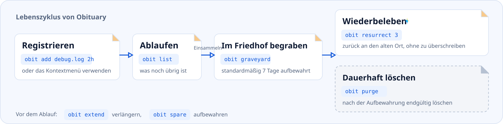

<p align="center"><a href="README.md">&nbsp;English</a> | <a href="README.zh-CN.md">&nbsp;简体中文</a> | <a href="README.zh-TW.md">&nbsp;繁體中文</a> | <a href="README.ja.md">&nbsp;日本語</a> | <a href="README.ko.md">&nbsp;한국어</a> | <a href="README.es.md">&nbsp;Español</a> | <a href="README.fr.md">&nbsp;Français</a> | <a href="README.de.md">&nbsp;Deutsch</a> | <a href="README.pt-BR.md">&nbsp;Português (Brasil)</a> | <a href="README.ru.md">&nbsp;Русский</a></p>
<div align="center">
  <h1>
    <picture>
      <source media="(prefers-color-scheme: dark)" srcset="docs/assets/brand/obituary-horizontal-dark.png">
      <source media="(prefers-color-scheme: light)" srcset="docs/assets/brand/obituary-horizontal-light.png">
      
    </picture>
  </h1>
  <p>
    <strong>Obituary — der Papierkorb für KI-Agenten</strong><br>
    Was deine KI hinterlässt, verschwindet beim Ablauf von selbst; was deine KI löscht, kommt sieben Tage lang zurück.
  </p>
    <p>
    <a href="#warum-obituary">Warum Obituary</a> ·
    <a href="#installation">Installation</a> ·
    <a href="#schnellstart">Schnellstart</a> ·
    <a href="docs/usage.en.md">Benutzerleitfaden</a> ·
    <a href="docs/README.md">Dokumentation</a>
  </p>
</div>

<p align="center">
  <picture>
    <source media="(prefers-color-scheme: dark)" srcset="docs/assets/demo/demo-en-dark.gif">
    <source media="(prefers-color-scheme: light)" srcset="docs/assets/demo/demo-en-light.gif">
    
  </picture>
</p>

<p align="center">
  <picture>
    <source media="(prefers-color-scheme: dark)" srcset="docs/assets/readme/i18n/de/lifecycle-dark.svg">
    <source media="(prefers-color-scheme: light)" srcset="docs/assets/readme/i18n/de/lifecycle-light.svg">
    
  </picture>
</p>

Obituary ist der Papierkorb für KI-Agenten: Der Agent und du entscheiden, was hineinkommt. Ein Agent gibt den Debug-Skripten, Logs und Screenshots, die er schreibt, eine Lebensdauer, und du fügst eigene Dateien über das Kontextmenü hinzu; alles darin wird beim Ablauf begraben und bleibt sieben Tage lang im ursprünglichen Zustand wiederherstellbar. Niemand muss sich an die Bereinigung erinnern, und `rm -rf` eines Agenten zerstört nichts mehr endgültig. Die interne Funktionsweise steht in [docs/architecture.md](docs/architecture.md) (Chinesisch).

## Warum Obituary

Obituary entstand, weil Agenten uns dazu gedrängt haben. Sobald Version 0.0.1 lief, installierten wir sie auf unseren eigenen Rechnern; jede spätere Version wurde von Agenten in den von ihr überwachten Repositories geschrieben.

- **Agenten erzeugen schneller Unordnung, als Menschen sie beseitigen.** Wer zwischen Claude Code, Codex, DeepSeek und WorkBuddy wechselt, füllt ein Projekt schnell mit Debug-Skripten, Logs, Screenshots und `test-results/`. Niemand weiß, was noch wichtig ist, also wagt niemand das Löschen. Obituary überlässt die Entscheidung dem, der es am besten weiß: Der Agent kennt seine Skripte und Logs und gibt ihnen mit `obit mark` beim Schreiben eine Lebensdauer; du fügst deine Dateien über das Kontextmenü hinzu. Bei Fälligkeit werden sie begraben, ohne dass jemand an die Bereinigung denken muss.
- **Unsicher, ob es noch gebraucht wird? Begrabe es.** `obit bury` verschiebt es in den Friedhof, wo es sieben Tage lang im ursprünglichen Zustand wiederherstellbar bleibt. Braucht ein Agent es in dieser Zeit, meldet Obituary sofort Friedhof und Nummer; `obit resurrect` bringt es zurück. Ansonsten bleibt es aus dem Weg und der Agent muss zuerst keine Liste lesen.
- **Angst vor einem einzigen `rm -rf`.** Dass Agenten ein Benutzerverzeichnis oder ein ganzes Laufwerk löschen, ist keine hypothetische Gefahr mehr. Mit aktivem Löschschutz werden `rm -rf`, `git clean` und `Remove-Item` gestoppt und durch den gleichwertigen `obit`-Befehl ersetzt. Die Dinge kommen in den Friedhof statt zu verschwinden. Auch Umwege wie `find -delete` und `xargs rm` werden gestoppt.
- **Angst, dass sich der Befehl unterwegs verändert.** Zwischen dem beabsichtigten und dem ausgeführten Befehl liegen Shell-Anführungszeichen, Escapes und manchmal ein Proxy, der Befehle umschreibt. Ein verlorenes Zeichen macht aus `rm -rf "$OUT"/` ein `rm -rf /`. Deshalb prüft Obituary vor `obit rm` den tatsächlichen Pfad auf der Festplatte, verweigert Laufwerkswurzeln, Systemverzeichnisse und das Benutzerprofil selbst und begräbt alles andere wiederherstellbar. Unter Windows läuft Codex durch eine weitere Shell; Löschungen in Backticks oder Shell-Substitutionen werden auch in Anführungszeichen gestoppt.

## Was es tut

- **Dateien und Ordnern eine Lebensdauer geben.** `obit add debug.log 2h` begräbt die Datei, sobald die Zeit abgelaufen ist. Mit `--at` legst du einen Zeitpunkt fest, mit `extend` verlängerst du und mit `spare` verschonst du sie.
- **Der Agent entscheidet, was hineinkommt.** `obit init` ergänzt Obituary in den Agent-Anweisungen(`OBIT.md`, Agent Skill und MCP optional). Der Agent gibt seinen Debug-Skripten, Logs und Screenshots mit `obit mark` eine Lebensdauer, holt temporären Platz mit `obit mktemp`, begräbt Unsicheres mit `obit bury` und registriert beim Bearbeiten hinterlassene `*.bak`-Dateien.
- **Eigene Dateien hinzufügen.** Unter Windows klickst du Dateien oder Ordner im Explorer rechts an, wählst „Add to Obituary“ und dann 1, 7 oder 30 Tage oder „Bury now (recoverable)“. Für einen Ordner wie Downloads kannst du auch eine Richtlinie vergeben.
- **Automatische Registrierung nach Bedarf.** Standardmäßig ist sie aus. Nach dem Einschalten in Settings registriert sie nach Regeln(`.playwright-mcp/`, `test-results/`, `*.log`, `*.bak`, `*.orig` und `*~`) sowie nach von Hooks gesehenen Schreibvorgängen. Es gibt abgestufte, vollständig automatische und vollständig bestätigungspflichtige Modi. Abhängigkeiten, Build-Ausgaben und Caches werden nie automatisch registriert, Git-verfolgte Dateien nie angefasst. Der Hintergrundprozess verarbeitet automatische Registrierungen nach dem Schreiben. Daher kann es einen Moment dauern, bis eine neue Datei in `obit list` erscheint.
- **Aufräumen am Sitzungsende.** Bevor ein Agent stoppt, listet Obituary die in dieser Sitzung erstellten und noch nicht eingeordneten Dateien auf und bittet darum, Debug-Skripten, Logs und Screenshots eine Lebensdauer zu geben oder sie zu begraben, während die Lieferobjekte bleiben. Höchstens einmal pro Sitzung.
- **Alles, was ein Agent löscht, kann zurückkommen.** Mit aktivem Löschschutz werden `rm -rf`, `git clean` und ähnliche Befehle gestoppt und der gleichwertige `obit`-Befehl mitgeteilt. Bei seiner Verwendung kommen die Dinge in den Friedhof.
- **Erst begraben, später dauerhaft löschen.** Der Friedhof bewahrt standardmäßig sieben Tage alles auf; `obit resurrect` bringt es zurück, ohne das zu überschreiben, was jetzt dort liegt.
- **Nach Identität statt nach Name verfolgen.** Jeder Eintrag enthält Volume-Seriennummer und 128-Bit-Datei-ID. Deshalb wird eine umbenannte oder verschobene Datei weiterhin gefunden, während eine andere Datei am alten Pfad unangetastet bleibt.
- **Claude Code und Codex.** `obit init` registriert Hooks und einen Agent Skill; ein MCP-Server ist optional, und `--uninstall` entfernt nur Obituary-eigene Einträge.
- **Wie Everything im Windows-Infobereich.** `obit init` startet beim Anmelden ein Tray-Symbol. Das Menü zeigt letzte Begräbnisse, erlaubt die Wiederbelebung, pausiert die automatische Bereinigung und öffnet das kleine Obituary-Fenster. Eine geplante Windows-Aufgabe bleibt als Fallback.
- **Ein kleines Fenster (Windows / Ubuntu 24.04 amd64).** Expiring, Graveyard, For you, Settings und Logs ermöglichen Wiederbelebung, Vorschlagsfreigaben und Einstellungen ohne Kommandozeile(`obit-gui.exe` oder „Open Obituary“ im Tray). Chinesisch und Englisch, acht Oberflächen. Unter Ubuntu lässt sich Obituary über das Anwendungsmenü öffnen.
- **Kontextmenü und Daten im Explorer (Windows).** Rechtsklick → „Add to Obituary“ → 1, 7 oder 30 Tage oder „Bury now (recoverable)“. Unter Windows 11 liegt es unter „Show more options“. Verfolgte Elemente in Downloads und Desktop erscheinen als „name (11-13 burial)“ (bei vereinfachtem Chinesisch: „name（11-13 下葬）“), der echte Dateiname bleibt gleich.
- **Docker-Container.** `obit docker add <container> 3d` gibt einem Container eine Lebensdauer. Bei Ablauf stoppt `docker stop` ihn(`obit resurrect` startet ihn wieder), und erst nach der Aufbewahrung entfernt `docker rm` ihn. Bei automatischer Registrierung werden auch Container registriert, die eine Agent-Sitzung für das Projekt startet.
- Mit `obit mark --docker-volume cache 3d` (auch `add`) wird `cache` in drei Tagen begraben, mit `obit bury --docker-volume -- cache` sofort. Volumes werden nie automatisch registriert. Obituary verarbeitet nur ausdrücklich registrierte oder begrabene Volumes und löscht weder Images noch Netzwerke.
- **Ordner-Richtlinien.** `obit watch Downloads 2w` begräbt jede dort eintreffende Datei zwei Wochen später. Ein abgelaufener Unterordner erzeugt nur einen Vorschlag und wird nach deiner Zustimmung begraben; die Richtlinie selbst braucht ebenfalls deine Zustimmung.

## Installation

Windows 10 / 11, macOS und Linux(x64 und ARM64). Sende diesen Satz an den Agenten, den du verwendest: Er installiert Obituary, verbindet es mit sich selbst und hält an, sobald du entscheiden musst.

```text
Read https://obituary.woodfish.site/agent-install.md and follow it to install Obituary and connect it to yourself.
```


<p align="center">
  <picture>
    <source media="(prefers-color-scheme: dark)" srcset="docs/assets/readme/agents/agents-dark.svg">
    <source media="(prefers-color-scheme: light)" srcset="docs/assets/readme/agents/agents-light.svg">
    
  </picture>
</p>

Die Plattformen im Überblick:

| | Windows | macOS | Linux |
|---|---|---|---|
| Installation | Scoop, das `install.ps1`-Skript(winget wird geprüft) | Homebrew, das `install.sh`-Skript | das `install.sh`-Skript |
| Ablaufprüfung | residenter Tray-Prozess, Aufgabenplanung als Fallback | Benutzer-agent von launchd | `systemd --user`-Timer; Benutzer-crontab ohne systemd |
| CLI, Friedhof und Wiederbelebung, optionale automatische Registrierung, Löschschutz, Agent-Integration(Hooks, Skill, MCP), Docker-Container, Ordner-Richtlinien | ja | ja | ja |
| Tray, kleines Fenster, Kontextmenüs, Begräbnisdaten im Explorer, Startmenü- und Desktop-Verknüpfungen | ja | Kleines Fenster und Menüsymbol unter macOS per universellem DMG · Finder: Schnellaktionen, Datums-Tags | Fenster und Tray unter Ubuntu 24.04 amd64 (deb) · Nautilus: Skripte · Dolphin: Menü, Datums-Tags |
| Papierkorbmodus | ja | nur Friedhof | ja |

Bei aktiver Desktop-Überwachung verarbeitet der Tray-Prozess fällige Einträge sofort; ein unabhängiger Auftrag prüft stündlich nach. Ausgaben ohne Tray prüfen weiterhin alle fünf Minuten.

Manuelle Installation, Aktualisierung und Deinstallation stehen im [Installationsleitfaden](docs/install.en.md).

## Sprache wechseln

Obituary unterstützt derzeit English und vereinfachtes Chinesisch. CLI, Tray, kleines Fenster und Explorer-Menü verwenden dieselbe Spracheinstellung.

- Vorübergehend wechseln: Vor einem Befehl OBIT_LANG=en oder OBIT_LANG=zh-CN setzen.
- Einstellung speichern: obit config --language en, obit config --language zh-CN oder obit config --language auto ausführen.
- Automatische Auswahl: OBIT_LANG entfernen und ui.language = auto lassen; Obituary prüft Konfiguration, LC_ALL, LC_MESSAGES, LANG und die UI-Sprache des Betriebssystems.
- In dieser Phase übersetzt: Ausgabe und Hilfe von list, bury und resurrect sowie Windows-Tray und native Menütexte. Hook- und MCP-Protokolltexte bleiben englisch und stabil.

## Schnellstart

Übliche Befehle(ersetze `<id>` durch die Nummer aus der Quittung von `obit add` oder `obit bury` bzw. aus `obit list` / `obit graveyard`):

```powershell
obit add debug.log 2h                       # bury it in 2 hours (alias: mark)
obit add output\shots 1d12h                 # folders work too
obit add report.zip --at "2026-12-01 18:00" # at a given moment
obit list                                   # what is left and for how long
obit extend <id> 1d                         # one more day
obit spare <id>                             # stop tracking, keep the file (alias: cancel)
obit reap                                   # bury everything that is due now (alias: sweep; --dry-run previews)
obit bury old-build                         # bury right away
obit graveyard                              # what is in the graveyard and when it will be purged (--here: this folder only)
obit resurrect <id>                         # put it back; if the name is taken, it comes back renamed, never overwriting
obit resurrect --last                       # undo the last deletion: everything one obit bury / obit rm buried comes back
obit purge                                  # purge what is past retention (--all for everything, after confirming; --dry-run previews)
obit purge <id>                             # purge this grave now (permanent; asks first, --yes outside a terminal); also abandons an unverifiable interrupted resurrect
obit stats                                  # eulogy: how much was buried, space freed, resurrections (alias: eulogy)
obit log                                    # the full record of everything done
```

Hintergrundbetrieb, Agent-Verbindungen, Löschschutz, MCP und Skill werden im [Benutzerleitfaden](docs/usage.en.md) erklärt.

## Dokumentation

- [Benutzerleitfaden](docs/usage.en.md): alle Funktionen im Detail
- [Installationsleitfaden](docs/install.en.md): manuelle Installation, Aktualisierung und Deinstallation
- [Agent-Abdeckung](docs/agents.md): wie weit jeder der 30 Agenten verbunden wird
- [Dokumentationsindex](docs/README.md): alle Dokumente einschließlich Architektur und Code-Regeln
- [Richtlinie zur Codesignatur](https://obituary.woodfish.site/docs/en/code-signing): kostenlose Codesignatur von [SignPath.io](https://about.signpath.io/), Zertifikat von [SignPath Foundation](https://signpath.org/)
- [Datenschutzrichtlinie](https://obituary.woodfish.site/docs/en/privacy)

## Obituary gemeinsam weiterentwickeln

Issues und Pull Requests sind willkommen. Am wertvollsten ist ein Issue mit seiner Lösung: Du findest das Problem, behebst es und nach dem Merge erscheint dein Avatar hier. [CONTRIBUTING.md](CONTRIBUTING.md) erklärt den Einstieg; melde Probleme, die die falsche Datei löschen könnten, wie in [SECURITY.md](SECURITY.md) beschrieben privat.

<a href="https://github.com/woodfishhhh/obituary/graphs/contributors"></a>

Deutschsprachige Nutzer chatten ebenfalls in der QQ-Gruppe **1135603207** und in der [LINUX DO](https://linux.do)-Community.

<p>
  <a href="https://star-history.com/#woodfishhhh/obituary&Date">
    <picture>
      <source media="(prefers-color-scheme: dark)" srcset="https://api.star-history.com/svg?repos=woodfishhhh/obituary&type=Date&theme=dark">
      
    </picture>
  </a>
</p>

## Lizenz

[MIT](LICENSE)
