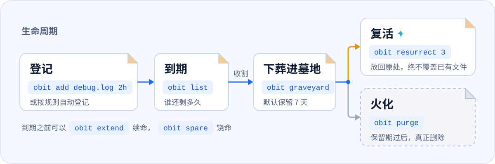
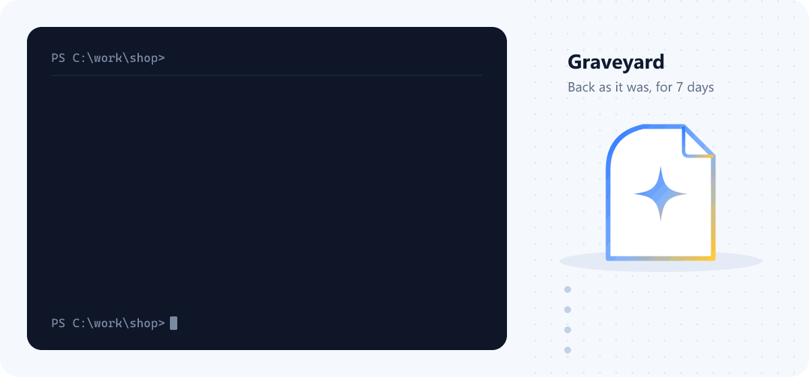

<div align="center">
  <h1>
    <picture>
      <source media="(prefers-color-scheme: dark)" srcset="docs/assets/brand/obituary-horizontal-dark.png">
      <source media="(prefers-color-scheme: light)" srcset="docs/assets/brand/obituary-horizontal-light.png">
      
    </picture>
  </h1>
  <p>
    <strong>Every file has a deadline.</strong><br>
    What your AI leaves behind leaves on its own when it expires; what your AI deletes comes back for seven days.
  </p>
    <p>
    <a href="#why-obituary">Why Obituary</a> ·
    <a href="#install">Install</a> ·
    <a href="#quick-start">Quick start</a> ·
    <a href="docs/usage.en.md">User guide</a> ·
    <a href="docs/README.md">Docs</a>
  </p>
</div>

<p align="center">
  <picture>
    <source media="(prefers-color-scheme: dark)" srcset="docs/assets/readme/lifecycle-dark.svg">
    <source media="(prefers-color-scheme: light)" srcset="docs/assets/readme/lifecycle-light.svg">
    
  </picture>
</p>

<p align="center">
  <picture>
    <source media="(prefers-color-scheme: dark)" srcset="docs/assets/demo/demo-en-dark.gif">
    <source media="(prefers-color-scheme: light)" srcset="docs/assets/demo/demo-en-light.gif">
    
  </picture>
</p>

Built for AI agents: the debug scripts, logs, screenshots and test output an agent produces carry a lifespan from the moment they are created. Nobody has to remember to clean up, and an agent's `rm -rf` no longer destroys anything for good. How it works inside: [docs/architecture.md](docs/architecture.md) (Chinese).

## Why Obituary

Agents pushed us into writing it. As soon as version 0.0.1 ran we installed it on our own machines, and every version since was written by agents in repositories it was watching.

- **Agents make mess faster than people clean it up.** Rotate between Claude Code, Codex, DeepSeek and WorkBuddy and a project soon fills with debug scripts, logs, screenshots and `test-results/`. Nobody can say which of it still matters, so nobody dares delete any of it. Obituary gives everything its rules recognise a lifespan the moment it appears; what the rules don't recognise is listed as a proposal when the session ends, and nothing is registered until you agree.
- **Not sure it's still needed? Bury it.** `obit bury` moves it into the graveyard, where it stays restorable as it was for seven days before it is really deleted. If an agent reaches for it during those seven days, Obituary tells it on the spot: it is in the graveyard, here is its number, and `obit resurrect` puts it back. The rest of the time it stays out of the way: an agent starts work knowing only that Obituary is there, without reading a list first.
- **Afraid of one `rm -rf`.** Agents wiping a home directory or a whole drive is no longer hypothetical; people have posted it more than once. With the delete guard on, an agent's `rm -rf`, `git clean` or `Remove-Item` is stopped and replaced by the equivalent `obit` command: things go to the graveyard instead of disappearing.
- **Afraid the command changes on the way.** Between the command an agent means and the one that runs sit shell quoting, escaping and sometimes a proxy that rewrites commands. Lose one character and `rm -rf "$OUT"/` becomes `rm -rf /`. So Obituary does not trust the command text alone: before `obit rm` touches anything it checks the real path on disk, refuses drive roots, system directories and the user profile itself, and buries everything else where it can be resurrected.

## What it does

- **Give files and folders a lifespan.** `obit add debug.log 2h` buries it when time is up. Pick a moment with `--at`, extend it any time (`extend`), or spare it (`spare`).
- **Register agent output automatically by rule.** Built-in rules cover `.playwright-mcp/`, `test-results/`, `__pycache__/`, `*.log` and more. Only untracked files inside a Git work tree are registered, and the first time in a project you get a proposal to approve.
- **Anything an agent deletes can come back.** With the delete guard on, an agent's `rm -rf`, `git clean` and similar commands are stopped and the agent is told the equivalent `obit` command. It uses that instead, and things go to the graveyard rather than disappearing.
- **Bury first, purge later.** The graveyard keeps everything for 7 days by default; `obit resurrect` puts it back where it was and never overwrites what is there now.
- **Files are tracked by identity, not by name.** Every record keeps the volume serial number and the 128-bit file ID, so a renamed or moved file is still found, and a different file that now sits at the old path is left alone.
- **Claude Code and Codex.** `obit init` registers hooks and an Agent Skill; an MCP server is optional; `--uninstall` removes only what Obituary added.
- **Lives in the tray, like Everything.** `obit init` starts a tray icon at login. Its menu shows recent burials (click one to resurrect it), lets you pause automatic cleanup, and opens Obituary's small window. A Windows scheduled task remains as a fallback.
- **A small window.** Upcoming, Graveyard, Decisions, Settings and Logs: resurrect files, approve proposals and change settings without the command line (`obit-gui.exe`, or "Open Obituary" in the tray menu). Chinese and English, eight looks.
- **Context menu and dates in Explorer.** Right-click a file in Explorer to give it a lifespan. Tracked items in Downloads and on the Desktop show as "name (11-13 burial)" while the real file name stays the same.
- **Docker containers.** Containers an agent session started are listed as a proposal when it ends and tracked only if you approve; at expiry they are stopped with `docker stop` (`obit resurrect` starts them again) and removed with `docker rm` only after the retention period. Volumes and images are never touched. `obit docker add <container> 3d` registers one by hand.
- **Folder policies.** `obit watch Downloads 2w`: every file that lands there is buried two weeks later. An expired subfolder only produces a proposal and is buried after you approve it. The policy itself needs your approval too.

## Install

Windows 10 / 11 (x64 and ARM64). Send this sentence to the agent you use. It installs Obituary, connects it to itself and stops wherever a decision is yours:

```text
Read https://obituary.woodfish.site/agent-install.md and follow it to install Obituary and connect it to yourself.
```


<p align="center">
  <picture>
    <source media="(prefers-color-scheme: dark)" srcset="docs/assets/readme/agents/agents-dark.svg">
    <source media="(prefers-color-scheme: light)" srcset="docs/assets/readme/agents/agents-light.svg">
    
  </picture>
</p>

Installing by hand, updating and uninstalling: see the [install guide](docs/install.en.md).

## Quick start

Common commands (replace `<id>` with the number from an `obit add` or `obit bury` receipt, or from `obit list` / `obit graveyard`):

```powershell
obit add debug.log 2h                       # bury it in 2 hours (alias: mark)
obit add output\shots 1d12h                 # folders work too
obit add report.zip --at "2026-12-01 18:00" # at a given moment
obit list                                   # what is left and for how long
obit extend <id> 1d                         # one more day
obit spare <id>                             # stop tracking, keep the file (alias: cancel)
obit reap                                   # bury everything that is due now (alias: sweep; --dry-run previews)
obit bury old-build                         # bury right away
obit graveyard                              # what is in the graveyard and when it will be purged (--here: this folder only)
obit resurrect <id>                         # put it back; if the name is taken, it comes back renamed, never overwriting
obit resurrect --last                       # undo the last deletion: everything one obit bury / obit rm buried comes back
obit purge                                  # purge what is past retention (--all for everything, --dry-run previews)
obit purge <id>                             # purge this grave now (permanent); also abandons an unverifiable interrupted resurrect
obit stats                                  # eulogy: how much was buried, space freed, resurrections (alias: eulogy)
obit log                                    # the full record of everything done
```

Background running, connecting each agent, the delete guard, MCP and the Skill are covered in the [user guide](docs/usage.en.md).

## Documentation

- [User guide](docs/usage.en.md): every feature in detail
- [Install guide](docs/install.en.md): installing by hand, updating and uninstalling
- [Agent coverage](docs/agents.md): how far each of the 30 agents connects
- [Docs index](docs/README.md): every document, including the architecture and code conventions

## Build Obituary with us

Issues and pull requests are welcome. The most welcome is an issue that comes with its fix: you found it, you fixed it, and once it is merged your avatar shows up here. [CONTRIBUTING.md](CONTRIBUTING.md) says how to start; report anything that could delete the wrong file privately, as [SECURITY.md](SECURITY.md) describes.

<a href="https://github.com/woodfishhhh/obituary/graphs/contributors"></a>

<p>
  <a href="https://star-history.com/#woodfishhhh/obituary&Date">
    <picture>
      <source media="(prefers-color-scheme: dark)" srcset="https://api.star-history.com/svg?repos=woodfishhhh/obituary&type=Date&theme=dark">
      
    </picture>
  </a>
</p>

## License

[MIT](LICENSE)
