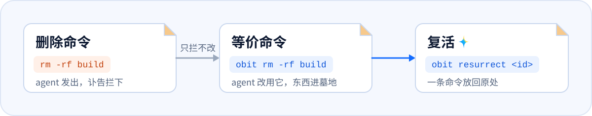

<div align="center">
  <h1>
    <picture>
      <source media="(prefers-color-scheme: dark)" srcset="docs/assets/brand/obituary-horizontal-dark.png">
      <source media="(prefers-color-scheme: light)" srcset="docs/assets/brand/obituary-horizontal-light.png">
      
    </picture>
  </h1>
  <p>
    <strong>Every file has a deadline.</strong><br>
    Write an obituary for a file or folder. When its lifespan runs out it is buried in a graveyard; you can resurrect it at any time during the retention period, and only after that is it really deleted.
  </p>
  <p>
    <a href="#build"></a>
    <a href="#build"></a>
    <a href="LICENSE"></a>
  </p>
  <p>
    <strong>English</strong> · <a href="README.md">中文</a>
  </p>
  <p>
    <a href="#why-obituary">Why</a> ·
    <a href="#install">Install</a> ·
    <a href="#quick-start">Quick start</a> ·
    <a href="#claude-code">Claude Code</a> ·
    <a href="#codex">Codex</a> ·
    <a href="#delete-guard-anything-an-agent-deletes-can-come-back">Delete guard</a> ·
    <a href="#safety">Safety</a> ·
    <a href="docs/README.md">Docs</a>
  </p>
</div>

<p align="center">
  <picture>
    <source media="(prefers-color-scheme: dark)" srcset="docs/assets/readme/lifecycle-dark.svg">
    <source media="(prefers-color-scheme: light)" srcset="docs/assets/readme/lifecycle-light.svg">
    
  </picture>
</p>

<p align="center">
  <picture>
    <source media="(prefers-color-scheme: dark)" srcset="docs/assets/demo/demo-dark.gif">
    <source media="(prefers-color-scheme: light)" srcset="docs/assets/demo/demo-light.gif">
    
  </picture>
</p>

Built for AI agents: the debug scripts, logs, screenshots and test output an agent produces carry a lifespan from the moment they are created. Nobody has to remember to clean up, and an agent's `rm -rf` no longer destroys anything for good. How it works inside: [docs/architecture.md](docs/architecture.md) (Chinese).

## Why Obituary

Agents pushed us into writing it. As soon as version 0.0.1 ran we installed it on our own machines, and every version since was written by agents in repositories it was watching.

- **Agents make mess faster than people clean it up.** Rotate between Claude Code, Codex, DeepSeek and WorkBuddy and a project soon fills with debug scripts, logs, screenshots and `test-results/`. Nobody can say which of it still matters, so nobody dares delete any of it. Obituary gives everything its rules recognise a lifespan the moment it appears; what the rules don't recognise is listed as a proposal when the session ends, and nothing is registered until you agree.
- **Not sure it's still needed? Bury it.** `obit bury` moves it into the graveyard, where it stays restorable as it was for seven days before it is really deleted. If an agent reaches for it during those seven days, Obituary tells it on the spot: it is in the graveyard, here is its number, and `obit resurrect` puts it back. The rest of the time it stays out of the way: an agent starts work knowing only that Obituary is there, without reading a list first.
- **Afraid of one `rm -rf`.** Agents wiping a home directory or a whole drive is no longer hypothetical; people have posted it more than once. With the delete guard on, an agent's `rm -rf`, `git clean` or `Remove-Item` is stopped and replaced by the equivalent `obit` command: things go to the graveyard instead of disappearing.
- **Afraid the command changes on the way.** Between the command an agent means and the one that runs sit shell quoting, escaping and sometimes a proxy that rewrites commands. Lose one character and `rm -rf "$OUT"/` becomes `rm -rf /`. So Obituary does not trust the command text alone: before `obit rm` touches anything it checks the real path on disk, refuses drive roots, system directories and the user profile itself, and buries everything else where it can be resurrected.

## What it does

- **Give files and folders a lifespan.** `obit add debug.log 2h` buries it when time is up. Pick a moment with `--at`, extend it any time (`extend`), or spare it (`spare`).
- **Register agent output automatically by rule.** Built-in rules cover `.playwright-mcp/`, `test-results/`, `__pycache__/`, `*.log` and more. Only untracked files inside a Git work tree are registered, and the first time in a project you get a proposal to approve.
- **Anything an agent deletes can come back.** With the delete guard on, an agent's `rm -rf`, `git clean` and similar commands are stopped and the agent is told the equivalent `obit` command. It uses that instead, and things go to the graveyard rather than disappearing.
- **Bury first, purge later.** The graveyard keeps everything for 7 days by default; `obit resurrect` puts it back where it was and never overwrites what is there now.
- **Files are tracked by identity, not by name.** Every record keeps the volume serial number and the 128-bit file ID, so a renamed or moved file is still found, and a different file that now sits at the old path is left alone.
- **Claude Code and Codex.** `obit init` registers hooks; an MCP server and an Agent Skill are optional; `--uninstall` removes only what Obituary added.
- **Lives in the tray, like Everything.** `obit init` starts a tray icon at login. Its menu shows recent burials (click one to resurrect it), lets you pause automatic cleanup, and opens Obituary's small window. A Windows scheduled task remains as a fallback.
- **A small window.** Graveyard, Decisions, Upcoming, Settings and Logs: resurrect files, approve proposals and change settings without the command line (`obit-gui.exe`, or "Open Obituary" in the tray menu). Chinese and English, eight looks.
- **Context menu and dates in Explorer.** Right-click a file in Explorer to give it a lifespan. Tracked items in Downloads and on the Desktop show as "name (11-13 burial)" while the real file name stays the same.
- **Docker containers.** Containers an agent session started are listed as a proposal when it ends and tracked only if you approve; at expiry they are stopped with `docker stop` (`obit resurrect` starts them again) and removed with `docker rm` only after the retention period. Volumes and images are never touched. `obit docker add <container> 3d` registers one by hand.
- **Folder policies.** `obit watch Downloads 2w`: every file that lands there is buried two weeks later. An expired subfolder only produces a proposal and is buried after you approve it. The policy itself needs your approval too.

## Install

Windows 10 / 11 (x64 and ARM64).

**Easiest: let your agent do it.** Send this sentence to the agent you use (Claude Code, Codex, Cursor…). It installs Obituary, connects it to itself and stops wherever a decision is yours:

```text
Read https://raw.githubusercontent.com/woodfishhhh/obituary/main/docs/agent-install.md and follow it to install Obituary and connect it to yourself.
```

**By hand:** pick one of the three, then run `obit doctor` to check the installation.

```powershell
# Scoop
scoop bucket add obituary https://github.com/woodfishhhh/scoop-bucket
scoop install obituary

# winget
winget install woodfishhhh.Obituary

# Install script: download it, read it, then run it
# (installs to %LOCALAPPDATA%\Programs\obituary, adds it to your user PATH, creates a Start menu shortcut)
irm https://raw.githubusercontent.com/woodfishhhh/obituary/main/packaging/install.ps1 -OutFile install.ps1
.\install.ps1 -Version 1.0.0          # -WhatIf previews, -NoPath leaves PATH alone
```

- All three download the same archive from the GitHub release and check its SHA-256 before unpacking; a mismatch stops the install.
- 1.0.0 is not code-signed yet. If you download the archive with a browser, Windows may show "Windows protected your PC"; choose "More info → Run anyway". Scoop, winget and the install script usually do not trigger this.
- The small window `obit-gui.exe` needs the WebView2 runtime (built into Windows 11 and present on most Windows 10 machines) and is x64 only; the ARM64 build has the command line and the tray.
- To build from source, see [Build](#build).

### Updates

Once a day at most, Obituary asks GitHub whether a new stable release is out. It reads public release information only and sends no usage data. When there is one, the tray menu and the small window say so, and Settings > About and updates shows the command for the way you installed it:

- Scoop: `scoop update obituary`
- winget: `winget upgrade woodfishhhh.Obituary`
- Install script: run the install command again

Obituary only checks and tells you; it never downloads or replaces files itself. In a terminal, `obit update` shows your version and the update command, and `obit update --check` checks right away.

To keep it offline, turn off "Check for updates automatically" in Settings, or put this in `config.toml`:

```toml
[update]
check = false
```

You can still check by hand.

## Quick start

Common commands (replace `<id>` with the number from an `obit add` or `obit bury` receipt, or from `obit list` / `obit graveyard`):

```powershell
obit add debug.log 2h                       # bury it in 2 hours (alias: mark)
obit add output\shots 1d12h                 # folders work too
obit add report.zip --at "2026-12-01 18:00" # at a given moment
obit list                                   # what is left and for how long
obit extend <id> 1d                         # one more day
obit spare <id>                             # stop tracking, keep the file (alias: cancel)
obit reap                                   # bury everything that is due now (alias: sweep; --dry-run previews)
obit bury old-build                         # bury right away
obit graveyard                              # what is in the graveyard and when it will be purged (--here: this folder only)
obit resurrect <id>                         # put it back; if the name is taken, it comes back renamed, never overwriting
obit resurrect --last                       # undo the last deletion: everything one obit bury / obit rm buried comes back
obit purge                                  # purge what is past retention (--all for everything, --dry-run previews)
obit purge <id>                             # purge this grave now (permanent); also abandons an unverifiable interrupted resurrect
obit stats                                  # eulogy: how much was buried, space freed, resurrections (alias: eulogy)
obit log                                    # the full record of everything done
```

Background running: [Background](#background). Agents: [Claude Code](#claude-code) and [Codex](#codex).

## For people: tray, small window, context menu

```powershell
obit init                                   # Claude Code hooks, and the tray starts at login
obit init --context-menu --yes              # Explorer context menu (classic menu; on Windows 11 under "Show more options"; --dry-run lists every entry)
obit watch C:\Users\you\Downloads 2w        # files that land in Downloads are buried two weeks later, once they have been left untouched for 10 minutes (a proposal you approve first; expired subfolders get their own proposal)
obit watch --list                           # folder policies, their exemptions and quiet periods
obit watch --remove C:\Users\you\Downloads  # remove a policy and the lifespans it registered
```

- Tray menu: recent burials (click to resurrect), items due within 24 hours, pause / resume, Open Obituary (the small window), Quit (the scheduled task keeps working).
- `obit-gui.exe` must sit next to `obitd.exe` for the tray to open it. Every switch shows exactly what it will change and writes only after you confirm; trusting a `.obitrules` file trusts exactly the version shown in the window.
- Explorer dates come from a hidden `desktop.ini` in the folder and appear by default only in Downloads, on the Desktop and in folders under a policy. `[explorer]` in `config.toml` turns them off (`enabled = false`) or on everywhere (`everywhere = true`). Explorer caches folder views, so after extending a lifespan the same window may show the old date for up to a minute.
- The window, tray and context menu follow `[ui] language` in `config.toml` (`auto`, `zh-CN` or `en`; `auto` follows Windows). You can switch it in Settings.

## Claude Code

```powershell
obit init -g                         # all projects (~/.claude); obit init alone installs into this project (.claude/)
obit init -g --show --agent claude   # what is installed (without --agent: a one-line summary per agent, then the details)
obit init -g --uninstall             # remove only what Obituary added
```

`obit init` registers `obit hook claude` in `settings.json` (SessionStart, before each tool call, after writes, Stop, SessionEnd), writes an `OBIT.md` for the agent, and adds one reference line to `CLAUDE.md`: `@OBIT.md` in `~/.claude/CLAUDE.md` for the user scope (`-g`), `@.claude/OBIT.md` in the project's `CLAUDE.md` for a project.

- <details>
  <summary>How <code>obit init</code> edits your configuration</summary>

  - Your settings and key order stay as they are. Running it again adds nothing twice; if `obit.exe` moved, running it again refreshes the path.
  - Every edit is preceded by a backup: `.bak` the first time, then `.bak.1`, `.bak.2` …; old backups are never overwritten. If you save the file between the moment the change is computed and the write, Obituary refuses to write.
  - Only an `OBIT.md` carrying Obituary's marker is replaced or removed; your own compound commands that happen to contain `obit hook claude` are not mistaken for Obituary's. Only a hook whose program is an absolute path to `obit.exe` counts as Obituary's (`obit init` always writes the absolute path); one written with a relative path or a bare `obit` is never changed or removed.

  </details>

- Any error in a hook lets the agent continue silently (the error goes to `hook.log`). `OBIT_DISABLED=1` turns hooks off temporarily; `OBIT_HOOK_AUDIT=1` records what each hook received and did, readable with `obit hook audit`.

```powershell
obit doctor              # read-only check: PATH, obitd, runner, Claude Code / Codex integration, data directory, ledger, config (--json)
```

Once installed:

- **Consent first.** The first time Obituary wants to register something by rule in a project, it creates a proposal instead of acting. The agent passes it on to you (in a real session Claude said: "Obituary has a pending proposal… I haven't acted on it."). `obit approve <id>` lets that project register automatically from then on; `obit reject <id>` means never ask about this project again.
- **Large things** (over 1 GB or 200 files) are proposed as well.
- **Session diff.** A snapshot is taken when a session starts (kept in the data directory, nothing is added to your repository) and compared when it ends. Items covered by rules are registered; leftovers no rule covers are **only proposed, not registered**, because new untracked files may be code you have not committed yet. At the next session start the agent sees what was left behind. Items you resurrected or spared are not registered again by the session diff until they are written again.
- **Git is asked again before burial.** Anything registered by rule or proposal is not buried if it has been committed by the time it expires.
- **Proposals expire on their own.** Files that no longer exist are not listed; the background runner asks Git per project in batches, drops entries that were committed or deleted, and withdraws proposals with nothing left (recorded in the audit log, not counted as a rejection). If the project folder or repository is temporarily unreachable (renamed, drive offline), the proposal is kept as is.
- **Grave notices.** When an agent's tool call touches a path that is buried and still restorable (or something inside a buried directory), Obituary tells it the grave number, when it was buried, how long it stays restorable and `obit resurrect <id>`. It only informs: the tool call is never blocked or changed, and each grave is mentioned once per session. Claude Code and Codex hear it before the tool runs; other agents at the point listed in `obit init --show`. Existing installations get it by running `obit init` again.
- **Session summary (optional).** To save the agent's tokens, a session starts with only the proposals that need your decision. Turn on "Session summary" in the desktop app's Settings, or set `[hooks] session_summary = true` in `config.toml`, and the agent also hears this project's items due within 24 hours and its recent restorable burials (`obit mktemp` scratch directories excluded).
- **Upcoming expiries (with the session summary on).** At session start the agent sees this project's items due within 24 hours.

```powershell
obit proposals           # proposals waiting for you
obit approve 3           # approve: register what it lists
obit reject 3            # reject
```

## Codex

```powershell
obit init -g --agent codex   # ~/.codex/hooks.json plus a block in AGENTS.md; obit init --agent codex installs into this project
```

- One `hooks.json` serves Windows and WSL: `command` is `/mnt/d/…/obit.exe hook codex` (WSL calls the Windows build through interop) and `commandWindows` is the Windows command. `/mnt/<drive>/…` paths from WSL become `<drive>:\…`; paths inside WSL's own file system (`/home/…`) are skipped for now.
- Codex edits files with `apply_patch`; Obituary reads the patch for added, changed and moved files (deleted ones do not count).
- **Codex runs only hooks you trusted.** After installing, open Codex, run `/hooks` and trust Obituary's hooks. Project hooks also need the project itself to be trusted.
- A project install refuses to write if `.codex`, `.claude` or a backup file is a link pointing outside the project.

## Other agents

```powershell
obit init -g --show                         # every supported agent, how far each integration goes, what is installed
obit init -g --agent gemini,cursor          # install one or several; without -g, into this project only
obit init -g --agent gemini --mcp --skill   # also register the MCP server and install the Skill (where supported)
obit init -g --agent gemini --uninstall     # remove only what Obituary added
```

Without `--agent` only Claude Code is installed (Codex as in the previous section); Obituary never installs into other agents on its own.

| Method | Agents |
|---|---|
| Native hooks | GitHub Copilot (VS Code and Copilot CLI), Cursor, Gemini CLI, Factory Droid, Trae / Trae CN, Kimi, Mistral Vibe, Google Antigravity; Tencent CodeBuddy (CLI and IDE), Qoder / Qoder CN / Lingma, Zhipu ZCode |
| Plugin (Obituary installs a small plugin that calls `obit.exe hook`) | OpenCode, OpenClaw, Pi, Oh My Pi, Hermes, Cline, Kilo Code, MiniMax Code, DeepSeek Harness |
| Rules file and MCP only | Roo Code, Windsurf, WorkBuddy, QoderWork |

- Agents differ in what they support: registration after writes, the session-start notice, the delete guard, MCP and the Skill. The [agent coverage table](docs/agents.md) lists "supported / limited / unsupported" with reasons; it is generated by `obit init --show --format markdown` from the capability declarations in the code, and a test fails if the two disagree. The delete guard is enabled only where the host proves the command runs locally and in which shell.
- Where public documentation is not enough to write safely (OpenClaw's JSON5 config, Windsurf's and Cursor's global rules, some MCP locations), `obit init` prints the complete manual steps and reports "incomplete, manual steps required". It never pretends to have installed something and never writes to guessed folders.
- Plugins need you to confirm they run locally (for example `OBIT_OPENCODE_LOCAL=1` or `OBIT_CLINE_LOCAL_SHELL=bash`); the install output says what to set. Operations that run remotely or in the cloud never register a local file with the same name.

## Docker containers

```powershell
obit docker add web-1 3d       # register a container by name or ID; it expires in three days
obit docker list               # registered containers (--json works too)
obit resurrect <id>            # start a container that was stopped at expiry
```

- Obituary manages containers only. Volumes hold data and removing one is permanent, so volumes, images and networks are never touched.
- **Expiry means stopping.** After `docker stop` the container and its writable layer remain; `obit resurrect <id>` runs `docker start` and stops tracking its lifespan. Only after the retention period (`[graveyard] retention_days`, 7 days by default) is it removed with `docker rm`, never with `-v` or `-f`; if it is running by then (you or someone started it), it counts as resurrected and is kept. `obit purge` and `--all` also wait for the retention period for containers. Recycle mode does not apply to containers: they are still stopped first and removed after retention.
- **Containers are identified by full ID.** Names are only for display; before every stop, start or remove the full ID and creation time are checked again, and nothing happens if they differ. Obituary also records the Docker context and daemon a container lives on and only ever acts on that daemon, so switching `docker context` cannot redirect it. A container you removed outside Obituary is recorded as removed externally and its record is cleared. A container started with `--rm` (AutoRemove) would be deleted by Docker when stopped, so Obituary refuses to register it.
- **Containers from an agent session are only proposed.** When a session ends, Obituary lists in the background the containers created during it: those whose compose working directory or bind mounts are inside the project are attributed to it, the rest are listed as created during the session. Nothing is tracked until you `obit approve`. Hooks never call Docker; if Docker is not installed or not running, this is skipped quietly and `obit doctor` explains why.

## Delete guard: anything an agent deletes can come back

```powershell
obit init -g --guard-rm                 # Claude Code; add --agent codex for Codex. Off by default
```

<p align="center">
  <picture>
    <source media="(prefers-color-scheme: dark)" srcset="docs/assets/readme/delete-guard-dark.svg">
    <source media="(prefers-color-scheme: light)" srcset="docs/assets/readme/delete-guard-light.svg">
    
  </picture>
</p>

When it is on and an agent runs `rm -rf build`, `rmdir`, `git clean -fdx`, `Remove-Item -Recurse` or a similar delete, Obituary stops that execution and tells the agent the equivalent command, such as `obit rm -rf build`. Once the agent uses it, things go to the graveyard instead of disappearing, and `obit resurrect <id>` puts them back.

- **Deny, never rewrite.** Obituary does not rewrite the agent's command: Claude Code checks permissions against the rewritten command, so rewriting would defeat your `deny` rules. Denying and letting the agent issue the equivalent command keeps all your permission rules in force.
- **Miss rather than misfire.** Only deletes at the start of a command (or after `&&`, `;` or a newline) are recognised. After `||`, inside strings, in heredocs, `$(…)`, `sudo`, `xargs rm`, `find -delete` and interactive deletes all pass through (recorded in the audit log with `OBIT_HOOK_AUDIT=1`).
- **Never falls back to a real delete.** Every path given to `obit rm` / `obit remove-item` / `obit git-clean` is buried; when the guard refuses one (drive roots, system folders, the user profile itself and so on) the error follows `rm`'s format and the exit code is non-zero.
- Files tracked by Git are buried too, so uncommitted changes can be recovered (this is a deliberate delete by the agent, unlike automatic registration, which never touches tracked files).
- `obit rm -rf` on a folder that contains `.git` buries the whole repository: a real `rm -rf` would destroy it, burial can at least be undone, and refusing might push the agent to `/bin/rm`. Protections that cannot be forced (system folders, user folders) still apply.
- **Deliberately narrow.** The equivalent command must never select more than the original, so Obituary does not translate across shells and lets anything uncertain pass.

  <details>
  <summary>What is stopped and what passes, per host</summary>

  | Host | Stopped, with an equivalent command | Passes |
  |---|---|---|
  | Claude Code (Bash tool) | `rm`, `rmdir`, `git clean`, optionally preceded by a literal `cd x` (joined with `&&`, `;` or a newline); `rm -f *.log` (when no file in the folder starts with `-`), `rm -rf ../dist`, `rm -- "$target"` (variables after `--`) | Other leading statements (`trap`, `hash`, `npm …`), variables before `--` (they may expand to options), POSIX absolute paths starting with `/`, complex constructs, interactive deletes, `/usr/bin/rm` with a path |
  | Codex, under WSL's `/mnt/<drive>` | A single `rm` / `rmdir` whose arguments are relative paths without `..`, `~`, wildcards or quotes (use `obit.exe` through interop) | Everything else, including `git clean` and WSL's own file system |
  | Codex, declared Windows PowerShell | A single `Remove-Item` or alias with one literal path (`-Recurse`, `-Force` allowed) | Multiple statements, pipelines, provider paths, `~`, wildcards, backticks, curly quotes |
  | Codex on Windows with an unknown shell, pwsh on Linux, `git rm` | — | Everything |

  General rules: the delete must be the **last segment** of the command, joined only with `&&`, `;` or newlines (`obit rm` and `rm` do not succeed and fail in exactly the same cases, so a later command that depends on the exit code could diverge). File names ending in a dot or space always pass (Windows would normalise them into another name). Bash commands containing carriage returns, NUL bytes, backticks, or both a backslash continuation and a `#` comment, or more than one continuation, also pass. Use the same `obit` path in commands as the installed hook.

  </details>

- You can use them yourself: `obit rm`, `obit rmdir` and `obit git-clean` accept the common non-interactive options of `rm`, `rmdir` and `git clean` (unsupported ones such as `-i` or `rmdir -p` are errors, not silently ignored). `obit remove-item` takes one literal path (no wildcards, ignores `$WhatIfPreference`) and is not a full `Remove-Item`; for wildcards use `obit rm *.log` in bash. Known limits: [docs/architecture.md](docs/architecture.md#威胁模型).
- Turn it off temporarily with `OBIT_GUARD_RM=0`. `obit stats` shows how many deletes were stopped and how much was buried.

## MCP server and Agent Skill

```powershell
obit init -g --mcp --skill                 # Claude Code; add --agent codex for Codex. Neither is installed by default
obit init -g --show                        # also shows whether mcp / skill are installed and current
```

- **`obit mcp`** is a stdio MCP server exposing Obituary's operations as tools the agent can call: `obit_mark`, `obit_mktemp`, `obit_bury`, `obit_resurrect`, `obit_extend`, `obit_spare`, and the queries `obit_list`, `obit_graveyard`, `obit_proposals`, `obit_stats` (`obit_graveyard` also records verified interrupted resurrections; the rest are read-only).
- **Your decisions stay yours.** Approving or rejecting proposals, trusting `.obitrules`, purging the graveyard and changing configuration have no MCP tools; the tool list is fixed by tests. The agent can only pass a proposal on to you.
- Paths must be absolute: the MCP server's working directory is not necessarily the agent's, so relative paths are not guessed. IDs are written `5` or `#5`; an unknown ID is an error and never falls back to a file name. At most 100 items per call; notes and session text up to 4 KiB (the same as the CLI); `obit_list`, `obit_graveyard` and `obit_proposals` return up to 200 entries per page, paged by ID with `limit` / `after`. Receipts carry a `version`; pass it back when paging, and if the list changed between pages you get `changed: true` and should read again from the start. Overlong text in receipts is truncated and marked, so receipts always fit the protocol's size limit.
- <details>
  <summary>Where it is registered</summary>

  - For Claude Code's user scope Obituary uses the official command (`claude mcp add --scope user --transport stdio obituary -- <obit.exe> mcp` / `claude mcp remove --scope user obituary`; `--dry-run` prints the full command). This needs Claude Code 2.1.318 or newer (`claude update`): older versions write that file without taking a lock. `~/.claude.json` is a state file Claude Code rewrites constantly, so Obituary only reads it. Project scope writes `.mcp.json` directly.
  - Codex gets `[mcp_servers.obituary]` in `config.toml`, wrapped in `# obit:mcp:begin` / `# obit:mcp:end` comments. Uninstalling removes the whole marked block, including options you added inside it (such as `enabled` or `env`). If the command or arguments inside the block were changed, or `obituary` is also defined outside it, Obituary does not recognise the block and neither installs nor removes it.

  </details>

- The **Agent Skill** is a `SKILL.md` telling the agent when to give its output a lifespan, how to delete restorably, and which decisions belong to you. Claude Code gets it in `~/.claude/skills/obituary/`, Codex in `~/.agents/skills/obituary/` (projects: `.claude/skills/`, `.agents/skills/`). A `.obituary-skill` file next to it records the hash at install time: once you edit the Skill, Obituary no longer overwrites or removes it.
- A plain `obit init -g` refreshes an installed Skill and Codex MCP block (for example after `obit.exe` moved) but does not install new ones. Claude Code's user-scope MCP registration is the exception: the official command can only remove and re-add, which is not atomic, so a plain refresh only reports "outdated" with the manual command; pass `--mcp` to replace it. A broken extension config never blocks installing the hooks; it only produces a warning.
- The installer runs only a `claude.exe` from an absolute PATH directory (for npm installs it follows `claude.cmd` to the exe behind it) and refuses one in the current folder or repository, so running `obit init` inside someone else's repository cannot execute a program planted there. The check uses the folder's identity on disk, not its spelling, so another name (a junction, `\\localhost\C$`, a short name, a hard link) does not get around it. Manual commands whose arguments contain double quotes need PowerShell 7.3 or newer.
- With `mode = "recycle"` in `config.toml`, burials go to the system Recycle Bin; the MCP tool descriptions say so and `obit resurrect` cannot bring things back from there.
- Restart the agent after installing. `obit doctor` checks whether both are installed and point at the current `obit.exe` (not installed is fine; they are optional). It only shows the configuration is right, not that the agent has connected.

## Automatic lifespans for agent output

```powershell
obit rules                       # the rules in effect here (built-in plus a trusted .obitrules)
obit rules check debug.log out/  # preview what would be registered and by which rule (changes nothing)
obit rules apply debug.log       # register by rule
$dir = obit mktemp 1d            # a temporary folder that buries itself: .obit/tmp/ in a project (not in Git), otherwise the system temp folder; in bash: dir=$(obit mktemp 1d)
```

Built-in rules cover common agent clutter: `.playwright-mcp/`, `test-results/`, `__pycache__/`, `*.log` and more. A `.obitrules` file at the project root uses `.gitignore` syntax with a lifespan after each pattern:

```
output/**        7d      # every item under output gets its own lifespan
!output/keep/**          # never touch (negation wins, even over registering a parent folder)
test-results/    off     # turn off a built-in rule
```

Unlike `.gitignore`: negation wins rather than the last match; on Windows matching ignores case (including non-ASCII letters, regardless of Git's `core.ignorecase`); an invalid pattern (such as an unclosed `[`) is an error naming the file and line, and automatic registration in that project pauses instead of quietly treating it as no match. The same happens if a trusted `.obitrules` is deleted, until you run `obit untrust`.

**Hard rules for automatic registration:** only untracked items inside a Git work tree; a folder with even one tracked file is never touched; if Git cannot answer, skip; an existing lifespan is never shortened.

**Project rules must be trusted first.** A repository's own `.obitrules` has no effect until you have reviewed it and run `obit trust` (so someone else's repository cannot use rules to take your private files). Trust records the file's SHA-256; any change needs a new review. Non-interactive sessions need `--yes`; in CI you can set `OBIT_TRUST_PROJECT_RULES=1`.

Durations: `s` `m` `h` `d` `w`, combinable (`1d12h`). Query and result commands (`list`, `graveyard`, `proposals`, `stats`, `mark`, `bury`, `resurrect` and others) support `--json` for scripts and agents; delete wrappers such as `obit rm` keep their original command's output format and have no `--json`.

A bare number in `resurrect` and `purge` (`5`, `#5`) is always an ID; an unknown ID is an error and never falls back to a file name. For a file whose name is a number, write `./5` or an absolute path. Paths given with short names (such as `DIRECT~1`) are expanded to long names first.

## Safety

- **Bury, then purge.** Expired items move to the graveyard and are kept for 7 days (`retention_days` under `[graveyard]` in `config.toml`) before the real delete; until then, `obit resurrect` brings them back. The graveyard is on the same drive (the data directory's graveyard on that drive, a hidden `.obituary` at the root of other drives), so burial is a rename: fast, and never half done. You can also send burials straight to the system Recycle Bin (`mode = "recycle"` under `[graveyard]`); then you restore from the Recycle Bin and `obit resurrect` cannot help.
- **Purging is the only permanent delete.** Every burial creates its own grave folder and records its file ID. Before purging or resurrecting, Obituary checks that the grave is still that folder, holds exactly one item, and that item is the object that was buried. A damaged ledger or a graveyard swapped for a link therefore cannot delete anything outside the graveyard.
- **Resurrection only goes back to where it came from.** If the name is taken there, nothing is overwritten: the item comes back next to it as `name (resurrected).ext`, both are kept, and the receipt shows the real path. The original path is the original location: if a parent folder was deleted it is recreated, and if it was replaced by another ordinary folder the item still goes there. What is refused is being redirected: a parent that became a junction or symbolic link, a junction retargeted, a drive letter now on another volume (the grave stays as it is). The target folder is pinned for the final move, so a rename or relink after the check cannot change where it lands. Resurrecting by path prefers an exact match; a match that differs only in letter case must be unique, otherwise use the ID.
- **Files, not file names.** Every record keeps the volume serial number and 128-bit file ID: renamed or moved files are still found, and a different file now at the old path is left alone. Identity is checked again right before deleting. Files with more than one hard link are refused.
- **Protected paths.** Drive roots, `C:\Windows`, Program Files, ProgramData, and the user profile, Desktop, Documents, Downloads and similar folders themselves (and their parents) are refused, including redirected ones. Their contents can be given lifespans. Short names and junctions in parent folders are resolved to real paths first; links themselves are always refused.
- **Git repositories.** `obit add` and `obit bury` on a folder containing `.git` at any depth need `--force`, and the check is repeated at expiry; if it cannot finish, the burial is refused. The exception is the delete guard's `obit rm -rf`, which buries the whole thing exactly as a real `rm -rf` would delete it (see [Delete guard](#delete-guard-anything-an-agent-deletes-can-come-back)).
- **When unsure, don't delete.** A record is given up only when the file is known to be gone. Access denied, a removed volume and similar cases are retried later.
- **Everything is recorded.** Every add, extension, cancellation and deletion goes into the audit log (`obit log`).

## Background

By default `obitd.exe` lives in the tray, starts at login and buries things on time to the second; the tray icon is its only interface. A Windows scheduled task also runs `obitd --once` every 5 minutes (and at each login) as a fallback, so expired items are still reaped and old graves purged if the tray is closed or never started. The task is hidden, runs on battery, and catches up on missed runs (shutdown, sleep). Agent hooks also do a round at session start and end; `obit reap` runs one now. Queries such as `list`, `graveyard`, `stats` and `log` are read-only and never bury anything.

```powershell
obit init                       # tray starts at login (HKCU\...\Run); --uninstall removes it
obit daemon enable              # tray at login plus the fallback scheduled task (--dry-run lists what would be installed)
obit daemon status              # current mode and the next expiry (--json)
obit daemon disable             # remove the scheduled task and login start, and stop the running daemon (--dry-run previews)
```

After registering (`add`, `approve`, `mktemp`, `rules apply`) or burying, if no runner serves your data directory, Obituary starts a temporary resident process and suggests `enable`. A scheduled task serving a different data directory (for example after moving it with `OBIT_HOME`) counts as none; `obit daemon status` points this out.

When several agents work at once and a hook cannot get the ledger lock in time, the registration is queued on disk and applied by the next process that holds the lock; `obit doctor` shows the queue if it backs up.

Data lives in `%LOCALAPPDATA%\obituary`: `store.json` (ledger), `audit.jsonl` (audit log), `obitd.log` (daemon log), `graveyard\` (this drive's graveyard); the full list is in [docs/architecture.md](docs/architecture.md#数据布局). Configuration is `%APPDATA%\obituary\config.toml`; `obit config` shows it and `obit config --create` writes a commented default:

```toml
[graveyard]
mode = "graveyard"      # or "recycle": straight to the system Recycle Bin
retention_days = 7      # days the graveyard keeps things
```

`OBIT_HOME` (data), `OBIT_CONFIG_DIR` (configuration) and `OBIT_USER_HOME` (user home) move these locations; when looking for Claude Code and Codex configuration, `obit init` also honours `CLAUDE_CONFIG_DIR` and `CODEX_HOME`. The tests use these variables for isolation.

## Uninstall

```powershell
obit uninstall --dry-run      # see what would be removed
obit uninstall                # remove everything Obituary set up, after you confirm
.\install.ps1 -Uninstall      # if you used the install script: also remove the program files, PATH entry and Start menu shortcut
```

`obit uninstall` removes the user-level and current Git project's agent hooks, MCP and Skill, login start, the scheduled task, the running daemon, the context menu, Explorer date labels and folder policies, and only what Obituary itself added. The graveyard and ledger are kept by default and you are told how much is in the graveyard and where; if you really want them gone, add `--purge-data`, which lists the graveyard first and asks once more. If you installed project-level hooks in other projects too, run `obit uninstall` in each of them before removing the program; otherwise their hooks break when `obit` is gone. For Scoop or winget installs, run `obit uninstall` first and then their own uninstall command.

## Build

Go 1.26+. Windows only for now; macOS and Linux compile but cannot bury yet.

```bash
go build -o bin/obit.exe ./cmd/obit
go build -ldflags=-H=windowsgui -o bin/obitd.exe ./cmd/obitd   # required, or a console window appears at login
CGO_ENABLED=0 go build -tags desktop,production -ldflags "-H windowsgui" -o bin/obit-gui.exe ./cmd/obit-gui
go test -short ./...                                           # the fast tier; the full suite runs in CI
```

Keep the three executables in one folder. The small window's frontend is in `cmd/obit-gui/frontend` (React, pnpm); the built `dist/` is committed, so changing Go code needs no Node. When changing the UI: `pnpm install`, `pnpm dev` for a preview, `pnpm build` to update `dist/`. Real Recycle Bin tests are skipped unless `OBIT_TEST_RECYCLE=1`, in which case test files go to your Recycle Bin.

## Documentation

- [Docs index](docs/README.md): what each document covers and for whom
- [Architecture](docs/architecture.md) (Chinese): how things flow, where each decision is made, which contracts must not break
- [Agent coverage](docs/agents.md): how far each of the 30 agents is supported (generated; do not edit by hand)
- [AGENTS.md](AGENTS.md): conventions for writing code in this repository

## License

[MIT](LICENSE)
