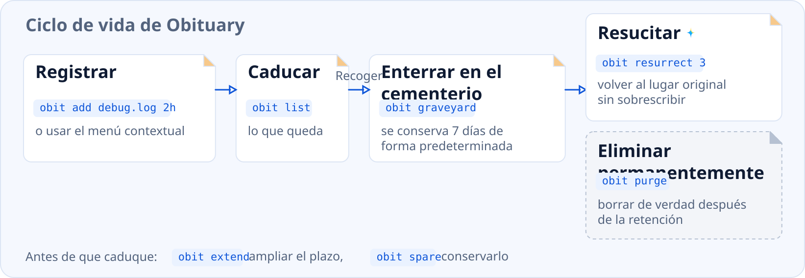

<p align="center"><a href="README.md">&nbsp;English</a> | <a href="README.zh-CN.md">&nbsp;简体中文</a> | <a href="README.zh-TW.md">&nbsp;繁體中文</a> | <a href="README.ja.md">&nbsp;日本語</a> | <a href="README.ko.md">&nbsp;한국어</a> | <a href="README.es.md">&nbsp;Español</a> | <a href="README.fr.md">&nbsp;Français</a> | <a href="README.de.md">&nbsp;Deutsch</a> | <a href="README.pt-BR.md">&nbsp;Português (Brasil)</a> | <a href="README.ru.md">&nbsp;Русский</a></p>
<div align="center">
  <h1>
    <picture>
      <source media="(prefers-color-scheme: dark)" srcset="docs/assets/brand/obituary-horizontal-dark.png">
      <source media="(prefers-color-scheme: light)" srcset="docs/assets/brand/obituary-horizontal-light.png">
      
    </picture>
  </h1>
  <p>
    <strong>Obituary — la papelera para agentes de IA</strong><br>
    Lo que tu IA deja atrás se va solo cuando caduca; lo que tu IA elimina vuelve durante siete días.
  </p>
    <p>
    <a href="#por-qué-obituary">Por qué Obituary</a> ·
    <a href="#instalación">Instalación</a> ·
    <a href="#inicio-rápido">Inicio rápido</a> ·
    <a href="docs/usage.en.md">Guía de usuario</a> ·
    <a href="docs/README.md">Documentación</a>
  </p>
</div>

<p align="center">
  <picture>
    <source media="(prefers-color-scheme: dark)" srcset="docs/assets/demo/demo-en-dark.gif">
    <source media="(prefers-color-scheme: light)" srcset="docs/assets/demo/demo-en-light.gif">
    
  </picture>
</p>

<p align="center">
  <picture>
    <source media="(prefers-color-scheme: dark)" srcset="docs/assets/readme/i18n/es/lifecycle-dark.svg">
    <source media="(prefers-color-scheme: light)" srcset="docs/assets/readme/i18n/es/lifecycle-light.svg">
    
  </picture>
</p>

Obituary es la papelera para agentes de IA: el agente y tú decidís qué entra. El agente da una vida útil a los scripts de depuración, registros y capturas que escribe, y tú añades tus propios archivos desde el menú contextual; todo lo que entra se entierra al caducar y puede restaurarse tal como estaba durante siete días. Nadie tiene que acordarse de limpiar y el `rm -rf` de un agente ya no destruye nada para siempre. Consulta [docs/architecture.md](docs/architecture.md) para conocer su funcionamiento interno (en chino).

## Por qué Obituary

Los agentes nos llevaron a escribirlo. En cuanto la versión 0.0.1 funcionó, la instalamos en nuestros propios equipos, y desde entonces cada versión ha sido escrita por agentes en los repositorios que vigilaba.

- **Los agentes ensucian más rápido de lo que las personas limpian.** Alternar entre Claude Code, Codex, DeepSeek y WorkBuddy llena pronto un proyecto de scripts de depuración, registros, capturas y `test-results/`. Nadie sabe qué sigue siendo útil, así que nadie se atreve a borrarlo. Obituary deja la decisión en manos de quien mejor lo sabe: el agente reconoce sus scripts y registros y les da una vida útil con `obit mark` al escribirlos; tú añades tus archivos desde el menú contextual. Una vez dentro, se entierran al caducar y nadie tiene que recordar la limpieza.
- **¿No sabes si todavía hace falta? Entiérralo.** `obit bury` lo mueve al cementerio, donde puede restaurarse tal como estaba durante siete días antes de eliminarse de verdad. Si un agente lo necesita durante esos siete días, Obituary le avisa al instante de que está en el cementerio y le da su número; `obit resurrect` lo devuelve. El resto del tiempo no molesta: el agente puede empezar sabiendo solo que Obituary está allí, sin leer primero una lista.
- **Miedo a un solo `rm -rf`.** Que un agente borre un directorio personal o una unidad completa ya no es una hipótesis. Con el guardia de eliminación activado, `rm -rf`, `git clean` y `Remove-Item` se detienen y se sustituyen por el comando `obit` equivalente: las cosas van al cementerio en lugar de desaparecer. También se detienen rodeos como `find -delete` y `xargs rm`.
- **Miedo a que el comando cambie por el camino.** Entre el comando que pretende el agente y el que se ejecuta están las comillas y escapes del shell, y a veces un proxy que reescribe comandos. Si se pierde un carácter, `rm -rf "$OUT"/` se convierte en `rm -rf /`. Obituary no confía solo en el texto: antes de que `obit rm` toque nada comprueba la ruta real del disco, rechaza raíces de unidad, directorios del sistema y el propio perfil del usuario, y entierra todo lo demás de forma recuperable. En Windows, Codex pasa el comando por otro shell, así que también se detiene una eliminación dentro de backticks o sustituciones de shell aunque esté entre comillas.

## Qué hace Obituary

- **Da una vida útil a archivos y carpetas.** `obit add debug.log 2h` lo entierra cuando se acaba el tiempo. Elige un momento con `--at`, amplíalo con `extend` o perdónalo con `spare`.
- **El agente decide qué entra.** `obit init` añade Obituary a las instrucciones del agente(`OBIT.md`, Agent Skill y MCP son opcionales). El agente da una vida útil con `obit mark` a sus scripts, registros y capturas, obtiene espacio temporal con `obit mktemp`, entierra lo dudoso con `obit bury` y registra los archivos `*.bak` que deja al editar.
- **Tú también puedes añadir archivos.** En Windows, haz clic derecho en archivos o carpetas del Explorador (se pueden seleccionar varios), elige “Add to Obituary” y selecciona 1, 7 o 30 días, o “Bury now (recoverable)”; también puedes dar una política a una carpeta como Downloads.
- **Registro automático cuando lo quieras.** Está desactivado por defecto. Al activarlo en Settings, registra por reglas(`.playwright-mcp/`, `test-results/`, `*.log`, copias `*.bak`, `*.orig` o `*~`) y por las escrituras que ven los hooks. Hay tres modos: escalonado, totalmente automático o preguntar por todo. Las dependencias, salidas de compilación y cachés nunca se registran automáticamente y los archivos seguidos por Git nunca se tocan.
- **Orden al terminar la sesión.** Cuando un agente está a punto de detenerse, Obituary enumera los archivos que creó en esa sesión y aún no se han clasificado, y le pide que dé una vida útil o entierre scripts, registros y capturas, conservando los entregables. Como máximo una vez por sesión.
- **Lo que elimina un agente puede volver.** Con el guardia activado, `rm -rf`, `git clean` y comandos similares se detienen y el agente recibe el `obit` equivalente. Al usarlo, las cosas van al cementerio en vez de desaparecer.
- **Entierra primero, elimina después.** El cementerio conserva todo durante siete días por defecto; `obit resurrect` lo devuelve a su lugar y nunca sobrescribe lo que hay allí.
- **Los archivos se siguen por identidad, no por nombre.** Cada registro conserva el número de serie del volumen y el ID de archivo de 128 bits, así que un archivo renombrado o movido sigue encontrándose; si otro archivo ocupa la ruta anterior, se deja intacto.
- **Claude Code y Codex.** `obit init` registra hooks y un Agent Skill; el servidor MCP es opcional y `--uninstall` solo elimina lo que añadió Obituary.
- **Vive en la bandeja, como Everything (Windows).** `obit init` inicia un icono en la bandeja al entrar. Su menú muestra entierros recientes, permite resucitarlos, pausar la limpieza automática y abrir la ventana pequeña de Obituary. El Programador de tareas de Windows queda como respaldo.
- **Una ventana pequeña (Windows).** Upcoming, Graveyard, Decisions, Settings y Logs permiten resucitar archivos, aprobar propuestas y cambiar ajustes sin la línea de comandos(`obit-gui.exe` o “Open Obituary” en la bandeja). Incluye chino y español, con ocho aspectos.
- **Menú contextual y fechas en el Explorador (Windows).** Haz clic derecho en archivos o carpetas → “Add to Obituary” → 1, 7 o 30 días, o “Bury now (recoverable)”. En Windows 11 está en “Show more options”. Los elementos seguidos en Downloads y Desktop aparecen como “name (11-13 burial)” y el nombre real no cambia.
- **Contenedores Docker.** `obit docker add <container> 3d` da una vida útil al contenedor; al caducar se detiene con `docker stop`(`obit resurrect` lo inicia de nuevo) y solo se elimina con `docker rm` después de la retención. Los volúmenes e imágenes nunca se tocan. Con el registro automático, también se registran los contenedores que una sesión del agente inicia para el proyecto.
- **Políticas de carpetas.** `obit watch Downloads 2w` entierra cada archivo que llega allí dos semanas después. Una subcarpeta caducada solo crea una propuesta y se entierra cuando la apruebas; la política también necesita tu aprobación.

## Instalación

Windows 10 / 11, macOS y Linux (x64 y ARM64). Envía esta frase al agente que uses: instalará Obituary, se conectará a sí mismo y se detendrá cuando la decisión sea tuya.

```text
Read https://obituary.woodfish.site/agent-install.md and follow it to install Obituary and connect it to yourself.
```


<p align="center">
  <picture>
    <source media="(prefers-color-scheme: dark)" srcset="docs/assets/readme/agents/agents-dark.svg">
    <source media="(prefers-color-scheme: light)" srcset="docs/assets/readme/agents/agents-light.svg">
    
  </picture>
</p>

Cada plataforma de un vistazo:

| | Windows | macOS | Linux |
|---|---|---|---|
| Instalación | Scoop, el script `install.ps1`(winget en revisión) | Homebrew, el script `install.sh` | el script `install.sh` |
| Comprueba la caducidad cada 5 minutos | proceso residente en la bandeja, Programador de tareas como respaldo | agente launchd de usuario | temporizador `systemd --user`; crontab de usuario sin systemd |
| CLI, cementerio y resurrección, registro automático opcional, guardia de eliminación, integración con agentes(hooks, Skill, MCP), contenedores Docker, políticas de carpetas | sí | sí | sí |
| Bandeja, ventana pequeña, menús contextuales, fechas de entierro en el Explorador, accesos del menú Inicio y del escritorio | sí | en su lugar el CLI: `obit list`, `obit graveyard`, `obit resurrect` | como macOS |
| Modo Papelera de reciclaje | sí | solo cementerio | solo cementerio |

Para instalar manualmente, actualizar y desinstalar, consulta la [guía de instalación](docs/install.en.md).

## Cambiar el idioma

Obituary admite actualmente English y chino simplificado. La CLI, la bandeja, la ventana pequeña y el menú del Explorador comparten una sola configuración.

- Cambio temporal: establece OBIT_LANG=en o OBIT_LANG=zh-CN antes de ejecutar un comando.
- Guardar la opción: ejecuta obit config --language en, obit config --language zh-CN u obit config --language auto.
- Selección automática: elimina OBIT_LANG y deja ui.language = auto; Obituary revisa la configuración, LC_ALL, LC_MESSAGES, LANG y el idioma de la interfaz del sistema.
- Traducido en esta fase: salida y ayuda de list, bury y resurrect, además del texto de la bandeja y los menús nativos de Windows. El texto de protocolo de Hook y MCP permanece en inglés y estable.

## Inicio rápido

Comandos habituales(sustituye `<id>` por el número del recibo de `obit add` o `obit bury`, o por el número de `obit list` / `obit graveyard`):

```powershell
obit add debug.log 2h                       # bury it in 2 hours (alias: mark)
obit add output\shots 1d12h                 # folders work too
obit add report.zip --at "2026-12-01 18:00" # at a given moment
obit list                                   # what is left and for how long
obit extend <id> 1d                         # one more day
obit spare <id>                             # stop tracking, keep the file (alias: cancel)
obit reap                                   # bury everything that is due now (alias: sweep; --dry-run previews)
obit bury old-build                         # bury right away
obit graveyard                              # what is in the graveyard and when it will be purged (--here: this folder only)
obit resurrect <id>                         # put it back; if the name is taken, it comes back renamed, never overwriting
obit resurrect --last                       # undo the last deletion: everything one obit bury / obit rm buried comes back
obit purge                                  # purge what is past retention (--all for everything, after confirming; --dry-run previews)
obit purge <id>                             # purge this grave now (permanent; asks first, --yes outside a terminal); also abandons an unverifiable interrupted resurrect
obit stats                                  # eulogy: how much was buried, space freed, resurrections (alias: eulogy)
obit log                                    # the full record of everything done
```

La ejecución en segundo plano, la conexión de cada agente, el guardia de eliminación, MCP y Skill se explican en la [guía de usuario](docs/usage.en.md).

## Documentación

- [Guía de usuario](docs/usage.en.md): todas las funciones en detalle
- [Guía de instalación](docs/install.en.md): instalación manual, actualización y desinstalación
- [Cobertura de agentes](docs/agents.md): hasta dónde se conecta cada uno de los 30 agentes
- [Índice de documentación](docs/README.md): todos los documentos, incluida la arquitectura y las normas de código
- [Política de firma de código](https://obituary.woodfish.site/docs/en/code-signing): firma de código gratuita proporcionada por [SignPath.io](https://about.signpath.io/), con certificado de [SignPath Foundation](https://signpath.org/)
- [Política de privacidad](https://obituary.woodfish.site/docs/en/privacy)

## Construye Obituary con nosotros

Se aceptan issues y pull requests. Lo más útil es un issue que incluya su solución: encuentras el problema, lo arreglas y, cuando se integra, tu avatar aparece aquí. [CONTRIBUTING.md](CONTRIBUTING.md) explica cómo empezar; informa en privado de cualquier problema que pueda eliminar el archivo equivocado, como se describe en [SECURITY.md](SECURITY.md).

<a href="https://github.com/woodfishhhh/obituary/graphs/contributors"></a>

Los usuarios de habla china también conversan en el grupo QQ **1135603207** y en la comunidad [LINUX DO](https://linux.do).

<p>
  <a href="https://star-history.com/#woodfishhhh/obituary&Date">
    <picture>
      <source media="(prefers-color-scheme: dark)" srcset="https://api.star-history.com/svg?repos=woodfishhhh/obituary&type=Date&theme=dark">
      
    </picture>
  </a>
</p>

## Licencia

[MIT](LICENSE)
