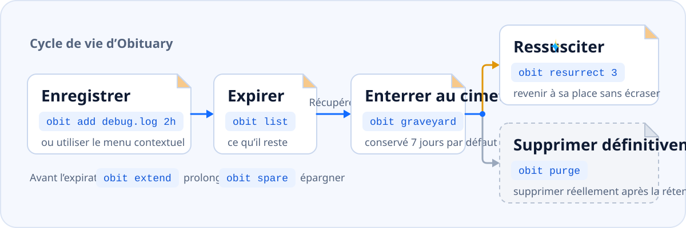

<p align="center"><a href="README.md">&nbsp;English</a> | <a href="README.zh-CN.md">&nbsp;简体中文</a> | <a href="README.zh-TW.md">&nbsp;繁體中文</a> | <a href="README.ja.md">&nbsp;日本語</a> | <a href="README.ko.md">&nbsp;한국어</a> | <a href="README.es.md">&nbsp;Español</a> | <a href="README.fr.md">&nbsp;Français</a> | <a href="README.de.md">&nbsp;Deutsch</a> | <a href="README.pt-BR.md">&nbsp;Português (Brasil)</a> | <a href="README.ru.md">&nbsp;Русский</a></p>
<div align="center">
  <h1>
    <picture>
      <source media="(prefers-color-scheme: dark)" srcset="docs/assets/brand/obituary-horizontal-dark.png">
      <source media="(prefers-color-scheme: light)" srcset="docs/assets/brand/obituary-horizontal-light.png">
      
    </picture>
  </h1>
  <p>
    <strong>Obituary — la corbeille des agents IA</strong><br>
    Ce que votre IA laisse derrière elle disparaît à l’expiration ; ce que votre IA supprime revient pendant sept jours.
  </p>
    <p>
    <a href="#pourquoi-obituary">Pourquoi Obituary</a> ·
    <a href="#installation">Installation</a> ·
    <a href="#démarrage-rapide">Démarrage rapide</a> ·
    <a href="docs/usage.en.md">Guide utilisateur</a> ·
    <a href="docs/README.md">Documentation</a>
  </p>
</div>

<p align="center">
  <picture>
    <source media="(prefers-color-scheme: dark)" srcset="docs/assets/demo/demo-en-dark.gif">
    <source media="(prefers-color-scheme: light)" srcset="docs/assets/demo/demo-en-light.gif">
    
  </picture>
</p>

<p align="center">
  <picture>
    <source media="(prefers-color-scheme: dark)" srcset="docs/assets/readme/i18n/fr/lifecycle-dark.svg">
    <source media="(prefers-color-scheme: light)" srcset="docs/assets/readme/i18n/fr/lifecycle-light.svg">
    
  </picture>
</p>

Obituary est la corbeille des agents IA : l’agent et vous décidez de ce qui y entre. Un agent donne une durée de vie aux scripts de débogage, journaux et captures qu’il écrit, et vous ajoutez vos propres fichiers depuis le menu contextuel ; tout ce qui entre est enterré à l’expiration et peut être restauré tel quel pendant sept jours. Personne n’a besoin de se souvenir du nettoyage et le `rm -rf` d’un agent ne détruit plus rien définitivement. Fonctionnement interne dans [docs/architecture.md](docs/architecture.md) (en chinois).

## Pourquoi Obituary

Obituary est né parce que les agents nous y ont poussés. Dès que la version 0.0.1 a fonctionné, nous l’avons installée sur nos propres machines, et chaque version suivante a été écrite par des agents dans les dépôts qu’il surveillait.

- **Les agents créent du désordre plus vite que les humains ne le nettoient.** Alterner entre Claude Code, Codex, DeepSeek et WorkBuddy remplit vite un projet de scripts de débogage, journaux, captures et `test-results/`. Personne ne sait ce qui sert encore, donc personne n’ose supprimer. Obituary laisse décider celui qui sait : l’agent connaît ses scripts et journaux et leur donne une durée avec `obit mark` ; vous ajoutez vos fichiers depuis le menu contextuel. À l’échéance, ils sont enterrés et personne n’a à se rappeler de nettoyer.
- **Vous ne savez pas si c’est encore nécessaire ? Enterrez-le.** `obit bury` le déplace au cimetière, où il reste restaurable tel quel pendant sept jours avant sa suppression réelle. Si un agent le recherche pendant ces sept jours, Obituary lui indique immédiatement le cimetière et son numéro ; `obit resurrect` le remet en place. Le reste du temps, il ne gêne pas le travail.
- **Peur d’un seul `rm -rf`.** Les agents qui effacent un dossier personnel ou un disque entier ne sont plus un scénario théorique. Avec le garde de suppression, `rm -rf`, `git clean` et `Remove-Item` sont bloqués et remplacés par la commande `obit` équivalente : les éléments vont au cimetière au lieu de disparaître. Les détours comme `find -delete` et `xargs rm` sont également bloqués.
- **Peur que la commande change en chemin.** Entre la commande voulue par l’agent et celle qui s’exécute se trouvent les guillemets et échappements du shell, parfois un proxy qui réécrit les commandes. Un caractère perdu transforme `rm -rf "$OUT"/` en `rm -rf /`. Obituary vérifie donc le vrai chemin avant que `obit rm` agisse, refuse les racines de disque, les dossiers système et le profil utilisateur, puis enterre le reste de façon restaurable. Sous Windows, Codex passe par un autre shell : les suppressions dans des backticks ou substitutions shell sont aussi bloquées.

## Ce que fait Obituary

- **Donner une durée de vie aux fichiers et dossiers.** `obit add debug.log 2h` l’enterre à l’échéance. Choisissez une date avec `--at`, prolongez avec `extend` ou épargnez-le avec `spare`.
- **L’agent décide de ce qui entre.** `obit init` ajoute Obituary aux instructions de l’agent(`OBIT.md`, Agent Skill et MCP sont facultatifs). L’agent donne une durée avec `obit mark` à ses scripts, journaux et captures, prend un espace temporaire avec `obit mktemp`, enterre ce qui est incertain avec `obit bury` et enregistre les fichiers `*.bak` laissés pendant l’édition.
- **Vous pouvez ajouter vos fichiers.** Sous Windows, cliquez droit sur des fichiers ou dossiers dans l’Explorateur, choisissez « Add to Obituary » puis 1, 7 ou 30 jours, ou « Bury now (recoverable) » ; vous pouvez aussi appliquer une politique à un dossier comme Downloads.
- **Enregistrement automatique à la demande.** Désactivé par défaut, il n’ajoute rien seul. Activé dans Settings, il enregistre selon des règles(`.playwright-mcp/`, `test-results/`, `*.log`, `*.bak`, `*.orig`, `*~`) et les écritures vues par les hooks. Trois modes existent : gradué, totalement automatique ou demander pour tout. Les dépendances, sorties de build et caches ne sont jamais enregistrés automatiquement, et les fichiers suivis par Git ne sont jamais touchés.
- **Rangement de fin de session.** Avant l’arrêt d’un agent, Obituary liste les fichiers créés pendant la session et encore non classés, puis lui demande de donner une durée ou d’enterrer scripts, journaux et captures en conservant les livrables. Une fois au plus par session.
- **Tout ce qu’un agent supprime peut revenir.** Avec le garde activé, `rm -rf`, `git clean` et autres commandes sont bloqués et l’agent reçoit la commande `obit` équivalente. En l’utilisant, les éléments vont au cimetière.
- **Enterrer d’abord, supprimer ensuite.** Le cimetière conserve tout sept jours par défaut ; `obit resurrect` remet l’élément à sa place sans jamais écraser ce qui s’y trouve.
- **Suivi par identité, pas par nom.** Chaque entrée conserve le numéro de série du volume et l’ID de fichier 128 bits : un fichier renommé ou déplacé reste identifiable, tandis qu’un autre fichier arrivé à l’ancien chemin est laissé intact.
- **Claude Code et Codex.** `obit init` enregistre les hooks et un Agent Skill ; le serveur MCP est facultatif et `--uninstall` ne retire que ce qu’Obituary a ajouté.
- **Dans la barre système, comme Everything (Windows).** `obit init` démarre une icône à la connexion. Le menu affiche les enterrements récents, permet de ressusciter un fichier, de suspendre le nettoyage automatique et d’ouvrir la petite fenêtre Obituary. Le Planificateur de tâches Windows reste une solution de secours.
- **Une petite fenêtre (Windows / Ubuntu 24.04 amd64).** Upcoming, Graveyard, Decisions, Settings et Logs permettent de restaurer des fichiers, approuver des propositions et modifier les réglages sans ligne de commande(`obit-gui.exe` ou « Open Obituary »). Chinois et anglais, huit apparences. Sur Ubuntu, ouvrez Obituary depuis le menu des applications.
- **Menu contextuel et dates dans l’Explorateur (Windows).** Clic droit → « Add to Obituary » → 1, 7 ou 30 jours, ou « Bury now (recoverable) ». Sous Windows 11, l’option est dans « Show more options ». Les éléments suivis affichent « name (11-13 burial) » sans changer le vrai nom.
- **Conteneurs Docker.** `obit docker add <container> 3d` donne une durée au conteneur ; à l’échéance, `docker stop` l’arrête(`obit resurrect` le redémarre), puis `docker rm` ne le supprime qu’après rétention. Volumes et images ne sont jamais touchés. Les conteneurs démarrés par une session d’agent pour le projet sont aussi enregistrés si l’automatisation est activée.
- **Politiques de dossiers.** `obit watch Downloads 2w` enterre chaque fichier arrivé deux semaines plus tard. Un sous-dossier expiré produit seulement une proposition et est enterré après approbation ; la politique elle-même doit aussi être approuvée.

## Installation

Windows 10 / 11, macOS et Linux(x64 et ARM64). Envoyez cette phrase à l’agent que vous utilisez : il installera Obituary, s’y connectera et s’arrêtera lorsque la décision vous revient.

```text
Read https://obituary.woodfish.site/agent-install.md and follow it to install Obituary and connect it to yourself.
```


<p align="center">
  <picture>
    <source media="(prefers-color-scheme: dark)" srcset="docs/assets/readme/agents/agents-dark.svg">
    <source media="(prefers-color-scheme: light)" srcset="docs/assets/readme/agents/agents-light.svg">
    
  </picture>
</p>

Chaque plateforme en bref :

| | Windows | macOS | Linux |
|---|---|---|---|
| Installation | Scoop, script `install.ps1`(winget en revue) | Homebrew, script `install.sh` | script `install.sh` |
| Vérification de l’expiration toutes les 5 minutes | processus résident dans la barre système, Planificateur des tâches en secours | agent launchd utilisateur | minuteur `systemd --user` ; crontab utilisateur sans systemd |
| CLI, cimetière et résurrection, enregistrement automatique optionnel, garde de suppression, intégration agent(hooks, Skill, MCP), conteneurs Docker, politiques de dossiers | oui | oui | oui |
| Barre système, petite fenêtre, menus contextuels, dates d’enterrement dans l’Explorateur, raccourcis du menu Démarrer et du bureau | oui | Petite fenêtre et icône de barre des menus macOS via DMG universel; pas encore de menu contextuel | Fenêtre et icône de notification sur Ubuntu 24.04 amd64 (deb) |
| Mode Corbeille | oui | cimetière uniquement | cimetière uniquement |

Pour installer manuellement, mettre à jour et désinstaller, consultez le [guide d’installation](docs/install.en.md).

## Changer de langue

Obituary prend actuellement en charge English et le chinois simplifié. La CLI, la zone de notification, la petite fenêtre et le menu de l’Explorateur partagent un même réglage.

- Changement temporaire : définissez OBIT_LANG=en ou OBIT_LANG=zh-CN avant une commande.
- Enregistrer le réglage : exécutez obit config --language en, obit config --language zh-CN ou obit config --language auto.
- Choix automatique : supprimez OBIT_LANG et laissez ui.language = auto ; Obituary vérifie la configuration, LC_ALL, LC_MESSAGES, LANG puis la langue de l’interface du système.
- Traduit dans cette phase : sorties et aides de list, bury et resurrect, ainsi que le texte de la zone de notification et des menus natifs Windows. Le protocole Hook et MCP reste en anglais et stable.

## Démarrage rapide

Commandes courantes(remplacez `<id>` par le numéro du reçu de `obit add` ou `obit bury`, ou par celui affiché par `obit list` / `obit graveyard`) :

```powershell
obit add debug.log 2h                       # bury it in 2 hours (alias: mark)
obit add output\shots 1d12h                 # folders work too
obit add report.zip --at "2026-12-01 18:00" # at a given moment
obit list                                   # what is left and for how long
obit extend <id> 1d                         # one more day
obit spare <id>                             # stop tracking, keep the file (alias: cancel)
obit reap                                   # bury everything that is due now (alias: sweep; --dry-run previews)
obit bury old-build                         # bury right away
obit graveyard                              # what is in the graveyard and when it will be purged (--here: this folder only)
obit resurrect <id>                         # put it back; if the name is taken, it comes back renamed, never overwriting
obit resurrect --last                       # undo the last deletion: everything one obit bury / obit rm buried comes back
obit purge                                  # purge what is past retention (--all for everything, after confirming; --dry-run previews)
obit purge <id>                             # purge this grave now (permanent; asks first, --yes outside a terminal); also abandons an unverifiable interrupted resurrect
obit stats                                  # eulogy: how much was buried, space freed, resurrections (alias: eulogy)
obit log                                    # the full record of everything done
```

Le fonctionnement en arrière-plan, la connexion de chaque agent, le garde de suppression, MCP et Skill sont détaillés dans le [guide utilisateur](docs/usage.en.md).

## Documentation

- [Guide utilisateur](docs/usage.en.md) : toutes les fonctions en détail
- [Guide d’installation](docs/install.en.md) : installation manuelle, mise à jour et désinstallation
- [Couverture des agents](docs/agents.md) : jusqu’où chacun des 30 agents se connecte
- [Index des documents](docs/README.md) : tous les documents, dont l’architecture et les règles de code
- [Politique de signature du code](https://obituary.woodfish.site/docs/en/code-signing) : signature gratuite par [SignPath.io](https://about.signpath.io/), certificat par [SignPath Foundation](https://signpath.org/)
- [Politique de confidentialité](https://obituary.woodfish.site/docs/en/privacy)

## Construisons Obituary ensemble

Les issues et pull requests sont les bienvenues. Le plus utile est une issue accompagnée de sa correction : trouvez le problème, corrigez-le et votre avatar apparaîtra ici après fusion. [CONTRIBUTING.md](CONTRIBUTING.md) explique comment commencer ; signalez en privé tout problème susceptible de supprimer le mauvais fichier, comme indiqué dans [SECURITY.md](SECURITY.md).

<a href="https://github.com/woodfishhhh/obituary/graphs/contributors"></a>

Les utilisateurs sinophones discutent aussi dans le groupe QQ **1135603207** et la communauté [LINUX DO](https://linux.do).

<p>
  <a href="https://star-history.com/#woodfishhhh/obituary&Date">
    <picture>
      <source media="(prefers-color-scheme: dark)" srcset="https://api.star-history.com/svg?repos=woodfishhhh/obituary&type=Date&theme=dark">
      
    </picture>
  </a>
</p>

## Licence

[MIT](LICENSE)
