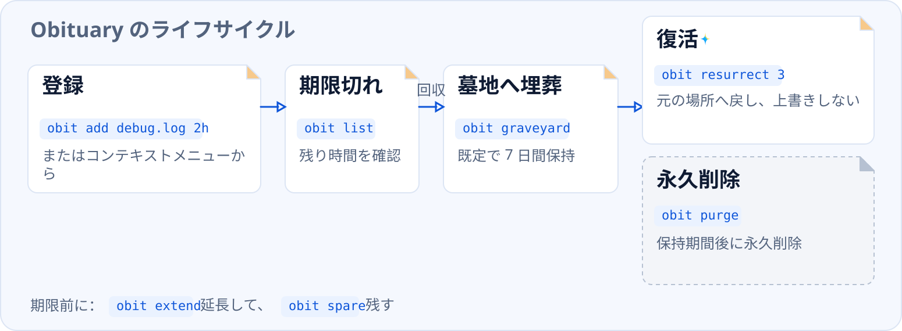

<p align="center"><a href="README.md">&nbsp;English</a> | <a href="README.zh-CN.md">&nbsp;简体中文</a> | <a href="README.zh-TW.md">&nbsp;繁體中文</a> | <a href="README.ja.md">&nbsp;日本語</a> | <a href="README.ko.md">&nbsp;한국어</a> | <a href="README.es.md">&nbsp;Español</a> | <a href="README.fr.md">&nbsp;Français</a> | <a href="README.de.md">&nbsp;Deutsch</a> | <a href="README.pt-BR.md">&nbsp;Português (Brasil)</a> | <a href="README.ru.md">&nbsp;Русский</a></p>
<div align="center">
  <h1>
    <picture>
      <source media="(prefers-color-scheme: dark)" srcset="docs/assets/brand/obituary-horizontal-dark.png">
      <source media="(prefers-color-scheme: light)" srcset="docs/assets/brand/obituary-horizontal-light.png">
      
    </picture>
  </h1>
  <p>
    <strong>Obituary — AI エージェントのごみ箱</strong><br>
    AI が残したものは期限が来ると自動で片づき、AI が削除したものは 7 日間取り戻せます。
  </p>
    <p>
    <a href="#なぜ-obituary-なのか">なぜ Obituary なのか</a> ·
    <a href="#インストール">インストール</a> ·
    <a href="#クイックスタート">クイックスタート</a> ·
    <a href="docs/usage.en.md">ユーザーガイド</a> ·
    <a href="docs/README.md">ドキュメント</a>
  </p>
</div>

<p align="center">
  <picture>
    <source media="(prefers-color-scheme: dark)" srcset="docs/assets/demo/demo-en-dark.gif">
    <source media="(prefers-color-scheme: light)" srcset="docs/assets/demo/demo-en-light.gif">
    
  </picture>
</p>

<p align="center">
  <picture>
    <source media="(prefers-color-scheme: dark)" srcset="docs/assets/readme/i18n/ja/lifecycle-dark.svg">
    <source media="(prefers-color-scheme: light)" srcset="docs/assets/readme/i18n/ja/lifecycle-light.svg">
    
  </picture>
</p>

Obituary は AI エージェントのごみ箱です。何を入れるかはエージェントとあなたが決めます。エージェントは書き出すデバッグスクリプト、ログ、スクリーンショットに寿命を設定し、あなたは右クリックメニューから自分のファイルを追加できます。入ったものは期限になると埋葬され、7 日間は元の状態に戻せます。誰かが片づけを覚えておく必要はなく、エージェントの `rm -rf` が完全な破壊になることもありません。内部の仕組みは [docs/architecture.md](docs/architecture.md)（中国語）をご覧ください。

## なぜ Obituary なのか

Obituary はエージェントに必要とされて生まれました。バージョン 0.0.1 が動くようになった時点で自分たちのマシンに導入し、それ以降のすべてのバージョンを、監視対象のリポジトリでエージェントが書いてきました。

- **エージェントが散らかす速度は、人が片づける速度より速い。** Claude Code、Codex、DeepSeek、WorkBuddy を切り替えて使うと、プロジェクトにはデバッグスクリプト、ログ、スクリーンショット、`test-results/` がすぐに溜まります。何がまだ必要か分からないため、誰も削除できません。Obituary は最もよく知る人に判断を任せます。エージェントは自分が書いたデバッグスクリプトやログを知っているので、書くときに `obit mark` で寿命を設定できます。自分のファイルは右クリックメニューから追加できます。入ったものは期限になると埋葬され、片づけを覚えておく必要はありません。
- **まだ必要か分からない？ まず埋葬しましょう。** `obit bury` は墓地へ移し、7 日間は元の状態に戻せるようにします。エージェントがその間に必要とすると、Obituary はその場で墓地にあることと番号を伝え、`obit resurrect` で戻します。それ以外のときは邪魔をしません。エージェントは最初に一覧を読むことなく、Obituary があることだけを知って作業を始められます。
- **一度の `rm -rf` が怖い。** エージェントがホームディレクトリやドライブ全体を消す事故は、もう仮想の話ではありません。削除ガードを有効にすると、エージェントの `rm -rf`、`git clean`、`Remove-Item` は停止され、同等の `obit` コマンドに置き換えられます。ものは消えずに墓地へ送られます。`find -delete` や `xargs rm` のような迂回削除も停止されます。
- **コマンドが途中で変わるのが怖い。** エージェントが意図したコマンドと実行されるコマンドの間には、シェルの引用符やエスケープ、コマンドを書き換えるプロキシが入ることがあります。1 文字失われるだけで `rm -rf "$OUT"/` は `rm -rf /` になります。Obituary はコマンド文字列だけを信頼しません。`obit rm` が触れる前にディスク上の実際のパスを確認し、ドライブのルート、システムディレクトリ、ユーザープロファイル自体を拒否し、それ以外を復活できる形で埋葬します。Windows では Codex がコマンドを別のシェルへ渡すため引用符が失敗することがあり、バッククォートやシェル置換内の削除も引用符内にあって停止されます。

## できること

- **ファイルとフォルダーに寿命を設定する。** `obit add debug.log 2h` は時間になると埋葬します。`--at` で時刻を指定し、いつでも `extend` で延長したり `spare` で対象から外したりできます。
- **何を入れるかはエージェントが決める。** `obit init` はエージェントの指示に Obituary を追加します（`OBIT.md`、Agent Skill、MCP は任意）。エージェントは書いたデバッグスクリプト、ログ、スクリーンショットに `obit mark` で寿命を設定し、一時領域は `obit mktemp` から取り、迷うものは `obit bury` で埋葬し、編集時に残した `*.bak` ファイルも登録します。
- **自分のファイルも追加できる。** Windows ではエクスプローラーでファイルやフォルダーを右クリックし（複数選択も可）、「Add to Obituary」を選んで 1、7、30 日、または「Bury now (recoverable)」を指定できます。Downloads のようなフォルダーにポリシーを設定することもできます。
- **必要なときだけ自動登録。** 既定ではオフで、自動的には何も入りません。設定でオンにすると、ルール（`.playwright-mcp/`、`test-results/`、`*.log`、編集時に残る `*.bak`、`*.orig`、`*~` など）と hook が見た書き込みから登録します。モードは、段階式（このセッションでエージェントが作ったものは直接入り、以前からあるものは確認を待つ）、完全自動、すべて確認の 3 つです。依存関係、ビルド出力、キャッシュはどのモードでも自動登録されず、Git 管理中のファイルにも触れません。常駐プロセスは書き込み後に自動登録を処理するため、新しいファイルが `obit list` に表示されるまで少し時間がかかることがあります。
- **セッション終了時の整理。** エージェントが停止しようとすると、Obituary はこのセッションで作られ、まだ分類されていないファイルを一覧にして、成果物を残しながらデバッグスクリプト、ログ、スクリーンショットに寿命を設定するか埋葬するよう促します。各セッションで最大 1 回です。
- **エージェントが削除したものも戻せる。** 削除ガードが有効なら、エージェントの `rm -rf`、`git clean` などは停止され、同等の `obit` コマンドが伝えられます。それを使えばものは消えずに墓地へ入ります。
- **先に埋葬し、後で永久削除。** 墓地は既定で 7 日間すべてを保持します。`obit resurrect` は元の場所に戻し、現在そこにあるものを上書きしません。
- **名前ではなく ID で追跡。** 各記録はボリュームシリアル番号と 128 ビットのファイル ID を保持するため、名前変更や移動後も見つけられ、元のパスに別のファイルが来ても触りません。
- **Claude Code と Codex。** `obit init` は hook と Agent Skill を登録します。MCP サーバーは任意で、`--uninstall` は Obituary が追加したものだけを削除します。
- **Everything のように Windows のトレイに常駐。** `obit init` はログイン時にトレイアイコンを起動します。メニューから最近の埋葬を確認して復活し、自動整理を一時停止し、小さな Obituary ウィンドウを開けます。Windows のタスクスケジューラも予備として残ります。
- **小さなウィンドウ（Windows / Ubuntu 24.04 amd64）。** Expiring、Graveyard、For you、Settings、Logs から、コマンドラインを使わずにファイルを復活し、提案を承認し、設定を変更できます（`obit-gui.exe`、または「Open Obituary」）。中国語と英語、8 種類の見た目に対応します。 Ubuntu ではアプリ一覧から Obituary を開きます。
- **エクスプローラーのコンテキストメニューと日付（Windows）。** ファイルやフォルダーを右クリック（複数選択可）→「Add to Obituary」→ 1、7、30 日、または「Bury now (recoverable)」。Windows 11 では「Show more options」の中にあります。Downloads とデスクトップの追跡項目は「name (11-13 burial)」（簡体字中国語のインターフェースでは「name（11-13 下葬）」）と表示され、実際のファイル名は変わりません。
- **Docker コンテナ。** `obit docker add <container> 3d` はコンテナに寿命を設定します。期限になると `docker stop` で停止し（`obit resurrect` で再起動）、保持期間後に `docker rm` で削除します。自動登録を有効にすると、プロジェクト用にエージェントのセッションが起動したコンテナも登録され、後で伝えられます。
- `obit mark --docker-volume cache 3d`（`add` も可）で `cache` を3日後に埋葬できます。すぐに埋葬するには `obit bury --docker-volume -- cache` を実行します。ボリュームは自動登録されません。明示的に登録または埋葬したものだけが対象です。イメージやネットワークは削除しません。
- **フォルダーポリシー。** `obit watch Downloads 2w` は、そこに入ったすべてのファイルを 2 週間後に埋葬します。期限切れのサブフォルダーは提案だけを出し、承認後に埋葬されます。ポリシー自体にも承認が必要です。

## インストール

Windows 10 / 11、macOS、Linux（x64 と ARM64）に対応しています。次の文を使っているエージェントに送ると、Obituary をインストールして接続し、判断が必要な箇所で停止します。

```text
Read https://obituary.woodfish.site/agent-install.md and follow it to install Obituary and connect it to yourself.
```


<p align="center">
  <picture>
    <source media="(prefers-color-scheme: dark)" srcset="docs/assets/readme/agents/agents-dark.svg">
    <source media="(prefers-color-scheme: light)" srcset="docs/assets/readme/agents/agents-light.svg">
    
  </picture>
</p>

各プラットフォームの導入方法と機能：

| | Windows | macOS | Linux |
|---|---|---|---|
| インストール | Scoop、`install.ps1` スクリプト（winget は審査中） | Homebrew、`install.sh` スクリプト | `install.sh` スクリプト |
| 期限の確認 | 常駐トレイプロセス、予備としてタスクスケジューラ | ユーザー launchd エージェント | `systemd --user` タイマー、systemd がない場合はユーザー crontab |
| CLI、墓地と復活、任意の自動登録、削除ガード、エージェント連携（hook、Skill、MCP）、Docker コンテナ、フォルダーポリシー | あり | あり | あり |
| トレイ、小さなウィンドウ、コンテキストメニュー、エクスプローラーの埋葬日、スタートメニューとデスクトップショートカット | あり | macOS の universal DMG で小窓とメニューバーのトレイを利用可能 · Finder: クイックアクション, 日付タグ | Ubuntu 24.04 amd64 の deb でウィンドウとトレイを利用可能 · Nautilus: スクリプト · Dolphin: メニュー、日付タグ |
| ごみ箱モード | あり | 墓地のみ | あり |

デスクトップ版で監視が有効な場合、トレイの常駐プロセスが期限に合わせて処理し、独立したジョブが1時間ごとに取りこぼしを確認します。トレイのない版では従来どおり5分間隔です。

手動インストール、更新、アンインストールは[インストールガイド](docs/install.en.md)をご覧ください。

## 言語の切り替え

Obituary は現在、English と簡体字中国語をサポートしています。CLI、トレイ、小さなウィンドウ、エクスプローラーのメニューで同じ設定を使います。

- 一時的に切り替える：コマンドの前に OBIT_LANG=en または OBIT_LANG=zh-CN を設定します。
- 保存する：obit config --language en、obit config --language zh-CN、または obit config --language auto を実行します。
- 自動選択：OBIT_LANG を削除して ui.language = auto にすると、設定、LC_ALL、LC_MESSAGES、LANG、OS の UI 言語を順に確認します。
- この段階で翻訳済み：list、bury、resurrect の出力とヘルプ、Windows のトレイとネイティブメニュー。Hook と MCP のプロトコル文字列は英語で安定しています。

## クイックスタート

よく使うコマンド（`<id>` は `obit add` または `obit bury` の結果、あるいは `obit list` / `obit graveyard` に表示された番号に置き換えます）：

```powershell
obit add debug.log 2h                       # bury it in 2 hours (alias: mark)
obit add output\shots 1d12h                 # folders work too
obit add report.zip --at "2026-12-01 18:00" # at a given moment
obit list                                   # what is left and for how long
obit extend <id> 1d                         # one more day
obit spare <id>                             # stop tracking, keep the file (alias: cancel)
obit reap                                   # bury everything that is due now (alias: sweep; --dry-run previews)
obit bury old-build                         # bury right away
obit graveyard                              # what is in the graveyard and when it will be purged (--here: this folder only)
obit resurrect <id>                         # put it back; if the name is taken, it comes back renamed, never overwriting
obit resurrect --last                       # undo the last deletion: everything one obit bury / obit rm buried comes back
obit purge                                  # purge what is past retention (--all for everything, after confirming; --dry-run previews)
obit purge <id>                             # purge this grave now (permanent; asks first, --yes outside a terminal); also abandons an unverifiable interrupted resurrect
obit stats                                  # eulogy: how much was buried, space freed, resurrections (alias: eulogy)
obit log                                    # the full record of everything done
```

バックグラウンド実行、各エージェントへの接続、削除ガード、MCP、Skill の詳細は[ユーザーガイド](docs/usage.en.md)にあります。

## ドキュメント

- [ユーザーガイド](docs/usage.en.md)：すべての機能を詳しく説明
- [インストールガイド](docs/install.en.md)：手動インストール、更新、アンインストール
- [エージェント対応表](docs/agents.md)：30 個のエージェントがどこまで接続できるか
- [ドキュメント索引](docs/README.md)：アーキテクチャとコード規約を含む全ドキュメント
- [コード署名ポリシー](https://obituary.woodfish.site/docs/en/code-signing)：[SignPath.io](https://about.signpath.io/) による無料のコード署名、証明書は [SignPath Foundation](https://signpath.org/)
- [プライバシーポリシー](https://obituary.woodfish.site/docs/en/privacy)

## Obituary と一緒に作る

Issue と PR を歓迎します。最もありがたいのは修正付きの Issue です。問題を見つけ、修正し、取り込まれるとあなたのアバターがここに表示されます。始め方は [CONTRIBUTING.md](CONTRIBUTING.md) を、誤ったファイルを削除する可能性のある問題は [SECURITY.md](SECURITY.md) の説明に従って非公開で報告してください。

<a href="https://github.com/woodfishhhh/obituary/graphs/contributors"></a>

中国語を話すユーザーは QQ グループ **1135603207** と [LINUX DO](https://linux.do) コミュニティでも交流できます。

<p>
  <a href="https://star-history.com/#woodfishhhh/obituary&Date">
    <picture>
      <source media="(prefers-color-scheme: dark)" srcset="https://api.star-history.com/svg?repos=woodfishhhh/obituary&type=Date&theme=dark">
      
    </picture>
  </a>
</p>

## ライセンス

[MIT](LICENSE)
