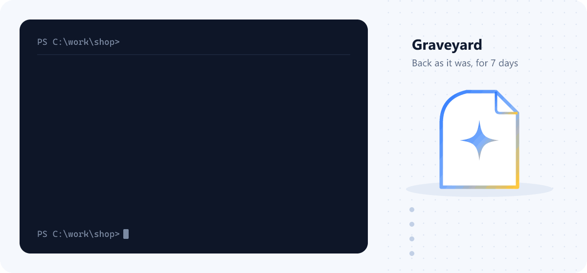
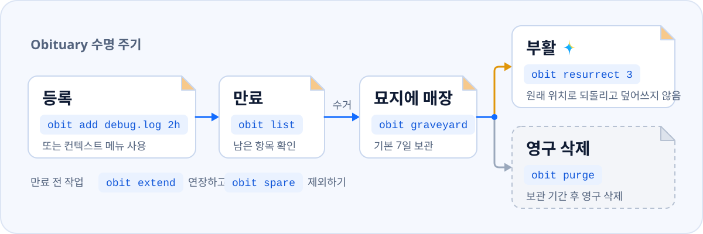

<p align="center"><a href="README.md">&nbsp;English</a> | <a href="README.zh-CN.md">&nbsp;简体中文</a> | <a href="README.zh-TW.md">&nbsp;繁體中文</a> | <a href="README.ja.md">&nbsp;日本語</a> | <a href="README.ko.md">&nbsp;한국어</a> | <a href="README.es.md">&nbsp;Español</a> | <a href="README.fr.md">&nbsp;Français</a> | <a href="README.de.md">&nbsp;Deutsch</a> | <a href="README.pt-BR.md">&nbsp;Português (Brasil)</a> | <a href="README.ru.md">&nbsp;Русский</a></p>
<div align="center">
  <h1>
    <picture>
      <source media="(prefers-color-scheme: dark)" srcset="docs/assets/brand/obituary-horizontal-dark.png">
      <source media="(prefers-color-scheme: light)" srcset="docs/assets/brand/obituary-horizontal-light.png">
      
    </picture>
  </h1>
  <p>
    <strong>Obituary — AI 에이전트를 위한 휴지통</strong><br>
    AI가 남긴 것은 수명이 끝나면 스스로 정리되고, AI가 삭제한 것은 7일 동안 되돌릴 수 있습니다.
  </p>
    <p>
    <a href="#obituary가-필요한-이유">Obituary가 필요한 이유</a> ·
    <a href="#설치">설치</a> ·
    <a href="#빠른-시작">빠른 시작</a> ·
    <a href="docs/usage.en.md">사용자 가이드</a> ·
    <a href="docs/README.md">문서</a>
  </p>
</div>

<p align="center">
  <picture>
    <source media="(prefers-color-scheme: dark)" srcset="docs/assets/demo/demo-en-dark.gif">
    <source media="(prefers-color-scheme: light)" srcset="docs/assets/demo/demo-en-light.gif">
    
  </picture>
</p>

<p align="center">
  <picture>
    <source media="(prefers-color-scheme: dark)" srcset="docs/assets/readme/i18n/ko/lifecycle-dark.svg">
    <source media="(prefers-color-scheme: light)" srcset="docs/assets/readme/i18n/ko/lifecycle-light.svg">
    
  </picture>
</p>

Obituary는 AI 에이전트를 위한 휴지통입니다. 무엇을 넣을지는 에이전트와 여러분이 결정합니다. 에이전트는 작성하는 디버그 스크립트, 로그, 스크린샷에 수명을 부여하고, 여러분은 오른쪽 클릭 메뉴에서 파일을 추가할 수 있습니다. 들어온 항목은 만료되면 매장되고 7일 동안 원래 상태로 복원할 수 있습니다. 정리를 기억할 필요가 없으며 에이전트의 `rm -rf`도 더 이상 영구적으로 파괴하지 않습니다. 내부 동작은 [docs/architecture.md](docs/architecture.md)(중국어)를 참고하세요.

## Obituary가 필요한 이유

Obituary는 에이전트가 필요해서 만들어졌습니다. 버전 0.0.1이 실행되자마자 우리 컴퓨터에 설치했고, 그 뒤의 모든 버전은 감시 중인 저장소에서 에이전트가 작성했습니다.

- **에이전트가 어지르는 속도는 사람이 치우는 속도보다 빠릅니다.** Claude Code, Codex, DeepSeek, WorkBuddy를 번갈아 사용하면 프로젝트에 디버그 스크립트, 로그, 스크린샷, `test-results/`가 빠르게 쌓입니다. 무엇이 아직 필요한지 알 수 없어 아무도 지우지 못합니다. Obituary는 가장 잘 아는 사람에게 판단을 맡깁니다. 에이전트는 자신이 만든 파일을 알고 있으므로 작성할 때 `obit mark`로 수명을 설정하고, 여러분은 오른쪽 클릭 메뉴에서 파일을 추가합니다. 들어온 항목은 만료되면 매장되므로 정리를 기억할 필요가 없습니다.
- **아직 필요한지 모르겠나요? 먼저 매장하세요.** `obit bury`는 항목을 묘지로 옮기고 7일 동안 원래 상태로 복원할 수 있게 합니다. 에이전트가 그 기간에 다시 필요로 하면 Obituary가 묘지와 번호를 즉시 알려 주고 `obit resurrect`가 되돌립니다. 그 밖에는 방해하지 않으므로 에이전트는 목록을 먼저 읽지 않고도 Obituary가 있다는 사실만 알고 작업을 시작합니다.
- **한 번의 `rm -rf`가 두렵습니다.** 에이전트가 홈 디렉터리나 전체 드라이브를 지우는 일은 더 이상 가상의 일이 아닙니다. 삭제 가드를 켜면 `rm -rf`, `git clean`, `Remove-Item`이 중지되고 동등한 `obit` 명령으로 바뀝니다. 항목은 사라지지 않고 묘지로 갑니다. `find -delete`와 `xargs rm` 같은 우회 삭제도 중지됩니다.
- **명령이 실행되기 전에 바뀔까 두렵습니다.** 에이전트가 의도한 명령과 실제 명령 사이에는 셸 인용, 이스케이프, 명령을 다시 쓰는 프록시가 있을 수 있습니다. 문자 하나를 잃으면 `rm -rf "$OUT"/`가 `rm -rf /`가 됩니다. 그래서 Obituary는 명령 문자열만 믿지 않습니다. `obit rm`이 동작하기 전에 디스크의 실제 경로를 확인하고 드라이브 루트, 시스템 디렉터리, 사용자 프로필 자체를 거부하며 나머지는 복원 가능한 방식으로 매장합니다. Windows에서 Codex는 다른 셸을 거치므로 인용부호 안의 백틱이나 셸 치환 속 삭제도 중지됩니다.

## 기능

- **파일과 폴더에 수명을 부여합니다.** `obit add debug.log 2h`는 시간이 되면 매장합니다. `--at`으로 시점을 지정하고, 언제든 `extend`로 연장하거나 `spare`로 추적을 멈출 수 있습니다.
- **무엇을 넣을지는 에이전트가 결정합니다.** `obit init`은 에이전트 지침에 Obituary를 추가합니다(`OBIT.md`, Agent Skill, MCP는 선택 사항). 에이전트는 `obit mark`로 작성한 디버그 스크립트, 로그, 스크린샷에 수명을 부여하고 `obit mktemp`로 임시 공간을 만들며, 확신이 없는 것은 `obit bury`로 매장하고 편집 중 남긴 `*.bak` 파일도 등록합니다.
- **여러분의 파일도 추가할 수 있습니다.** Windows에서 탐색기의 파일이나 폴더를 오른쪽 클릭하고(여러 개 선택 가능) “Add to Obituary”를 선택한 뒤 1일, 7일, 30일 또는 “Bury now (recoverable)”를 지정하세요. Downloads 같은 폴더에 정책을 설정할 수도 있습니다.
- **원할 때 자동 등록을 켭니다.** 기본값은 꺼짐이라 아무것도 자동으로 들어가지 않습니다. 설정에서 켜면 규칙(`.playwright-mcp/`, `test-results/`, `*.log`, 편집 중 남은 `*.bak`, `*.orig`, `*~` 등)과 hook이 본 쓰기를 등록합니다. 단계형, 완전 자동, 모든 항목 확인의 세 모드가 있습니다. 의존성, 빌드 출력, 캐시는 어떤 모드에서도 자동 등록하지 않으며 Git으로 추적되는 파일도 건드리지 않습니다.
- **세션 종료 정리.** 에이전트가 멈추려 하면 Obituary는 이번 세션에서 만들었지만 아직 분류하지 않은 파일을 보여 주고, 결과물은 남긴 채 디버그 스크립트, 로그, 스크린샷에 수명을 부여하거나 매장하도록 합니다. 세션당 최대 한 번입니다.
- **에이전트가 삭제한 것도 돌아옵니다.** 삭제 가드가 켜져 있으면 `rm -rf`, `git clean` 같은 명령이 중지되고 동등한 `obit` 명령이 안내됩니다. 그 명령을 사용하면 항목은 사라지지 않고 묘지로 갑니다.
- **먼저 매장하고 나중에 영구 삭제합니다.** 묘지는 기본 7일 동안 모든 항목을 보관합니다. `obit resurrect`는 원래 위치로 되돌리며 현재 그곳에 있는 항목을 덮어쓰지 않습니다.
- **이름이 아니라 파일 ID로 추적합니다.** 모든 기록에는 볼륨 일련 번호와 128비트 파일 ID가 저장되므로 이름을 바꾸거나 이동해도 찾을 수 있고, 원래 경로에 다른 파일이 생기면 건드리지 않습니다.
- **Claude Code와 Codex.** `obit init`은 hook과 Agent Skill을 등록합니다. MCP 서버는 선택 사항이며 `--uninstall`은 Obituary가 추가한 것만 제거합니다.
- **Windows에서 Everything처럼 트레이에 상주합니다.** `obit init`은 로그인할 때 트레이 아이콘을 시작합니다. 메뉴에서 최근 매장을 보고 복원하거나 자동 정리를 일시 중지하고 Obituary의 작은 창을 열 수 있습니다. Windows 작업 스케줄러는 예비 수단으로 남습니다.
- **작은 창(Windows / Ubuntu 24.04 amd64).** Upcoming, Graveyard, Decisions, Settings, Logs에서 명령줄 없이 파일을 복원하고 제안을 승인하며 설정을 바꿀 수 있습니다(`obit-gui.exe` 또는 트레이 메뉴의 “Open Obituary”). 중국어와 영어, 8가지 외관을 제공합니다. Ubuntu에서는 앱 목록에서 Obituary를 엽니다.
- **탐색기의 컨텍스트 메뉴와 날짜(Windows).** 파일이나 폴더를 오른쪽 클릭하고(여러 개 선택 가능) → “Add to Obituary” → 1일, 7일, 30일 또는 “Bury now (recoverable)”를 선택합니다. Windows 11에서는 “Show more options” 아래에 있습니다. Downloads와 Desktop의 추적 항목은 실제 파일명은 그대로 둔 채 “name (11-13 burial)”로 표시됩니다.
- **Docker 컨테이너.** `obit docker add <container> 3d`는 컨테이너에 수명을 부여합니다. 만료되면 `docker stop`으로 중지하고(`obit resurrect`로 다시 시작), 보관 기간이 지난 뒤에만 `docker rm`으로 제거합니다. 볼륨과 이미지는 건드리지 않습니다. 자동 등록을 켜면 프로젝트용 에이전트 세션이 시작한 컨테이너도 등록되고 나중에 알려 줍니다.
- **폴더 정책.** `obit watch Downloads 2w`는 그곳에 들어오는 모든 파일을 2주 뒤 매장합니다. 만료된 하위 폴더는 제안만 만들고 승인한 뒤 매장합니다. 정책 자체도 승인이 필요합니다.

## 설치

Windows 10 / 11, macOS, Linux(x64 및 ARM64)을 지원합니다. 다음 문장을 사용하는 에이전트에게 보내면 Obituary를 설치하고 연결하며, 결정이 필요한 곳에서 멈춥니다.

```text
Read https://obituary.woodfish.site/agent-install.md and follow it to install Obituary and connect it to yourself.
```


<p align="center">
  <picture>
    <source media="(prefers-color-scheme: dark)" srcset="docs/assets/readme/agents/agents-dark.svg">
    <source media="(prefers-color-scheme: light)" srcset="docs/assets/readme/agents/agents-light.svg">
    
  </picture>
</p>

각 플랫폼의 설치 방법과 기능:

| | Windows | macOS | Linux |
|---|---|---|---|
| 설치 방법 | Scoop, `install.ps1` 스크립트(winget 검토 중) | Homebrew, `install.sh` 스크립트 | `install.sh` 스크립트 |
| 5분마다 만료 확인 | 상주 트레이 프로세스, 작업 스케줄러를 예비로 사용 | 사용자 launchd 에이전트 | `systemd --user` 타이머; systemd가 없으면 사용자 crontab |
| CLI, 묘지와 부활, 선택적 자동 등록, 삭제 가드, 에이전트 통합(hook, Skill, MCP), Docker 컨테이너, 폴더 정책 | 있음 | 있음 | 있음 |
| 트레이, 작은 창, 컨텍스트 메뉴, 탐색기의 매장 날짜, 시작 메뉴와 바탕 화면 바로 가기 | 있음 | macOS universal DMG에서 작은 창과 메뉴 막대 트레이 지원, 컨텍스트 메뉴는 아직 없음 | Ubuntu 24.04 amd64용 deb에서 작은 창과 트레이 지원 |
| 휴지통 모드 | 있음 | 묘지만 사용 | 묘지만 사용 |

수동 설치, 업데이트, 제거는 [설치 가이드](docs/install.en.md)를 참고하세요.

## 언어 전환

Obituary는 현재 English와 간체 중국어를 지원합니다. CLI, 트레이, 작은 창, 파일 탐색기 메뉴가 하나의 설정을 공유합니다.

- 임시 전환: 명령을 실행하기 전에 OBIT_LANG=en 또는 OBIT_LANG=zh-CN을 설정합니다.
- 저장: obit config --language en, obit config --language zh-CN 또는 obit config --language auto를 실행합니다.
- 자동 선택: OBIT_LANG를 지우고 ui.language = auto로 두면 설정, LC_ALL, LC_MESSAGES, LANG, 운영체제 UI 언어를 차례로 확인합니다.
- 이번 단계에서 번역된 항목: list, bury, resurrect 출력과 도움말, Windows 트레이와 기본 메뉴 텍스트입니다. Hook과 MCP 프로토콜 텍스트는 영어로 안정적으로 유지됩니다.

## 빠른 시작

자주 쓰는 명령( `<id>`를 `obit add` 또는 `obit bury` 영수증의 번호, 혹은 `obit list` / `obit graveyard`에 표시된 번호로 바꾸세요):

```powershell
obit add debug.log 2h                       # bury it in 2 hours (alias: mark)
obit add output\shots 1d12h                 # folders work too
obit add report.zip --at "2026-12-01 18:00" # at a given moment
obit list                                   # what is left and for how long
obit extend <id> 1d                         # one more day
obit spare <id>                             # stop tracking, keep the file (alias: cancel)
obit reap                                   # bury everything that is due now (alias: sweep; --dry-run previews)
obit bury old-build                         # bury right away
obit graveyard                              # what is in the graveyard and when it will be purged (--here: this folder only)
obit resurrect <id>                         # put it back; if the name is taken, it comes back renamed, never overwriting
obit resurrect --last                       # undo the last deletion: everything one obit bury / obit rm buried comes back
obit purge                                  # purge what is past retention (--all for everything, after confirming; --dry-run previews)
obit purge <id>                             # purge this grave now (permanent; asks first, --yes outside a terminal); also abandons an unverifiable interrupted resurrect
obit stats                                  # eulogy: how much was buried, space freed, resurrections (alias: eulogy)
obit log                                    # the full record of everything done
```

백그라운드 실행, 각 에이전트 연결, 삭제 가드, MCP와 Skill의 자세한 사용법은 [사용자 가이드](docs/usage.en.md)에 있습니다.

## 문서

- [사용자 가이드](docs/usage.en.md): 모든 기능의 자세한 설명
- [설치 가이드](docs/install.en.md): 수동 설치, 업데이트, 제거
- [에이전트 지원표](docs/agents.md): 30개 에이전트가 어느 단계까지 연결되는지
- [문서 색인](docs/README.md): 아키텍처와 코드 규칙을 포함한 모든 문서
- [코드 서명 정책](https://obituary.woodfish.site/docs/en/code-signing): [SignPath.io](https://about.signpath.io/)가 무료 코드 서명을 제공하며 인증서는 [SignPath Foundation](https://signpath.org/)이 제공합니다
- [개인정보 보호정책](https://obituary.woodfish.site/docs/en/privacy)

## Obituary 함께 만들기

이슈와 PR을 환영합니다. 가장 좋은 이슈는 수정이 함께 오는 이슈입니다. 문제를 발견하고 고치면, 병합 후 여러분의 아바타가 여기에 표시됩니다. 시작 방법은 [CONTRIBUTING.md](CONTRIBUTING.md)에 있고, 잘못된 파일을 삭제할 수 있는 문제는 [SECURITY.md](SECURITY.md)의 안내에 따라 비공개로 신고해 주세요.

<a href="https://github.com/woodfishhhh/obituary/graphs/contributors"></a>

중국어 사용자는 QQ 그룹 **1135603207**과 [LINUX DO](https://linux.do) 커뮤니티에서도 대화할 수 있습니다.

<p>
  <a href="https://star-history.com/#woodfishhhh/obituary&Date">
    <picture>
      <source media="(prefers-color-scheme: dark)" srcset="https://api.star-history.com/svg?repos=woodfishhhh/obituary&type=Date&theme=dark">
      
    </picture>
  </a>
</p>

## 라이선스

[MIT](LICENSE)
