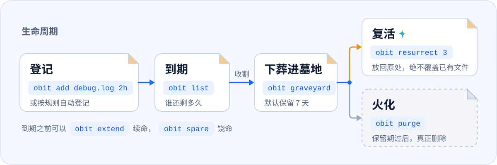

<div align="center">
  <h1>
    <picture>
      <source media="(prefers-color-scheme: dark)" srcset="docs/assets/brand/obituary-horizontal-dark.png">
      <source media="(prefers-color-scheme: light)" srcset="docs/assets/brand/obituary-horizontal-light.png">
      
    </picture>
  </h1>
  <p>
    <strong>讣告 · AI 的回收站</strong><br>
    AI 写下的垃圾到期自己走，AI 删掉的东西七天内都能找回。
  </p>
    <p>
    <a href="#为什么有讣告">为什么有讣告</a> ·
    <a href="#安装">安装</a> ·
    <a href="#快速上手">快速上手</a> ·
    <a href="docs/usage.md">使用手册</a> ·
    <a href="docs/README.md">文档</a>
  </p>
</div>

<p align="center">
  <picture>
    <source media="(prefers-color-scheme: dark)" srcset="docs/assets/readme/lifecycle-dark.svg">
    <source media="(prefers-color-scheme: light)" srcset="docs/assets/readme/lifecycle-light.svg">
    
  </picture>
</p>

<p align="center">
  <picture>
    <source media="(prefers-color-scheme: dark)" srcset="docs/assets/demo/demo-dark.gif">
    <source media="(prefers-color-scheme: light)" srcset="docs/assets/demo/demo-light.gif">
    
  </picture>
</p>

讣告是 AI 的回收站，为 AI agent 设计：agent 生成的调试脚本、日志、截图、测试产物，从生成那一刻起就带着寿命，用不着它「记得清理」，也不会被 `rm -rf` 误删。内部怎么运作见 [docs/architecture.md](docs/architecture.md)。

## 为什么有讣告

讣告是被 agent 逼出来的。版本 0.0.1 一能跑，我们就装在自己的机器上，之后的每个版本都是 agent 在它看着的仓库里写出来的。

- **agent 产垃圾的速度，比人清理的速度快。** Claude Code、Codex、DeepSeek、WorkBuddy 轮着用，项目里很快堆满调试脚本、日志、截图和 `test-results/`。哪些还有用，谁也说不清，所以谁都不敢删。讣告让规则认得的东西一生成就带上寿命；规则认不得的，会话结束后列成一份提议，你点头才登记。
- **拿不准有没有用？先下葬。** `obit bury` 把它挪进墓地，七天之内原样放得回来，过了保留期才真正删除。七天里 agent 要是又用到它，讣告会当场告诉它：这个东西在墓地里，编号多少，`obit resurrect` 一条命令放回原处。平时不打扰：agent 开工时只知道有讣告在，不用先读一遍清单。
- **怕 agent 一句 `rm -rf`。** agent 删光用户目录、删空整块盘，这样的事故已经有人贴出来过不止一次。打开删除护栏后，agent 的 `rm -rf`、`git clean`、`Remove-Item` 会被拦下，换成等价的 `obit` 命令：东西进墓地，不会消失。
- **怕命令在路上变了样。** agent 想的命令和真正执行的命令之间，隔着 shell 的引号和转义，还可能隔着一层改写命令的代理。一个符号被吃掉，`rm -rf "$OUT"/` 就成了 `rm -rf /`。所以讣告不只看命令文本：`obit rm` 动手前按磁盘上的真实路径再核对一遍，盘符根、系统目录、用户目录本身一律拒绝，其余的都是可以复活的下葬。

## 它能做什么

- **给文件和文件夹设寿命**：`obit add debug.log 2h`，寿命一到就下葬进墓地；也可以指定时刻（`--at`），随时续命（`extend`）或饶它一命（`spare`）。
- **按规则自动登记 agent 产物**：内置规则覆盖 `.playwright-mcp/`、`test-results/`、`__pycache__/`、`*.log` 等。只登记 Git 工作区里、没有被 Git 跟踪的东西；第一次先生成提议，等你同意。
- **agent 删掉的东西都能复活**：开启删除护栏后，agent 的 `rm -rf`、`git clean` 这类删除命令会被拦下，讣告告诉它一条等价的 `obit` 命令；改用之后，东西进墓地而不是消失。
- **先下葬，再火化**：墓地默认保留 7 天，期间随时 `obit resurrect` 放回原处，绝不覆盖已有文件。
- **认文件，不认文件名**：每条记录都存着卷序列号和 128 位文件 ID，文件改名或移动了照样找得到；原路径上换成了别的文件，就不碰它。
- **接入 Claude Code 和 Codex**：`obit init` 注册 hook 和 Agent Skill，MCP 服务可选；`--uninstall` 只删讣告加的东西。
- **托盘常驻，像 Everything**：`obit init` 让托盘图标随登录启动，菜单里能看最近下葬的、点一下复活、暂停自动清理、打开讣告的小窗口；Windows 任务计划留作兜底。
- **一个小窗口**：即将下葬、即将火化（墓地）、待你决定、设置、日志五页，不会用命令行也能复活文件、批准提议、改设置（`obit-gui.exe`，托盘菜单「打开讣告」）。
- **右键菜单和资源管理器里的日期**：在资源管理器里右键给文件设寿命；下载、桌面里被跟踪的东西显示成「名字（11-13 下葬）」，真实文件名不变。
- **Docker 容器**：agent 会话里新起的容器，会话结束后列成提议，你批准才登记；到期先 `docker stop`（`obit resurrect` 就是重新启动），保留期过后才 `docker rm`。卷和镜像一律不碰。也可以 `obit docker add <容器> 3d` 手动登记。
- **文件夹策略**：`obit watch 下载目录 2w`，放进来的文件各自两周后进墓地；子文件夹到期时只生成提议，等你批准才下葬（策略本身也要你批准）。

## 安装

支持 Windows 10 / 11、macOS 和 Linux（x64 和 ARM64）。把这句话发给你正在用的 agent，它会装好讣告、接到自己身上，要你拍板的地方会停下来问你：

```text
读 https://obituary.woodfish.site/agent-install.md ，照里面的步骤帮我安装讣告并接入你自己。
```


<p align="center">
  <picture>
    <source media="(prefers-color-scheme: dark)" srcset="docs/assets/readme/agents/agents-dark.svg">
    <source media="(prefers-color-scheme: light)" srcset="docs/assets/readme/agents/agents-light.svg">
    
  </picture>
</p>

自己装、更新和卸载见[安装文档](docs/install.md)。

## 快速上手

常用命令（`<编号>` 换成 `obit add`、`obit bury` 回执里或 `obit list`、`obit graveyard` 列出的编号）：

```powershell
obit add debug.log 2h                       # 2 小时后收走（别名 mark）
obit add output\shots 1d12h                 # 文件夹也可以
obit add report.zip --at "2026-12-01 18:00" # 指定时刻
obit list                                   # 谁还剩多久
obit extend <编号> 1d                       # 续命 1 天
obit spare <编号>                           # 饶它一命：不再跟踪，文件保留（同 cancel）
obit reap                                   # 现在就把已到期的下葬（同 sweep，--dry-run 只预览）
obit bury old-build                         # 立刻下葬
obit graveyard                              # 墓地里有什么、还剩几天被火化（--here 只看当前目录下的）
obit resurrect <编号>                       # 复活：放回原处；原处已有同名的，改名放回，绝不覆盖
obit resurrect --last                       # 撤销上一次删除：一条 obit bury / obit rm 埋下的几项一起回来
obit purge                                  # 火化保留期已过的（--all 全部，先确认；--dry-run 预览）
obit purge <编号>                           # 立即火化这一座（永久删除，先确认；非终端要加 --yes）；也用来放弃一条无法核实的中断复活
obit stats                                  # 悼词：埋了多少、腾出多少空间、复活过几次（同 eulogy）
obit log                                    # 生平记录：做过的所有事
```

后台运行、接入各家 agent、删除护栏、MCP 和 Skill 的详细用法见[使用手册](docs/usage.md)。

## 文档

- [使用手册](docs/usage.md)：每项功能的详细用法
- [安装文档](docs/install.md)：自己装、更新和卸载
- [agent 覆盖表](docs/agents.md)：30 家 agent 各自接到哪一步
- [文档索引](docs/README.md)：全部文档，包括架构和代码约定
- [代码签名政策](https://obituary.woodfish.site/docs/code-signing)：Free code signing provided by [SignPath.io](https://about.signpath.io/), certificate by [SignPath Foundation](https://signpath.org/)
- [隐私政策](https://obituary.woodfish.site/docs/privacy)：讣告联网只做一件事，每天最多一次检查新版本，可以关掉

## 一起做讣告

欢迎提 issue 和 PR。最欢迎的是带着修复来的 issue：发现问题，顺手修好，合进去之后你的头像就会出现在这里。怎么开始见 [CONTRIBUTING.md](CONTRIBUTING.md)；可能误删文件的问题请按 [SECURITY.md](SECURITY.md) 私下报告。

<a href="https://github.com/woodfishhhh/obituary/graphs/contributors"></a>

用着有问题、有想法，也可以来 QQ 用户群聊：**1135603207**，或者到 [LINUX DO](https://linux.do) 社区找我们。


<p>
  <a href="https://star-history.com/#woodfishhhh/obituary&Date">
    <picture>
      <source media="(prefers-color-scheme: dark)" srcset="https://api.star-history.com/svg?repos=woodfishhhh/obituary&type=Date&theme=dark">
      
    </picture>
  </a>
</p>

## 许可证

[MIT](LICENSE)
