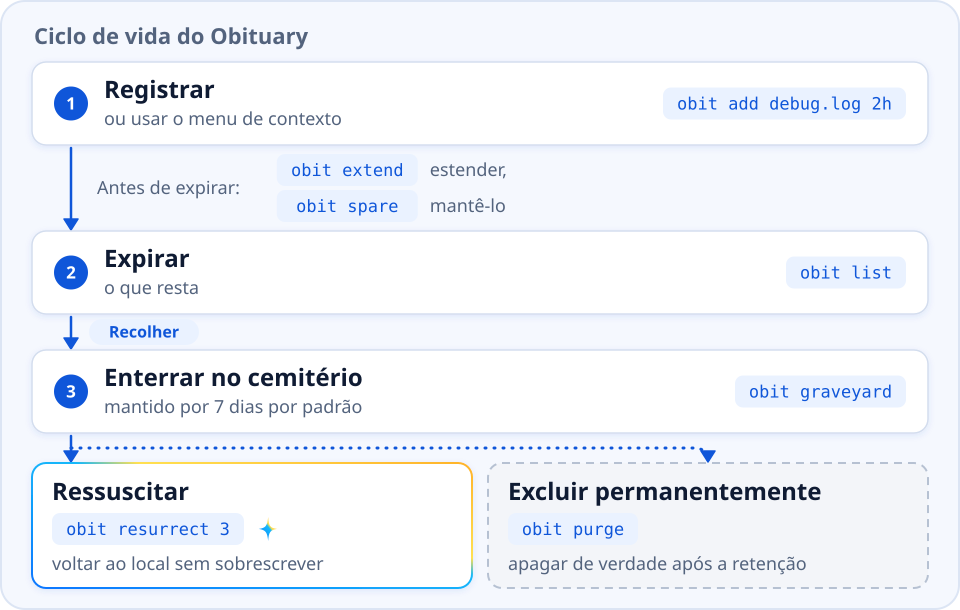

<p align="center"><a href="README.md">&nbsp;English</a> | <a href="README.zh-CN.md">&nbsp;简体中文</a> | <a href="README.zh-TW.md">&nbsp;繁體中文</a> | <a href="README.ja.md">&nbsp;日本語</a> | <a href="README.ko.md">&nbsp;한국어</a> | <a href="README.es.md">&nbsp;Español</a> | <a href="README.fr.md">&nbsp;Français</a> | <a href="README.de.md">&nbsp;Deutsch</a> | <a href="README.pt-BR.md">&nbsp;Português (Brasil)</a> | <a href="README.ru.md">&nbsp;Русский</a></p>
<div align="center">
  <h1>
    <picture>
      <source media="(prefers-color-scheme: dark)" srcset="docs/assets/brand/obituary-horizontal-dark.png">
      <source media="(prefers-color-scheme: light)" srcset="docs/assets/brand/obituary-horizontal-light.png">
      
    </picture>
  </h1>
  <p>
    <strong>Obituary — a lixeira para agentes de IA</strong><br>
    O que sua IA deixa para trás desaparece quando expira; o que sua IA apaga volta por sete dias.
  </p>
    <p>
    <a href="#por-que-obituary">Por que Obituary</a> ·
    <a href="#instalação">Instalação</a> ·
    <a href="#início-rápido">Início rápido</a> ·
    <a href="docs/usage.en.md">Guia do usuário</a> ·
    <a href="docs/README.md">Documentação</a>
  </p>
</div>

<p align="center">
  <picture>
    <source media="(prefers-color-scheme: dark)" srcset="docs/assets/demo/demo-en-dark.gif">
    <source media="(prefers-color-scheme: light)" srcset="docs/assets/demo/demo-en-light.gif">
    
  </picture>
</p>

<p align="center">
  <picture>
    <source media="(prefers-color-scheme: dark)" srcset="docs/assets/readme/i18n/pt-BR/lifecycle-dark.svg">
    <source media="(prefers-color-scheme: light)" srcset="docs/assets/readme/i18n/pt-BR/lifecycle-light.svg">
    
  </picture>
</p>

Obituary é a lixeira para agentes de IA: o agente e você decidem o que entra. O agente dá uma vida útil aos scripts de depuração, logs e capturas que escreve, e você adiciona seus próprios arquivos pelo menu de contexto; tudo que entra é enterrado ao expirar e pode ser restaurado como estava por sete dias. Ninguém precisa lembrar de limpar, e o `rm -rf` de um agente não destrói mais nada para sempre. Veja o funcionamento interno em [docs/architecture.md](docs/architecture.md) (em chinês).

## Por que Obituary

Os agentes nos levaram a criar isso. Assim que a versão 0.0.1 funcionou, instalamos em nossas próprias máquinas, e todas as versões seguintes foram escritas por agentes nos repositórios que ele monitorava.

- **Agentes fazem sujeira mais rápido do que pessoas limpam.** Alternar entre Claude Code, Codex, DeepSeek e WorkBuddy logo enche um projeto de scripts de depuração, logs, capturas e `test-results/`. Ninguém sabe o que ainda importa, então ninguém ousa apagar. Obituary deixa a decisão com quem sabe melhor: o agente conhece seus scripts e logs e dá uma vida útil a eles com `obit mark`; você adiciona seus arquivos pelo menu de contexto. Quando entram, são enterrados no vencimento e ninguém precisa lembrar da limpeza.
- **Não sabe se ainda precisa? Enterre.** `obit bury` move o item para o cemitério, onde ele pode ser restaurado como estava por sete dias antes de ser realmente apagado. Se um agente precisar dele nesse período, Obituary avisa na hora que ele está no cemitério e informa seu número; `obit resurrect` o coloca de volta. No restante do tempo, fica fora do caminho.
- **Medo de um único `rm -rf`.** Agentes apagando uma pasta pessoal ou uma unidade inteira já não são uma hipótese. Com o guardião de exclusão ligado, `rm -rf`, `git clean` e `Remove-Item` são bloqueados e substituídos pelo comando `obit` equivalente. As coisas vão para o cemitério em vez de desaparecer. Desvios como `find -delete` e `xargs rm` também são bloqueados.
- **Medo de o comando mudar no caminho.** Entre o comando pretendido pelo agente e o que roda ficam aspas e escapes do shell e, às vezes, um proxy que reescreve comandos. Um caractere perdido transforma `rm -rf "$OUT"/` em `rm -rf /`. Obituary verifica o caminho real antes de `obit rm` agir, recusa raízes de unidade, diretórios do sistema e o próprio perfil do usuário, e enterra todo o resto de forma restaurável. No Windows, o Codex passa por outro shell, então exclusões dentro de backticks ou substituições do shell também são bloqueadas.

## O que ele faz

- **Dê uma vida útil a arquivos e pastas.** `obit add debug.log 2h` enterra o item quando o tempo acaba. Use `--at` para escolher o momento, `extend` para prolongar ou `spare` para poupá-lo.
- **O agente decide o que entra.** `obit init` adiciona Obituary às instruções do agente(`OBIT.md`, Agent Skill e MCP são opcionais). O agente usa `obit mark` para dar vida útil a scripts, logs e capturas, usa `obit mktemp` para espaço temporário, `obit bury` para o que não tem certeza e registra arquivos `*.bak` deixados durante a edição.
- **Você pode adicionar os seus.** No Windows, clique com o botão direito em arquivos ou pastas no Explorer, escolha “Add to Obituary” e selecione 1, 7 ou 30 dias, ou “Bury now (recoverable)”; também é possível definir uma política para uma pasta como Downloads.
- **Registro automático quando você quiser.** Desligado por padrão, nada entra sozinho. Ao ligar em Settings, registra por regras(`.playwright-mcp/`, `test-results/`, `*.log`, `*.bak`, `*.orig` e `*~`) e pelas escritas vistas pelos hooks. Há modos graduado, totalmente automático e perguntar tudo. Dependências, saídas de build e caches nunca são registrados automaticamente, e arquivos rastreados pelo Git nunca são tocados.
- **Organização no fim da sessão.** Quando um agente está prestes a parar, Obituary lista os arquivos criados naquela sessão que ainda não foram classificados e pede que ele dê uma vida útil ou enterre scripts, logs e capturas, mantendo os entregáveis. No máximo uma vez por sessão.
- **Tudo que um agente apaga pode voltar.** Com o guardião ligado, `rm -rf`, `git clean` e comandos parecidos são bloqueados e o agente recebe o `obit` equivalente. Ao usá-lo, os itens vão para o cemitério.
- **Enterre primeiro, exclua depois.** O cemitério mantém tudo por sete dias por padrão; `obit resurrect` devolve ao local original sem sobrescrever o que estiver lá.
- **Arquivos são rastreados por identidade, não por nome.** Cada registro guarda o número de série do volume e o ID de arquivo de 128 bits, então arquivos renomeados ou movidos continuam sendo encontrados; outro arquivo no caminho antigo permanece intacto.
- **Claude Code e Codex.** `obit init` registra hooks e um Agent Skill; o servidor MCP é opcional e `--uninstall` remove apenas o que Obituary adicionou.
- **Fica na bandeja, como o Everything (Windows).** `obit init` inicia um ícone ao entrar. O menu mostra enterros recentes, permite ressuscitar, pausar a limpeza automática e abrir a janela do Obituary. O Agendador de Tarefas do Windows fica como alternativa.
- **Uma janela pequena (Windows / Ubuntu 24.04 amd64).** Expiring, Graveyard, For you, Settings e Logs permitem ressuscitar arquivos, aprovar propostas e mudar configurações sem a linha de comando(`obit-gui.exe` ou “Open Obituary”). Chinês e inglês, oito aparências. No Ubuntu, abra o Obituary pelo menu de aplicativos.
- **Menu de contexto e datas no Explorer (Windows).** Clique com o botão direito → “Add to Obituary” → 1, 7 ou 30 dias, ou “Bury now (recoverable)”. No Windows 11 fica em “Show more options”. Itens rastreados em Downloads e Desktop aparecem como “name (11-13 burial)” (ou “name（11-13 下葬）” com a interface em chinês simplificado) sem mudar o nome real.
- **Contêineres Docker.** `obit docker add <container> 3d` dá uma vida útil ao contêiner; ao expirar, `docker stop` o para(`obit resurrect` o inicia novamente) e `docker rm` só o remove depois da retenção. Com o registro automático, contêineres iniciados por uma sessão do agente para o projeto também são registrados.
- Use `obit mark --docker-volume cache 3d` (ou `add`) para enterrar `cache` em três dias, ou `obit bury --docker-volume -- cache` para enterrá-lo agora. Volumes nunca são registrados automaticamente. O Obituary só trata os que você registra ou enterra explicitamente e não exclui imagens nem redes.
- **Políticas de pastas.** `obit watch Downloads 2w` enterra cada arquivo que chega ali duas semanas depois. Uma subpasta expirada apenas gera uma proposta e é enterrada após aprovação; a própria política também precisa de aprovação.

## Instalação

Windows 10 / 11, macOS e Linux(x64 e ARM64). Envie esta frase ao agente que você usa: ele instalará o Obituary, conectará a si mesmo e parará quando a decisão for sua.

```text
Read https://obituary.woodfish.site/agent-install.md and follow it to install Obituary and connect it to yourself.
```


<p align="center">
  <picture>
    <source media="(prefers-color-scheme: dark)" srcset="docs/assets/readme/agents/agents-dark.svg">
    <source media="(prefers-color-scheme: light)" srcset="docs/assets/readme/agents/agents-light.svg">
    
  </picture>
</p>

Cada plataforma de relance:

| | Windows | macOS | Linux |
|---|---|---|---|
| Instalação | Scoop, o script `install.ps1`(winget em análise) | Homebrew, o script `install.sh` | o script `install.sh` |
| Verificação de vencimentos | processo residente na bandeja, Agendador de Tarefas como alternativa | agente launchd do usuário | timer `systemd --user`; crontab do usuário sem systemd |
| CLI, cemitério e ressurreição, registro automático opcional, guardião de exclusão, integração com agentes(hooks, Skill, MCP), contêineres Docker, políticas de pastas | sim | sim | sim |
| Bandeja, janela pequena, menus de contexto, datas de enterro no Explorer, atalhos do menu Iniciar e da área de trabalho | sim | Janela pequena e ícone da barra de menus no macOS por DMG universal · Finder: Ações Rápidas, Etiquetas de data | Janela e bandeja no Ubuntu 24.04 amd64 (deb) · Nautilus: Scripts · Dolphin: menu, Etiquetas de data |
| Modo Lixeira | sim | somente cemitério | sim |

Com a supervisão de desktop ativa, a bandeja trata os vencimentos e uma tarefa independente verifica pendências a cada hora. Edições sem bandeja continuam verificando a cada cinco minutos.

Para instalar manualmente, atualizar e desinstalar, consulte o [guia de instalação](docs/install.en.md).

## Trocar o idioma

Obituary oferece atualmente English e chinês simplificado. A CLI, a bandeja, a janela pequena e o menu do Explorer compartilham uma configuração.

- Troca temporária: defina OBIT_LANG=en ou OBIT_LANG=zh-CN antes de executar um comando.
- Salvar a opção: execute obit config --language en, obit config --language zh-CN ou obit config --language auto.
- Escolha automática: remova OBIT_LANG e mantenha ui.language = auto; o Obituary verifica a configuração, LC_ALL, LC_MESSAGES, LANG e o idioma da interface do sistema.
- Traduzido nesta fase: saída e ajuda de list, bury e resurrect, além dos textos da bandeja e dos menus nativos do Windows. O texto de protocolo do Hook e do MCP continua em inglês e estável.

## Início rápido

Comandos comuns(substitua `<id>` pelo número do recibo de `obit add` ou `obit bury`, ou pelo número mostrado por `obit list` / `obit graveyard`):

```powershell
obit add debug.log 2h                       # bury it in 2 hours (alias: mark)
obit add output\shots 1d12h                 # folders work too
obit add report.zip --at "2026-12-01 18:00" # at a given moment
obit list                                   # what is left and for how long
obit extend <id> 1d                         # one more day
obit spare <id>                             # stop tracking, keep the file (alias: cancel)
obit reap                                   # bury everything that is due now (alias: sweep; --dry-run previews)
obit bury old-build                         # bury right away
obit graveyard                              # what is in the graveyard and when it will be purged (--here: this folder only)
obit resurrect <id>                         # put it back; if the name is taken, it comes back renamed, never overwriting
obit resurrect --last                       # undo the last deletion: everything one obit bury / obit rm buried comes back
obit purge                                  # purge what is past retention (--all for everything, after confirming; --dry-run previews)
obit purge <id>                             # purge this grave now (permanent; asks first, --yes outside a terminal); also abandons an unverifiable interrupted resurrect
obit stats                                  # eulogy: how much was buried, space freed, resurrections (alias: eulogy)
obit log                                    # the full record of everything done
```

Execução em segundo plano, conexão com cada agente, guardião de exclusão, MCP e Skill estão no [guia do usuário](docs/usage.en.md).

## Documentação

- [Guia do usuário](docs/usage.en.md): todos os recursos em detalhes
- [Guia de instalação](docs/install.en.md): instalação manual, atualização e desinstalação
- [Cobertura de agentes](docs/agents.md): até onde cada um dos 30 agentes se conecta
- [Índice de documentos](docs/README.md): todos os documentos, incluindo arquitetura e regras de código
- [Política de assinatura de código](https://obituary.woodfish.site/docs/en/code-signing): assinatura gratuita fornecida por [SignPath.io](https://about.signpath.io/), com certificado da [SignPath Foundation](https://signpath.org/)
- [Política de privacidade](https://obituary.woodfish.site/docs/en/privacy)

## Construa o Obituary conosco

Issues e pull requests são bem-vindos. O mais útil é um issue que já venha com a correção: você encontra o problema, corrige e, após o merge, seu avatar aparece aqui. [CONTRIBUTING.md](CONTRIBUTING.md) explica como começar; relate em privado qualquer problema que possa excluir o arquivo errado, conforme [SECURITY.md](SECURITY.md).

<a href="https://github.com/woodfishhhh/obituary/graphs/contributors"></a>

Usuários que falam chinês também conversam no grupo QQ **1135603207** e na comunidade [LINUX DO](https://linux.do).

<p>
  <a href="https://star-history.com/#woodfishhhh/obituary&Date">
    <picture>
      <source media="(prefers-color-scheme: dark)" srcset="https://api.star-history.com/svg?repos=woodfishhhh/obituary&type=Date&theme=dark">
      
    </picture>
  </a>
</p>

## Licença

[MIT](LICENSE)
