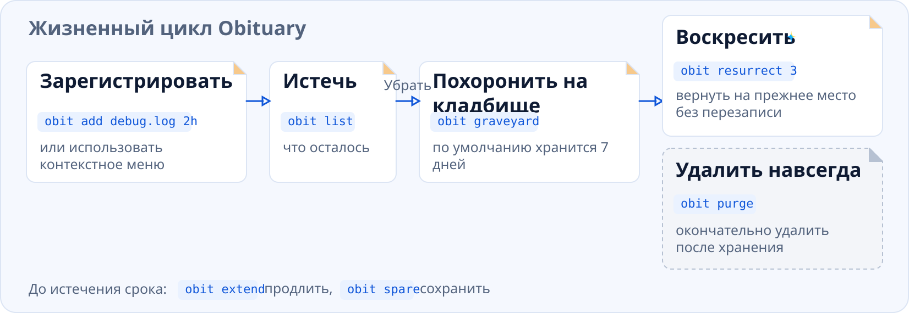

<p align="center"><a href="README.md">English</a> | <a href="README.zh-CN.md">简体中文</a> | <a href="README.zh-TW.md">繁體中文</a> | <a href="README.ja.md">日本語</a> | <a href="README.ko.md">한국어</a> | <a href="README.es.md">Español</a> | <a href="README.fr.md">Français</a> | <a href="README.de.md">Deutsch</a> | <a href="README.pt-BR.md">Português (Brasil)</a> | <strong>Русский</strong></p>
<div align="center">
  <h1>
    <picture>
      <source media="(prefers-color-scheme: dark)" srcset="docs/assets/brand/obituary-horizontal-dark.png">
      <source media="(prefers-color-scheme: light)" srcset="docs/assets/brand/obituary-horizontal-light.png">
      
    </picture>
  </h1>
  <p>
    <strong>Obituary — корзина для ИИ-агентов</strong><br>
    То, что оставляет ваша ИИ, исчезает само после истечения срока; удалённое вашей ИИ можно вернуть в течение семи дней.
  </p>
    <p>
    <a href="#зачем-нужен-obituary">Зачем нужен Obituary</a> ·
    <a href="#установка">Установка</a> ·
    <a href="#быстрый-старт">Быстрый старт</a> ·
    <a href="docs/usage.en.md">Руководство пользователя</a> ·
    <a href="docs/README.md">Документация</a>
  </p>
</div>

<p align="center">
  <picture>
    <source media="(prefers-color-scheme: dark)" srcset="docs/assets/readme/i18n/ru/lifecycle-dark.svg">
    <source media="(prefers-color-scheme: light)" srcset="docs/assets/readme/i18n/ru/lifecycle-light.svg">
    
  </picture>
</p>

<p align="center">
  <picture>
    <source media="(prefers-color-scheme: dark)" srcset="docs/assets/demo/demo-en-dark.gif">
    <source media="(prefers-color-scheme: light)" srcset="docs/assets/demo/demo-en-light.gif">
    
  </picture>
</p>

Obituary — это корзина для ИИ-агентов: агент и вы решаете, что туда попадает. Агент назначает срок жизни написанным им скриптам отладки, журналам и снимкам экрана, а вы добавляете свои файлы через контекстное меню; всё добавленное при истечении срока отправляется на кладбище и семь дней восстанавливается как было. Никому не нужно помнить об уборке, а `rm -rf` агента больше не уничтожает ничего навсегда. Внутреннее устройство описано в [docs/architecture.md](docs/architecture.md) (на китайском).

## Зачем нужен Obituary

Obituary появился потому, что агенты заставили нас его написать. Как только заработала версия 0.0.1, мы установили её на свои компьютеры; все последующие версии агенты писали в наблюдаемых ими репозиториях.

- **Агенты создают беспорядок быстрее, чем люди его убирают.** Если чередовать Claude Code, Codex, DeepSeek и WorkBuddy, проект быстро заполняется скриптами отладки, журналами, снимками и `test-results/`. Никто не знает, что ещё нужно, поэтому никто не решается удалять. Obituary оставляет решение тому, кто знает лучше: агент назначает своим скриптам и журналам срок с помощью `obit mark`, а вы добавляете свои файлы через контекстное меню. После добавления они будут похоронены по сроку, и помнить об уборке не нужно.
- **Не уверены, что это ещё нужно? Похороните.** `obit bury` перемещает объект на кладбище, где семь дней его можно восстановить как было, прежде чем он будет удалён окончательно. Если агент обратится к нему в эти семь дней, Obituary сразу сообщит, что объект на кладбище, и назовёт номер; `obit resurrect` вернёт его. В остальное время Obituary не мешает работе.
- **Страшно от одного `rm -rf`.** Агент, стирающий домашний каталог или целый диск, уже не гипотетическая опасность. При включённой защите удаления `rm -rf`, `git clean` и `Remove-Item` останавливаются и заменяются эквивалентной командой `obit`. Объекты попадают на кладбище, а не исчезают. Обходы вроде `find -delete` и `xargs rm` тоже останавливаются.
- **Страшно, что команда изменится по дороге.** Между задуманной агентом командой и выполненной стоят кавычки и экранирование shell, а иногда прокси, переписывающий команды. Потеря одного символа превращает `rm -rf "$OUT"/` в `rm -rf /`. Поэтому перед действием `obit rm` проверяет настоящий путь на диске, отказывает для корней дисков, системных каталогов и самого профиля пользователя, а остальное хоронит с возможностью восстановления. В Windows Codex использует дополнительный shell, поэтому удаления внутри backtick или shell-подстановки останавливаются даже в кавычках.

## Что делает Obituary

- **Назначайте срок жизни файлам и папкам.** `obit add debug.log 2h` похоронит объект по истечении времени. Укажите момент через `--at`, продлите срок через `extend` или пощадите объект через `spare`.
- **Агент сам решает, что добавить.** `obit init` добавляет Obituary в инструкции агента(`OBIT.md`, Agent Skill и MCP необязательны). Агент назначает срок своим скриптам, журналам и снимкам через `obit mark`, получает временное пространство через `obit mktemp`, хоронит сомнительное через `obit bury` и регистрирует оставленные при редактировании файлы `*.bak`.
- **Вы добавляете свои файлы.** В Windows нажмите правой кнопкой на файлы или папки в Проводнике, выберите «Add to Obituary», затем 1, 7 или 30 дней либо «Bury now (recoverable)». Для папки вроде Downloads можно задать политику.
- **Автоматическая регистрация по желанию.** По умолчанию отключена. После включения в Settings регистрация идёт по правилам(`.playwright-mcp/`, `test-results/`, `*.log`, `*.bak`, `*.orig`, `*~`) и по записям, замеченным hook. Есть ступенчатый, полностью автоматический режим и режим подтверждения всего. Зависимости, результаты сборки и кэши никогда не регистрируются автоматически, а файлы под контролем Git не трогаются.
- **Уборка в конце сессии.** Перед остановкой агента Obituary перечисляет созданные в этой сессии ещё не классифицированные файлы и просит назначить скриптам, журналам и снимкам срок или похоронить их, сохранив результаты. Не чаще одного раза за сессию.
- **Удалённое агентом можно вернуть.** При включённой защите удаления `rm -rf`, `git clean` и похожие команды останавливаются, а агент получает эквивалентную команду `obit`. После её использования объекты попадают на кладбище.
- **Сначала похоронить, потом удалить навсегда.** Кладбище по умолчанию хранит всё семь дней; `obit resurrect` возвращает объект на место и не перезаписывает то, что уже находится там.
- **Отслеживание по идентичности, а не по имени.** Каждая запись хранит серийный номер тома и 128-битный ID файла, поэтому переименованный или перемещённый файл всё равно находится, а другой файл на старом пути остаётся нетронутым.
- **Claude Code и Codex.** `obit init` регистрирует hook и Agent Skill; MCP-сервер необязателен, а `--uninstall` удаляет только добавленное Obituary.
- **Живёт в трее, как Everything (Windows).** `obit init` запускает значок при входе в систему. В меню видны недавние захоронения, их можно воскресить, приостановить автоматическую уборку и открыть небольшое окно Obituary. Планировщик заданий Windows остаётся резервом.
- **Небольшое окно (Windows).** Upcoming, Graveyard, Decisions, Settings и Logs позволяют без командной строки воскресить файлы, одобрить предложения и изменить настройки(`obit-gui.exe` или «Open Obituary» в меню трея). Китайский и английский, восемь вариантов оформления.
- **Контекстное меню и даты в Проводнике (Windows).** Нажмите правой кнопкой → «Add to Obituary» → 1, 7 или 30 дней либо «Bury now (recoverable)». В Windows 11 пункт находится в «Show more options». Отслеживаемые объекты в Downloads и Desktop показываются как «name (11-13 burial)», настоящее имя не меняется.
- **Контейнеры Docker.** `obit docker add <container> 3d` назначает контейнеру срок. При истечении `docker stop` останавливает его(`obit resurrect` запускает снова), а `docker rm` удаляет только после хранения. Тома и образы не трогаются. При автоматической регистрации регистрируются и контейнеры, запущенные сессией агента для проекта.
- **Политики папок.** `obit watch Downloads 2w` хоронит каждый попавший туда файл через две недели. Просроченная подпапка только создаёт предложение и хоронится после одобрения; сама политика также требует одобрения.

## Установка

Windows 10 / 11, macOS и Linux(x64 и ARM64). Отправьте эту фразу используемому агенту: он установит Obituary, подключит его к себе и остановится там, где решение за вами.

```text
Read https://obituary.woodfish.site/agent-install.md and follow it to install Obituary and connect it to yourself.
```


<p align="center">
  <picture>
    <source media="(prefers-color-scheme: dark)" srcset="docs/assets/readme/agents/agents-dark.svg">
    <source media="(prefers-color-scheme: light)" srcset="docs/assets/readme/agents/agents-light.svg">
    
  </picture>
</p>

Платформы в кратком виде:

| | Windows | macOS | Linux |
|---|---|---|---|
| Установка | Scoop, скрипт `install.ps1`(winget на проверке) | Homebrew, скрипт `install.sh` | скрипт `install.sh` |
| Проверка срока каждые 5 минут | процесс в трее, Планировщик заданий как резерв | пользовательский агент launchd | таймер `systemd --user`; пользовательский crontab без systemd |
| CLI, кладбище и воскрешение, опциональная автоматическая регистрация, защита удаления, интеграция с агентами(hook, Skill, MCP), контейнеры Docker, политики папок | да | да | да |
| Трей, небольшое окно, контекстные меню, даты захоронения в Проводнике, ярлыки меню Пуск и рабочего стола | да | вместо этого CLI: `obit list`, `obit graveyard`, `obit resurrect` | как в macOS |
| Режим корзины | да | только кладбище | только кладбище |

Ручная установка, обновление и удаление описаны в [руководстве по установке](docs/install.en.md).

## Быстрый старт

Основные команды(замените `<id>` номером из квитанции `obit add` или `obit bury` либо номером из `obit list` / `obit graveyard`):

```powershell
obit add debug.log 2h                       # bury it in 2 hours (alias: mark)
obit add output\shots 1d12h                 # folders work too
obit add report.zip --at "2026-12-01 18:00" # at a given moment
obit list                                   # what is left and for how long
obit extend <id> 1d                         # one more day
obit spare <id>                             # stop tracking, keep the file (alias: cancel)
obit reap                                   # bury everything that is due now (alias: sweep; --dry-run previews)
obit bury old-build                         # bury right away
obit graveyard                              # what is in the graveyard and when it will be purged (--here: this folder only)
obit resurrect <id>                         # put it back; if the name is taken, it comes back renamed, never overwriting
obit resurrect --last                       # undo the last deletion: everything one obit bury / obit rm buried comes back
obit purge                                  # purge what is past retention (--all for everything, after confirming; --dry-run previews)
obit purge <id>                             # purge this grave now (permanent; asks first, --yes outside a terminal); also abandons an unverifiable interrupted resurrect
obit stats                                  # eulogy: how much was buried, space freed, resurrections (alias: eulogy)
obit log                                    # the full record of everything done
```

Фоновый режим, подключение каждого агента, защита удаления, MCP и Skill описаны в [руководстве пользователя](docs/usage.en.md).

## Документация

- [Руководство пользователя](docs/usage.en.md): все функции подробно
- [Руководство по установке](docs/install.en.md): ручная установка, обновление и удаление
- [Охват агентов](docs/agents.md): насколько подключается каждый из 30 агентов
- [Индекс документов](docs/README.md): все документы, включая архитектуру и правила кода
- [Политика подписи кода](https://obituary.woodfish.site/docs/en/code-signing): бесплатная подпись от [SignPath.io](https://about.signpath.io/), сертификат от [SignPath Foundation](https://signpath.org/)
- [Политика конфиденциальности](https://obituary.woodfish.site/docs/en/privacy): Obituary лишь раз в день проверяет новую версию, и эту проверку можно отключить

## Создавайте Obituary вместе с нами

Issues и pull requests приветствуются. Особенно полезен issue с готовым исправлением: вы находите проблему, исправляете её, и после слияния ваш аватар появляется здесь. Как начать, описано в [CONTRIBUTING.md](CONTRIBUTING.md); о проблемах, которые могут удалить не тот файл, сообщайте приватно по [SECURITY.md](SECURITY.md).

<a href="https://github.com/woodfishhhh/obituary/graphs/contributors"></a>

Русскоязычные пользователи также общаются в QQ-группе **1135603207** и сообществе [LINUX DO](https://linux.do).

<p>
  <a href="https://star-history.com/#woodfishhhh/obituary&Date">
    <picture>
      <source media="(prefers-color-scheme: dark)" srcset="https://api.star-history.com/svg?repos=woodfishhhh/obituary&type=Date&theme=dark">
      
    </picture>
  </a>
</p>

## Лицензия

[MIT](LICENSE)
