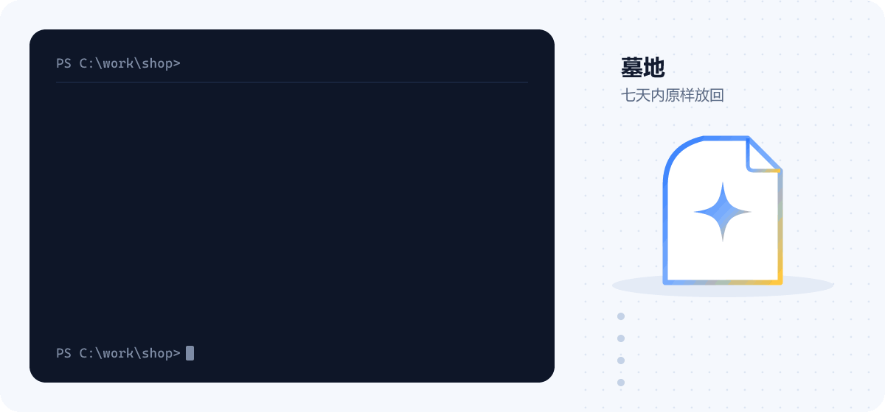
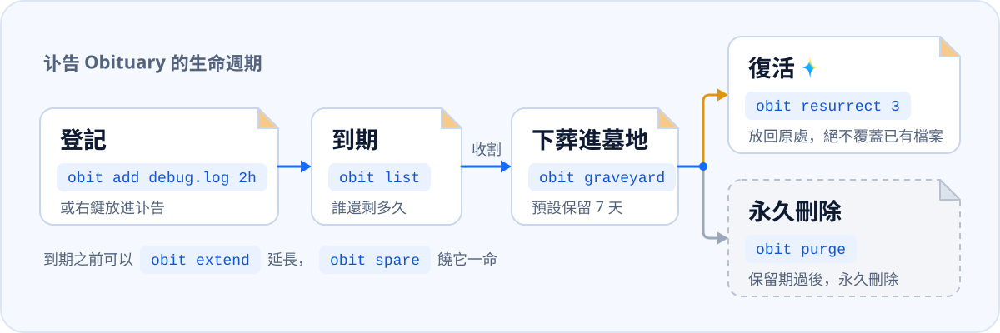

<p align="center"><a href="README.md">&nbsp;English</a> | <a href="README.zh-CN.md">&nbsp;简体中文</a> | <a href="README.zh-TW.md">&nbsp;繁體中文</a> | <a href="README.ja.md">&nbsp;日本語</a> | <a href="README.ko.md">&nbsp;한국어</a> | <a href="README.es.md">&nbsp;Español</a> | <a href="README.fr.md">&nbsp;Français</a> | <a href="README.de.md">&nbsp;Deutsch</a> | <a href="README.pt-BR.md">&nbsp;Português (Brasil)</a> | <a href="README.ru.md">&nbsp;Русский</a></p>
<div align="center">
  <h1>
    <picture>
      <source media="(prefers-color-scheme: dark)" srcset="docs/assets/brand/obituary-horizontal-dark.png">
      <source media="(prefers-color-scheme: light)" srcset="docs/assets/brand/obituary-horizontal-light.png">
      
    </picture>
  </h1>
  <p>
    <strong>讣告 · AI 的回收站</strong><br>
    AI 寫下的垃圾到期自動離開，AI 刪掉的東西七天內都能找回。
  </p>
    <p>
    <a href="#為什麼需要讣告">為什麼需要讣告</a> ·
    <a href="#安裝">安裝</a> ·
    <a href="#快速上手">快速上手</a> ·
    <a href="docs/usage.md">使用手冊</a> ·
    <a href="docs/README.md">文件</a>
  </p>
</div>

<p align="center">
  <picture>
    <source media="(prefers-color-scheme: dark)" srcset="docs/assets/demo/demo-dark.gif">
    <source media="(prefers-color-scheme: light)" srcset="docs/assets/demo/demo-light.gif">
    
  </picture>
</p>

<p align="center">
  <picture>
    <source media="(prefers-color-scheme: dark)" srcset="docs/assets/readme/i18n/zh-TW/lifecycle-dark.svg">
    <source media="(prefers-color-scheme: light)" srcset="docs/assets/readme/i18n/zh-TW/lifecycle-light.svg">
    
  </picture>
</p>

讣告是 AI agent 的回收站：由 agent 和你一起決定什麼要放進來。agent 寫下除錯腳本、日誌和截圖時順手設定壽命，你也能從右鍵選單加入自己的檔案；進來的東西到期後會下葬，七天內可以原樣恢復。沒有人需要記得清理，agent 的 `rm -rf` 也不會再永久摧毀東西。內部運作方式見 [docs/architecture.md](docs/architecture.md)（中文）。

## 為什麼需要讣告

讣告是被 agent 逼出來的。版本 0.0.1 能執行後，我們立刻安裝在自己的機器上；之後每個版本，都是 agent 在它監看的儲存庫裡寫出來的。

- **agent 製造垃圾的速度比人清理得快。** 在 Claude Code、Codex、DeepSeek 和 WorkBuddy 之間切換，很快就會把專案塞滿除錯腳本、日誌、截圖和 `test-results/`。沒人說得準哪些還有用，所以誰也不敢刪。讣告把判斷交給最了解的人：agent 知道哪些除錯腳本和日誌是自己寫的，寫下時用 `obit mark` 設定壽命；你自己的檔案則從右鍵選單加入。進來後到期自動下葬，不必再記得清理。
- **不確定還需不需要？先下葬。** `obit bury` 會把它移進墓地，七天內都能原樣恢復，保留期後才永久刪除。七天內 agent 再次需要它時，讣告會立即告知它東西在墓地和對應編號，`obit resurrect` 會把它放回原處。其他時間不會打擾 agent；它不用先讀清單就能開始工作。
- **害怕一次 `rm -rf`。** agent 清空使用者目錄或整個磁碟已不是假設情境。開啟刪除護欄後，agent 的 `rm -rf`、`git clean` 和 `Remove-Item` 會被攔下，改成等價的 `obit` 命令；東西會進墓地而不是消失。`find -delete` 和 `xargs rm` 等繞路刪除也會被攔下。
- **害怕命令在路上變形。** agent 想執行的命令和實際執行的命令之間，可能隔著 shell 引號、跳脫字元和改寫命令的代理。少一個字元，`rm -rf "$OUT"/` 就可能變成 `rm -rf /`。讣告不只信任命令文字：`obit rm` 動手前會核對磁碟上的實際路徑，拒絕磁碟根目錄、系統目錄和使用者目錄本身，其餘都以下葬方式保存並可復活。Windows 上 Codex 會把命令再交給另一層 shell，因此引號內反引號或 shell 替換中的刪除也會被攔下。

## 它能做什麼

- **為檔案和資料夾設定壽命。** `obit add debug.log 2h` 到期後會下葬；用 `--at` 指定時間，隨時用 `extend` 延長，或用 `spare` 停止追蹤。
- **由 agent 決定什麼要進來。** `obit init` 會把讣告加入 agent 的指示（`OBIT.md`、Agent Skill、MCP 可選）。agent 用 `obit mark` 為寫下的除錯腳本、日誌和截圖設定壽命，用 `obit mktemp` 取得暫存空間，把拿不準的東西用 `obit bury` 下葬，也會登記編輯時留下的 `*.bak` 檔案。
- **你也能加入自己的檔案。** Windows 上在檔案總管右鍵檔案或資料夾（可一次多選），選擇「Add to Obituary」後指定 1、7 或 30 天，或「Bury now (recoverable)」；也能替 Downloads 這類資料夾設定政策。
- **需要時再開啟自動登記。** 預設關閉，不會自行加入任何東西。從設定開啟後，會依規則（`.playwright-mcp/`、`test-results/`、`*.log`、編輯時留下的 `*.bak`、`*.orig`、`*~` 等）以及 hook 看到的寫入登記，提供分級、全自動和全部詢問三種模式。依賴、建置輸出和快取在任何模式都不會自動登記，Git 追蹤中的檔案也不會碰。
- **工作階段結束時整理。** agent 即將停止時，讣告會列出這次工作階段建立、尚未分類的檔案，請它為除錯腳本、日誌和截圖設定壽命或下葬，同時保留交付成果；每個工作階段最多一次。
- **agent 刪掉的東西都能回來。** 開啟刪除護欄後，agent 的 `rm -rf`、`git clean` 等命令會被攔下，並收到等價的 `obit` 命令；改用後東西會進墓地而不是消失。
- **先下葬，再永久刪除。** 墓地預設保留所有東西七天；`obit resurrect` 會放回原處，絕不覆蓋現在那裡的檔案。
- **依檔案身分追蹤，而不是檔名。** 每筆記錄都保存磁碟區序號和 128 位元檔案 ID，因此改名或搬移後仍能找到；如果原路徑出現另一個檔案，則會保持不動。
- **Claude Code 和 Codex。** `obit init` 會註冊 hook 和 Agent Skill；MCP 伺服器可選，`--uninstall` 只移除讣告加入的內容。
- **像 Everything 一樣常駐 Windows 系統匣。** `obit init` 會在登入時啟動系統匣圖示；選單可查看最近的下葬、點擊復活、暫停自動清理並開啟讣告小視窗。Windows 工作排程器仍作為備援。
- **Windows / Ubuntu 24.04 amd64 小視窗。** Upcoming、Graveyard、Decisions、Settings 和 Logs 讓你不用命令列就能復活檔案、核准提案和變更設定（`obit-gui.exe`，或系統匣選單的「Open Obituary」）。支援中文和英文，以及八種外觀。 在 Ubuntu 上從應用程式選單開啟訃告。
- **檔案總管右鍵選單和日期（Windows）。** 右鍵檔案或資料夾（可多選）→「Add to Obituary」→ 1、7 或 30 天，或「Bury now (recoverable)」；Windows 11 位於「Show more options」。Downloads 和桌面上的追蹤項目會顯示為「name (11-13 burial)」，實際檔名不變。
- **Docker 容器。** `obit docker add <container> 3d` 為容器設定壽命；到期時用 `docker stop` 停止（`obit resurrect` 會重新啟動），保留期後才用 `docker rm` 移除。卷和映像檔永遠不會被碰。開啟自動登記後，agent 工作階段為專案啟動的容器也會登記，之後會告知你。
- **資料夾政策。** `obit watch Downloads 2w` 會讓其中每個新檔案兩週後下葬。到期的子資料夾只會產生提案，核准後才下葬；政策本身也需要你核准。

## 安裝

支援 Windows 10 / 11、macOS 和 Linux（x64 與 ARM64）。把下面這句話傳給你使用的 agent；它會安裝讣告、接入自己，遇到需要你決定的地方就停下來詢問：

```text
Read https://obituary.woodfish.site/agent-install.md and follow it to install Obituary and connect it to yourself.
```


<p align="center">
  <picture>
    <source media="(prefers-color-scheme: dark)" srcset="docs/assets/readme/agents/agents-dark.svg">
    <source media="(prefers-color-scheme: light)" srcset="docs/assets/readme/agents/agents-light.svg">
    
  </picture>
</p>

各平台的安裝方式與功能：

| | Windows | macOS | Linux |
|---|---|---|---|
| 安裝方式 | Scoop、`install.ps1` 腳本（winget 審核中） | Homebrew、`install.sh` 腳本 | `install.sh` 腳本 |
| 每 5 分鐘檢查到期 | 常駐系統匣程序，工作排程器作為備援 | 使用者 launchd agent | `systemd --user` 計時器；沒有 systemd 時使用使用者 crontab |
| CLI、墓地與復活、選用的自動登記、刪除護欄、agent 整合（hook、Skill、MCP）、Docker 容器、資料夾政策 | 有 | 有 | 有 |
| 系統匣、小視窗、右鍵選單、檔案總管中的下葬日期、開始選單和桌面捷徑 | 有 | 改用 CLI：`obit list`、`obit graveyard`、`obit resurrect` | Ubuntu 24.04 amd64 桌面套件（`.deb`）提供小視窗與系統匣 |
| 資源回收筒模式 | 有 | 僅墓地 | 僅墓地 |

手動安裝、更新和解除安裝請參閱[安裝指南](docs/install.md)。

## 切換語言

讣告目前支援 English 和簡體中文，命令列、系統匣、小視窗與檔案總管選單共用一個語言設定。

- 臨時切換：執行命令前設定 OBIT_LANG=en 或 OBIT_LANG=zh-CN。
- 儲存設定：執行 obit config --language en、obit config --language zh-CN 或 obit config --language auto。
- 自動選擇：移除 OBIT_LANG，並保持 ui.language = auto；讣告會依序檢查設定、LC_ALL、LC_MESSAGES、LANG 與作業系統介面語言。
- 本階段已翻譯：list、bury、resurrect 的輸出與說明，以及 Windows 系統匣和原生選單文字。Hook 與 MCP 協議文字保持英文且穩定。

## 快速上手

常用命令（將 `<id>` 替換成 `obit add` 或 `obit bury` 回執中的編號，或 `obit list` / `obit graveyard` 列出的編號）：

```powershell
obit add debug.log 2h                       # bury it in 2 hours (alias: mark)
obit add output\shots 1d12h                 # folders work too
obit add report.zip --at "2026-12-01 18:00" # at a given moment
obit list                                   # what is left and for how long
obit extend <id> 1d                         # one more day
obit spare <id>                             # stop tracking, keep the file (alias: cancel)
obit reap                                   # bury everything that is due now (alias: sweep; --dry-run previews)
obit bury old-build                         # bury right away
obit graveyard                              # what is in the graveyard and when it will be purged (--here: this folder only)
obit resurrect <id>                         # put it back; if the name is taken, it comes back renamed, never overwriting
obit resurrect --last                       # undo the last deletion: everything one obit bury / obit rm buried comes back
obit purge                                  # purge what is past retention (--all for everything, after confirming; --dry-run previews)
obit purge <id>                             # purge this grave now (permanent; asks first, --yes outside a terminal); also abandons an unverifiable interrupted resurrect
obit stats                                  # eulogy: how much was buried, space freed, resurrections (alias: eulogy)
obit log                                    # the full record of everything done
```

背景執行、接入各個 agent、刪除護欄、MCP 和 Skill 的詳細用法請參閱[使用手冊](docs/usage.md)。

## 文件

- [使用手冊](docs/usage.md)：每項功能的詳細說明
- [安裝指南](docs/install.md)：手動安裝、更新和解除安裝
- [agent 覆蓋表](docs/agents.md)：30 個 agent 各自能接入到哪一步
- [文件索引](docs/README.md)：包含架構與程式碼規範的全部文件
- [程式碼簽署政策](https://obituary.woodfish.site/docs/code-signing)：由 [SignPath.io](https://about.signpath.io/) 提供免費程式碼簽署，憑證由 [SignPath Foundation](https://signpath.org/) 提供
- [隱私政策](https://obituary.woodfish.site/docs/privacy)

## 一起打造讣告

歡迎提出 issue 和 PR。最受歡迎的是附帶修正的 issue：發現問題、順手修好，合併後你的頭像就會出現在這裡。如何開始請見 [CONTRIBUTING.md](CONTRIBUTING.md)；可能誤刪檔案的問題請依 [SECURITY.md](SECURITY.md) 說明私下回報。

<a href="https://github.com/woodfishhhh/obituary/graphs/contributors"></a>

使用中文的使用者也可以加入 QQ 群 **1135603207**，或在 [LINUX DO](https://linux.do) 社群交流。

<p>
  <a href="https://star-history.com/#woodfishhhh/obituary&Date">
    <picture>
      <source media="(prefers-color-scheme: dark)" srcset="https://api.star-history.com/svg?repos=woodfishhhh/obituary&type=Date&theme=dark">
      
    </picture>
  </a>
</p>

## 授權條款

[MIT](LICENSE)
