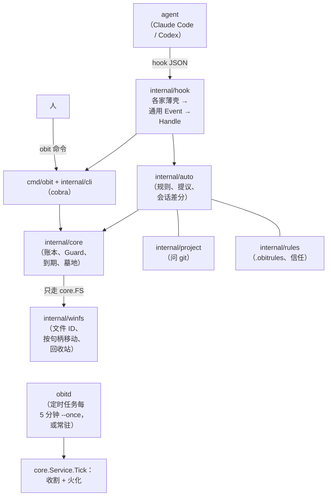

# 讣告 Obituary 架构

[首页](../README.md) · [文档](README.md) · **架构**

这份文档写给要改代码的人和 agent：东西怎么流动，每个决定在哪里做出，哪些约定不能破。用法见 [README](../README.md)，代码约定见 [AGENTS.md](../AGENTS.md)。

## 目录

- [总览](#总览)
- [原则](#原则)
- [威胁模型](#威胁模型)
- [关卡](#关卡)
- [流程](#流程)
  - [登记](#登记)
  - [到期](#到期)
  - [墓地](#墓地)：[位置与归属](#位置与归属)、[根或坟墓不见了](#根或坟墓不见了)、[下葬](#下葬)、[复活](#复活)、[火化](#火化)、[编号与按路径查找](#编号与按路径查找)
  - [hook](#hook)
  - [删除护栏](#删除护栏pretooluse--guard-rm-才注册)
  - [MCP](#mcpobit-mcp)
  - [安装](#安装obit-init)
- [路径写法](#路径写法)
- [core.FS 契约](#corefs-契约)
- [数据布局](#数据布局)
- [账本与审计](#账本与审计)
- [运行器](#运行器)
- [测试](#测试)
- [不做的事](#不做的事)

## 总览



一个二进制做所有判断，hook 只是把各家的 JSON 换成同一种 `hook.Event`。`obitd` 只是换了个入口的同一套 `core.Service`。

## 原则

- **每个决定只在一处做出。** 下面「关卡」一节列出了每类决定的唯一位置。新入口必须调用这些关卡，不准另写一份判断。
- **hook 永远放行。** 出错就退出 0、不输出东西，错误写进 `hook.log`。Stop / SessionEnd 必须静默，因为 Claude Code 收到 additionalContext 会接着跑。
- **权限只降不升。** 拿不准就按更严的处理：问不出 Git 就当作已被跟踪，核对不了身份就不动，规则加载失败就不登记。
- **安装可重复、可撤销。** 先算出计划，再落盘；只碰自己写的东西。
- **用户目录只有一个入口。** `internal/userdirs` 是唯一解析数据目录、配置目录、主目录、`~/.claude`、`~/.codex` 的地方，源码扫描测试强制这一点。
- **不确定就不删。** 只有确定对象已经不在了（`ErrNotFound`），才放弃一条记录；`ErrUnsafe` 是拒绝；其他错误一律稍后重试。
- **永久删除只有一处。** `Purge` 是唯一会 `RemoveAll` 的地方，而且只删经过 `verifyGrave` 的坟墓目录。
- **认对象，不认路径。** 每条记录带卷序列号加 128 位文件 ID，移动和删除都在同一个打开的句柄上核对身份。

## 威胁模型

讣告要防的是**失误和意外**，不是和你同权限的恶意程序：

| 要防住 | 例子 |
|---|---|
| agent 和人的失误 | 给错路径、对源码目录设寿命、`rm -rf` 删错东西 |
| 不可信的仓库内容 | 别人仓库里的 `.obitrules` 想收走你的文件（所以要先信任）、指向项目外的 `.claude` / `.codex` 链接 |
| 过时或被改坏的账本 | 记录里的路径已经换成了别的对象、坟墓编号被改过 |
| 普通程序的并发 | 编辑器在保存、另一个 `obit` 在跑、agent 在登记的同时文件被改名或移动 |
| 暂时性故障 | git 不可用、文件被占用、拒绝访问、卷被拔掉：一律稍后重试，不下结论 |

**已知限制**：回收站模式（`mode = "recycle"`）下，核对身份后由 Shell 按路径回收，中间有几毫秒的时间窗。如果恰好在这时原路径被换成了另一个文件，进回收站的会是那个文件（仍可从回收站还原）。不先把对象挪进暂存目录再回收，是因为那样每一次回收在回收站里的「原位置」都会变成暂存目录。默认的墓地模式全程按句柄移动，没有这个问题。

**删除护栏的已知限制**（都需要特殊环境，后果都是「下葬了、能复活」，修它们需要在原生程序里模拟外部系统，这正是护栏刻意不做的跨系统翻译）：

- PowerShell 会话里设了 `$WhatIfPreference` / `$ConfirmPreference` 时，原生的 `obit remove-item` 拿不到会话状态，不会只预览或询问。
- 目录里有 NTFS ACL 禁止删除的子项时，`rm -rf` 删不掉它们，而整目录改名下葬会把它们一起带进墓地；火化时若因权限删不掉，会退避重试。
- WSL 开了 `metadata` 挂载选项时，Linux 侧的文件权限 Windows 这边不检查：`rm` 因 Linux 权限失败的地方，`obit.exe rm` 可能成功下葬。
- agent 的 shell 若继承了同名的包装函数（例如导出的 `rm() { /usr/bin/rm -i "$@"; }`），hook 只看得到命令文本、看不到会话里的函数，建议的 `obit rm` 会绕过这个包装。

**不防**：以你的身份运行、专门针对讣告的恶意进程，比如在「核对坟墓」和「删除坟墓」之间的一瞬把目录换掉。这样的进程本来就能直接删除你的文件，防它没有意义。审查时这类问题不算缺陷；但凡是普通程序就能碰上的时间窗，依然要处理。

## 关卡

| 决定 | 唯一位置 | 说明 |
|---|---|---|
| 路径能不能碰 | `core.Guard.Check` | 盘符根、系统目录、用户文件夹本身及其上级（含重定向的已知文件夹）；先还原 8.3 短名和 junction |
| 能不能自动登记 | `auto.Engine.vetUnit` | 规则、会话遗留物、批准的提议三条路都过它：在项目里、未被跟踪（里面也没有被跟踪的）、不会缩短已有寿命 |
| 到期了还能不能下葬 | `core.Service.recheckAutomatic` | 自动登记的条目在下葬前重新问一遍：还在原项目、仍未被跟踪、规则没有改为保护它 |
| 坟墓是不是真的 | `core.Service.verifyGrave` | 火化和复活之前：是登记过的那个坟墓目录、里面只有一项、身份对得上 |
| 这条 shell 命令是不是删除 | `guardrm.Suggest` | 删除护栏：bash 用 shfmt 的解析器（`mvdan.cc/sh/v3/syntax`）解析语法结构，PowerShell 用手写的引号感知分词，只认命令位置上的 `rm` / `rmdir` / `git clean` / `Remove-Item`；看不懂就放行 |
| 清单能不能信 | `core.Service.inspectManifest` | 恢复之前：名称、编号、时间、路径都在本账本的墓地根下，原路径不在墓地里，坟墓和对象的身份都对得上 |
| 规则文件能不能用 | `rules.TrustStore` | 信任绑定审阅时的 SHA-256，内容一改就失效；键是规则文件的真实长名（RealPath），精确比较，8.3 短名、junction 写法都归到同一个键，`K` 和开尔文符号不会被合并；untrust 还会撤销所有解析到同一个文件身份的记录（UNC 写法、硬链接），规则文件已经不在时，用还在的父目录的身份加文件名识别别名，并按父目录实际的大小写语义比较（大小写敏感目录里的 `K` 和 `k` 互不影响）；Check / Trust 不按身份放宽；`rules check` / `rules apply` 在旧格式信任存储下按项目显示一次升级提示 |
| 配置文件是不是我们的 | `integrate.Apply` | 落盘前比对计划时读到的原文，被改过就拒绝 |
| agent 能通过 MCP 做什么 | `NewServer`（`internal/cli/mcp/tools.go`） | 只有登记、建临时目录、下葬、复活、续期、取消跟踪和只读查询；批准、拒绝、信任、火化、配置不在清单里，`TestMCPToolInventory` 固定这份清单 |

## 流程

### 登记

三个入口，最后都进 `Service.Add`：

1. **显式**：`obit add` / `mark`、`obit mktemp`。只过 Guard 和身份校验，用户点名的路径就是用户的意思。`mktemp` 的 cwd 必须是存在的目录。
2. **规则**：写文件之后的 hook，或 `obit rules apply`。`auto.decide` 在真实路径上找项目、加载已信任的规则、匹配出登记单元（目录可以整体折叠成一个单元，除非里面有被否定规则保护的东西），再过 `vetUnit`。
3. **提议**：项目第一次要自动登记、单次太大、会话遗留物，都先生成提议。`obit approve` 原子地认领提议，对每个候选重新 `vetCandidate`（还在、还在同一个项目、规则没保护、过 `vetUnit`），通过的以来源 `proposal` 登记。
   - 提议会过期：展示时（hook、`obit proposals`、MCP）只用 Lstat 去掉已不存在的候选，hook 里不起 git；后台运行器（每次 tick 和 `obit reap`）按项目用 `git ls-files` 批量复核（按 Windows 原生命令行 32767 字符上限分批，匹配规则和 git 的 `:(icase)` 一样只折叠 ASCII 大小写），已被跟踪或已不存在的候选按原始路径加修订号精确移除，清空的提议自动撤回（审计记为 `proposal-withdrawn`，不算用户拒绝）。
   - 会话遗留物仍按会话分组；在账本写锁内跳过同项目其他会话已提议的路径，保留原提议的编号、会话、候选修订和通知记录。同会话刷新照常更新修订，已登记且文件身份仍相同的路径也不重复提议。
   - 遗留物的文件拒绝记录在同项目的各会话间共享，沿用最多 256 组、4096 路径的有界历史；容器拒绝仍按会话。批准时只有成功结案且修订未变的候选才清理旧账本中其他 leftovers 提议里的同路径，重试项与并发刷新保留；拒绝也清理这些同路径。清空的孪生提议一并移除，其中其他候选原样保留。后台刷新继续只裁剪不存在或已被 Git 跟踪的候选，已有重复在用户作决定时收尾。
   - 项目根 `Lstat` 明确不存在时，后台核对卷根可访问、最近现存祖先可读且卷标识相同，并逐级确认现存祖先都是普通目录（无 junction、符号链接或挂载点）；满足后按候选原路径和修订号裁剪，清空时撤回，审计注明 `project deleted`、提议编号和项目路径。裁剪前在提议锁内再次核对，不改变用户同意或拒绝状态，也不移动文件。改名后的旧路径同样按消失处理。
   - 卷离线、祖先拒绝访问或为重解析点、项目根不是目录、`.git` 读不到等情况继续保留提议并报告重试。GUI、CLI、MCP 共用只读的候选存在性过滤；GUI 待决定计数沿用同一列表并加待信任规则数，指纹只包含展示内容，部分展示的快照必须等后台裁剪后重新审阅才能决定。
   - git 查询覆盖全部候选（包括已经不存在的），git 出错时整个项目一条都不裁：worktree 和子模块的 `.git` 只是指针文件，它还在不代表主仓库可用，交给 git 自己判断。

每条记录都带 `Source`（`cli`、`mktemp`、`rule`、`proposal`、`session`）、`Project`、`Session`，所以「这是谁、在哪次会话里生成的」随时能查。

### 到期

`Service.Sweep` 同一个数据目录同时只跑一个（`sweep.lock`）：

1. 逐条认领已到期的条目，记下它的修订号 `Rev`。
2. 用文件 ID 找到对象现在的位置（被改名、移动了也找得到）。
3. 过 Guard；自动登记的条目过 `recheckAutomatic`（在下葬的写锁内再过一次）。
4. 下葬（见下一节；或按配置进回收站）。
5. 回写：如果期间这条记录被续命或取消（`Rev` 变了），以新记录为准。拒绝的从账本删掉，文件原地不动；重试的记下错误并指数退避。

### 墓地

#### 位置与归属

- 每块盘一个墓地，保证下葬只是同盘改名：数据目录所在的盘用 `<数据目录>\graveyard`，其他盘用 `<盘>:\.obituary\graveyard\<账本键>`（隐藏；账本键是数据目录路径的哈希，两个数据目录不会共用坟墓）。
- 是不是数据目录所在的盘，按卷根的写法判断（`pathutil.VolumeRoot`；`\\?\` 写法先统一成普通写法），全程只做字符串运算。`\\localhost\C$\…`、SUBST 盘这类别名写法，各用自己卷根下带账本键的墓地，即使它物理上和数据目录在同一块盘上：不按身份换算成同一个墓地：卷序列号加根目录 ID 证明不了是同一块物理盘（克隆卷就会重复），换算会把两个账本的墓地合在一起，SUBST 盘上的复活也会失败。
- 墓地根集合在一次操作里只算一次（`obit graveyard --json` 在 1k 条目时约 0.4 s）；解析失败（例如根还不存在）的不缓存，用到时重新解析，免得第一次下葬建出根之后还按「不存在」判断。
- **账本键与归属标记**：账本键的算法保持不变（对 Unicode 小写后的路径求哈希；改算法会让用户名带大写非 ASCII 字母的用户找不到已有的跨卷坟墓），但 Unicode 小写会把 NTFS 上不同的名字（如 `K` 和开尔文符号）折叠成同一个键，所以每个跨卷墓地根旁边有一个归属标记 `<账本键>.owner`（`{"version":1,"path":…,"identity":{…}}`），记下数据目录本身的身份（卷序列号加 128 位文件 ID，路径只用于诊断）。
  - 扫描、建坟、火化之前按身份核对，不按名字：大小写敏感目录里的 `Data` 和 `data`、`K` 和开尔文符号都是不同的数据目录；属于别的数据目录、或者数据目录被移动或从备份恢复而身份变了，就拒绝（`graveyard ledger key collision or data directory identity changed`），提示确认归属后删掉那个 `.owner` 文件重新认领。
  - 没有标记的旧根照常可读，下一次建坟时认领（`.owner.lock` 串行化首次认领）；早期开发版写的只有路径的标记，在名字相同、身份相符时升级成新格式；doctor 只读核对、不升级。
  - 一次 sweep 或 bury 调用内，对已经成功落盘确认的归属做缓存，同一个根不再重写；失败和未确认的不缓存。
- **授权用的根比较**：凡是授权导入、清理、火化的墓地根比较（graveDir、inspectManifest、inspectCleanup），在 RealPath 之后要求名字和目录身份同时一致：名字按 Windows 的序数规则比较（`FS.SameName`，不用 Go 的 Unicode 折叠，否则 `K` 和开尔文符号会被当成一个），身份两边都用不跟随最后一级 reparse 的 `Identify`（跟随的话，最后一级 junction 会把两个不同的根解析成同一个目标）。数据目录本身经过 junction 是正常情况，RealPath 会还原它；墓地目录本身是 junction 时，两边是同一个 junction，也照常通过。
- **接受的残余风险**：还没被标记的旧根，在「两个数据目录的名字只差 Unicode 折叠等价的字符（如 `K` 和开尔文符号），又把 A 的 store.json 恢复进了 B」时，B 能按 A 账本自己的记录火化 A 的坟墓。被火化的正是那个账本记录、安排要火化的东西，碰不到墓地以外的用户文件；彻底解决需要账本记住自己属于哪个数据目录，再配一套迁移后重新认领的流程，代价超过这个场景。升级后第一次建坟就会给根打上标记，之后就不再受影响。
- **已知限制**：账本键来自数据目录的写法，所以换写法（8.3 短名、UNC、SUBST，或者 M2b 之前用 `\\?\` 前缀设置的 OBIT_HOME 现在被统一成普通写法）会让其他卷上已有的坟墓走不到；坟墓和记录都还在，purge 只会拒绝、不会删除。8.3 短名、UNC、SUBST 写法换回原来的写法即可；以前用 `\\?\` 前缀的，现在没法换回，旧坟墓要手工处理（M2b 还没发布，没有已知用户这样设置）。不做旧键别名：多一套别名规则的风险大于这种情况本身。

#### 根或坟墓不见了

- 按规则算出的根不存在时，只有确认坟墓目录本身也不在、而且卷在线，才算丢失；坟墓目录还在（哪怕里面的对象被改了名）就拒绝并保留记录（布局不受支持）。
- 坟墓目录还在、身份相符、但里面的对象被讣告之外的程序删掉了（空坟墓）：resurrect 报 `grave is empty; its object was removed outside Obituary; obit purge <id> clears the record`，doctor 报 WARN，只有显式 `obit purge <编号>` 会删掉这条记录，并清理能证明属于自己的空坟墓（不计入火化统计）。

#### 下葬

- 下葬的步骤（收割和显式下葬共用 `prepareBurial` / `commitBurialBatch`，单项策略入口仍可用 `moveToGrave`）：
  1. 定编号：已跟踪的用条目自己的 ID；未跟踪的只把 `NextID` 加一预留。
  2. 独占创建坟墓目录 `<id>-<UTC 时间>-<6 位随机>`，记下它的身份 `GraveID`。
  3. 在墓地根下写清单 `<坟墓目录名>.json`（照 freedesktop 回收站的 `.trashinfo`）：编号、原路径、对象和坟墓的身份、原因、来源。写临时文件、落盘、改名。
  4. 在**一次账本写锁**内：核对 `Rev` 没变、仍然到期；核对目录里没有寿命更长的条目；自动登记的再问一遍规则和 Git；然后 `MovePinned` 进坟墓、写墓地记录、移除条目。任何一项不过就不移动，删掉清单和空坟墓。
  5. 删掉清单；到锁外统计大小，再补写统计（大目录不会让 hook 卡在锁上）。
- **有界批处理**：墓地模式的收割、`bury`、`rm`、`rmdir`、`git-clean`、`remove-item` 和 MCP 的 `obit_bury` 共用最多 32 项、锁内工作 100 毫秒的提交器。到达工作量预算后先提交已处理的前缀，再释放账本锁；已经开始的系统调用和落盘确认会完成。显式下葬按批预留编号，身份检查、父目录和独立清单准备、大小统计都在锁外；锁内逐项复核修订、Guard 和身份，一项拒绝保留同批其余项。未提交的移动逐项保留清单，恢复时补记且只计数一次。回收站模式沿用逐项 Shell 回收与修订回写。
- **参数顺序**：命令检查和回执按输入顺序处理，重复路径、祖先子路径和解析到同一处的别名先提交前面的批，再检查后一个参数，因此 `rmdir child parent` 能观察到子目录已离开。请求取消后完成正在移动的那一项及其提交，后面的参数保持未执行。
- **中间状态只在清单里。** 账本条目上没有「下葬中」字段，普通的 `add` / `spare` / `extend` 碰不到它。收割和 `bury` 拿到 `sweep.lock` 后先扫墓地里的清单：已有墓地记录的，删掉残留清单；坟墓里正好是清单说的那个对象的，补写墓地记录；坟墓是空的（没来得及移动），删掉清单和空目录；其他情况一律不动，只记日志，`obit doctor` 报 WARN。清单要逐项核对（名称、编号、时间、路径都在本账本的墓地根下、原路径不在墓地里），改坏的清单不能把任何操作引到墓地外。
- **随父目录下葬的子条目**：寿命不晚于父目录、当前位于目录里的其他条目，在同一事务里被收进这条墓地记录（`Contains`），清单里记下它们的 ID 和身份。补记时逐个核对：确定已离开坟墓的子对象从 `Contains` 里去掉，并且**不恢复它原来的寿命**（不确定就不删：丢掉寿命只是让它多留着）。父目录正在下葬时，对子条目的 `extend` / `spare` / `add` 一律拒绝，提示先 `obit reap` 再复活父目录。
- `bury` 和收割共用 `sweep.lock`（`bury` 最多等 10 秒），同一条记录不会被埋两次；`bury` 失败就如实报错，不留下新记录。
- 剩下的窗口：Git 复查和 `MovePinned` 之间约一两毫秒；第一次在其他盘上 `bury` 一个未跟踪对象、移动后写账本失败时，这块盘还不在账本里，收割扫不到，再执行一次 `bury <原路径>` 就会补记。

#### 复活

- 复活和火化都先过 `verifyGrave`。复活绝不覆盖：原路径被占用时加后缀，名字试到上限或遇到错误就停。
- **复活只回原处**：原路径就是原位置。普通目录按路径认，被重建或被换成另一个普通目录都还是原位置（同 freedesktop 规范、GNOME gio 和 trash-cli 的 restore，它们按原路径重建父目录）；要拦的只有「被重定向」。
  - 下葬时把原路径从父目录到卷根的每一级祖先记进 `Burial.Parents`（路径、跟随后的目录身份、当时是不是 reparse point），清单里同样保存。
  - 复活前逐级核对：当时不是 reparse、现在是（junction、符号链接、挂载点，按原生属性判断所有 reparse 标签）的拒绝；当时就是 reparse 的（比如项目放在 junction 后面），现在必须仍是 reparse 且指向同一个目录；普通祖先只要求卷序列号不变（盘符被重映射时拒绝）。
  - 缺失的祖先由复活重建，不把新目录的身份写回记录，所以同一文件夹里的多个墓地都能复活，中途失败也能重试。
  - 目标（原写法和解析后的写法、包括每个加后缀的候选名）都要过 Guard 的受保护位置判断。
  - **被拒绝的复活不建任何目录**：先固定最近的现存祖先，对原始路径做预检（现存祖先照下面的规则核对，缺失的普通祖先放行，缺失的、记录里是 reparse 的祖先直接拒绝；Guard 按这个祖先解析出的真实位置判断目标），预检通过后才在固定的句柄上逐级建缺失的目录（`NtCreateFile` 以 `RootDirectory` 按单个名字创建，`OBJ_DONT_REPARSE`，遇到任何 reparse 都拒绝；同 Go 的 `internal/syscall/windows.Mkdirat`，不用 `os.Root.MkdirAll`，因为它会跟随根内链接）。
  - 预检之后祖先仍可能被普通程序挪走（固定句柄共享删除，不阻塞别人的移动），所以建目录时按 `IO_STATUS_BLOCK.Information` 记下哪些是本次新建的（`FILE_CREATED`，已存在的 `FILE_OPENED` 不算），保留创建句柄直到移动成功；之后任何原因拒绝或移动失败，都从最深处起用创建句柄撤销本次新建、且仍为空的目录（照 Go 的 `Deleteat`，先用 `FileDispositionInformationEx` 的 `DELETE | POSIX_SEMANTICS`，这样别人开着子目录也不会让上一级因「非空」而残留；不支持时退回普通的 `FileDispositionInformation`，删除要等句柄关闭或目录非空而留下时给出警告；不按路径删）。复活只删自己刚建的空目录。
  - 之后照旧「先固定、再核对、再比对」：先不跟随最后一个 reparse 地打开目标的直接父目录并固定句柄（必须是普通目录）；然后对原始路径逐级做上面的核对；最后确认原始直接父路径此刻跟随后的身份（卷序列号 + 文件 ID）就是句柄指向的那个目录。解析出来的路径只用来打开，从不当作核对的基准。
  - 再用这个句柄做 `RootDirectory` 按单个文件名改名（`NtSetInformationFile` 的 `FileRenameInformation`，Go 的 `Renameat` 也这样做），源对象仍在核对过身份的句柄上移动，所以检查之后父目录被改名或换成 junction 都影响不了落点；回执和审计里的路径是移动后从源句柄读出的实际位置（移动已成功、但这次读取恰好失败时，退回预计位置，并在审计里注明 `actual restored path unavailable; expected path used`）。
  - 名字冲突由这次改名本身判定（不覆盖，换下一个后缀），不再先探测路径。
  - 旧记录没有 `Parents`：祖先里出现 reparse point 一律拒绝。
  - 拒绝时墓地和记录都保留。
- **复活的中间状态也在清单里。** 移动之前，把这座坟墓的清单改写成第 2 版（`version: 2`，带 `resurrect`：目标父目录的身份和计划的名字）；空坟墓留到账本提交成功后才和清单一起删掉。移动成功但账本写入失败时，回执给出实际路径并报可重试的错误，意图留在原处。之后再次 `resurrect`、收割前的恢复（`sweep.lock` 下，`bury` 和 `Tick` 也先做这一步）和 `obit graveyard` 都会处理它，状态如下：
  - `restore-ready`：坟墓里还是原对象（没来得及移动），复核后删掉意图，照常处理。
  - `resurrected`：坟墓是空的，并且在记录的目标父目录里按源对象的卷序列号 + 文件 ID 找到了它（`FS.FindRestored`，不按名字猜），补记「已复活」（一次账本提交里删墓地记录、计数，再写审计），回执给出实际位置。
  - `restore-committed`：账本里已经没有这条记录（编号已分配、没被条目或提议占用），而且坟墓已空或已不存在，只剩清理意图和空坟墓；回执照样按身份找出实际位置。账本里没有记录、坟墓里却还是原对象时，说明账本过时或损坏，记为 `unverifiable`（`ledger contradicts the nonempty grave`），绝不报「已复活」。
  - `unverifiable`：找不到或核对不了，原样保留，不猜成功，也不回滚。

  **提交和清理分开算**：账本一旦提交，这次复活就算完成，回执（`restored` / outcome）立即给出、墓地列表里不再有它；之后删空坟墓或清单失败（比如别的程序以不共享删除的方式开着清单）只对这一条记警告，留到下次清理，不中止收割、下葬或火化里的其他工作。真正的账本写入失败仍报可重试的错误。恢复扫描里其他单条记录的核对失败（意图复核、子条目核对、补记前的检查）也一样只记这一条，只有账本读写失败才中止整次恢复。

  **清理回执**：删墓地记录的那次账本提交里，同时写下一条带位置的清理回执（账本的 `restoreCleanups`：类型是复活或放弃、墓地记录本身包括坟墓路径和身份、实际路径、意图）。扫描墓地时也扫这些回执所在的卷，所以即使那块盘上已经没有别的记录，残留的清单和空坟墓也能清掉；清单已经不在时，回执也能单独核实并终结（卷离线、核实不了时保留）。按原路径重试复活时，活跃的墓地记录和这些已提交的回执、残留清单放在一起，按 `FindBurial` 的规则（逐字节相同优先、同路径取最新、模糊匹配必须唯一）一次选出：选中的是已提交的那条，就确认它并报告实际位置，不会改去复活同一路径下更旧的记录。删掉证据之前，先再确认一次账本已经落盘。

  **残留与空根**：残留的已提交清单不会遮住空坟墓的 WARN；空墓地根被普通清理程序删掉后，在卷在线、确认坟墓也不在时，清理回执照样能收尾。

  **锁内只给保守提示**：`spare` / `extend` / `mark` 碰到有未完成复活的记录时，在账本锁内只读这条记录的清单、认出第 2 版意图，就提示「先 `obit resurrect <编号>` 或 `obit reap`；核实不了时 `obit purge <编号>` 显式放弃」，不在锁内按身份搜目录。

  **无法核实的出路**：移动成功后用户又把对象挪到别的目录、或编辑器替换保存了它，自动恢复永远找不到。这时只有用户显式执行 `obit purge <编号或原路径>` 才放弃这条记录：坟墓身份核对通过且为空、意图有效、此刻仍找不到对象，才在一次账本提交里删掉墓地记录（不计入已复活和已腾出空间），审计记 `abandoned`（写明意图里的目标父目录、计划名字和原因），再清理空坟墓与清单；此刻能找到对象就改为补记复活。`purge --all` 不放弃这种记录，MCP 也没有这个入口。`resurrect` / `spare` / `mark` / `purge` 遇到它时，错误信息会指出这条命令。放弃同样写清理回执，残留清单显示为 `restore-abandoned`，清理时不会被当成复活。显式 `purge` 逐项给回执（成功、失败、未执行），先输出回执再返回错误；只有整个错误树都是审计写入失败（`core.OnlyAuditErrors`）时才降为警告，混进了真正的账本失败就非零退出。

  **计划名字**：清单里的计划名字必须是单个合法名字、不超过 255 个 UTF-16 单元，写清单之前就按同样的规则校验；重名时生成的「 (resurrected)」候选名会先给后缀留出预算，截短主干（保留扩展名，不拆 UTF-16 代理对）；扩展名本身就放不下时，整个名字一起截短，保证仍然合法；旧版本写下的不合法计划名，只有在 verifyGrave 确认原对象完好地留在坟墓里时才丢弃意图重新复活。

  旧版本程序把第 2 版清单当成未知格式，安全地拒绝。下葬清单仍是第 1 版。

#### 火化

- `Tick` = 收割 + 火化保留期已过的坟墓。统计在下葬时记大小，火化后计入「已腾出空间」。
- **火化意图**：purge 删除坟墓之前，先把经过核实的火化意图（`purgeIntent`）写进账本；账本里已经有意图（上一次可能没确认落盘）时，删除前用 `Store.Confirm` 再确认一次落盘，单个和批量火化都一样；删除后在同一次提交里移除记录、结算统计、写入 purged 事件。提交失败后重试，看到意图且坟墓确实不在，就记为 purged，而不是 lost；火化未完成的记录不能复活，Tick 会按重试间隔续做（下一次到期时间按火化重试时间算，不再受原保留期限制）；`obit graveyard` 把它显示为 `purging (retry at …)` 并附上一次失败的原因，JSON / MCP 的 pending 状态为 `purging`，doctor 计入需要关注的记录（WARN）。

#### 编号与按路径查找

- **墓地命令里的数字一律是编号**：`resurrect`、`purge`（包括 MCP 的 `obit_resurrect`）先按写法判断引用是不是编号（可选的 `#`、正负号、ASCII 数字，前后带空白也算），再解析数值；解析不了的（超出 int64，如 `9223372036854775808`，或带空白，如 ` 9001`）报「不是有效编号」，同样不退回文件名。写成 `9001` 或 `#9001` 的引用只按编号找，找不到就报错并提示「按文件名请写 `./9001` 或绝对路径」，绝不退回到当前目录下叫 `9001` 的文件（否则一个失效编号可能让 `purge` 立即火化另一条记录）。提示文字也只写纯数字（`obit purge 1`），不写 `#1`：bash 和 PowerShell 都会把空格后的 `#1` 当注释。`spare` / `extend` 这些不删东西的命令保持原来的回退规则。
- **撤销上一次删除**（`obit resurrect --last`，`LastBurialRefs`）：一次显式删除（一次 `obit bury`、一条 `obit rm` 命令即使逐项下葬、一次 MCP `obit_bury`）在每条墓地记录上记同一个操作 `Operation`（`crypto/rand.Text` 编号、开始时间、会话、项目），清单里也有，中断恢复后不变；到期收割不带操作。会话依次取 `OBIT_SESSION_ID`、`CLAUDE_CODE_SESSION_ID`（Claude Code 会传给它的 Bash / PowerShell 工具，记成 `claude:<id>`）、`CODEX_THREAD_ID`（Codex 工具环境里实际有，但不是官方保证的接口，尽力使用，记成 `codex:<id>`）；项目是当前目录所在的 Git 项目，找不到就不记，删除照常进行。选择时：调用方有会话，只选这个会话的最新批次，没有再找当前 Git 项目里没有会话的最新批次；调用方没有会话（人在普通终端里执行），选当前 Git 项目里最新的一批，不论是哪个会话删的。别的项目、到期收割、没有操作编号的旧记录都不会被当成「上一次」，也不做全局兜底。读墓地时刚补记为已复活的成员也参与确定最新批次：最新批次因此已经全部复活的，报告它并停下，绝不回退到更旧的批次。找不到、开始时间并列，或最新批次里还有没入账的待恢复清单（提示先 `obit reap`）都报错并指向 `obit graveyard`。`--last` 只选出编号，复活仍走上面的全部核对。MCP 不提供 `last`：调用方没有可靠的会话。
- **只看当前目录下的墓地**（`obit graveyard --here`、MCP `obit_graveyard` 的可选参数 `here`，必须是绝对路径；`FilterGraveyard`）：原路径是这个目录本身或在它下面（含待恢复和已复活的原路径），长名展开后按下面的规则比较，`C:\a` 不会匹配到 `C:\ab`；分页和 `total` 按过滤之后算。
- **按路径找墓地或条目**（`FindBurial` / `FindPath`）：先找 `filepath.Clean` 后逐字节相同的；没有才按 ASCII 大小写折叠找，结果必须唯一，否则要求用编号。不用 Go 的 Unicode 折叠：它会把 NTFS 上不同的名字（如 `k` 和开尔文符号 `K`，U+212A；普通的 `K` 仍按 ASCII 折叠）当成一个。Guard 和受保护位置的判断仍用宽松的 `samePath`，那里多匹配只会更保守。

### Docker 容器（D-0042）

- 容器是第二种条目（`kind: "container"`），和文件共用编号序列；账本 v14 起保存完整容器 ID 和创建时间。文件的下葬、复活、火化路径遇到容器条目一律跳过，容器走 `internal/core/container*.go` 和 `internal/docker`。
- 到期是 `docker stop`（保留可写层），复活是 `docker start`，保留期过后火化是 `docker rm`（不带 `-v`、`-f`）。每次动手前都重新 inspect，完整 ID 和创建时间对不上就不动；火化时正在运行的当作复活。AutoRemove 容器拒绝登记。
- 会话差分在后台的 `obit hook finish` 里按会话时间窗找新建的容器，生成提议；hook 进程本身从不调用 docker。docker stop 等待容器自己的 StopTimeout 再加 5 秒（不给 docker stop 传 `--timeout`，尊重用户设的宽限期），其他调用 5 秒。
- **绑定原来的 daemon。** 登记、提议和意图都记下 Docker 上下文或端点和 daemon ID，之后每次调用都显式带 `--context` / `--host`；daemon 对不上就不动并诊断。只有在原来的 daemon 上确认容器不存在，才按「外部移除」结案（清掉意图和记录，计入 `containersLost`）。旧的 v14 记录没有这些字段：在当前端点找到同一个 ID 和创建时间时补记，找不到就保留记录。
- **完整 ID 也可能被当成名字。** Docker 按完整 ID、精确名字、ID 前缀的顺序解析引用。动手前若有容器的名字恰好等于这个完整 ID 就拒绝。stop 和 start 之后会再核对作用的是原容器，不是就记 `container-ambiguous` 审计。rm 前后各记一份完整 ID 清单（崩溃后也能接着比），有别的已知容器跟着消失，就保留墓地记录和意图、记 `container-ambiguous`，不当作正常火化；外部同时删了别的容器也会触发这个保守诊断。从最后一次检查到 Docker 解析引用之间仍有一个 CLI 往返的窗口：如果原容器恰好在这时被外部删除、另一个已停止的容器又改名成这个完整 ID，rm 可能删到那个容器；清单能发现「原先就有的容器少了一个」，但证明不了因果，清单之后才新建又被删掉的替代容器也发现不了。docker CLI 做不到按 ID 加创建时间原子执行。
- **停止的意图分阶段。** 只有在 docker stop 子进程真正启动前一刻才记成「已发送」；前置检查没通过（例如有同名容器）就退回「准备」，之后能再试。结果不明的 stop，第一次恢复时看到容器还在运行就开始计时，过了它的 StopTimeout 加 5 秒仍在运行，就清掉意图、按原寿命重试并记 `container-stop-retry` 审计；这是有界的恢复策略，证明不了两次观察之间它一直在运行。StopTimeout 为无限的、以及缺少初始运行状态的旧意图，继续保守等待人工核实。长超时只用于 docker stop 本身，之后的核对都是 5 秒。
- **docker 调用不持有账本锁。** 停、启、删都分两步：先在 `store.lock` 内核对条目并写下容器意图（`containerIntents`：随机 token、操作、条目或墓地快照），提交；再在锁外 inspect 并调用 docker；最后再 inspect 一次实际状态，回到锁内核对意图仍是这一次的，提交结果、统计和审计并清掉意图。中途崩溃时，恢复只观察、不重复破坏性操作：运行中的容器绝不记成已下葬，有删除意图而容器已不在就补记火化，没执行的意图清掉后按原寿命重试。停容器期间寿命被续期或饶过，就重新 `docker start` 并记审计。容器操作仍在 `graveyard.lock` 内串行，停一个容器的十几秒里，`obit rm` 这类文件下葬会等它。
- 意图字段是 v14 的可选字段：旧 v14 账本照常读写；账本里有未完成的容器意图时，要用新版本处理，旧版本写回会丢掉它不认识的字段。

### hook

```
agent 的 JSON ──► hook.Claude / hook.Codex（解析、路径换算）──► hook.Event ──► hook.Handle
```

- `Handle` 包住真正的处理：记审计（`OBIT_HOOK_AUDIT=1` 时写 `hook-audit.log`）、把返回给 agent 的文字截到 2000 字符以内、出错只写 `hook.log`。
- 会话开始：记快照、注入到期预告和待处理的提议。写文件之后：`Observe`（项目没同意过就生成提议，同意过就按规则登记，太大的改为提议）。
- cwd 或祖先的项目发现被拒绝访问时，只在错误指向的路径位于 Windows 已知文件夹 API 返回的 Program Files、Program Files (x86)、Windows 目录本身或其子目录时安静跳过；路径先规范化，忽略大小写，按目录分隔符限定边界。该次事件跳过自动工作、快照和后台派发，`hook.log` 写一行带 cwd 和原因的 `skip:` 说明；项目归属仍属未知，禁止进入非项目会话快照分支。用户项目等其他位置的发现权限错误继续返回错误并记录权限诊断，让用户知道自动登记不可用；无法取得受保护位置时也保留错误。`PostToolUse` 保持逐个写入路径重新发现项目、核对 Git 跟踪的流程。其他发现错误和数据目录、账本、墓地的权限错误继续报错。doctor 不统计 `skip:` 行；旧日志只有同时具有 `discover project from` 来源、`resolve project directory` 操作、拒绝访问原因，且结构化诊断的 path 位于上述受保护位置时才免于告警。
- 慢活交给 `hook.Runner`：`Tick` 在有东西到期（或墓地里有待恢复的清单）且没有常驻进程时启动一次 `obitd --once`；`Finish` 在后台跑 `obit hook finish` 算会话遗留物，Stop 一分钟最多一次，SessionEnd 总是跑。hook 自己不做慢活，因为 SessionEnd 只有 1.5 秒（Claude Code）或 3 秒（Codex）。
- 一次 hook 调用里所有账本锁的等待加起来不超过 1 秒（`Store.WithDeadline`），读用共享锁；拿不到就放弃这次处理、只记日志。后台下葬正持锁时，其他项目的 hook 不会被卡住。
- Codex：从 `apply_patch` 补丁里只认第 0 列的 `*** Add/Update/Move` 头；WSL 的 `/mnt/x/…` 换成 `X:\…`，WSL 自己文件系统里的路径跳过。
- hook 收到的超过 4 KiB 的 session id 统一换成 `sha256:<摘要>`（同一会话前后一致），显式的 CLI / MCP 登记仍然拒绝超长元数据。
- 提议的「已通知」标记写入失败时，提示照常输出、诊断写进 `hook.log`（至少送达一次，宁可重复）。
- **墓地提醒（D-0041）**：工具调用引用的路径不存在、又落在一座还能复活的坟（原路径本身或下葬目录之下）时，告诉 agent 编号和 `obit resurrect`。只提醒，不拒绝、不改写。PreToolUse 先用数据目录里的 `grave-notice-paths.json`（每次账本写入后重建的路径索引，只用来排除无关路径，本身不算依据）过滤，命中了才在 25 毫秒的共享锁预算内读账本再核对，拿不到锁就跳过这次提醒；每个会话已提醒过的坟记在 `sessions/grave-notices-<摘要>.json`。路径按原样大小写比较，宁可漏提醒。会话开始时另列本项目最近下葬的坟（不含 mktemp 临时目录和本会话自己下葬的）。

### 删除护栏（PreToolUse，`--guard-rm` 才检查删除）

```
agent 的 shell 命令 ──► hook 薄壳 ──► guardrm.Suggest ──► deny + 等价的 obit 命令（陈述句）
                                                     └──► 看不懂 / 不是删除 ──► 放行（审计）
agent 发出 `obit rm …` ──► 用户的权限规则照常检查 ──► 每个路径 Service.Bury（拒绝就报错，绝不真删）
```

- **只拦不改。** hook 从不改写命令：Claude Code 按改写后的命令检查权限，改写会绕过用户的 deny；Codex 改写还必须给 allow。hook 只输出 deny，所以只会收紧权限。
- PreToolUse 现在总是注册：没开删除护栏时命令行带 `--notice-only`，只做墓地提醒。每次工具调用前都会触发，所以它不起 git、不碰网络；删除检查只做语法解析，账本只在被引用的路径不存在且命中墓地索引时才读（进程内一次处理约 0.4 到 0.8 毫秒，其中 bash 解析约 17 微秒，不含进程启动）。
- **bash 的语法交给 shfmt 的解析器，支持范围仍由我们定。** `lex_bash.go` 用 `mvdan.cc/sh/v3/syntax`（v3.14.1）解析语句、单词边界、引号和赋值，只接受普通命令和 `&&`；重定向、管道、`||`、后台、取反、子 shell、函数、条件和循环、heredoc、`${…}`、`$(…)`、扩展通配都整条放行。解析器能解析的语法不等于护栏支持的子集。库只给出语法结构，不做去引号；求值用的 `expand.Literal` 会展开变量和 `~`、查询用户目录，所以我们保留一段只针对允许节点的静态解码。解析失败、含 NUL 字节或回车、反斜杠续行和 `#` 同时出现、续行不止一处时整条放行：v3.14.1 会把注释末尾的续行和下一行并成一条命令，和真实 bash 不一致。PowerShell 那半边没有现成的 Go 解析器，仍在 `lex.go`。
- 等价命令只换命令词、保留参数原文，通配和变量仍由原 shell 展开。PowerShell 不替原生程序展开通配，所以带通配的 `Remove-Item` 一律放行，`obit remove-item` 也只接受字面路径（出现 `* ? [ ]` 就报错）。
- **宁可漏拦，不能多选。** 护栏在两个风险之间取舍：拦得太少（常见写法漏拦），或建议的命令选中得比原命令多。后者会删错东西，所以凡是可能「多选」的功能（跨 shell 的路径换算、PowerShell 数组与通配、根据参数猜 shell）都不做；常见写法用一张主场景表固定下来，作为回归测试。

### MCP（`obit mcp`）

```
agent ──stdio──► obit mcp ──► mcpPaths（只收绝对路径；编号严格当编号）──► Service / Engine（和命令行同一套关卡）
                    └──► {data, error?, warning?}；部分失败也带回每一项的结果
```

- stdout 只写协议消息，诊断信息不进 stdout；后台进程用静默模式拉起。
- 工具直接调用 `core.Service` 和 `auto.Engine`，不经过命令行解析，所以 Guard、身份核对、墓地协议和命令行完全一样。
- 编号写成 `5` 或 `#5` 时只按编号找，找不到就报错。命令行里 `#5` 同样不再退回到当前目录下叫 `#5` 的文件。
- 用户的决定（`approve` / `reject` / `trust` / `untrust` / `purge` / 配置 / 安装）不提供工具。要加新工具，必须同时改 `TestMCPToolInventory`。
- 回执必须始终小于 SDK 的帧上限（go-sdk `DefaultMaxLineLength` 16 MiB，结构化结果和文本各写一份）：备注、会话、来源在 `core` 登记处统一限制为 4 KiB（命令行同一规则），每次调用最多 100 项；`obit_list` / `obit_graveyard` / `obit_proposals` 默认和最大都是 200 条，按编号升序用游标翻页：参数 `limit` / `after`（上一页最后一个编号，十进制字符串），返回 `hasMore` / `nextAfter` 和本次读取时的 `total`（照 GitHub MCP server 的 after / endCursor；按编号续读，两页之间有复活、火化或裁剪不会漏掉仍在的项）。
- 编号是登记时分配的，进墓地可能更晚，所以翻页期间新出现的较小编号会落在已读过的区间：每个列表回执带 `version`（本次读到的完整集合与 pending 状态的摘要；条目还算上路径和文件身份，提议还算上排序后的候选路径及其 `Rev`（`Rev` 由提议自己的 `candidateSeq` 分配，候选被裁掉再加回也不会重用），所以同一编号换成另一个对象、提议新增候选都算变了；备注、到期时间、通知记录不算），调用方把它传回，集合变了就照常返回这一页并加 `changed: true` 和提示，要完整视图就从头再读。
- 同一编号的多条回执（坏清单与记录并存）不拆到两页。
- 墓地列表在墓地锁（独占）下一次读出账本记录和待补记清单（`core.ReadGraveyard`，CLI 的 `obit graveyard` 同样用它），后台恢复不会让一项在两份视图之间消失；读账本时也持 `store.lock` 的共享锁（`Store.ReadSnapshot`，不迁移、不写，读完就放），否则 Windows 上不共享删除的读取会让同时进行的账本替换报 Access is denied。
- 它还会顺手补记核实过的中断复活（见上文），并在回执的 `restored` 里给出实际路径（MCP 最多 200 条，另给 `restoredCount`），所以 `obit_graveyard` 不再标为只读工具。
- MCP 和 `--json` 的 bury 回执里，附带的恢复回执最多 20 条，超出的只报数量并提示用 `obit log --lines <N>` 查看（这些恢复已经收尾，`obit graveyard` 里看不到了；N 也算上了本次一起补投递的旧事件）；MCP 最终的 JSON 再受 256 KiB 预算约束，二次压缩时保留原来的总数。回执里的长字符串和嵌套列表按 Serena `_limit_length` 的思路截断并标注，不改账本，旧账本里的超长备注也能列出来。
- 工具不声明 OutputSchema：go-sdk v1.8.0 的 `applySchema` 会把结构化结果解成 `float64` 再编码，大编号会丢精度，不声明时服务器发出的 JSON 原样保留 int64（SDK 客户端自己解析时仍可能用 float64，读编号请用文本里的 JSON 或精确解析）。

### 安装（`obit init`）

1. **计划**：读出每个要改的文件，记下原文（`Change.orig`）。`settings.json` 保持键顺序，不转义 `&&`；重复的键保留第一次出现的位置、取最后一次的值（和 `JSON.parse` 一致）；内容没变就不写，有改动时整份按两空格缩进重新输出。读入时容忍 UTF-8 BOM；hook 配置（Claude 的 `settings.json`、Codex 的 `hooks.json`）、MCP 的 `.mcp.json` 和 Codex 的 `config.toml` 改写时都保留原来的 BOM，原文件没有 BOM 或新建的文件不加；判断内容是否相同时忽略 BOM，重复执行不改文件。只认严格匹配 `obit … hook <agent>` 的命令是我们的，用户的复合命令不算；路径变了就刷新旧的处理器并去重；`OBIT.md` 必须带归属标记才会被替换或删除；Codex 的 `AGENTS.md` 只改标记块。
2. **落盘**：再读一次，和原文不一样就拒绝；写编号备份（`.bak`、`.bak.1` …，独占创建，旧备份永不覆盖）；临时文件加改名。项目级安装拒绝写穿指向项目外的链接。
   - hook 条目只有程序是指向 `obit` / `obit.exe` 的绝对路径（或 WSL 的 `/mnt/<盘>/…` 路径）、参数是 `hook <agent>`（可带 `--notice-only` 或 `--event <事件>`）才算我们的；相对路径和裸命令一律不算。Codex 的 `command` 和 `commandWindows` 每个非空字段都得是我们的，混合条目原样保留，计划里标「保留：含非讣告命令」。是不是删除护栏、是不是纯提醒，都按解码后的同一份 argv 判断，不在 JSON 原文里找子串。
3. **MCP 与 Skill（`--mcp` / `--skill`，可选）**：
   - Claude 的 `mcpServers.obituary` 只有同时满足这几条才算我们的：`type` 省略或为 `stdio`；`command` 的文件名是 `obit` 或 `obit.exe`（不分大小写），而且要么是绝对路径、要么就是这个裸文件名；`args` 恰好是 `["mcp"]`。不是就拒绝安装、卸载时保留。刷新时保留条目里的其他字段（如 `env`），只换 `command`。
   - 用户级的 `~/.claude.json` 是 Claude Code 运行时整体重写的状态文件，直接改名覆盖会和它互相吞掉写入。所以讣告只读它判断归属，写入交给官方的 `claude mcp add-json` / `remove --scope user`（2.1.318 起它们在共享锁里重读再合并，更早的版本拒绝执行），执行前只核对 `obituary` 这一条有没有变，执行后再读一次核对结果；刷新时 add 失败会用旧条目恢复。
   - 只执行真正的 `claude.exe`：npm 安装的 `claude.cmd` 会按 npm 的固定布局找到它背后的 `claude.exe`，绝不经 `cmd.exe` 转一道（参数会被 cmd 再解释一遍）。子进程放进 Job Object，超时连同子进程树一起结束。
   - 找不到合适的 `claude` 就报错并给出可以在 PowerShell 里原样粘贴的手动命令（普通条目用 `claude mcp add … -e KEY=VALUE`，避开 Windows PowerShell 5.1 吞掉参数里双引号的问题；参数含双引号或为空、或条目有其他字段时，改给 `claude.exe mcp add-json` 并注明需要 PowerShell 7.3 或更新），不退回到直接改文件。
   - 查找 `claude.exe` 照 Go 的 `ErrDot` 策略：PATH 里的相对目录、`.`、空项一律跳过；是否落在当前目录或当前 Git 项目里按目录身份（卷序列号 + 128 位文件 ID）判断，不按路径字符串：当前目录取原路径和跟随所有链接后的路径，各自再找项目根；候选 exe 的原路径、解析后路径和它的每个硬链接名字（`FindFirstFileNameW`），逐级向上比较祖先目录的身份，命中就拒绝（向上走到卷根为止，`\\?\UNC\server\share` 这类写法停在共享根，见 `internal/pathutil`）。这样 junction（两个方向）、`\\localhost\C$` 这类 UNC、`\\?\` 前缀、8.3 短名、尾随点都按同一个对象处理。npm 安装的 `claude.exe` 本来就有两个硬链接，所以不拒绝多硬链接，而是逐个检查名字；取不到身份或列不出名字时拒绝。
   - 每条命令执行后都回读文件，按看到的状态（旧值、新值、缺失、其他、读不到）决定是否恢复和怎么报告，任一步（包括恢复前后）回读到的已经是目标新值就报告 target state confirmed 并继续后续安装；输出只保留头尾各 32 KiB。
   - 官方命令只能先删再加，替换已有注册不是原子的：普通刷新只报告过期，显式 `--mcp` 才替换。官方说明其他 Claude 会话的保存仍可能覆盖刚加的条目，`obit doctor` 会发现这种情况。
   - 项目级 `.mcp.json` 不是状态文件，照常走计划和比对原文。
   - 卸载 hooks 不依赖扩展：MCP 或 Skill 处理不了（文件损坏、不是我们的）时原样保留并报告，其余照常卸载，最后以非零退出。
   - Codex 的 `config.toml` 只改 `# obit:mcp:begin` / `# obit:mcp:end` 之间的块，标记必须是独立的注释行（字符串里的同样文字不算）。块里的内容和整份 TOML 里解析出来的 `mcp_servers.obituary` 必须一致，卸载前还要确认删掉这块不会改变其余配置的含义（TOML 的表作用域会越过注释）。
   - `SKILL.md` 逐字节写入，不加标记；归属记在旁边的 `.obituary-skill`（版本加内容哈希）。写入分两步提交，中途中断后重试能认出是自己写了一半的文件。哈希对不上就是用户改过，安装拒绝、卸载保留。已核实的 skill 和标记不留备份，事务锁放在数据目录，保持固定锁名直到所有写入结束。OpenClaw 插件清单仍存在时，卸载保留 skill 及归属回执，并提示核实 Gateway 停用后再手工处理。
4. **几家 agent 共用的文件**（同一份规则文件或 MCP 配置被多家读取，如 Qoder、CodeBuddy、MiniMax）：
   - 规则块的开始和结束标记必须各自独占一行；标记残缺、重复或夹在正文里就拒绝改写。改写时保留 BOM、换行风格（LF / CRLF）和块外的每个字节。
   - 共享的 MCP 注册用归属回执（schema 2）记录哪几家装过。旧版本写的回执标为 `legacy-unverified`，不当作可信归属；最后一家已知的 agent 卸载时保留注册并提示用户核对，显式重装（如 `obit init --mcp`）可以补全归属。
   - 旁注放在数据目录的 `integration-receipts/<路径摘要><原扩展名>`，其回执加 `.obituary-asset`；项目生成资产的回执为 `<路径摘要>.obituary-asset`。摘要算法与快捷方式一致，旁注按旧绝对路径求摘要，内容格式保持不变；全局共用同一套旁注协议。新旧位置一起预检，在数据目录中的 `.lock` 锁内复核正文与归属，持锁到全部提交。先提交新位置，再删除核实过的旧旁注和空锁；中断后重试继续迁移，无法证明归属的旧备份保留。已核实的生成文件不留相邻备份，项目中用户配置的编号备份放在 `integration-backups/<路径摘要>.bak[.编号]`。
5. **开始菜单与桌面快捷方式**：归属回执放在数据目录的 `shortcut-receipts/<路径摘要>.obituary-asset`；摘要为绝对路径经 `pathutil.Abs`、`filepath.Clean` 和 ASCII 小写折叠后的 SHA-256。回执继续绑定快捷方式绝对路径、目标和内容摘要；包管理器或用户已有的快捷方式保持原样。新旧回执及快捷方式一起预检，在新回执旁的 `.lock` 锁内复核并按原来的原子写入协议提交。旧的相邻回执可只读识别，下一次写入先提交新回执，再删除核实过的旧回执；卸载移除已核实的快捷方式及回执。已核实的生成文件不留相邻备份，桌面与开始菜单只放 `.lnk`。未使用上述旁注协议的全局插件资产继续使用相邻回执和编号备份。

## 路径写法

路径进账本、参与比较之前先统一写法。卷根、绝对化和「写法会不会被 Windows 改写」的判断在 `internal/pathutil`（`VolumeRoot`、`Abs`、`Unchanged`），长名展开和名字比较在 `core.FS`（`LongPath`、`SameName`）。

- **路径按长名记录**：8.3 短名（如 `DIRECT~1`，`%TEMP%` 常是 `C:\Users\RUNNER~1\…`）只是别名，原目录删掉后 NTFS 可能把同一个短名分给另一个长名目录。所以登记、`mktemp`、下葬、提议候选在路径进账本前用 `FS.LongPath` 逐级展开现存的名字：每一级相对上一级的句柄打开（不跟随这一级的 reparse），用 `NtQueryInformationFile` 的 `FileNormalizedNameInformation` 只取这一级的真名，拼回原来的词法父路径。这样只要求遍历和读属性权限，不需要列目录（`GetLongPathNameW` 需要），也不改变 junction 的词法位置，耗时随深度线性增长；不存在的部分保留原写法。哪一级取不到真名时：名字里有 `~`、可能是短名的，拒绝登记并提示用长名；其他的保留原写法，但这条记录不标 `longNames`。展开完整的新墓地记录带 `longNames: true`。
  - 按路径引用记录（`resurrect` / `purge` / `spare` / `extend`、MCP 的 `obit_resurrect`）时，先在 `Service` 边界用同一个 `FS.LongPath` 展开，再交给 `State` 做纯字符串匹配；所以在短名写法的当前目录里 `obit bury x` 之后 `obit resurrect x` 照样能找到。展开不完整时要求改用编号。
  - 旧记录不改写。没有 `longNames` 的旧记录复活时逐级核对：现存的每一级，把现在的写法展开成长名，和记录里的写法不同（说明记录的是别名，包括不带 `~` 的自定义短名），就要求身份与记录相同，否则拒绝。「不同」按 Windows 的序数忽略大小写规则判断（`FS.SameName`，即 `CompareStringOrdinal`）：只差大小写（包括 `à` / `À` 这类非 ASCII 字母）不算别名；不用 Go 的 Unicode 折叠，它会把 `K` 和开尔文符号当成同名；缺失的那一级只有本身像短名（带 `~`）才拒绝，不连累下面的普通长名目录。不猜新的长名位置。
- `\\?\` 开头的扩展路径会关掉 Win32 的规范化（例如保留结尾的点），而 `filepath.Abs`（`GetFullPathNameW`）仍会把它规范化成另一个名字：`\\?\C:\work\a.txt.` 会变成 `\\?\C:\work\a.txt`，对象不存在时就会选中邻居。所以 `pathutil.Abs` 只在 Windows 自己的规范化不改变这个写法、而且转成普通写法（`\\?\C:\x` → `C:\x`，`\\?\UNC\s\sh\x` → `\\s\sh\x`）后也不改变时才接受，并且之后一律用普通写法登记和匹配；尾点、尾空格、`..`、重复的分隔符、`nul` 这类设备名都拒绝，不管对象存在与否，提示改用编号。`\\?\Volume{GUID}` 和 GLOBALROOT 写法没有普通写法，也拒绝。展开之后还要再查一次：8.3 短名（如 `LONGDO~1`）本身能通过检查，但展开出的真名可能以点或空格结尾（`Long Document Name.txt.`），普通写法下又会被 Win32 改写成邻居的名字；所以展开结果必须同样不被规范化改变，对象存在时还要核对展开前后是同一个对象，否则拒绝并提示用编号。不只检查完整路径：Windows 只去掉最后一级结尾的点和空格，`…\Long Directory Name \payload.txt`（中间目录名以空格结尾）整体不变，但之后用 `filepath.Dir` 拆出的父路径单独使用时会指向邻居 `Long Directory Name`；中间级叫 `nul` 也一样。所以展开结果的每一级前缀都要通过同样的检查。
- 结尾的分隔符表示「必须是目录」：`x\` 或 `x/` 指向的现存对象必须是目录，按路径找墓地记录和条目时只匹配目录；`obit bury build/` 照常可用。
- 只处理整个文件或目录：卷根之后带 `:` 的路径（备用数据流，如 `document.txt:review`）一律拒绝。流和宿主共用文件 ID，按 ID 找回会找到宿主；旧账本里的流条目绝不按 ID 回退去找宿主，sweep 只报重试，用 `obit spare` 取消。卷根统一由 `pathutil.VolumeRoot` 计算（扩展 UNC 带上服务器和共享，Go 的 `filepath.VolumeName` 只返回 `\\?\UNC`）。
- **入口统一写法**：数据目录在 `userdirs` 里先统一成普通写法（`\\?\C:\h` 和 `C:\h` 是同一个数据目录、同一个账本键）；obitd 的 `--home` / `--config-dir`、`project.Find`、`obit trust` 的规则文件，以及 userdirs 的所有环境变量入口（OBIT_CONFIG_DIR、OBIT_USER_HOME、CLAUDE_CONFIG_DIR、CODEX_HOME）也用 `pathutil.Abs`，并检查每一级前缀，会被规范化改写的写法直接拒绝，不会落到旁边的账本、配置或项目上。
- **找仓库**：`project.Find` 往上找仓库时，每一级父目录都要通过检查，否则返回错误（hook 保留未知项目状态，按上面的发现失败规则处理）；`GIT_CEILING_DIRECTORIES` 照 Git for Windows 的 `setup.c`（`canonicalize_ceiling_entry`）和 `path.c`（`longest_ancestor_length`）处理：按字面分隔、不去引号，空项之后的条目保留原字节，不可用的条目丢弃，其余条目做和遍历路径相同的规范化和别名解析（扩展写法、8.3 短名、junction）；当前目录带 `\\?\` 前缀时，根相对的条目（`\Users\…`）按规范化后的工作目录的卷根或共享根解析；结果与原生 git 一致，不启动 git 进程。

## core.FS 契约

`internal/core` 只通过这个接口碰文件系统，`internal/winfs` 是 Windows 实现，测试用不进回收站的 `testFS`：

| 方法 | 承诺 |
|---|---|
| `Identify(path)` | 返回卷序列号加 128 位文件 ID，不跟随最后一级链接；有多个硬链接的文件返回 `ErrUnsafe` |
| `IdentifyFollowing(path)` / `Resolve(path)` | 跟随 reparse 后的身份和路径，复活时用来核对原路径的各级祖先 |
| `LongPath(path)` | 逐级展开现存的 8.3 短名，不解析词法上的 junction，不存在的部分保留原写法；有一级展开不了时 `complete` 为 false，这样的记录不标 `longNames` |
| `SameName(a, b)` | 按 Windows 的序数忽略大小写规则（`CompareStringOrdinal`）比较两个名字，用来区分大小写变化和真正的短名别名 |
| `Locate(id)` | 按 ID 找到对象现在的路径；确定不在了才返回 `ErrNotFound` |
| `Recycle(path, want)` | 核对身份后移进系统回收站，不带关联文件；失败就报错，绝不退化成永久删除 |
| `MovePinned(path, want, to)` | 打开、核对身份、在同一个句柄上改名；目标已存在就失败，绝不替换；目标父目录的卷序列号必须和对象相同（多一道保险；墓地位置本身按卷根写法决定） |
| `OpenRestoreParent(path)` / `MkdirRestoreParent(parent, name)` | 固定复活的目标父目录（必须是普通目录，身份在句柄上查询）；在固定的句柄上按单个名字新建或打开下一级普通目录，不跟随中途出现的 reparse。`Rollback` 只按创建句柄撤销本次新建、仍为空的目录 |
| `MovePinnedInto(path, want, parent, name)` | 在句柄上核对源对象，改名进已固定的父目录，返回从源句柄读出的实际路径；移动成功但读不出路径时返回空路径、不报错，调用方在审计里注明用了预计位置 |
| `FindRestored(parent, source)` | 同时核对源对象和它直接父目录的身份，给中断的复活找回实际位置 |
| `MakeGrave(dir)` | 独占创建坟墓目录，已存在就失败；第一次在其他盘上建 `.obituary` 时把它设为隐藏 |
| `RealPath(path)` | 真实路径（还原 8.3 短名，解析父目录里的 junction 和符号链接，最后一级不跟随），所有「在不在某个项目里」的判断都用它 |

## 数据布局

数据目录 `%LOCALAPPDATA%\obituary`（`OBIT_HOME` 可改）：

| 文件 | 内容 |
|---|---|
| `store.json` | v17 热账本：条目、提议、项目状态、策略、统计、待投递审计、容器意图、数据归属，以及墓地引用和完整安全索引；通过 `store.lock` 串行提交，经 `os.Root` 按目录句柄替换 |
| `graveyard.<generation>.json` | 不可变墓地快照：`burials`、`restoreCleanups` 和 `parentChains` / `operations` / `origins` / `volumes` 去重表；由热账本的 `{generation,file,hash}` 引用，校验版本、DataID、generation 和 SHA-256 后才能使用 |
| `store.v<版本>-<SHA-256>.json.bak` | 升级前的完整原字节；保留为回退证据，不覆盖不同内容 |
| `audit.jsonl` | 审计日志（`obit log`） |
| `trusted_rules.json` | 已信任的 `.obitrules` 及其 SHA-256（版本 2，键是真实长名；版本 1 的旧键丢掉了大小写，无法证明对应哪个文件，所以一律当作未信任，提示 `trust store format was upgraded; review the rules and run obit trust again`；下一次 trust / untrust 写成版本 2） |
| `graveyard\` | 这块盘的墓地：坟墓目录，以及正在下葬或复活的那几个的清单 `*.json` |
| `sessions\` | 会话快照和遗留物计算的去抖标记 |
| `shortcut-receipts\` | 开始菜单与桌面快捷方式的归属回执及事务锁 |
| `integration-receipts\` | agent 集成的归属回执、owners、reference 旁注及事务锁 |
| `integration-backups\` | 项目集成修改用户配置时保留的编号备份 |
| `hook.log` / `hook-audit.log` | hook 错误与 `skip:` 说明 / hook 审计（加锁轮转） |
| `obitd.log` | 后台进程日志（轮转） |
| `proposal-log.json` / `proposal-log.lock` | 按项目保存上次提议刷新错误；共用锁文件以独占方式串行更新，临时文件经 `os.Root.Rename` 替换，常驻和各次 `--once` 共用去重状态 |
| `update.json` / `update.lock` | 正式版更新检查缓存和独立的检查锁；缓存记录检查时间、ETag、发布说明和最近错误，不读写账本 |
| `*.lock`、`obitd.stop` | 锁文件；常驻进程的停止信号 |

配置目录 `%APPDATA%\obituary`（`OBIT_CONFIG_DIR` 可改）：`config.toml`，所有键都可省略。项目里只有 `.obit/`（`mktemp` 的临时目录），自动写进 `.git/info/exclude`。

## 账本与审计

热账本 `store.json` 引用不可变墓地快照，审计日志仍是 `audit.jsonl`。两份账本只有一个逻辑提交点：热账本的原子替换。

- **读**：`ReadHot` 只读热账本；`Read` / `ReadSnapshot` 在同一个 `store.lock` 内先读引用再读相应快照，前者保留旧版身份合并的写回行为，后者用共享锁且不迁移。墓地查询、调度、GUI、CLI、MCP、doctor 和卸载读取联合快照。`Inspect` 不建目录、不建锁、不迁移；读到已被回收的旧代时重新核对热引用，只有引用确实变化才有限重试。账本、快照和清单都用共享读、写、删除的 `readShared` 打开。被引用快照缺失、损坏或身份不符时返回错误，不能当作空墓地。
- **写**：`UpdateHot` 用于登记、提议刷新和 outbox 确认；回调试图修改墓地、清理回执、引用、安全索引或容器意图会报错。`UpdateGraveyard` 用于下葬认领与提交、统计补记、复活与清理回执、火化意图与结案、恢复补记和容器结案，原 `Update` 兼容入口也执行联合事务。全局编号始终由热账本分配。
- **唯一提交点**：墓地变化时，先在数据目录独占创建快照临时文件、写入并 `Sync`，用 `os.Root.Link` 独占发布最终名字，再刷新原写句柄和目录项；已有文件绝不被覆盖。generation 是随机的不透明编号。然后写热账本临时文件、`Sync`，用 `Root.Rename` 按目录句柄替换，再刷新同一个写句柄。Stats、Items、墓地引用、清理回执与待补审计一起提交；热账本替换之前失败只留下未引用快照，旧状态仍有效。Windows 保留 POSIX 替换与共享删除读取语义，审计轮转沿用相同的替换辅助函数。
- **锁与回收**：墓地操作保持「墓地锁 → store.lock」，持 store.lock 的代码不反向等待墓地锁。普通 hook 只拿 store.lock，不重写快照。确认热提交后保留当前代和前一代，每次墓地换代最多核验两个其他候选，仅回收已验证同一 DataID、格式、generation 和文件名的快照；未知、损坏、异主文件和链接原样保留，核验失败也计入上限。候选按文件名循环扫描，扫描位置 `graveyardGCCursor` 随原有热提交保存，跨进程继续推进，避免损坏或删除失败的文件挡住后续孤儿；位置只是维护提示，不授权删除，不增加提交或 flush。两个候选的上限限制锁内完整解码成本，又允许回收速度超过每次新产生的一代。回收失败仅留下孤儿，后续墓地提交循环重试，不撤销已提交操作。已经打开的共享删除读句柄可以读完，尚未打开旧代的诊断读者重试热引用。
- **热侧安全索引**：联合事务维护原路径、身份、编号（含随父目录下葬的编号）和清理回执的完整匹配索引、墓地卷根及预留火化审计槽数。紧凑散列的碰撞只多触发一次联合读取；索引命中后在已有 store.lock 内加载并校验快照。未提交清单继续按原协议检查。联合读重建并比对索引；索引、调度摘要以及提示缓存都不能授权移动、恢复或永久删除。
- **通知缓存**：`grave-notice-paths.json` 带 generation，仅在墓地换代或缓存缺失时重建；热写入和 outbox 不重建它。它只是提示用负过滤器，安全检查不依赖它。
- **v15 父目录链**：仅把逐字段完全相同的链合并，保留 `Path`、`Identity` 的卷写法、序列号、文件 ID 和 `Reparse`；读取还原成每条记录独立的 `[]BurialParent`，复活核对和独立墓地清单保持原样。越界或缺失的引用、混用内联 `parents` 一律拒绝；每次写入从现存墓地记录和清理回执重建表，最后一个引用消失时回收链。
- **v16 下葬记录**：`burials` 和 `restoreCleanups` 共用顶层 `operations`（完整操作）、`origins`（原登记的项目、会话）和 `volumes`（身份的卷写法、序列号）表，记录保存 `operationRef`、`originRef`，`identity` / `graveId` 保存 `fileId` 和 `volumeRef`。去重按完整 JSON 值逐字段比较，路径写法和操作各字段原样保留；缺省操作与空操作分别保留。读取还原独立对象，清单继续自包含；引用越界、指向空值、与内联字段混用均拒绝，写入时从现存记录和清理回执重建表并回收无引用值。更新版本先报版本不支持，避免误报损坏。
- **v1–v16 迁移**：只读快照和带 hook 期限的读只解码；下一次写入（或需要写回旧身份合并的普通读）在独占 store.lock 内先备份完整原字节并确认落盘，再生成第一代快照、编码后解回并逐字段核对等价，确认快照落盘后提交 v17 热引用和 `store-migrated` 待补审计。备份或快照失败不改旧账本；热替换前失败可从旧账本重试，替换后只有完整的新引用。相同备份可重新确认，不覆盖不同内容；更旧程序按版本明确拒绝 v17。回退前停止所有写入方，保留当前热账本和引用快照后再恢复原备份，备份后的操作须先核实。备份作为迁移证据保留。
- **备份和归属**：备份或复制数据目录必须保留 store.json 及其引用的快照；导出完整内存状态用联合读取，单独解码 store.json 得不到墓地。卸载先核对数据目录归属和被引用快照，仅把内容与 DataID 均验证过的快照加入可删除元数据清单，未知文件继续阻止自动清理。
- **内容没变不提交**：热事务只比较热字段；联合事务比较完整状态，墓地没变就沿用原引用。完全一样（且没有读时迁移事件、版本已是最新）就不写盘、不触发变更回调；已有待补审计仍留给 outbox。会话快照单独保存，hook 的 1 秒锁预算不变。删除独立恢复证据之前用 `Store.Confirm`：先验证并刷新被引用快照，再确认热账本落盘，之后才能退休清单和空坟墓。
- **提交未确认**：Go 的 `Renameat` 不会把改名本身写穿到磁盘（Microsoft 的 File Caching 文档：元数据要靠 `FlushFileBuffers`），所以临时文件的写句柄一直开到改名之后，再在同一个句柄上 `Sync` 一次；这次刷新失败就报「提交未确认」（`commit unconfirmed`，类型化错误）：
  - 下葬和复活保留清单；删除下葬清单之前（恢复扫描和直接复活都一样）先在锁内复核记录、再确认一次账本落盘。
  - 恢复时确认的下葬放进本次回执，所以原样重试 `bury` 能报出编号：只有按 FindBurial 的规则选中这条记录、而且原路径上没有别的对象（或者就是它）时，才算这次请求的结果，否则按编号另列；之后的统计写入失败也不会吞掉这份回执。
  - 确认下葬提交和补写审计是同一个步骤，恢复扫描和直接 resurrect / purge 都走它，审计没写成就保留清单；确认的复活和放弃复活也各补一条审计（原操作类型、编号，放弃时带目标父目录和计划名字，Detail 含 `confirmed after an unconfirmed commit`，至少一次，不改统计）。
  - mark / spare / extend 遇到它时，错误开头就是「commit unconfirmed: the change may already have taken effect; check obit list before retrying」，放在底层错误前面，MCP 截断到 512 字节也保得住（extend 不是幂等的）。
- **已移动、未提交**：sweep 和 bury 已经把对象移进坟墓、账本却没提交成功时，回执标为 recovery pending，带坟墓位置（`grave` 字段，只表示未提交的位置，不是已提交的 Burial）和「释放占用后重跑 obit reap」的提示。待恢复回执的 detail 以重试指示开头，截断也保得住。第一次在另一个卷上 bury 移动后提交失败、账本里还没有别的记录指向那个卷时，提示重跑原来的 `obit bury` 命令（reap 还找不到那个卷）。
- **审计队列（outbox）**：正常的下葬、到期下葬、purge、空坟墓 purge 的审计走账本里的待补审计队列（`pendingAudit`，outbox 做法）：和操作在同一次账本提交里写入，一次操作结束时（包括提前返回）统一追加并 Sync 到 audit.jsonl，然后才移除；sweep、Tick、`obit graveyard` 等恢复入口补投递，只补日志，不重复操作、不重复计数（至少一次，追加后、移除前崩溃会多一条）；队列为空时不读账本、不拿锁。积压到 1000 条时，新的下葬、火化、复活先拒绝（`audit backlog is full`），提示先解除审计日志的占用。
- **审计写不进去**：账本已经提交、但这次操作的审计写不进去时（例如 audit.jsonl 被别的程序以不共享写的方式打开），已经完成的复活或放弃不回滚，但清单和清理回执保留，等之后补写审计成功再清理。
- **审计行**：追加审计前，如果 audit.jsonl 末尾是被打断的半行，先补一个换行把它隔开，新事件不会被拼进去。一行审计序列化后不超过 1 MiB，超长的 Detail 截断并标 `[truncated]`，`obit log` 永远读得了。

## 运行器

- **定时任务**（默认，`obit daemon enable`）：任务计划程序里的隐藏任务 `Obituary Runner`，每 5 分钟和每次登录运行 `obitd --once --home … --config-dir …`。用 XML 定义（UTF-16 带 BOM，描述只用 ASCII，因为 `schtasks /Query /XML` 按控制台代码页输出），用电池时也运行，错过的会补跑，已有一个在跑时不重复启动。
- **常驻**（`--resident`）：命名互斥量标识「谁在服务这个数据目录」，`obitd.stop` 让它退出，开机自启写 HKCU Run。启动时和之后每 5 分钟都会 Tick 一次（不只在有条目到期时），所以只剩待恢复清单时也有人处理。
- **提议重试日志**：同项目、同原因只写一次，原因变化或后台确认恢复时再写；按项目分别比较，避免项目遍历顺序或其他 tick 错误造成重复。去重保存在数据目录，覆盖每次重新启动的 `--once`；暂停或未完成的提议刷新保留原诊断状态。原始错误继续由 `Tick` 返回，`--once` 仍失败退出，缓存读写错误也保留并输出原诊断。
- **兜底**：登记、批准、`mktemp`、`rules apply`、`bury` 成功后调用 `cmdutil.EnsureDaemon`：有常驻进程在服务这个数据目录，或定时任务的 `--home` 正好是它（`ScheduleServes`，用和 obitd 相同的参数解析），就什么都不做；否则临时起一个常驻进程。`--json` 模式下不往 stderr 写提示。
- 所有子进程都带 `CREATE_NO_WINDOW`，后台永远不弹黑框；`obitd.exe` 必须用 `-ldflags=-H=windowsgui` 构建。
- `obit doctor` 只读地检查以上所有环节（PATH、obitd、运行器、两家集成、数据目录权限、账本、信任存储、hook 日志、配置），给出 PASS / WARN / FAIL，有 FAIL 时退出码 1。

### 更新检查

三个程序共用 `internal/buildinfo.Version`，发布时注入。`internal/update` 用 `golang.org/x/mod/semver` 比较正式版；开发构建按基础正式版号比较，同号正式版不提示更新。

后台启动 5 秒后检查一次；常驻模式每小时复核配置和缓存，定时任务的 `--once` 也共用缓存。`update.lock` 串行化进程间检查，24 小时内自动检查复用结果，失败也计入间隔。请求只向公开的 GitHub `releases/latest` 发 GET，带 ETag、10 秒超时，拒绝重定向；不下载程序、不发送使用数据。响应大小上限 1 MiB，草稿和预发布被拒绝，最近一次成功发布信息在失败时保留。

`[update] check` 默认开启；关闭后自动检查静默返回，显式 `CheckUpdate` / `obit update --check` 允许手动查询。测试环境通过 `OBIT_TEST_NO_UPDATE=1` 阻止默认端点请求，HTTP 测试显式注入本机服务器。缓存复用账本的共享删除读取和原子替换辅助函数，与账本使用不同的锁。

安装方式按程序路径判断 Scoop、WinGet，脚本安装由同目录的 `.obituary-install.json` 标识；只生成对应更新命令，其他安装方式给出 release 链接。GUI 的 `Update` 和 doctor 只读缓存，托盘仅在有新版时显示入口。

## 测试

- **隔离**：每个测试包的 `TestMain` 调用 `testenv.Main`：把数据目录、配置目录、主目录、`~/.claude`、`~/.codex`、临时目录都指到一次性目录；清掉继承来的所有 `GIT_*` 变量，换上专用的全局 gitconfig，设 `GIT_CEILING_DIRECTORIES`，让测试仓库不会被外层仓库吞掉。
- **子进程注册表隔离**：Windows 上 `testenv.Main` 为每个测试进程创建独立的 HKCU 键，统一设置 `OBIT_TEST_REGISTRY_ROOT`；真实程序子进程把右键菜单和开机启动分别写进该根的 `Classes`、`Run`。变量必须以 `Software\obituary-test-` 开头，后续各段只接受 ASCII 字母、数字、连字符和下划线；空值、空段、点段和其他位置都报错。嵌套测试进程在父进程的根下分配独立子键，退出时只清理本次创建的键；崩溃测试故意终止的子进程也由父根清理兜底，显式注册表夹具同样属于本进程根；进程内 Run 测试仍用内存实现。快捷方式沿用 `OBIT_START_MENU_DIR`、`OBIT_USER_HOME` 的目录隔离。
- **真实桌面集成只读防线**：`testenv.Main` 在测试前后比较真实 Classes 下三类 `shell\Obituary.*`、`Obituary.ContextMenu` 及其 `AppUserModelId` 的完整树（包括空键、值类型和原始值）、真实 Run 中 `Obituary-` 前缀值、已知文件夹 API 返回的开始菜单和桌面「讣告 Obituary.lnk」的存在性、大小、修改时间。读取失败或出现变化就让测试失败并列出位置；快照从不修复或删除真实内容。
- **不漏到真实卷根**：`testenv.Main` 在测试前后比较 TEMP 所在卷根 `.obituary\graveyard` 下的顶层条目（账本键目录，以及 `<键>.owner`、`.owner.lock` 这类文件），多出新条目就让测试失败。
- **源码扫描**：`userdirs` 里的测试解析所有非测试源码，任何别处读 `LOCALAPPDATA`、`USERPROFILE`、`os.UserHomeDir` 之类的地方都要列进豁免表，并写明理由；豁免不再被用到也会报错。
- **真 Git、真文件 ID**：自动登记的测试跑在真实的临时 Git 仓库里，`core` 的测试用真实文件 ID。真实回收站和真实任务计划的测试默认跳过，要设 `OBIT_TEST_RECYCLE=1` / `OBIT_TEST_SCHEDULER=1`。
- **变异检查**：改安全逻辑时，先写失败测试；修完后把修复临时改回去（必须还能编译），确认测试真的失败，再恢复。编译不过的变异不算数。固定下来的变异表用 `go test -overlay` 跑：MCP 和核心关卡的在 `internal/cli/mcp/mcp_test.go`，删除护栏的在 `internal/cli/remove/remove_test.go`（运行命令见 AGENTS.md）。

## 不做的事

- **不做遥测。** 不上传任何使用数据，统计只存在本机，用 `obit stats` 查看。
- **不校验 hook 脚本。** 讣告的 hook 直接调用二进制，没有脚本可以被改，`obit doctor` 只核对配置里的命令是不是当前版本。
- **不主动弹通知。** 想看就查询（`obit list`、`obit stats`、`obit doctor`），到期预告只出现在 agent 的会话开头。M6 起有一个常驻托盘图标（2026-11-09 定），它只安静地待着，不推送。
