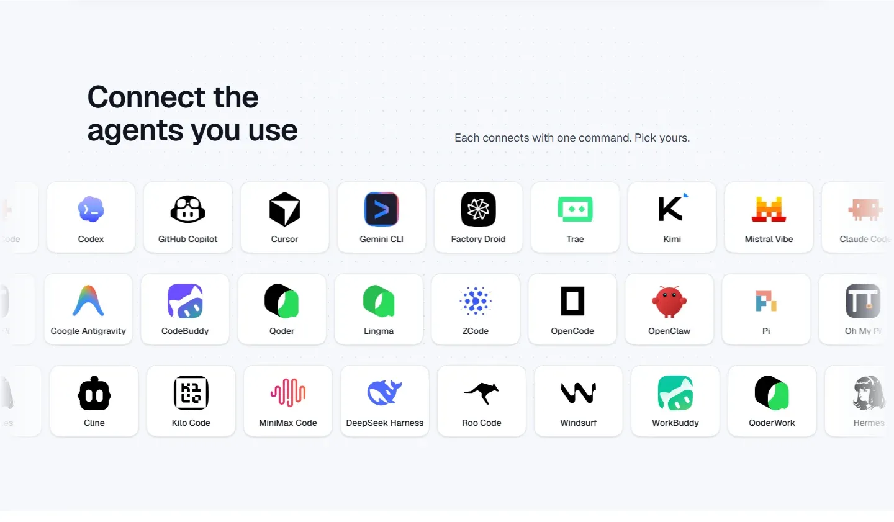
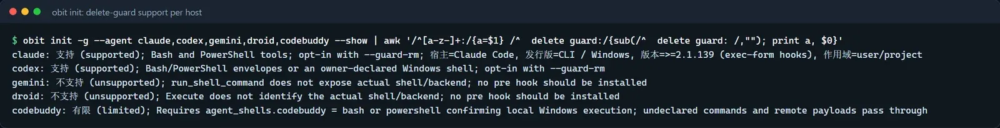

Obituary now connects to 30 agents. Seventeen use native hooks, nine use plugins, and four have only a rule file and MCP. At the start there were two, Claude Code and Codex. Around three in the afternoon of 9 November the integration layer became a registry of adapters, by 7:20 in the evening 29 of the 30 were connected, and ZCode followed the next morning. The agent coverage table in the documentation is generated by `obit init --show --format markdown`, so when a capability declaration in the code changes, the table changes with it.

## Three ways to connect

Whether an agent can connect to Obituary depends on what its host offers, and the entry point also decides how much Obituary can do.

The first is the native hook. The host starts a command before or after a tool call and passes the event as JSON on standard input. Claude Code, Codex, Copilot, Cursor, Gemini CLI and Factory Droid work this way, 17 hosts in all. The command is `obit hook <agent>`, and every call is a new process, so this step has to be light.

The second is the plugin. Hosts such as OpenCode, Pi, OpenClaw and Hermes extend through a TypeScript or Python plugin that runs inside the host process and have no command-style hook. We ship them a thin plugin that turns the host's tool-call events into versioned JSON and hands it to the same `obit hook <agent>`. Nine hosts connect this way.

The third has only a rule file and MCP. Roo Code, Windsurf, WorkBuddy and QoderWork are connected through those two alone, and Obituary installs no hook or plugin for them. What it can do is write its instructions into the rule file the host reads and register the MCP server, so that the agent decides for itself when to call `obit mark` and `obit bury`. None of these four has automatic registration after a file write, and none gets a deletion guard installed automatically.

<figure>
  
  <figcaption>The connection band on the landing page. Each icon is a connected agent and opens the setup page for that host.</figcaption>
</figure>

## One decision, a thin layer of translation

Thirty hosts cannot have thirty copies of the decision logic. All hosts share one pipeline, and each adapter does three things: decode the host's raw input into a neutral event, encode the result back into the host's protocol, and give a neutral answer when something fails. The handling itself lives in a single function, `Handle`. Adapters are listed in a registry, the `obit hook <agent>` subcommands are generated from it, input is capped at 4 MiB, and a UTF-8 byte order mark is stripped before decoding.

This skeleton landed at ten past three on 9 November and changed structure only. For Claude Code and Codex the test set was identical before and after, 2,522 results each time, and the body of `Handle` is byte-identical. The survey done before the work had found that the old entry point decided the event type before decoding, so every new agent would have opened the configuration before every shell command. Now the input is decoded to a neutral event first, only events other than PreToolUse open the full service, and PreToolUse still reads no ledger, starts no git process and touches no network.

The plugin protocol is version 1 of a JSON format with four rules. Paths come only from the host's official tool arguments or an explicit success report. A shell command needs trustworthy evidence of which shell it is for. Sessions are namespaced per agent. A response carries only a denial or context text, never an approval and never a rewritten command. The last rule matches the delete guard's own choice: Obituary only denies and does not edit an agent's command.

## What each host can do, stated as it is

The same event allows very different things in different hosts. Obituary splits capability into registration after a file write, session hints, the delete guard, MCP and Skill, and marks each one for each host as supported, limited or unsupported, with the reason beside it. `obit init --show` and `obit doctor --verbose` print this table, and the coverage table in the documentation is generated by the same command.

The strictest item is the delete guard, because it has to know which shell a command ran in. The same `rm -rf` means different things in bash and in PowerShell, and parsing it with the wrong grammar blocks the wrong object or suggests the wrong equivalent. Claude Code has separate Bash and PowerShell tools, so the tool name is enough. Codex 0.167 on native Windows reports every command as Bash and does not say which shell actually ran it. On 9 November we added a setting where the user declares whether Codex uses bash or powershell, and `obit init --guard-rm` infers it from Codex's configuration and writes it, which the user can change. A declared shell is used for parsing and blocking, and an undeclared one is let through. The setting later grew into a per-agent `[agent_shells]` table, which the delete guards of CodeBuddy and MiniMax Code use, and commands executed remotely are not blocked. Gemini CLI's `run_shell_command` and Droid's `Execute` do not give the shell's identity, so the coverage table marks them unsupported and Obituary installs no pre-execution hook for them.

<figure>
  
  <figcaption>Real output of one command, with awk keeping only the delete-guard line of each host. Supported, limited or unsupported is followed by the reason, and CodeBuddy needs its shell declared in the configuration first. The status words are printed in Chinese with an English gloss.</figcaption>
</figure>

## When the host cannot hand over text

Some hosts can notify Obituary in a write callback but have no way to pass text to the agent in that callback, for example the write callbacks of Antigravity, Hermes and Kilo Code, and Cursor's asynchronous session start. Obituary sometimes has something to tell the agent, such as a proposal waiting for the user's decision. At first such events were skipped entirely, so that write was neither observed nor registered. Now the event is handled as usual, with registration, observation and snapshots all done, and only the proposal is not marked as notified. The next event in the same session that can carry text delivers what is pending, and the mark is written only after delivery. The guarantee is at-least-once delivery, so a notice may repeat but is never lost. Claude Code and Codex behave as before.

## Chinese tools and steps that stay manual

For some hosts the public documentation is not enough to edit their configuration files with confidence, such as the global MCP location of Trae and the configuration path of Roo. For these `obit init` does not guess. It prints the exact manual steps, reports the status as manual setup required, which is not a failure, and does not pretend the host is installed.

The Chinese tools came in on the evening of 9 November. We surveyed more than twenty, connected CodeBuddy, WorkBuddy, Qoder (including the China edition), Lingma, MiniMax Code and DeepSeek Harness, and added ZCode the next morning. Tools that have been shut down, are old or have very few users were left out, and their users can still register Obituary's MCP server by hand and use the same instruction text.

Every newly added host carries a protocol fixture in the tests, a sample of the host's payloads, and the command-line acceptance runs it for each new agent name in the registry.
