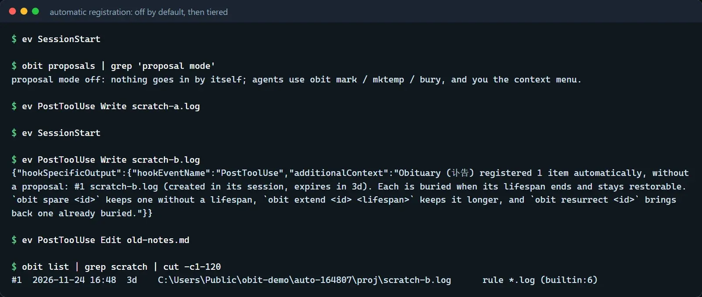

Automatic registration was opened up on 14 November, taken back that same night and switched off by default in the early hours of the next day.

**1.2.0 was published at 9 in the evening and 1.3.0 at half past three the next morning, less than seven hours apart.**

Each step along the way was pushed by a specific problem.

## Make every proposal safe to approve: two proposals listed uncommitted source files for burial

The problem started on 12 November. When a session ends, Obituary lists what the session left behind as proposals for the user to approve. Two proposals listed source files that an agent had just written and not yet committed as candidates to be buried in three days, and the agent could only tell the user to reject them.

The root cause was that the session diff called `git ls-files --others --directory` without `--exclude-standard`. The result held generated files that Git ignores together with new files that Git does not ignore and that were merely not committed yet.

The fix in the early hours of 13 November lets proposals collect only two kinds of thing and leaves everything else out:

- Collected: entries that Git ignores and whose names are dependencies, build output or caches.
- Not collected: a new file that is not ignored, because it is uncommitted work.
- Not collected: ignored files that are not on the list. Ignored does not mean regenerable, since `.env`, local settings files and `*.tfstate` are all ignored and none of them can be thrown away.
- Container proposals keep only containers that can be tied to the session's project through the compose working directory or a bind mount, because one that cannot may be the user's own.

The text of every proposal also says that it is recommended for approval and what approving does.

**The goal was that for every proposal Obituary hands out, the agent can say with confidence that it should be approved.**

## If they are safe to approve, why wait for a person: tiered automatic registration

On 14 November we asked the next question: if every proposal is safe to approve, why make the user nod at all? At 7:58 in the evening tiered automatic registration was merged, and `[proposals] mode` had three levels with tiered as the default.

### The three kinds of thing registered directly in tiered mode

1. A file the agent created itself in this session, which needs three pieces of evidence to hold at once:
   - The hook saw the write.
   - The Git snapshot taken at the start of the session does not contain the file, a folder above it, or anything inside it.
   - The file system's creation time is later than the start of the session, and so is that of everything inside it.
2. Git-ignored, regenerable leftovers.
3. Containers the session started for the project.

An older folder that was renamed or moved in keeps its old creation time, so even if an agent is talked into renaming a user's folder to `test-results/`, all it gets is a proposal.

Everything else, such as files that existed before the session, paths found only by the session diff and large folders the agent did not create, is still only a proposal.

### Four things that are never done in any mode

- Registering Git-tracked files.
- Registering a project the user declined.
- Approving a folder policy.
- Trusting `.obitrules`.

### Whatever is registered without asking is reported afterwards

Each automatic registration stores a receipt in the same ledger commit, and the hook passes the untold receipts to the agent after the write or at the start of the next session, with three ways out: `obit spare`, `obit extend` and `obit resurrect`.

`obit proposals` lists them under what was registered without asking, the window's decisions page has a list of what was handled automatically in which each item can be undone or kept longer, and the top of the page switches the mode and asks once before going fully automatic.

<figure>
  
  <figcaption>The automatic registration switch in the window. Off is selected by default today, with Tiered, Fully automatic and Ask about everything beside it.</figcaption>
</figure>

1.2.0 was published at 9 in the evening and 1.2.1 followed at nearly 11.

## The check that night: four kinds of problems with one root, "ignored by Git" does not mean "can be thrown away"

That night we went through everything Obituary tracked on this machine from the beginning and found four kinds of problems:

1. Dependencies and build output had been given expiry times, and one `node_modules` was long overdue and being tried every hour.
2. 311 records pointed at workspaces that had been deleted, and because Obituary did not check once a workspace was gone, those entries just hung there.
3. Two burials kept failing, and one 133 MB test directory had failed 54 times, each time by timing out, with a fixed hour between retries, no cap and no message, so nobody knew it was working for nothing.
4. One container had two proposals, and the project was recorded as the user's home directory, because the project was taken from the folder the session happened to be in.

These share a root.

**Being ignored by Git only says that something need not be committed, and does not say it can be thrown away. `node_modules`, local databases and build caches all belong here, and deleting them means reinstalling or rebuilding.**

1.2.x treated being Git-ignored as permission to handle something automatically, which is where the first kind of problem came from.

## Off by default, folded into 1.3.0

**The decision that night was to make automatic registration off by default and fold it into 1.3.0.**

When it is off, nothing goes into Obituary by itself and nothing is proposed. There are only two ways in:

- The agent registers things itself with `obit mark`, `obit mktemp` and `obit bury`.
- The user adds them from Explorer's context menu, which gained Add to Obituary and Bury now for that.

The delete guard, grave notices and the end-of-session tidy-up keep working, because in each of them the agent is making the decision. Even if the user turns an automatic mode on, dependencies, build output and caches are never registered automatically and no longer appear in proposals.

On upgrade, installations that already exist are all switched to off, whatever was registered automatically in that class is withdrawn and left where it was without a countdown, and from then on whatever the user sets in Settings stands. The instructions for agents, the README, the documentation and the website were changed to say the same thing.

### The other problems handled in 1.3.0

- Failing burials: Obituary has to search a folder for Git repositories first, and that search got only 100 milliseconds under the ledger lock, which is not enough with a cold cache, so it timed out and was retried forever. Now the search runs outside the lock for up to 30 seconds, only a quick 100-millisecond recheck is done under the lock, and a search that does not finish counts as a failure and never as a pass.
- Retry interval: after a failure it tries again after a while, starting at one minute and waiting longer each time up to a day, and after 12 failures in a row it stops and waits for the user. The window has a list of burials that failed with the reason, where they can be retried or no longer tracked.
- A file deleted outside Obituary has its record closed at the next check and need not wait until expiry.
- A container gets one proposal at most, and while Docker is not running the Approve button is unavailable and the card says why.

### A real run

In the same Git work tree, an agent writes a log in the default off mode and Obituary does nothing. After the mode is changed to tiered and a new session begins, a newly created log is registered on the spot and reported, while a note that existed before the session is edited and still not registered.

<figure>
  
  <figcaption>A real run in a demo Git work tree. ev is a small function that hands one Claude Code hook event to obit hook claude. Nothing is registered when the mode is off, a log created in the session is registered and reported in tiered mode, and a file that existed before the session is left alone.</figcaption>
</figure>

## 1.3.1: a patch 37 minutes after 1.3.0

After 1.3.0 was published we used it to bury temporary directories of about 13,000 entries each, and two of them failed twice in a row. An explicit `obit bury` already searched the whole folder outside the lock with no time limit, but that result was not used by the quick check under the lock, and with a cold cache 100 milliseconds was still not enough.

The fix makes that result count, and the checks that need no walk are repeated only if the quick check times out after a completed search.

**1.3.1 came out 37 minutes after 1.3.0.**
