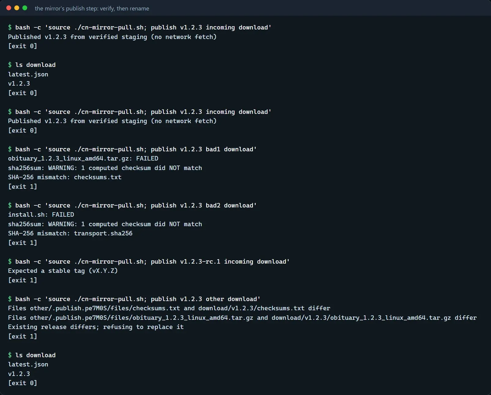

Obituary has to be installable for users in mainland China too, and GitHub is sometimes unreachable there and sometimes slow. On 11 November, the day 1.0.0 was released, the China mirror went live together with the website.

The mirror itself is not complicated. The hard part is how, after every release, the archives get onto it safely and in good time.

**That synchronization changed three times: upload at release time, the server pulling, and finally the pipeline pushing.**

## One domain, two routes: the mainland goes to the mirror, overseas to GitHub Pages

The website uses one domain whose DNS splits by route:

- The overseas route resolves to GitHub Pages.
- The mainland route resolves to a server in China.
- A separate subdomain meant for programs always points at that server.

There is a build of the site made specially for the mainland, in which every link on the pages, the sentence for agents and the installer point at the mirror, and no request goes to any outside site.

The program itself knows about the mirror:

- `install.ps1` downloads from GitHub by default, switches to the mirror if GitHub has not answered within 10 seconds, and with `-Mirror cn` uses the mirror from the start. The archive and `checksums.txt` always come from the same place.
- The install receipt records where the archive came from, GitHub, the mirror or a custom address, and a copy installed from the mirror gets an update command that uses the mirror's install script.
- When GitHub does not answer at all, the update check reads `latest.json` on the mirror and validates it as usual.
- When a stable release is published, the pipeline writes `latest.json` to the mirror as well.

## The first way: upload at release time, with two problems on the first day

The first way was the most direct. After an official release, the pipeline uploads the archives to the server in China. The two problems:

- The archives travelled from a data center in the US to the server in China, and 26 MB took more than ten minutes, so the job was cancelled and succeeded only when run again.
- The site deployment and the archive upload collided, because the server admits one upload at a time and the later one failed with an error.

The fix was to retry the upload, waiting a little while the server is busy, and to lengthen the upload timeout.

## The second way: the server pulls, and GitHub's download address timed out in two of three tries

On 19 November 1.4.2 changed the approach. After a release, the server in China pulls the archives straight from GitHub over parallel connections, so they can be downloaded from the China source within minutes.

The first real run got stuck. When the server downloaded `checksums.txt`, GitHub's release download address timed out in two of three tries, while the API address for the same file answered every time in under a second.

So each try now asks the API for a temporary address of the file, one anonymous API request per file, and aria2 opens 16 connections on that address. A failed try gets a fresh address and resumes the part that was not finished.

**A full pull of v1.4.1 on the server, 9 files and 66.6 MB in all, took 317 seconds, and `checksums.txt` and every archive matched the live mirror byte for byte.**

The install script has since come from the bytes of the Git tag, which are LF, and not from the CRLF copy that the old upload left.

## The third way: the pipeline pushes, and the server only rechecks and publishes by rename

The trouble lay in the route itself. The server in China reaching out to GitHub is the least reliable stretch of the whole chain. In the early hours of 21 November the synchronization became a push from a GitHub runner.

### The runner's side

- Downloads the six archives and `checksums.txt` with a read-only token.
- Takes the two install scripts from the same Git tag.
- Checks the list of archives and the SHA-256 values.
- Uploads them to a staging area on the server using a pinned host key.

### The server's side

The account that receives uploads can run only one restricted command, either to receive a write-only upload or to run `publish vX.Y.Z`. Both take the same lock.

- The server rechecks the files and hashes from the staging area.
- It publishes the complete version directory by renaming on the same file system.
- Then it atomically updates `latest.json` according to the latest official release that the runner had verified.
- If the same tag arrives with different content, the server refuses to overwrite it, and if the content is identical it keeps the original files.
- Deployment jobs are lined up in a queue, and a running one is not cancelled.

The checksum file `transport.sha256` checks that scripts and metadata were transferred without errors and is not a publisher's signature.

### How this step of the server behaves on the real code

The figure calls the publish function of the server script in the repository on synthetic release files. The first release goes through, and releasing identical content again changes nothing. These four cases are all rejected:

- A modified archive
- A modified install script
- A version number that is not a stable release
- Different content under the same tag

**After each rejection the public directory still holds only `latest.json` and one version directory.**

<figure>
  
  <figcaption>The publish step of the mirror's server script in a real run on synthetic files. A check that fails rejects everything, and the directory that is already public is not affected.</figcaption>
</figure>

## The manual route that was kept, and a rollback written down in advance

The old manual route was kept. A person can run `pull vX.Y.Z` and let the server fetch by itself, which is the only path left in the whole process where the server reaches out to GitHub.

The way back was written down in advance too:

1. Wait until deployment is idle.
2. Revert this workflow.
3. Withdraw only the authorization that belongs to this one key, and leave the other site keys alone.
4. Delete no version that has already been published.
