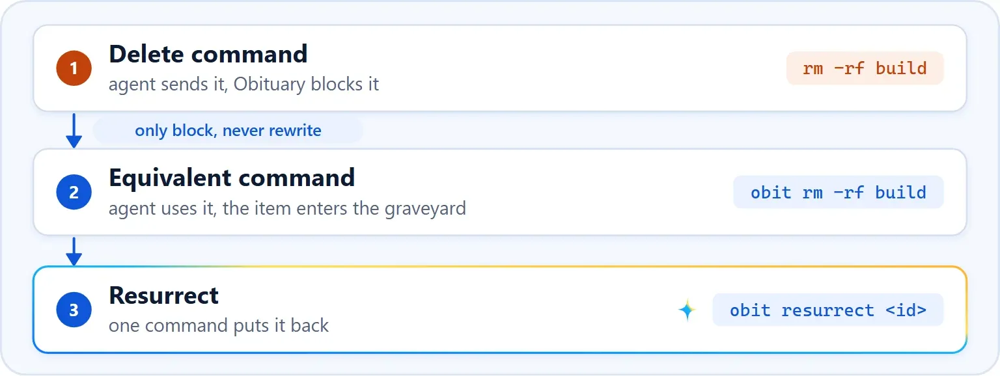
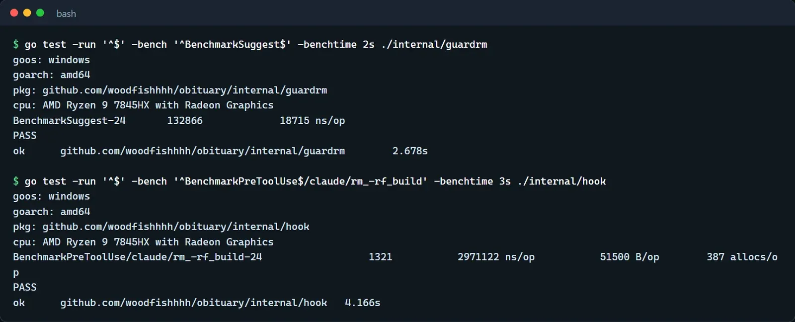

When an agent cleans up, it uses `rm -rf`, `git clean -fdx` or `Remove-Item`. All of them delete directly and leave nothing in the Recycle Bin.

The safety net on the editor side has limits too. Take Claude Code's checkpoints. The [official documentation](https://code.claude.com/docs/en/checkpointing) is clear that they track files changed by Claude's own file-editing tools, that a file changed only by Bash commands is not tracked, and that reverting it calls for version control such as Git. But much of what an agent cleans up was never in Git: debug scripts, logs, screenshots and changes that have not been committed.

The delete guard is made for that gap. It sits on the agent's pre-tool-use hook and reads the command about to run. If it recognises a deletion, it denies the call and names an equivalent that can be undone.

<figure>
  
  <figcaption>The whole path of the guard: block the delete command, name an equivalent, bury the item, and resurrect it with one command when needed.</figcaption>
</figure>

## Deny, never rewrite

The first design rewrote the command silently: the hook would turn `rm -rf x` into `obit rm -rf x`, and the agent would never know. On Claude Code 2.1.317 we found that this does not work. It checks permissions against the rewritten command, so a deny rule the user had set on the original command was bypassed. For Codex, rewriting a command also requires giving an allow on the user's behalf, which bypasses the user's rules just the same. A hook meant to protect the user had become a way around the user's permissions.

So the guard never rewrites a command. It denies, states the reason and the equivalent in a plain sentence, and the agent makes a fresh call, to which the user's own permission rules apply as usual. The cost is one more round trip for the agent. The text the agent sees is never translated, and it is written as a statement and never as a command. Below, a small function feeds a PreToolUse payload to `obit hook claude`. Without `--notice-only` the guard is on, and the output is a single line of JSON:

```text
$ hook() { printf '{"session_id":"demo","cwd":"C:/Users/Public/obit-demo","hook_event_name":"PreToolUse","tool_name":"%s","tool_input":{"command":"%s"}}' "$1" "$2" | obit hook claude; }

$ hook Bash 'rm -rf build'
{"hookSpecificOutput":{"hookEventName":"PreToolUse","permissionDecision":"deny","permissionDecisionReason":"Obituary's delete guard is on: `obit rm -rf build` provides restorable deletion; `obit resurrect` restores graveyard entries."}}
```

The guard can point an agent to four commands that bury: `obit rm`, `obit rmdir`, `obit remove-item` and `obit git-clean`. They follow the semantics of the original. `obit rm` keeps GNU rm's options, exit codes and messages, `obit remove-item` understands PowerShell's parameters, and `obit git-clean` previews with `git clean -n` and then buries the listed paths one by one. Every path goes through the same burial service, and a refusal is reported as an error and never degrades into a real deletion. The guard is off by default and is registered only by `obit init --guard-rm`.

## Stopping too little or selecting too much

In the first seven review rounds of the guard, the HIGH findings kept squeezing in from two directions: the guard stopped too little, or the command it suggested selected more than the original. The second is worse because it deletes the wrong thing, and the CRITICAL from the previous post is an example, since a fallback after `||` would really run when the equivalent command failed. So we settled on a principle: miss a command rather than select too much. Anything that could select more was not built. That covers translating paths between shells, PowerShell arrays and wildcards, and guessing the shell from the arguments, and complex commands that could not be parsed passed through.

We applied that principle too far, in a place where it did not belong, and we did it for five days. At 1.0.0 the guard denied only when it could produce a byte-for-byte equivalent obit command. That subset was narrow, and once a command got slightly more complicated the guard went silent. `rm -rf build && npm run build`, `rm -rf build 2>/dev/null`, `rm -rf build || true`, `rm -rf "$OUT"/*` and `git clean -fdx && npm ci` are all forms an agent commonly writes when it cleans up, and every one of them was outside the subset and ran unhindered.

On 13 November we saw that we had mixed up two questions: whether a command is a deletion, and whether we can offer a command that is exactly equivalent. The second has to be conservative, because a mistake selects too much and deletes the wrong thing. The first does not, because a denial executes nothing and cannot select anything, so it can be broad. [That commit](https://github.com/woodfishhhh/obituary/commit/12c9d11) separates the two. Any literal `rm`, `rmdir`, `git clean` or `Remove-Item` (aliases included) in a command position is denied. An equivalent is offered only when the command falls in the supported subset, and when none can be given, the reason says why and points to the general `obit bury <path>` and `obit git-clean`. The same function, now with a command that has an `&&`:

```text
$ hook Bash 'rm -rf build && npm run build'
{"hookSpecificOutput":{"hookEventName":"PreToolUse","permissionDecision":"deny","permissionDecisionReason":"Obituary's delete guard is on: `rm` deletes permanently and no exact obit equivalent applies to this command (deletion must be the final command segment). `obit bury <path>...` provides restorable deletion for literal paths, `obit git-clean` for git clean; `obit resurrect` restores graveyard entries. For targets selected at runtime, the safe alternative is to list and review the paths first, then give them as explicit operands to `obit rm -- <path>...`."}}
```

## How a command is read

Deciding whether a word is in command position means really parsing the shell, and a regular expression will not do. `\rm`, `'rm'`, `r''m`, `/usr/bin/rm` and `rm.exe` are all rm once quotes and paths are removed, and `git -C x clean` needs git's global options skipped before the subcommand is read. Strings, comments, the body of a quoted heredoc and the arguments of other commands are not commands, so `echo "rm -rf build"` is not stopped. `rm --help`, `git clean -n` and `Remove-Item -WhatIf` only preview and do not count either, and a command word containing a variable, a command substitution or a wildcard is not a literal deletion. When the shell is uncertain, as with Codex on Windows when no shell has been declared, the command passes and is written to the audit log. When bash fails to parse, the whole command is scanned word by word instead of being let through.

The first three commands below print nothing, which means they pass. The last two are denied. The first gives the PowerShell equivalent, and the second is a find with `-delete`, which has none:

```text
$ hook Bash 'echo \"rm -rf build\"'
$ hook Bash 'rm --help'
$ hook PowerShell 'Remove-Item -Recurse -Force build -WhatIf'
$ hook PowerShell 'Remove-Item -Recurse -Force build'
{"hookSpecificOutput":{"hookEventName":"PreToolUse","permissionDecision":"deny","permissionDecisionReason":"Obituary's delete guard is on: `obit remove-item -Recurse -Force build` provides restorable deletion; `obit resurrect` restores graveyard entries."}}
$ hook Bash 'find . -name \"*.tmp\" -delete'
{"hookSpecificOutput":{"hookEventName":"PreToolUse","permissionDecision":"deny","permissionDecisionReason":"Obituary's delete guard is on: `find -delete` deletes permanently and no exact obit equivalent applies to this command (unsupported command structure: find). `obit bury <path>...` provides restorable deletion for literal paths, `obit git-clean` for git clean; `obit resurrect` restores graveyard entries. For targets selected at runtime, the safe alternative is to list and review the paths first, then give them as explicit operands to `obit rm -- <path>...`."}}
```

The parser has been replaced once. The first one was a tokenizer we wrote by hand, about a thousand lines, and that part alone took 10 rounds of delete-guard review. On 9 November the bash half moved to the parser behind shfmt, `mvdan.cc/sh`, which recognises statements, word boundaries, quotes and assignments, while the guard's own subset still decides whether an equivalent can be given. The library does not remove quotes, so a small static decoder for the allowed nodes remains. Every behaviour difference from the swap landed on the conservative side: commands containing a NUL byte, and continuation lines combined with a comment, now pass. By 13 November the whole syntax tree was used to decide whether something is a deletion, and every command position is visited, in lists, pipelines, `||`, background commands, subshells, `$(…)`, backticks, process substitution and substitutions inside an unquoted heredoc. PowerShell has no ready-made Go parser, so we kept a hand-written scanner that skips comments and strings, reads script blocks and `$(…)` as code, and treats the typographic quotes PowerShell accepts as quotes.

We fuzzed this part as well. On 9 November we added a fuzz test for the guard, seeded with 90 commands, that checks whether a suggested command differs from the original only in the replaced command word, and a five-minute run executed 3,047,091 inputs. The same day an independent review of the parser swap found a low-severity problem. With an odd number of backslashes before a newline, the static decoder gave a suggestion where the old tokenizer would have let the command pass, and such continuations now pass as a whole. On 13 November fuzzing also caught a panic in an iterator of shfmt that fires when its caller stops at an error, and 4 MiB of brackets overflowed the parser's stack and crashed the hook, so nesting deeper than 256 levels is no longer handed to the parser.

The guard runs before every tool call, so it does not start git or touch the network, and it judges a command by parsing its syntax. Measured with the repository's benchmarks on this machine, parsing and judging a bash command takes about 18.7 microseconds, and the whole pre-tool-use hook, JSON decoding and the other checks included, takes about 3.0 milliseconds in process, not counting process start. The two numbers are two orders of magnitude apart, and a CPU profile shows that almost all of the difference is file-system calls on Windows: on every tool call the hook looks for `obit` on PATH and checks whether it is this very program, to decide whether the suggested equivalent command can start with `obit` or needs an absolute path, and that step does not depend on whether the command deletes anything.

<figure>
  
  <figcaption>The raw output of the two benchmarks: parsing and judging is measured in microseconds, the whole pre-tool-use hook in milliseconds.</figcaption>
</figure>

Both denials and passes are counted, `obit stats` shows how many were denied, and the commands that pass are written to the audit log, which is how a gap gets noticed.

## What it cannot stop

Today the guard recognises `rm`, `rmdir`, `git clean` and `Remove-Item` (aliases included) in command position, plus `find -delete`, `find -exec rm` and `xargs rm` in bash, three indirect forms added on 19 November in 1.4.2. Any other way of deleting is unknown to it. It reads only the text of a shell command and cannot see what a program does internally, and wrapper commands such as `sudo rm` or `bash -c '…'` are not parsed.

The architecture document records four known limits. All of them need a special environment, and in all of them the item is buried and can still be resurrected. Fixing them would mean emulating an external system inside a native program, which is the cross-system translation the guard deliberately does not do.

- When `$WhatIfPreference` or `$ConfirmPreference` is set in a PowerShell session, `obit remove-item` cannot see the session state and will not only preview or ask.
- When a directory holds children whose NTFS ACL forbids deletion, `rm -rf` cannot remove them, while burying the whole directory by rename takes them into the graveyard with it.
- When WSL is mounted with the `metadata` option, Linux-side permissions are not checked from the Windows side, so where `rm` fails on a permission, `obit rm` may succeed.
- When the agent's shell inherits a wrapper function with the same name (for example an exported `rm() { /usr/bin/rm -i "$@"; }`), the hook sees only the command text and not the functions of the session, and the suggested `obit rm` bypasses that wrapper.

The guard sees the command text the agent submits, so if the command changes before it reaches the shell, the guard does not see that. When Codex on Windows hands a command to another layer of shell, for example, the meaning of the quotes can change. That layer really did surface in an incident on 19 November, and another post covers it. Whether the guard is installed also depends on whether the host can tell us which shell a command actually runs in. Where it cannot, we do not install the guard, and the coverage table marks that cell as unsupported. Finally, a process that runs as you and is aimed specifically at Obituary can already delete your files directly, and the guard does not defend against it.
