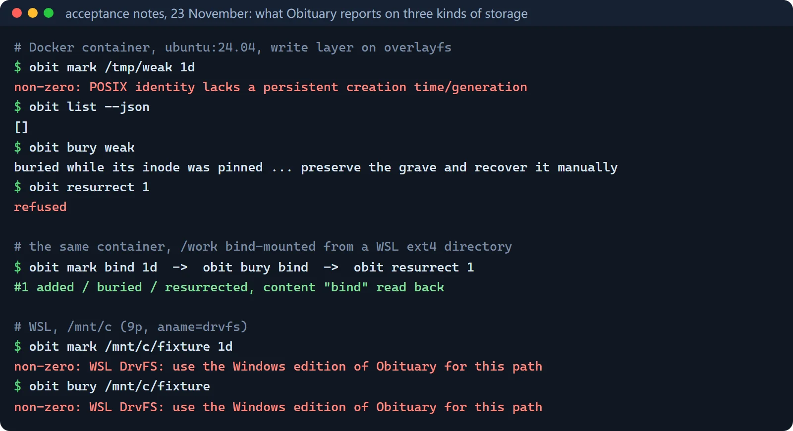

Obituary recognises a file by its persistent identity. Two kinds of place cannot give a reliable one, and on 23 November we checked their boundaries on real machines.

**On a container's write layer and on a Windows mount in WSL, Obituary refuses to register, leaves the file where it is, and says what to do.**

## Why it refuses: device plus inode gets reused after a deletion

A file that is deleted and created again, even at the same path, must not be mistaken for the original. On Windows Obituary uses a 128-bit file ID. On Linux and macOS a device number and an inode are not enough, because both can be reused after a deletion, and a path that is deleted and recreated may get the same pair of numbers.

So on POSIX the identity has to carry a creation time or a generation, and it is refused when it does not. If we cannot tell "an object that was deleted and recreated" from "the original object", we cannot give it a safe lifespan.

## The Docker write layer: refuse to register, leave the file alone

A container's own writable layer is overlayfs, and it cannot supply a persistent identity.

We made a temporary tag from the local `ubuntu:24.04` and ran it with `docker run --rm --network none`, as an ordinary user with no added capabilities, and `stat -f` confirmed that `/tmp` is `overlayfs`.

- `obit mark /tmp/weak 1d` returned non-zero with `POSIX identity lacks a persistent creation time/generation`.
- Reading `weak` straight back showed the file still in place. `obit list --json` was `[]`, and the graveyard had `burials: null, pendingCount: 0`.
- **The failed registration did not turn into a move.**

**Running `obit bury` by hand on such a write layer moves the file into the graveyard, but it cannot be resurrected automatically.** Only a separate `obit bury weak` moves anything, with the notice `buried while its inode was pinned ... preserve the grave and recover it manually`, and a following `obit resurrect 1` is refused. This is a different thing from an automatic expiry, so this kind of manual burial must not be advertised as recoverable.

<figure>
  
  <figcaption>An excerpt of the acceptance notes of 23 November, showing how Obituary reacts on three kinds of storage: it refuses on a container write layer, works on a bind mount, and refuses on a Windows mount in WSL while pointing to the Windows edition.</figcaption>
</figure>

### A directory bind-mounted in works normally

In the same container we bind-mounted a directory on WSL's native ext4 to `/work`, with both the files and Obituary's data directory inside that mount. `mark bind 1d`, `bury bind` and `resurrect 1` reported `#1 added`, `buried` and `resurrected` in turn. After the burial was confirmed the source path was gone, and after the resurrection the original content read back.

We did not assume that every volume provides a persistent identity. The advice in the docs is to keep the files and the data directory on a volume or bind mount backed by a filesystem such as ext4 that can provide one.

## A Windows mount in WSL: it used to be an error nobody could act on

In WSL a path such as `/mnt/c` is a Windows drive. `findmnt` shows it as 9p, and its mount options include `aname=drvfs`.

The old Linux edition behaved inconsistently here. `mark` failed but suggested using the Linux `bury`. If you followed the advice, the old build really tried to bury the file immediately and then, because the mount does not support a safe rename, ended with `retry ... nothing was overwritten (invalid argument)`. **What the user saw was a rename failure with nothing they could do about it.**

The Linux edition now refuses plainly on such paths:

```text
WSL DrvFS: use the Windows edition of Obituary for this path
```

We checked with two ledgers that it never manages the same file twice:

- The Windows edition first registered a test file as `#2`.
- A Linux process, in a separate mount namespace, bound the same Windows temporary directory to `/mnt/c` and ran `mark /mnt/c/fixture 1d` and `bury /mnt/c/fixture`. Both returned non-zero with the message above, and the content still read back as it was.
- On the Linux side `list --json` was `[]` and the graveyard had no entries. On the Windows side the list still held only `#2`.
- After the Windows edition ran `bury` the source path was gone, and after `resurrect 2` the original path and its 7 bytes of content matched the original.

The two ledgers share nothing, so neither manages half of the file.

### The check looks at the device, not at the `/mnt/` prefix

The detection sits at the entry of Linux file operations. It takes the major and minor numbers of the device the file lives on, finds the matching 9p mount in `/proc/self/mountinfo`, and refuses only if its options include `aname=drvfs`.

The reason is that DrvFS can be mounted somewhere else, or bind-mounted elsewhere, so guessing from a path prefix would miss those cases and would catch other 9p shares by mistake. Other 9p shares that can be recognised are not rejected wholesale. The identity algorithm, the ledger and the burial and resurrection protocol did not change.

### The first version put it in the wrong place: valid commands were refused

The first version put the check into general path resolution. With a project on DrvFS as the working directory and a native file in `/tmp` as the target, a valid command was refused too.

The final version limits the check to the Guard's check on "managed objects", and project lookup is no longer affected by it. In the same project, `mark`, `bury` and `resurrect` on a native file read back `native`, and that holds alongside the plain refusal of a DrvFS file.

The tests use `OBIT_TEST_DRVFS_PATH` pointing at a real file. `TestDrvFSOwnershipAppliesOnlyToManagedPaths` keeps the check to managed paths, and `Test9pDeviceOwnership` covers an aliased mount, a plain 9p mount and an unknown device. With the final Guard check removed (a temporary copy that still compiles), the first test fails with `missing Windows handoff: <nil>`, which shows it can catch the mistake.

The fix merged into main at 15:11 on 23 November.

## What the user docs say

The home page and the install notes in all ten languages carry the two points:

- **WSL:** keep projects and agent configuration on the native Linux filesystem, for example `~/projects`. DrvFS mounts such as `/mnt/c` may not support the safe renames installation needs, and for registering, burying or resurrecting files on those mounts, use the Windows edition only.
- **Docker:** if a container's overlayfs cannot provide a persistent file identity, `obit mark` refuses to register and leaves the file in place. To use lifespans and resurrection, keep the files and Obituary's data directory on a volume or bind mount backed by a filesystem such as ext4 that provides persistent identities.

## What was not tested

WSL1, other overlayfs set-ups with exports enabled, and every volume driver were not tested.
