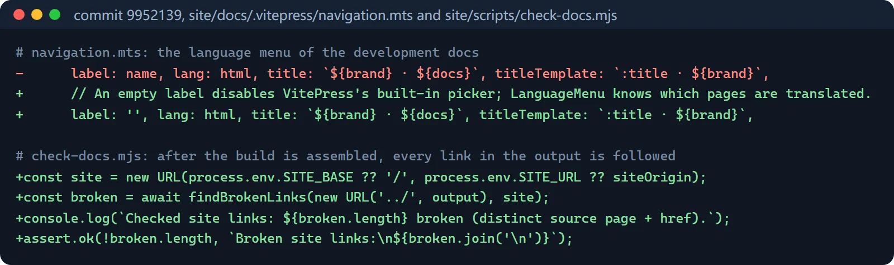

The page counts, images, RSS feeds and sitemaps on both sites all matched. The pass found one blocker: the development docs pages carried 320 links to pages that do not exist.

**The language menu on the development docs listed ten languages. Only Chinese and English have development docs, so the other eight were dead links, 160 in each build.**

## What the pass measured: two builds and two live domains

On 23 November the baseline was the 1.7.0 release commit. We built the overseas version (`pnpm build`) and the mainland mirror version (`pnpm build:cn`) locally, checked the output item by item, and then read the live sites back.

The counts in each local build:

| Item | Count |
|---|---:|
| Main docs pages | 160 (16 pages × 10 languages) |
| Agent guide pages | 270 (27 agents × 10 languages) |
| Development docs pages | 20 (10 each in Chinese and English) |
| Blog post pages | 44 (22 Chinese + 22 English) |
| Blog index pages | 2 |
| Sitemaps | 450 for the docs, 46 for the blog, 10 for the root, each unique and each entry matching the output |
| RSS | 22 items in Chinese, 22 in English |
| Language links between docs and agent pages | 430 pages × 10, none missing |

Of the 680 routes we expected, none was missing, and no image reference in the local output pointed at a missing file.

A few more things were checked one by one:

- The command reference for 77 commands times 10 languages matches what the command line actually prints for `--help`.
- The install commands in the 27 agent guides are identical to the output of the same `initCommand` the landing page's command strip uses, with 0 mismatches.
- The 6 tests of the blog's image contract all passed.

### Spot checks of user commands: install, uninstall, kept data, defaults

Every run explicitly used temporary data, config and user directories, and touched no real ledger. The 15 checks fall into five groups of three:

- **Install:** `obit config --create` followed by reading the paths back; `obit init --global --agent codex --mcp --skill` really writes the hooks, the MCP config and the skill; and the capabilities `--show` reports match the docs.
- **Uninstall:** `--dry-run` prints a plan and changes no file; `--yes` removes the hooks, the MCP config and the skill and keeps the data directory and `config.toml`; and the output says that the program files are removed by the installer or package manager.
- **Kept data:** data and config are still there after the uninstall, the plan does not list graveyard records as something to delete, and only what Obituary added is removed.
- **Platform boundaries:** the Windows scheduled task, macOS launchd and Linux systemd and crontab named in the docs all have matching source, and `init --dry-run` on Linux writes no Explorer menu and no registry entry.
- **Defaults:** `obit help init` defaults to the claude agent, and `obit config` shows `retention_days=7`, `update.check=true` and `proposals.mode=off`, all matching the command reference.

We then downloaded the 1.7.0 release archives for Windows and Linux, checked their SHA-256 and repeated the checks on Windows and on WSL, and both reported `obit version 1.7.0`. On this Windows machine `obit uninstall --yes` safely refused the system-service part because of another installation's scheduled task, and returned non-zero, while data and config were kept as documented. A full uninstall on a clean Windows is covered by the Scoop acceptance.

## The dead links: the language menu listed all ten languages

On each of the 20 development docs pages, the language menu pointed to 8 language directories that were never generated. For example `docs/dev/agent-integration.html` pointed to `/docs/zh-TW/dev/agent-integration.html`, and the same page also pointed to the pages of the same name in Japanese, Korean, Spanish, French, German, Portuguese and Russian.

**Twenty pages times 8 targets each is 160 links per build, 320 across the two.**

The repository already had `check-docs.mjs`, which requires that the development docs directories for languages other than Chinese and English do not exist. The generic language menu still emitted links for all ten. Each side was correct on its own, and nothing checked that they agreed.

## The fix: let our own language menu take over, then have the build follow every internal link

The fix was committed at 13:47 on 23 November and merged into main at 13:55, and both the overseas Pages site and the mainland mirror were deployed.

<figure>
  
  <figcaption>The two changes in one commit. The upper half is the language menu, where an empty label switches off VitePress's built-in picker; the lower half is the check added to the build, which fails on any broken internal link.</figcaption>
</figure>

The fix for the menu is one line: turn off VitePress's built-in language picker and let our own `LanguageMenu`, which knows which pages are translated, take over. The user docs stay in ten languages, and the menu on a development docs page now offers only Chinese and English.

### The new check: follow the links after the build is assembled

After both sites are assembled, `site/scripts/check-links.mjs` follows every link in every HTML page of the output, including `<a>`, the links between languages and the canonical links:

- A link to an internal page or file that does not exist is recorded as a "missing target".
- A link with a `#` anchor whose target page has no such `id` is recorded as a "missing anchor".
- A single entry fails the build, and each one is listed with its source page and link.

The checker has tests of its own, and they were wired into the build of both sites. Once the fix was live, the dead-link references in the two builds went from 320 to 0.

## The second find: a font file that was never published with the site

The build log had a warning that did not stop the build: `/fonts/noto-serif-sc-subset.woff2` was not resolved at build time, the output did not contain the file, and three stylesheets referred to it.

Those three are the lazily loaded styles of the window demo on the landing page, and they come from the desktop app's catalogue of looks. The calendar and one-line looks that visitors can choose do not use this serif font, and neither the docs nor the blog loads those chunks, so a visitor on the landing page could not see a typographic problem. A link that leads to a 404 will still cause trouble sooner or later.

The fix lets the variant styles refer directly to the single source file in the desktop app's `public/fonts`, keeps the old stable URL, and carries the font's OFL licence text along at assembly time, so no second copy of the binary is committed.

The same checker was extended to the `url()` references inside stylesheets. Run against the local overseas build from before the fix, it reported exactly 3 entries, all this font, and after the fix it reported 0 for both the overseas and the mainland build.

## Reading the live sites back: 506 pages return 200, and the mainland side can only be checked indirectly

After the deployment we read both domains back.

- The root, docs and blog sitemaps hold 506 routes in total, and all of them return 200 when fetched directly from overseas. Requesting the same routes against the address that resolves for the mainland also gave 200 for all 506.
- The 506 responses from the two sides are byte for byte identical by SHA-256.
- The font file returns 200 on both domains with the type `font/woff2` and 204,168 bytes, and the browser decodes it. The OFL licence text is 4,543 bytes, and both hashes match the desktop source file.
- In a browser we read back 22 pages on each domain. On the two blog articles, in both languages, the image elements all decoded and the code blocks were present.

The evidence for the mainland side has a limit. Because the responses are byte for byte identical, this machine cannot tell whether a request was proxied overseas or really answered by the mirror. All we can say is that the deployment jobs of both sites succeeded and that the actual responses are right, which does not show that a visit from a different network in the mainland sees the same.
