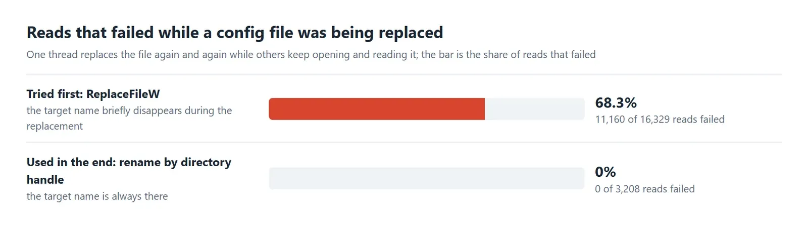
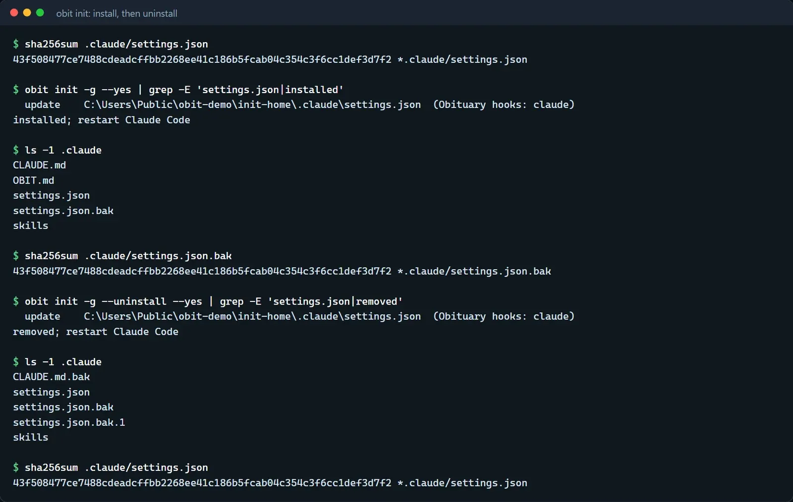

`obit init` has to write Obituary into the configuration files of many agents, for example Claude Code's `settings.json` and Codex's `hooks.json`. Those files are not ours. The user's editor may have one open, and the host agent may rewrite it at any moment. The installer must not swallow what someone has just saved, and it must not leave a half-written file behind. From the afternoon to the evening of 10 November we went through three rounds on this problem, and each round replaced a name with a handle.

## The window after the last check

The installer first computed a plan and recorded the original text of every file it would change. At apply time it read each file again, refused if it differed from the original and wrote only if it matched. Review found a window after that last check. If an editor saved the file with a temporary file and an atomic rename between the last check and the actual write, the editor's new content would be overwritten or deleted. We would be the ones acting, and the user would lose what they had just saved.

## ReplaceFileW first

Windows has no system call that atomically replaces a file by identity. Microsoft's documentation, when it covers updating a single document-like file, gives a common approach of writing a new file and then replacing the original, and ReplaceFile is one way to do that. ReplaceFileW can also keep the replaced version as a backup, which looked like a good fit. Measuring it showed that the target name briefly disappears during the replacement. With one thread replacing the file again and again and others constantly opening and reading it, 11,160 of 16,329 reads could not find the file. A host agent that reads its configuration at that moment may take it for missing and write a default one back. NTFS transactions were no way out either, since Microsoft explicitly recommends that developers not depend on them in new code.

## Hold the handle, not the name

What we settled on opens the target in the pinned parent directory with a handle that shares neither write nor delete, reads the final content and file identity, and requires both to match the plan. While holding that handle it writes a numbered backup with exclusive creation, and the backup is exactly the bytes that were just checked. The new content goes into a temporary file that is also created exclusively with a handle that shares neither write nor delete. Writing, verifying and publishing by rename all use that same handle, and so does deleting it on failure, so no other process gets a chance to swap the temporary file. Finally the handle on the target is closed and the rename replaces it at once. While the check and the backup are running, in-place writes and rename-saves by others are blocked by the sharing mode. If any step finds that the content or identity differs, the installation is aborted, the user's version stays as it was, and there is no automatic retry that would overwrite it. Deleting a file is also done on the verified handle and no longer by name. In the same experiment, none of 3,208 concurrent reads failed.

<figure>
  
  <figcaption>The result of the same concurrent-read experiment for the two ways of replacing. ReplaceFileW makes the target name disappear for a moment, while renaming by directory handle keeps the name there at all times.</figcaption>
</figure>

This change was itself reviewed for several more rounds. The first round found that the temporary file had been created through `os.Root`, closed and then renamed by name, so another process could swap it in between and get its own content published. That led to the approach above in which one handle lives through the whole process, and the rename uses `NtSetInformationFile` relative to the parent directory's handle. Another round found no new HIGH or MEDIUM and left two LOW items. One was that the temporary file was created by absolute path, so if the parent were swapped for a junction after the check the file would land somewhere else. It now uses `NtCreateFile` relative to the pinned parent handle, sharing read only and requesting delete access, the installer and the Explorer labels both write through that function, and the old path-based function is gone. Tests in both packages swap the parent for a directory or a junction after the final check and assert that nothing lands outside.

A short window remains between closing the handle and the end of the rename, measured at a median of 0.77 milliseconds and a P99 of 2.1. If an editor saves exactly inside it, its version may be overwritten, and the numbered backup preserves the checked older version. On such a conflict the installation counts as failed and the user has to run it again.

## Touch only what we wrote

The installer is strict about what counts as its own. Only a hook entry whose program is an absolute path to `obit` or `obit.exe` and whose arguments are `hook <agent>` belongs to Obituary, and a user's own compound command does not. When editing `settings.json` it keeps the key order, does not escape characters such as `&&`, keeps the original BOM, and writes the changed file with two-space indentation. Backups are created exclusively in the order `.bak`, `.bak.1`, and an older backup is never overwritten. Uninstalling removes only what was added.

The user-level `~/.claude.json` is a state file that Claude Code rewrites as a whole while it runs, and replacing it by rename would make it and us swallow each other's writes. Obituary therefore only reads it to decide ownership and leaves the writing to the official `claude mcp add-json` and `claude mcp remove`.

What follows is a real run. A `settings.json` in which the user has written their own PreToolUse hook has the same SHA-256 as its backup after installation, and after uninstalling it again matches the original exactly, with the version from before the uninstall kept in `settings.json.bak.1`.

<figure>
  
  <figcaption>obit init installing and then uninstalling in a temporary demo directory. The three sha256sum values agree, which shows that the backup holds the original bytes and that uninstalling restored the file byte for byte.</figcaption>
</figure>

## macOS and Linux

This approach relies on Windows sharing modes, which have no counterpart on macOS and Linux. On those platforms `obit init` kept returning unsupported, so agents could not connect, and burial working was of no use. The POSIX version arrived on 12 November. In the pinned parent directory it reads the target's content and identity, which includes device number, inode, size, modification time and content, and requires them to match the plan. Then it creates a numbered backup exclusively, writes the new content into an exclusively created temporary file in the same directory and calls fsync, checks once more just before the rename that the target has not changed, and finally renames it into place and syncs the directory. To delete a file it does not unlink directly. It first renames the file into a numbered backup without overwriting anything, then checks the identity, and puts the file back if it does not match. A very short window remains between the last check and the rename, of the same order as on Windows.
