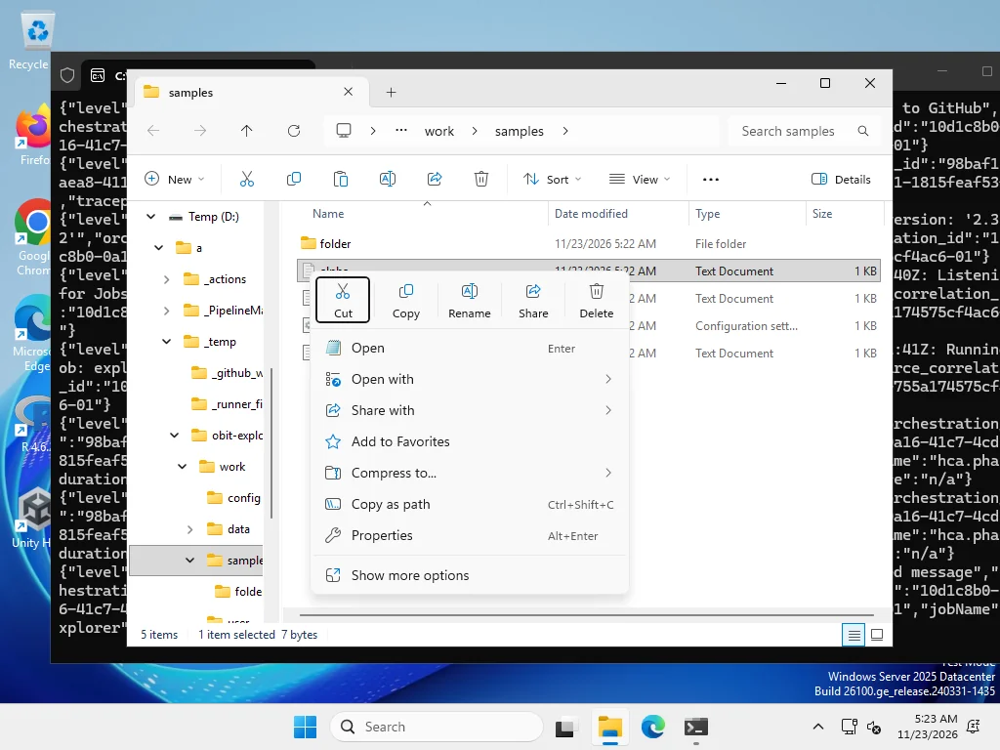
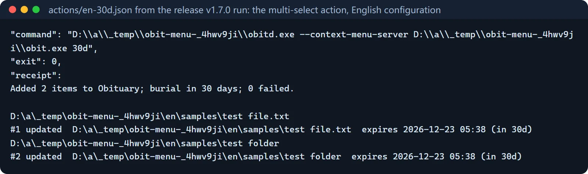
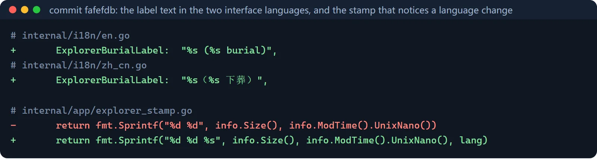

The registration and the actions of the Explorer right-click menu both passed acceptance, and the pass turned up one real defect.

**The date labels in Explorer were written in Chinese as 「名字（11-13 下葬）」, whatever the interface language.**

## How it was accepted: the released binaries, on a disposable Windows machine at GitHub

This development machine has no Windows Sandbox enabled, and we did not want to register a menu on a real desktop, so the acceptance runs on a GitHub-hosted Windows runner through the manually triggered `explorer-acceptance.yml`.

What was tested is the Windows amd64 archive of the released 1.7.0, whose SHA-256 matches the release manifest. The acceptance has two rounds, one with a Chinese configuration and one with an English configuration, each with its own ledger. Chinese and English here mean Obituary's interface language, not two Windows display languages.

## Clicking the menu did not work: 16 runs in 47 minutes, 15 of them failed

The first thing we wanted was for UI automation to click through the menu.

From 12:51, when the first acceptance workflow was added, to 13:38, when it passed, there were 17 commits and 16 runs. The first 12 runs were triggered by pushes, at 13:19 we turned the push trigger off, and the last 4 were triggered by hand. **Fifteen failed and the sixteenth passed, and the one that passed no longer clicked the menu.**

The three manual UI attempts stopped here:

- The first did not enumerate the classic menu.
- The second got only the buttons of the first layer and a `Popup`.
- In the third the bounding box of the `Popup` was NaN, so it could not be located.

<figure>
  
  <figcaption>A screenshot from the second manual run, taken on the runner's real desktop. The corner says Windows Server 2025. Only the first layer of the menu is there, with Show more options at the bottom, and the classic menu is behind it, which the automation never got into.</figcaption>
</figure>

## Calling the handlers the menu registers

If we could not click the menu, we could still call what sits behind it. The handlers are the ones really registered in the registry, only without the mouse.

- **Actions on one file or one folder:** read the command of that menu item from the registry, substitute the path placeholder and start it.
- **Actions on a multiple selection:** start the registered `LocalServer32` and pass the same set of Shell items as one `IDataObject` into `IDropTarget::Drop`.

The COM handler process returned 0 in both languages, the error list `failures.json` was empty, and no fallback entry point was used.

<figure>
  
  <figcaption>The real receipt of the multi-select action on the runner. A file and a folder were selected together with a 30-day lifespan, both succeeded, and both expire at 2026-12-23 05:38.</figcaption>
</figure>

The results, item by item:

- **Text:** the menu text for files, folders and the empty background matched what was expected in both rounds. The shared lifespan submenu is 1, 7 and 30 days by registration order.
- **Lifespans:** 1 day on a single file, 7 days on a single folder, and 30 days on a file and a folder selected together. For each, we checked the path the command line returned, the expiry and the object on disk. The receipt for the mixed selection was 2 succeeded and 0 failed.
- **Empty background:** what is registered is "set folder policy". After it ran, the record held the chosen folder, 30 days and `consent: pending`, and nothing was approved automatically.
- **Spare, bury, resurrect:** after `obit spare` cancelled the folder's lifespan it disappeared from the list. The registered bury action then moved only that folder, the other file stayed where it was, and the graveyard held only the folder. The registered resurrect action restored it, the bytes of the files inside matched, and the graveyard was empty again.
- **Labels and uninstall:** the comment and `InfoTip` already in a folder's `desktop.ini` survived the labelling, and after the uninstall the file was restored byte for byte. The parent directory's attributes went 16 → 17 → 16 and the INI file's 32 → 38 → 32, and the attributes of the sample file and folder returned to their original values. The third-party menu entries were still there, and Obituary's file-lifespan menu was gone.

## The defect the pass found: the label was always Chinese

In all ten languages of the user docs the date label is written in that language's own form: "name (11-13 burial)" in English, and in Spanish "nombre (entierro el 13 de noviembre)". What was actually written into Explorer had only one form: 「名字（11-13 下葬）」. Users of eight languages saw Chinese.

At first we meant to make the labels follow the docs in all ten languages. Then we changed our mind: Obituary's interface supports only Simplified Chinese and English, every other locale falls back to English, which is the documented convention, and the right-click menu and the notifications already work that way. So the label comes in two forms:

- Simplified Chinese interface: `名字（11-13 下葬）`
- Everything else: `name (11-13 burial)`

The docs and READMEs of the eight other languages had described labels in each language's form, which did not match, and we corrected them without extending the interface languages.

<figure>
  
  <figcaption>Three lines of the fix: the two forms of the label text, and the stamp for the state of the ledger gaining the language. Once the language in the stamp changes, the next synchronisation rewrites all the labels.</figcaption>
</figure>

The key points of the fix:

- **Change the interface language and the next refresh rewrites the labels.** The stamp used to decide when to synchronise labels recorded only the size and modification time of the ledger file, and now it records the language too. An old stamp without a language suffix makes the labels refresh once, so the Chinese labels written by 1.7.0 are rewritten in the current language.
- **A display name the user has edited is left alone.** An uninstall still restores the original display name exactly.

The fix was committed at 14:18 on 23 November and merged into main at 14:33. The full test suite on Windows and the main CI both passed.

## What was not tested

- Actually clicking the classic menu in Explorer.
- The order of our entries among the other menu items on screen, of which we can confirm only the registration order.
- The text the edit box shows when you press F2 on a labelled item.
- Whether the desktop notification really pops up when a lifespan is set or something is buried. The receipt proves the handler ran, not that a user saw a notice.

The fix for the date labels has not been looked at by hand in Explorer, and we will cover it with this acceptance run after the next release.
