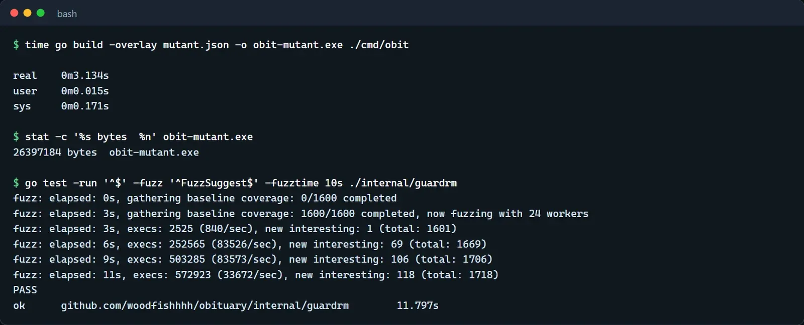

Obituary is written in Go, a choice we made on the first night. On the afternoon of 8 November it was put to the test again. By then there were about 13,600 lines of production code and 17,000 lines of tests, and 22 review rounds behind them, so should the project move to Rust? Our answer was no. Several concrete constraints all fall on the side of Go, and each one has a counterpart in the code and the tests.

## Why Rust was recommended at first

The first plan actually recommended Rust for the whole stack. The reasoning was that the new-style context menu of Windows 11 needs a COM DLL loaded into explorer.exe, that Go's runtime is a poor fit inside the Explorer process, and that writing everything in Rust would therefore be cleanest, with the command line, the background process and the extension DLL in one project. The alternative was Go for the command line and the background process, with only the small DLL left to C++ or Rust. We were learning Go at the time and chose the second option, and the plan said to write the DLL separately when we reached the phase for the desktop experience.

That DLL was never written. The context menu uses the classic registry-based menu, which on Windows 11 appears under "Show more options", so the main argument for Rust never came into play.

## The constraints that decided it

Obituary is installed on a user's machine and called constantly by agents: every time an agent writes a file or runs a deletion, a hook process starts. The language has to satisfy four constraints at once.

The first is distribution and startup. We need a single binary with no runtime and a fast cold start. A hook is a fresh process every time, Node starts slowly and would require the user to install Node first, which rules out TypeScript.

The second is calling system interfaces directly. Obituary checks identity with 128-bit file IDs, renames on the same handle, and sends things to the Recycle Bin through a COM interface. Go can call Win32 and COM directly with `x/sys/windows` and `syscall.SyscallN`, the code at the time had no cgo at all, and cross-compiling still takes one command. C++ could do it too, but at a higher cost in build, distribution and memory safety. `GOOS=linux` did not compile yet at that point, because the command line depended directly on Windows packages, and that was fixed in the following days when we did macOS and Linux.

The third matters most: the risk is in semantics, not in memory. What we have to guard against is deleting the wrong thing, a race window between checking and moving, and an identity that gets swapped, and our judgement is that Rust's borrow checker helps little with those. Tests do. Go's testing toolchain suits this directly. Every test package uses `TestMain` to point the user directories at throwaway ones, and `go test -overlay` runs mutation checks at compile level to show that every safety check has a test guarding it.

The fourth is speed of iteration. Go compiles in seconds, the code style is uniform and review is cheap, and the first two days of this project were basically 40 review rounds plus fixes. The official MCP Go SDK was also ready to use.

## Compile speed and parsing bash

Later events made the third and fourth constraints more concrete. A mutation check recompiles for every mutant, so compile speed decides whether the safety tests can be run at all. The build below was timed on this machine: after a one-line source change, recompiling and linking the whole command-line program into a 26 MB development executable took 3.1 seconds. The figure continues with Go's built-in fuzzing, which ran more than half a million inputs in 10 seconds.

<figure>
  
  <figcaption>Two real outputs from the same machine: the timing of an incremental build above, and the number of executions per second of the fuzzer below.</figcaption>
</figure>

The other reason comes from the delete guard. The guard has to decide which words in a shell command will really run as commands, which takes an exact parse of bash, with quotes, heredocs and command substitutions told apart. Go has the parser behind shfmt, `mvdan.cc/sh`, which has been tested on a great many real scripts, and we use it directly. Rust has bash parsing libraries too. We have not written a Rust version, so we have not compared them.

<figure>
  
  <figcaption>The direct dependencies listed in go.mod, where the core parts rely on existing libraries.</figcaption>
</figure>

## Using what Go offers

The question that afternoon also led to something practical. We went back over the code and found no goroutine in the production code, no `t.Parallel()` in the tests, and no fuzz tests yet. Some of that was deliberate. Ledger writes and burials have to happen one at a time, since concurrency would only fight over the same lock and widen the window for errors, and a hook spends its time starting a process, so a goroutine would not help. What was slow lay elsewhere, in asking git about one path at a time and in serial tests.

So we scheduled a pass on Go's capabilities, in the order measure, fuzz, then change. The fuzz tests covered 11 entry points that parse untrusted input and ran about 20 million executions in total. Among the problems they found was a `.obitrules` character range written as `[.-0]` that matched across the directory separator and widened automatic registration. After a write in an approved project, a hook now asks git once less, and its in-process time dropped from about 180 milliseconds to about 88, and from about 490 milliseconds to about 300 for the real process. Sweeping 1,000 expired entries went from about 100 seconds to 19.5 seconds, and purging 1,000 in the background from 78 seconds to about 4. 425 top-level tests and 97 subtests were made parallel.

The same day we discussed a single-writer ledger, where one resident process owns the ledger and the other commands send it requests to run in order. It is an established pattern, but Obituary had no resident process then, so it waits for the tray process.

When would we reconsider Rust? If Obituary had to be embedded as a library in another Rust program, or if some capability appeared that only Rust has and that we could not avoid. Neither has happened so far.
