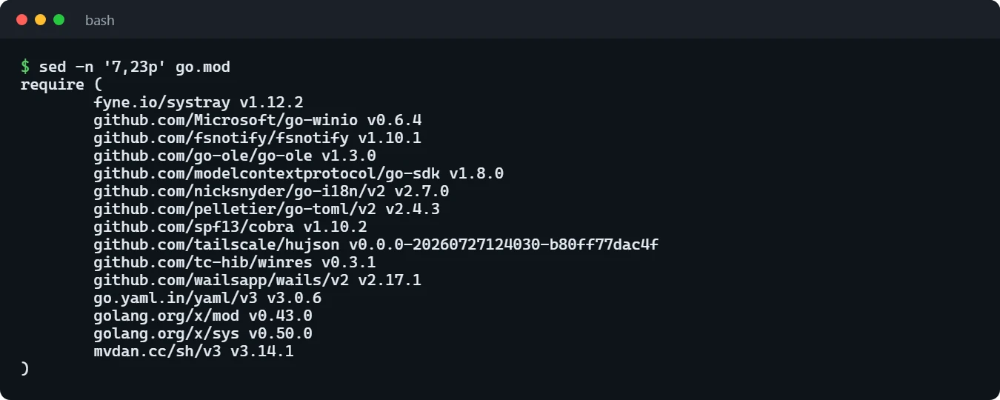

Obituary (the `obit` CLI) assigns lifespans to files and buries them in a graveyard when it runs out, where they can still be resurrected, built primarily for AI agents. Its first design plan recommended Rust. On the first night, we had already created `Cargo.toml` and two empty entry points before switching to Go minutes later. Over the next twelve days, as the codebase grew to 13,600 lines and then 64,000 lines, the question of rewriting it in Rust came up twice. Both times, once we ran the numbers, we stayed in Go.

That choice had little to do with language preference and everything to do with where risk actually sits in a tool like this. When a tool manages file lifetimes for agents and intercepts dangerous delete commands, the worst failures are misidentifying a file or misreading a shell command, not memory corruption. Guarding against those failures depends on testing—particularly mutation tests that require constant recompilation—which gives compile speed and parser maturity more weight than language features alone.

<figure>
  
  <figcaption>Real output from one machine: compiling a mutant and linking a 26 MB development binary took 3.1 seconds, and the delete guard's fuzz test ran more than 570,000 inputs in about 11 seconds.</figcaption>
</figure>

## Night one: the reason for Rust never shipped

On the evening of 7 November 2026, the project was still called Lifespan (command `ttl`), scoped as a small Windows utility for putting countdowns on files. The agent's first plan recommended full-stack Rust for a single reason: the modern Windows 11 context menu requires a COM DLL loaded into `explorer.exe`. Go and .NET runtimes do not belong inside the Explorer process, whereas Rust with `windows-rs` could hold the CLI, background daemon, and DLL in a single Cargo workspace. The fallback option was Go for the CLI and daemon with Rust only for the DLL, at the cost of maintaining two languages.

At 22:16, the project owner replied, "As you said, go." The agent read "go" as "go ahead with the recommendation," checked the local toolchain (Rust 1.96, GNU toolchain, no MSVC) along with versions for `windows`, `fs4`, and `chrono`, and started writing an edition 2024 `Cargo.toml` plus two empty entry points, `src/bin/ttl.rs` and `src/bin/ttld.rs`. The owner immediately followed up with two messages: "Go would be better" and "Why Rust?" The agent deleted the empty scaffold and revised the language section of the plan:

> Use Go. The Windows 11 modern context menu requires a COM DLL loaded into explorer.exe, and the Go runtime is not suited for running inside the Explorer process. At M2, write a small separate DLL in C++ or Rust whose only job is calling `ttl.exe`.

Before 22:30, the first stage was finished in Go: identifying files by NTFS file ID, sending them to the Recycle Bin through `IFileOperation`, five commands (`add`, `list`, `extend`, `cancel`, `sweep`), and 17 tests—16 passing, with the one touching the real Recycle Bin gated behind an environment variable. Around 22:46, the project pivoted to "agent-first, cross-platform." Agents routinely run inside Linux containers, WSL, or remote machines—our own Codex runs in WSL—which meant wiring up macOS Trash with `launchd` and Linux's freedesktop Trash specification with `systemd --user`. Go's cross-compilation moved from a bonus to a requirement.

That COM DLL was never written. Obituary's context menu uses classic registry entries, appearing under "Show more options" on Windows 11. The sole reason the first plan recommended Rust went unused.

## At 13,600 lines: four constraints

At 13:53 on 8 November, inside the M2b review loop (write code, two reviewers review in parallel, fix, review again), the project owner asked, "Should we switch to Rust?" By then the codebase held roughly 13,600 lines of production code and 17,000 lines of tests, hardened across 22 review rounds. Two minutes later, the owner pushed further: "If I put this project on my resume and someone asks why I used Go instead of Rust, C++, or TypeScript, how should I answer? And can we actually make good use of Go's strengths?"

Obituary runs locally on the user's machine, and every file write or deletion by an agent spawns a hook process. That execution model imposes four constraints.

First, distribution and startup. We need a single binary with zero runtime dependencies and fast cold starts. Because each hook spawns a fresh process, Node's cold-start latency and the requirement that users install Node ruled out TypeScript.

Second, direct OS API access. Obituary verifies file identity by 128-bit file ID, renames on the same open handle, and moves items into the Recycle Bin via COM. Go calls Win32 and COM directly through `x/sys/windows` and `syscall.SyscallN`—`internal/winfs/recycle_windows.go` invokes `IFileOperation` straight through its COM vtable—without a single `import "C"` anywhere in the repository. C++ can reach the same interfaces, at a higher cost in build complexity, distribution, and memory safety.

Third, risk lives in semantics rather than memory. What we have to prevent are accidental deletions, race windows between checking and moving, and file identity swaps. Rust's borrow checker offers limited help against those classes of bugs; tests do the heavy lifting. Go's testing toolchain maps directly onto this problem: `TestMain` in each test package redirects the user home directory to a temporary directory, and `go test -overlay` runs compile-time mutation tests to prove every safety check is guarded by a test. Behind those 13,600 lines sat 22 rounds of review reinforcing file-ID verification, same-handle renames, COM Recycle Bin calls, graveyard manifests and crash recovery, and delete-guard tokenization. Switching languages meant rewriting all of it, where any subtle behavioral drift could turn into accidental data loss and force another dozen-plus review rounds from scratch.

Fourth, performance bottlenecks sit outside the language. Hooks are short-lived processes where GC barely triggers. `obit.exe` is around 7 MB and `obitd.exe` around 6 MB. Go starts in a few milliseconds; real latency comes from spawning `git` subprocesses one by one (tens of milliseconds each) and disk I/O. Rust's `toml_edit` can edit TOML without disturbing formatting, but we only manage one delimited block inside Codex's `config.toml`, which already works.

We also set an explicit exit condition: reconsider Rust if Obituary ever needs to be embedded as a library inside another Rust program, or if we run into an unavoidable capability that only Rust provides.

That same afternoon, the owner asked, "Can we route ledger writes through a small helper process that accepts all commands and serializes them?" That is the standard single-writer pattern, and it maps cleanly onto Go: one goroutine in a resident process owns the ledger, requests enter over a channel, and processes communicate via Windows named pipes. We held off. Having each command acquire a file lock before reading, updating, and writing the ledger is already equivalent to a single writer in correctness, differing only in speed. Meanwhile, `obitd` was a scheduled task running every 5 minutes rather than a resident daemon. Keeping a fallback for when the daemon is not running meant retaining the file lock anyway—maintaining two paths—on top of managing pipe permissions, forwarding working directories and session IDs across processes, and handling protocol mismatches across upgrades. Once a resident daemon exists, it can serve as the fast path while the file lock remains underneath as the correctness guarantee.

## Putting Go's toolchain to work

Answering whether we were using Go's strengths prompted a codebase audit. We were already making good use of zero-cgo OS calls, `_windows.go` / `_other.go` platform file splits, `go:embed` to bundle `SKILL.md` into the binary, `context` timeouts (15 seconds max per `git` call, 1 second total across all lock waits inside a hook), the official MCP Go SDK, and `-overlay` mutation testing. The unused column was longer: zero fuzz tests, four benchmarks, zero goroutines in production code, zero `t.Parallel()` calls, a full test suite taking over two minutes, and broken cross-compilation because `cmd/obit` imported Windows packages directly and failed under `GOOS=linux`.

After the owner signed off, we inserted a Go capabilities pass at the tail end of M2b review, completed on 9 and 10 November. The sequence was strict: measure first, fuzz next, optimize last, leaving test counts, results, and existing mutation-test catches unchanged.

Baseline figures were measured on the same machine (Ryzen 9 7845HX, Go 1.26.4, with other workers running concurrently). `go test ./...` took 172 seconds wall clock. With 1,000 active entries and 1,000 graveyard records, `obit list` took 190 ms, `obit stats` 163 ms, and `obit graveyard --json` 432 ms. Hook latencies (median / p95) came out as follows:

| Scenario | In-process | Real `obit.exe hook claude` |
| --- | --- | --- |
| Post-write in an approved project (PostToolUse) | 201 / 294 ms | 306 / 338 ms |
| Post-write in a project not yet approved (proposal) | 97 / 123 ms | 231 / 260 ms |
| Session start (cold start / resume) | 103 / 24 ms | 211 / 144 ms |
| Stop | 0.5 ms | 127 ms |
| Delete guard PreToolUse | 0.9 to 1.9 ms | Not measured separately |

Fuzz testing covered every parser handling untrusted input: `.obitrules` rules, graveyard manifests, durations and `--at`, Claude and Codex payloads and patches, Codex TOML marker blocks, ordered JSON, and the delete guard—11 targets in total. Workers were instructed not just to check for panics, but to assert real properties: successful parses serialize and parse back to the same value; manifest checks reject paths outside the graveyard; lines not starting at column 0 are never treated as patch file headers; content outside marker blocks remains untouched. Each target ran for at least 2 minutes, totaling roughly 20 million executions, and surfaced two bugs. First, character ranges in `.obitrules` such as `[.-0]` span `/` in ASCII, matching across directory separators and broadening auto-registration scope. Second, bash commands with an odd number of backslashes before a newline were falsely blocked by the delete guard.

Then we fixed what the baseline exposed. Dropping one redundant Git query after a write in an approved project lowered in-process latency from roughly 180 ms to 88 ms, and real-process latency from roughly 490 ms to 300 ms. Batch reaping previously rewrote and flushed the entire ledger under the write lock for every buried item, making total write volume quadratic in entry count with two `fsync` calls per item. Switching to batches of up to 32 items in a single transaction—still re-verifying every item identically, with manifest-based recovery on interruption—brought `obit reap` on 1,000 expired entries from roughly 100 seconds down to 19.5 seconds, background cremation of 1,000 items from 78 seconds down to roughly 4 seconds, and 1,000 auto-registered entries from 108.7 seconds down to 14.4 seconds. Test hooks became injected dependencies, and 425 top-level tests and 97 subtests now run in parallel. Production code introduced goroutines only in safe read paths such as graveyard size calculation, leaving ledger writes and burials serial. Cross-compilation and packaging landed later in M7, and Linux CI enabled `-race`.

## At 64,000 lines: compile times and bash parsing

On the evening of 19 November, a friend looked at the project and asked, "Have you considered a Rust implementation?" The project owner said they disliked long compile times. The friend replied that "a small CLI tool doesn't take long to compile" and that "the biggest advantage is readability when writing a CLI." When the owner noted that Rust lacked a matching bash parser, the friend asked, "Why do you need a bash parser?" and argued that "a CLI itself doesn't need to follow bash syntax," pointing out that "`-delete` doesn't follow it."

That exchange touched two areas that are easy to underestimate.

First, compilation. By this point Obituary was no longer a small CLI; it included a resident daemon, a GUI, hooks for 26 agents, an MCP server, Explorer context menu integration, and extensive Windows handle and COM code. More importantly, mutation testing swaps one safety check in source for a broken version, compiles, and runs tests expecting failure. Every mutant has to be recompiled. In the screenshot above, compiling one mutant and linking a 26 MB binary took 3.1 seconds, keeping hundreds of mutants practical: the full MCP mutation suite finishes in roughly 6 minutes on an idle machine and shards across 8 machines in CI. In the Rust estimate we worked out that night, a full build takes several minutes and every mutant waits on incremental compilation. Compile speed here is not a matter of taste; it determines whether safety tests can run at all.

Second, bash syntax. Using a single dash for `-delete` is `find`'s own flag convention; bash ignores flag syntax and passes the token straight to `find`. Yet deciding which parts of a command string are literal text and which will execute is governed entirely by shell quoting and expansion rules. Without a bash parser, the delete guard cannot tell:

| Command | Triggers deletion |
| --- | --- |
| `echo "rm -rf /"` | No, just a string |
| `grep "rm -rf" log.txt` | No, an argument to `grep` |
| `x=$(rm -rf build)` | Yes, commands inside command substitution still execute |
| `rm -rf /` inside a `cat <<'EOF'` body | No, a quoted heredoc body is literal text |
| `$(rm -rf /)` inside a `cat <<EOF` body | Yes, an unquoted heredoc executes substitutions |
| `\rm -rf x`, `'rm' -rf x`, `r''m -rf x` | Yes, after stripping escapes and quotes all three invoke `rm` |

The delete guard works in two layers: parse bash rules to identify which commands will actually execute and with what arguments, then inspect arguments according to tool-specific rules for `find` or `xargs`. Early bash parsing was hand-written and later replaced by `mvdan.cc/sh`, the parser behind `shfmt`, battle-tested against large volumes of real scripts. PowerShell has no off-the-shelf Go parser and still relies on a hand-written quote-aware tokenizer. On the Rust side, `brush-parser` and `tree-sitter-bash` exist, though both trail in maturity and semantic precision.

<figure>
  
  <figcaption>Direct dependencies in go.mod: the official Go SDK for MCP, shfmt's mvdan.cc/sh for bash parsing, and golang.org/x/sys for system calls.</figcaption>
</figure>

## Doing the math on a rewrite

At 23:40 that same night, the project owner asked the agent for a full Rust rewrite plan and timeline. We measured the codebase first: roughly 64,000 lines of Go source and 91,000 lines of tests. The riskiest package, `core` (ledger, graveyard, burial, resurrection, cremation, expiration reaping), accounted for 15,000 lines of source and 21,000 lines of tests; `integrate` (`obit init`, rewriting configs for each agent) held 12,000 and 15,000; `cli` (over 30 commands) held 8,000 and 15,000; and `hook` (integrations for 26 agents) held 5,000 and 9,000. The GUI frontend is React and the website is not written in Go, so neither required touching.

| Stage | Scope | Duration |
| --- | --- | --- |
| 0. Validation | Four gates; stop if any gate fails | 1–2 weeks |
| 1. Foundation | Cargo workspace, test isolation, three-platform CI, `cargo-mutants`, and differential tests running Go and Rust builds on identical inputs to compare outputs, exit codes, and ledger state | 1–2 weeks |
| 2. Core | `core` and `winfs`, reading and writing existing ledgers and graveyards directly; port all 21,000 lines of tests and match current mutation kill rates | 3–4 weeks |
| 3. Delete guard and hooks | Bash and PowerShell parsing, 26 agent adapters, differential testing against a corpus of real commands | 2–3 weeks |
| 4. Peripherals | `obit init`, byte-for-byte matching output across 30+ commands, background daemon, system tray, context menu; migrate UI from Wails to Tauri | 3–4 weeks |
| 5. Packaging | Preserve installer filenames and `checksums.txt` format; reapply for code signing | 1 week |
| 6. Shadow run and cutover | Run the Go delete guard in shadow mode and log every divergence; release a 2.0 beta, then GA | 2–4 weeks |

The total came to 13 to 20 weeks assuming the owner makes decisions, the agent coordinates reviews, and four or five Codex workers run in parallel—or 6 to 12 months for one developer writing by hand full-time. An independent estimate on a separate branch came out to 14 to 21 weeks with the same verdict. The largest risk sat at the first gate of Stage 0: testing the Rust bash parser against hundreds of thousands of real commands collected from local Claude and Codex session logs alongside the delete guard's main scenario matrix, treating the Go build as the oracle. Passing required 100% agreement on the scenario matrix and 99.99% on the corpus, with every single divergence explained. Failing meant writing a bash parser from scratch, adding another one to two months. The other three gates verified opening files by file ID, handle-based renames, COM Recycle Bin calls, long paths, and hard links on real NTFS via `windows-rs`; confirming Tauri could carry the existing UI, tray, and notifications; and checking whether the official Rust MCP SDK covered every feature we use.

The benefits column was brief: a smaller installer and memory footprint, no GC, and stricter types for the ledger state machine. Users would not gain a single visible feature. Performance did not justify it either—the resident daemon idles at 0.03 CPU cores, and hooks start in a few milliseconds. After reading the plan, the owner replied, "Forget it, no Rust." Stage 0 never started.

## When we would run the numbers again

Rust's advantages are real: stricter types, no GC, and smoother Win32 and COM bindings. Starting a new project from scratch, it deserves a serious comparison. For Obituary, the bill for a rewrite is not 64,000 lines of source code; it is re-proving 91,000 lines of tests, 20 million fuzz inputs, hundreds of repeatedly compiled mutants, and the edge cases earned across twenty-plus review rounds in another language.

The criteria for revisiting the decision remain the two written down on 8 November: needing to embed Obituary as a library inside another Rust program, or hitting an unavoidable capability exclusive to Rust. If a single subcomponent ever becomes genuinely sensitive to startup time or memory, the realistic move is writing just that small binary in Rust. The rewrite estimate even left another escape hatch: if Rust's bash parser fails the gate, keep the delete guard as a small Go binary and write the rest in Rust. So far, neither condition has come up.
