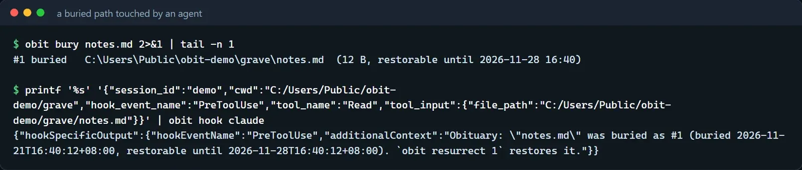
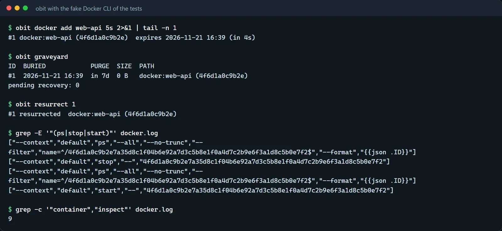

When a product story and the code disagree, our way out is to write the story down as a requirement.

**On the morning of 11 November that happened twice, once for grave notices and once for Docker containers.**

## The thing in the story: after a burial the agent has no idea where the file went

While telling the product story we described a scene. You are not sure whether a file is of any use, so you bury it, and if an AI uses it during the next seven days, it notices the file has been buried and resurrects it.

We went back and checked the code, and it could not do that. An agent hears about items expiring within 24 hours and about what was left behind last time only at the start of a session. After a file was buried, a tool call that used the path gave no hint at all, and the agent simply saw that the file did not exist.

## Grave notices: when an agent touches a buried path, Obituary tells it on the spot

When an agent's tool call refers to a path that does not exist but still has a grave that can be resurrected, meaning the buried path itself or a path inside a buried directory, Obituary tells it:

- the number in the graveyard
- when the burial happened
- how long resurrection remains possible
- an `obit resurrect <id>` command

It only notices. It does not deny the call and does not rewrite it, and each grave is mentioned once per session. Hosts that can attach context before a tool call notice on the spot, the others fall back to the next moment when they can deliver context, and the capability table says how far each host gets.

Here is a real run: a file is buried, and then a call by an agent that reads the file is handed to the hook.

<figure>
  
  <figcaption>The real output of a grave notice. When an agent reads a file that has been buried, the context returned by the hook holds the number, the time of burial, the last moment for resurrection and the command, and the call itself is untouched.</figcaption>
</figure>

### The notice happens before every tool call, so it has to be light

- PreToolUse used never to touch the ledger. Now it reads the ledger only when the path does not exist, only within a shared-lock budget of 25 milliseconds, and it skips the notice if the lock is not available.
- After every ledger write an index file that holds only paths is rebuilt and used to rule out unrelated paths first. It is not evidence by itself, and a hit is checked against the ledger.
- Paths are compared with their case as given, and a missed notice is preferred to a wrong one.
- At the start of a session the list can also include what was recently buried in this project and can still be resurrected, leaving out `obit mktemp` directories and whatever the session buried itself.

That session-start list was made opt-in the same night to save the agent's tokens, and it is switched on in the window's settings or with `[hooks] session_summary` in `config.toml`.

## Docker containers: stopped at expiry, removed only after the retention period

The same early morning brought another requirement. An agent runs `docker run` and `docker compose up` in a session, containers pile up one after another, and a few days later nobody remembers what each one was for or which can be removed.

**The first version on 11 November handled only containers and did not delete images, volumes or networks.**

Burying a container still leaves its volumes alone. A volume is handled separately, only when you mark or bury it explicitly with `--docker-volume`. Images and networks are still not removed.

### Two ways to register a container

- `obit docker add <container> <lifespan>` registers explicitly.
- Containers created during an agent session are listed as proposals for the user to decide on after the session, and only approval registers them. Those that can be attributed to a project, because the compose working directory points at the project or a bind mount lies inside it, are assigned to that project.

### What expiry, resurrection and purging each do

| Stage | Action | Notes |
|---|---|---|
| Expiry | `docker stop` | The container and its writable layer stay |
| Resurrection | `docker start` | |
| Purge after the retention period | `docker rm` | Without `-v` and without `-f` |

- Every operation uses the full container ID, names are only for display, and every action is preceded by a fresh inspect, with nothing done if the ID and the creation time do not match.
- If a container is running when it is due to be purged, it has been resurrected or started by hand, so it is treated as a resurrection and not deleted.
- A container started with `--rm` is removed by Docker itself once it stops, and Obituary refuses to register it.

### A trap in reference resolution: a container renamed to another container's full ID

Docker resolves a reference by full ID first, then exact name, then ID prefix. If the original container happens to vanish and another container is renamed to that long ID, a command that names the ID would hit that other container. So before acting Obituary checks whether any container has a name equal to the full ID and does nothing if one does.

What follows is the path walked through with the fake Docker command line from the tests. The top half is Obituary's output, and the bottom half is what the fake Docker recorded of the commands Obituary sent it. A `ps` check of this kind comes before both stop and start, and the whole run inspected 9 times.

<figure>
  
  <figcaption>A real run with the fake Docker command line from the tests. The container is stopped at expiry and started on resurrection, the command always carries the full container ID, and there is no -f and no -v.</figcaption>
</figure>

### Docker calls are slow, so they happen neither in the hook nor under the ledger lock

A `docker stop` waits for the container's own stop timeout, and a dozen seconds is common. Every operation takes three steps:

1. Under the lock, the entry is checked, a container intent is written and committed.
2. Docker is called outside the lock.
3. Back inside the lock, the intent is checked to still be this one, the result is committed and the intent cleared.

After a crash, recovery only observes and never repeats a destructive step:

- A running container is never recorded as buried.
- A purge intent whose container is already gone is recorded as a purge.
- An intent that was never carried out is cleared and retried at the original lifespan.

Registrations, proposals and intents also record the Docker context or endpoint and the daemon ID that were in use, every later call names them explicitly, and nothing is done if the daemon does not match.

## Two days later, container proposals were narrowed once more

From the decision to the second review round, all of it was done between a little after one and a little after five in the morning. Two days later container proposals were narrowed once more. Only containers whose compose working directory or bind mount lies in the session's project are proposed, and a container that could be assigned to the session only by its time window is no longer listed, because the user may have started it elsewhere.

**A missed proposal only means less cleanup and never a wrong deletion.**

Automatic registration is now off by default, and without it Obituary does not go looking for containers, so only what `obit docker add` registered has a lifespan. Obituary calls the `docker` command line, the one that comes with Docker Desktop or Docker Engine.
