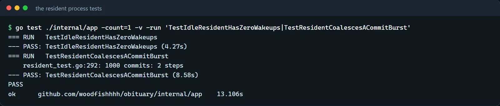
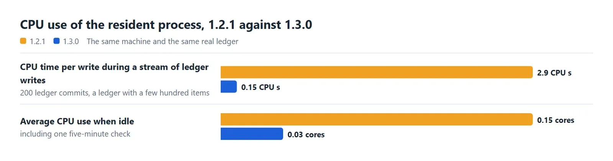

The resident process `obitd` has a simple job, which is to wait. It waits for files in folders to change and for the next expiry time. When idle it should use almost no CPU. During a check on the evening of 14 November we found it using about 0.37 of a CPU core while idle.

## Twenty times apart

The number was not normal. A process that only waits in the background for files to expire should sit close to zero when idle. We measured again straight away and this time it was 0.02 of a core. Two readings almost twenty times apart mean that the problem shows up when a lot of files change. Measuring only the idle state cannot find a load-dependent problem like this.

So the task handed to the worker started with reproducing it. Measure `obitd` and a resident file-search tool side by side over the same period, then deliberately create and delete ten thousand files and watch how `obitd` spikes. Next came finding the root cause, which meant checking whether the tray was refreshing constantly, how often the background process scanned, whether the file watch covered too much, and whether every file event triggered a full scan, using a CPU profile from pprof wherever possible. Last was fixing the root cause. Getting by with a lower checking frequency was not allowed, and after the fix the same method had to be run again, with the numbers from before and after both supplied.

## The cause was somewhere unexpected

From reading the code we saw that the tray polled once a second and took that for the main cause. The profile showed that the big cost was elsewhere. The synchronization of Explorer labels, for every tracked folder it checked, walked the whole directory tree, `node_modules` included, to look for `.git`. It did this for every tracked folder at every scheduled check. Had we changed only the tray's polling on a hunch, the CPU would still have been high afterwards. The fix is that a forced check no longer walks directories to look for repositories, a cost that the Explorer labels used to pay for every tracked folder at every check.

## Waking only on events

With the root cause found, the way the resident process wakes up was changed as well. It now wakes in only these cases: a file changes in the data directory or the configuration directory, the next expiry time arrives, or the full reconciliation that happens every 5 minutes, which is the only timer. A run of consecutive events is merged into one pass that starts after 300 milliseconds of quiet and is delayed by 2 seconds at most. The process's own ledger commits no longer wake it, which it recognizes by comparing the ledger's modification time. The graveyard reference is not read again unless it changes, and deferred observations can be replayed without running a whole round of checks. The tray no longer polls the configuration on a timer and watches `config.toml` instead. The watch on folder policies is handled only after a burst has settled, and folders are no longer rescanned when the ledger commits.

This rule was written into `AGENTS.md`: the resident process and the tray never poll on a timer and wake only on events, the only timer is the full reconciliation every 5 minutes, bursts are merged and its own commits do not wake it. From now on any new source of wakeups must come with a zero-wakeups-when-idle test. There are two such tests. The first lets the resident process finish its first round, which buries one due file, a commit of its own, then writes files such as a log and an audit file into the data directory and waits twice the longest merge window. The process must have handled that first round and nothing more. The second commits to the ledger 1000 times from another process and counts how many rounds the resident process runs, with an upper limit of 3.

<figure>
  
  <figcaption>A real run of the two tests. An idle resident process handles nothing after its first round, and a thousand consecutive ledger commits cause only 2 rounds.</figcaption>
</figure>

## Before and after

When 1.3.0 was released, the numbers before and after were measured on a machine whose ledger held a few hundred items. During a continuous stream of ledger writes, which is what an agent at work produces, 200 ledger commits cost 2.9 seconds of CPU each in 1.2.1 and 0.15 seconds afterwards, which amounts to the background load falling from about 2.9 cores to 0.2. When idle, including one routine five-minute check, the average fell from 0.15 cores to 0.03.

<figure>
  
  <figcaption>The comparison on the same machine with the same real ledger. The cost of each write during a stream of writes fell to less than a twentieth, and idle use fell to a fifth.</figcaption>
</figure>

The fix went into 1.3.0, published at half past three in the morning on 15 November.
