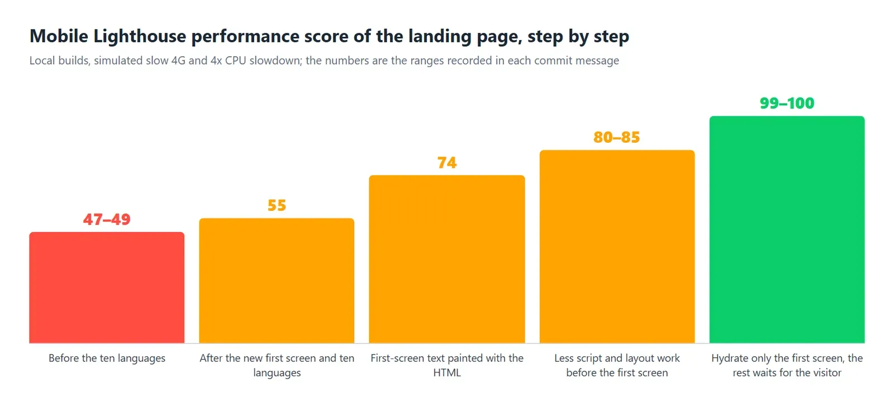
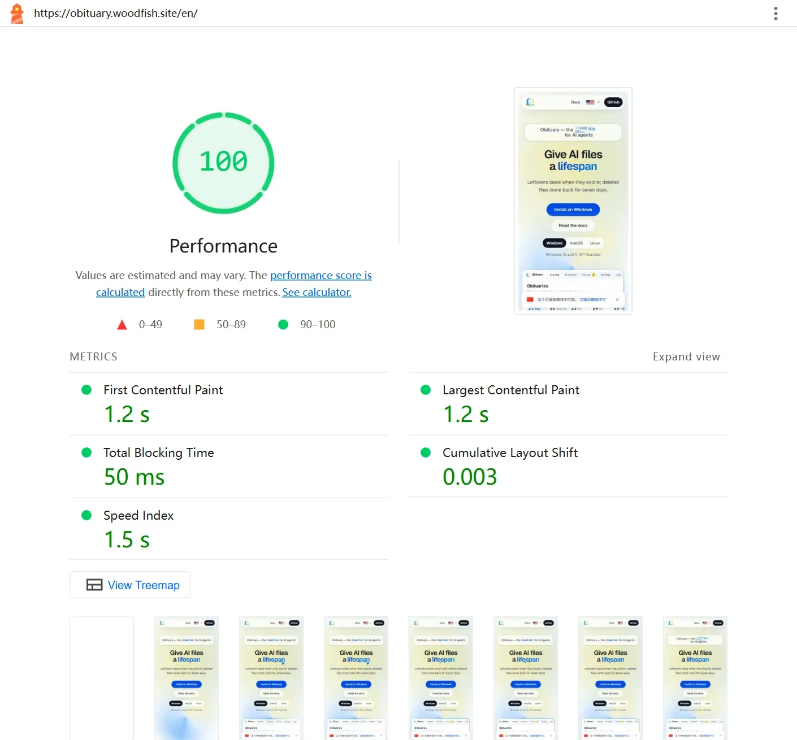

Late on 20 November the first screen of the website was replaced with the real components of the desktop window, running on sample data, so that a visitor can hover, select, extend and drag a file to another day. The first screen has a lot of animation and script, and on a phone it was slow.

Under Lighthouse's mobile settings, with simulated slow 4G and a 4x CPU slowdown, it scored only 55, and the version before the change had scored 47 to 49.

**Three hours and a bit later, measured the same way, the same local build scored 99 to 100.**

| Step | Time | Mobile score |
|---|---|---|
| Before the real components and the ten languages | | 47 to 49 |
| After the real components and the ten languages | late on 20 November | 55 |
| First-screen text painted with the HTML | 2:04 in the morning | 74 |
| Less script and layout work before the first screen | 2:21 | 80 to 85 |
| Hydrating only the first screen | 2:41 | 99 to 100 |

## Step one: first-screen text no longer waits for script, LCP from 5.2 seconds to 1.0

The tagline, the heading, the one sentence and the two buttons on the first screen were all wrapped in script-driven entrance animations that start at an opacity of 0, so the largest block of text on the page was painted only after the page's script had run. Lighthouse's simulation charged all of that script time to it, and the largest contentful paint, LCP, was 5.2 seconds.

They are now plain elements, and the text appears with the HTML. Only the window below keeps an entrance, written as a CSS animation of opacity and transform.

The sparkles on the heading were a second bill. They were ten script-driven SVGs, redrawn ten times a second and never stopping. Now they are fixed stars with a CSS animation that pauses when they are off screen or the tab is hidden and that are not drawn at all when reduced motion is on. In the first six seconds, the busy time of the main thread at a 4x slowdown fell from about 4.7 seconds to 2.7.

**The result of this step was an LCP going from 5.2 seconds to 1.0, and a score going from 55 to 74.**

## Step two: less work before the first screen, a score of 80 to 85

The aim was less script and layout work before the first screen appears:

- The two sections that use the animation library, the flow diagram and the story, now load after the first screen, and the build waits for them to render so that their text stays in the HTML.
- Entrances that wait for script, such as the fade on scroll and the rotating word, became CSS animations of opacity and transform, and the animation library is no longer in the entry script.
- Each page loads only the text of its own language, which took the entry script from 744 kB to 292 kB, and the text is named in a modulepreload link so that it arrives together with the script.
- The first screen's fonts are preloaded, so the text does not jump when they arrive, while the window's own fonts hide their text until they have loaded and do not swap.
- Sections below the first screen use `content-visibility: auto`, large soft glows are radial gradients and no longer blurred discs, images below the first screen are lazy, and the 512 px icon is no longer requested on every visit.

Measured against the version from before the ten languages:

| Metric | Before | After this step |
|---|---|---|
| Mobile score | 47 to 49 | 80 to 85 |
| LCP | 5.5 to 5.8 seconds | 0.9 seconds |
| Total blocking time | 3.1 to 6.8 seconds | 0.6 to 0.9 seconds |
| Main-thread work | 14 to 18 seconds | about 4.5 seconds |
| Desktop score | 71 to 88 | 87 to 96 |

## Step three: hydrate only the first screen, a score of 99 to 100

Nav and Hero hydrate at once. Everything below them and the footer is already in the HTML from the start, and the scripts for those sections load on the visitor's first scroll, touch, key press, pointer move or click on an anchor link, or 4.5 seconds after the page has loaded.

- A section that is in view when its script arrives is shown first so that nothing blinks. Before that it is plain text, and with scripts turned off it always is.
- The page's own fonts now use `font-display: optional`, so a font that arrives late does not replace the fallback in the middle of reading and push the layout around, and the first screen's fonts are preloaded and normally arrive in time.
- In a run with a slow network and a slow CPU the layout shift fell from 0.29 to 0.0004.
- On a phone the tagline keeps two lines of room, so a longer rotating word does not push the page down.

After this step:

| Metric | Before | After this step |
|---|---|---|
| Mobile score | 76 to 83 | 99 to 100 |
| Total blocking time | 0.7 to 1.2 seconds | 24 to 116 milliseconds |
| Main-thread work | 4.4 to 5.5 seconds | 1.7 to 2.9 seconds |
| LCP | | 0.9 seconds |
| Layout shift | | 0 to 0.004 |
| Desktop score | | 100 |

<figure>
  
  <figcaption>The mobile score after each step, with the numbers taken from the records in the commit messages, on local builds with simulated slow 4G and a 4x CPU slowdown.</figcaption>
</figure>

## These practices were later written into `AGENTS.md`

- First-screen text is visible in the HTML at once and must not be hidden by an entrance animation that depends on script. Entrances are plain CSS.
- Sections that use the animation library load lazily. Each page loads only its own language's text, and sections below the first screen use `content-visibility: auto`.
- Continuous animation uses only compositor properties, pauses off screen and in hidden tabs, is not shown with reduced motion on, and never changes styles from script on every frame.
- Any new effect gets a Lighthouse run before and after, and it must not pull LCP, TBT and CLS back.

This afternoon we ran a mobile Lighthouse test once more against the live English home page:

**It scored 100, with an LCP of 1.2 seconds, a total blocking time of 50 milliseconds and a layout shift of 0.003.**

<figure>
  
  <figcaption>A real Lighthouse mobile report of the live English home page, with the default simulated throttling.</figcaption>
</figure>
