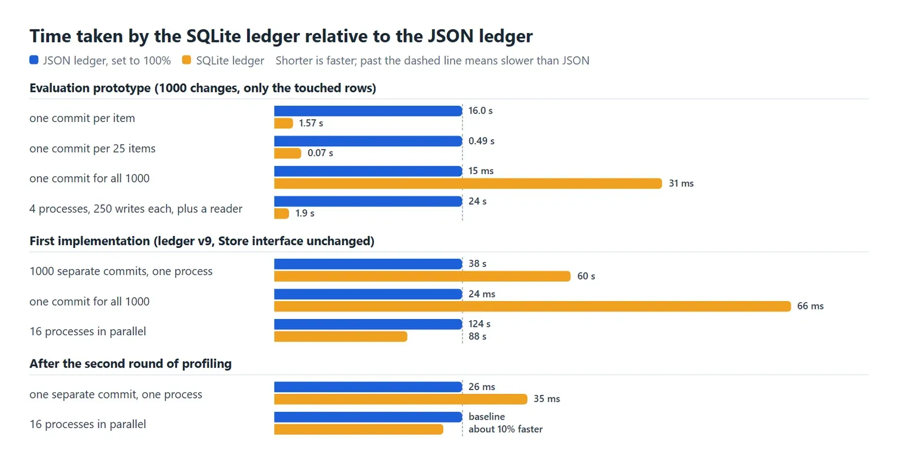
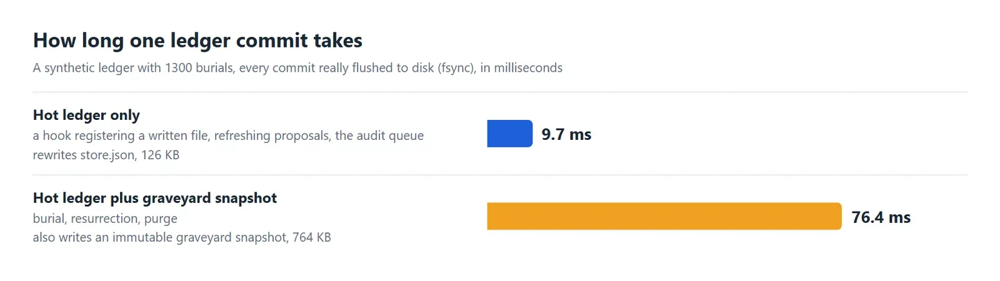

Obituary keeps its ledger in a JSON file that records every registration, every burial and every pending proposal. Users will run a dozen agents at once, as we do, and every file an agent writes starts a hook process that commits its own small change, while a JSON ledger is rewritten in full on every commit.

On 9 November we evaluated a move to SQLite in earnest.

**That branch has not been merged to this day. The ledger is still JSON, only much faster than it was.**

## Ten times faster in the prototype: scattered commits showed the largest gap

The evaluation used modernc.org/sqlite v1.62.0, a pure Go driver that needs no C compiler, in WAL mode with `synchronous=FULL`, so every commit really reached the disk, and it measured 1000 changes.

| Scenario | JSON | SQLite |
|---|---|---|
| One commit per item | 16.0 seconds | 1.57 seconds |
| One commit per 25 items | 0.49 seconds | 0.07 seconds |
| 4 processes writing 250 times each, a reader alongside | about 24 seconds | about 1.9 seconds |
| A single commit for all 1000 items | 15 milliseconds | 31 milliseconds |

The first three are the situations a dozen simultaneous agents produce, and they showed the largest gap. The last row is where JSON won: JSON writes the file once while SQLite's transaction overhead costs more.

That afternoon the decision was written down: SQLite, WAL with `synchronous=FULL`, the `core.Store` interface unchanged, the ledger stored by row. The costs went next to it:

- `obit.exe` would grow by 5.3 MiB.
- Old ledgers would need a migration.
- An older program would have to refuse the new format safely.
- A read-only diagnostic must not create files as a side effect.

## The first implementation was slower than JSON: the prototype touched only the rows involved

By the evening the first implementation was ready, with the ledger at v9: row storage, migration from the old JSON, refusal by older programs, read-only diagnostics that create nothing, and all tests passing. Measured next, scattered single-process commits were slower:

| Scenario | JSON | SQLite |
|---|---|---|
| 1000 commits, single process | about 38 seconds | about 60 seconds |
| A single commit of 1000 items | 24 milliseconds | 66 milliseconds |
| 16 processes concurrently | 124 seconds | 88 seconds |

**SQLite led only with several processes.**

The prototype read and wrote only the rows involved. The real implementation keeps the `Store` interface unchanged, so every commit still reads the whole ledger, decodes it and encodes it again after the change. JSON does those three steps as well. SQLite saved only the file write, and added a WAL commit and possibly a checkpoint when the connection closed.

The second round of profiling the next day measured each of these costs. After optimization a scattered single-process commit took 35 milliseconds against 26 for JSON, and with 16 processes SQLite was about 10% faster.

<figure>
  
  <figcaption>Time taken by SQLite relative to JSON for the same scenarios, with JSON set to 100%. The advantage from the prototype disappears in the first implementation, and after the second round of profiling only a small lead remains under concurrency.</figcaption>
</figure>

## Parked until the resident process

On the same evening the decision on a resident tray process was made: a small background process that stays in the system tray. A resident process can also be the single writer of the ledger and hold the database connection for good, so the checkpoint cost of opening and closing it goes away. With the whole ledger kept in memory, SQLite only has to write the rows that changed, and only then does the speed-up become real.

So:

- After the first result the bar was relaxed, and the work was limited to profiling and to cheap, low-risk improvements.
- After the second result the branch was kept and not merged, to be merged later together with the resident single writer.

The bar for merging was written down in concrete terms: scattered single-process commits no slower than JSON, and concurrent commits faster than JSON. **The ledger is still JSON.**

## What actually worked: batched reaping, a compact format, a graveyard snapshot

### Batched reaping: no per-item check was skipped

The first thing happened the same day. Clearing a thousand expired entries used to commit them one at a time. Now a batch of up to 32 shares one transaction, every item is still rechecked for identity the old way, and an interruption is recovered from the manifest.

The first review round reported a HIGH: a file that was `git add`ed after the batch's Git recheck would still be moved. The second version moved the recheck to just before each item is moved, a last check against the version in the Git index that takes at most about 1.7 milliseconds between the check and the move.

**For 1000 automatically registered entries the sweep dropped from 108.7 seconds to 14.4.**

### 11 November: ledger v15 and v16, and batch commits for deletion commands

- On the afternoon of 11 November the ledger moved to v15 with a compact encoding and each parent folder chain stored once, so a full graveyard no longer keeps hooks from getting the lock.
- That evening v16 stored each burial's operation, origin and volume once, which made the whole ledger about a quarter smaller.
- `obit rm`, `Remove-Item` and `git clean` used to take the ledger lock once per path, and a long run of deletions starved the hooks of other sessions. They now share the batch commit with the sweep, with up to 32 items or 100 milliseconds of work per batch and the lock released between batches.

| Measure | Before | After |
|---|---|---|
| Deleting 1000 paths | about 188 seconds | 16 seconds |
| The longest single lock hold | 240 milliseconds | about 100 milliseconds |

### Early on 12 November: ledger v17 and the graveyard split into its own snapshot

The hot ledger, `store.json`, keeps only what changes often, such as registrations, proposals and statistics. The burials moved into an immutable graveyard snapshot that the hot ledger refers to by hash.

- When the graveyard changes, the snapshot is published first and then the hot ledger is replaced atomically, which makes that replacement the single commit point.
- A missing snapshot, or one whose hash does not match, is refused and never read as an empty graveyard.
- A hook registering a written file now rewrites only the hot ledger.

**On a ledger with 1300 burials such an update went from 80 milliseconds to about 14, and the file a hook rewrites shrank to a seventh of its size.**

Running the same benchmark today, a commit that touches only the hot ledger takes 9.7 milliseconds and one that also touches the graveyard takes 76.4.

<figure>
  
  <figcaption>One real run of the repository's BenchmarkStoreLedger on this machine, with every commit flushed to disk. The hot ledger is 126 KB, the graveyard snapshot 764 KB, and hooks rewrite only the former.</figcaption>
</figure>
