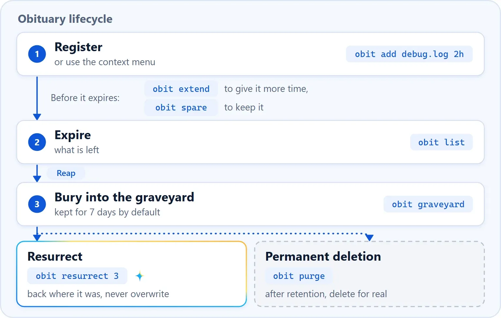

The first version of Obituary handed expired items to the system Recycle Bin. That was the easiest thing to do, and on the first night we started replacing it with a graveyard of our own. Obituary now splits one deletion into five actions, each with its own command and each with exactly one place where the decision is made: who checks identity, who moves, who really deletes. That gives review something to hold on to.

## One deletion, five actions

| Term | Command | What it does |
|---|---|---|
| Register | `obit mark <path> <lifespan>` (alias of `add`), `obit mktemp` | Gives a path a lifespan; `mktemp` hands back a temporary directory that expires by itself |
| Extend | `obit extend` | Pushes the expiry back |
| Spare | `obit spare` (alias of `cancel`) | Stops tracking; the file is left as it is |
| Bury | `obit bury`, or automatically at expiry | Moves into the graveyard; this is not a deletion |
| Resurrect | `obit resurrect` | Puts it back where it was, never overwriting |
| Purge | `obit purge`, or automatically after the retention period | Really deletes; 7 days after burial by default, configurable |

<figure>
  
  <figcaption>A file's life: it is registered, expires and is buried, can be resurrected at any time during the retention period, and is purged only after that.</figcaption>
</figure>

A file's life goes like this: register, expire, bury, then restorable at any time during the retention period, and only after that purged. The output below comes from the 1.6.0 code, run in a throwaway directory on the day we wrote this post, with the command line in its English interface. The first command also started a background process, which after a normal installation is usually already running.

```text
$ obit mark debug.log 3d
#1 added    C:\Users\Public\obit-demo\debug.log  expires 2026-11-24 15:05 (in 3d)
started a daemon for now; `obit daemon enable` sets up the hidden 5-minute runner that survives restarts

$ obit mark screenshots 1d
#2 added    C:\Users\Public\obit-demo\screenshots  expires 2026-11-22 15:05 (in 1d)

$ obit list
ID  EXPIRES           LEFT  PATH                                   NOTE
#2  2026-11-22 15:05  1d    C:\Users\Public\obit-demo\screenshots
#1  2026-11-24 15:05  3d    C:\Users\Public\obit-demo\debug.log

$ obit bury old-output
#3 buried   C:\Users\Public\obit-demo\old-output  (6 B, restorable until 2026-11-28 15:05)

$ obit graveyard
ID  BURIED            PURGE  SIZE  PATH
#3  2026-11-21 15:05  in 7d  6 B   C:\Users\Public\obit-demo\old-output
pending recovery: 0
```

## Why we did not stay with the Recycle Bin

Handing items to the Recycle Bin made sense: the system already has one and people know it. It did not fit the problem, though. The bin assumes that someone decides at some moment to delete now. The debug scripts and screenshots an agent leaves behind are often still useful when they are created and only become garbage two days later, when the session is long over. We wanted a file to carry a lifespan from the moment it is created.

An agent's own deletes do not go through the bin at all. `rm -rf`, `git clean -fdx` and `Remove-Item` delete directly and leave the bin empty, and in WSL, on a Linux server or in a container there is no Windows Recycle Bin to begin with.

Once an item is handed over, it is out of our hands. The bin does not record which agent, which session or which project put something there. It has its own capacity rules, so how long an item stays and whether it is destroyed outright are not up to us, and the system's file-operation interface even has a dedicated flag, `FOF_WANTNUKEWARNING` (see the [official documentation](https://learn.microsoft.com/en-us/windows/win32/api/shellapi/ns-shellapi-shfileopstructw)), that warns when a file is about to be permanently destroyed instead of recycled. Obituary also cannot put an item back on an agent's behalf: in recycle mode, `obit resurrect` simply cannot do it. Restoring from the bin is mostly a matter of clicking in a graphical window, while an agent that deleted the wrong thing needs one command that puts the item back exactly where it was.

There is a more basic reason as well. Having an AI guess afterwards what is garbage is the riskiest step, because a wrong guess deletes code that was never committed. So in the design at the time, this was left to hard rules and not to judgement. Files tracked by Git are never registered automatically, and there is no switch for that. The first automatic action in a project has to be approved by you. Git is asked once more right before an expired item is buried. And if an agent forgot to register something, a snapshot taken at the start and at the end of a session is compared to find what is new. What the rules recognise, such as `test-results/` or `*.log`, gets a lifespan, and what they do not recognise only becomes a proposal, since a new file that Git does not track may be work that has not been committed yet. That automatic registration changed twice later: proposals for leftovers were narrowed and, in the end, the whole thing became off by default, which later posts cover. Every record also carries its source, project and session, so who produced something in which session can always be looked up, and `obit stats` reports how much was buried, how much space was reclaimed and how often something was resurrected.

## How the graveyard makes sure what comes back is what was taken

The location follows one rule. On the volume that holds the data directory, the graveyard lives in a `graveyard` folder inside it, and on any other volume it lives in a hidden `.obituary\graveyard` at the volume root. A burial therefore always happens within one volume and is only a rename, which is fast and leaves no half-copied state. The graveyard stays out of projects because `git clean -fdx` would sweep it away along with everything else. Each grave is its own directory named with the ID, a UTC timestamp and six random characters, and it holds the object exactly as it was. The `old-output` we buried above looks like this in the graveyard:

```text
graveyard/
└── 3-20261121T070527Z-376905/
    └── old-output/
        └── report.txt
```

Just a rename sounds simple. The hard part is making sure that what we take is the thing that was registered. A burial opens the object, checks its identity (volume serial number plus a 128-bit file ID, along with type, link count and so on), and then renames it into the grave on the same handle. If checking and moving were two steps, looking up a path and then renaming by path, there would be a window in between: an editor replaces the file just then, and what gets moved is the new file. With one handle that window does not exist.

Before the move, a small manifest is written next to the graveyard with the ID, the original path, the identity of the object and of the grave, the reason and the source. If the process dies between the move and the ledger commit, the half-finished burial lives only in that manifest. The next run reads manifests first. If the grave holds exactly the object the manifest names, the record is completed, and if the grave is empty, the manifest is cleared. In every other case nothing is touched, it is only logged, and `obit doctor` raises a warning. The floor of the whole design is that anything uncertain is left alone. The move itself happens under a single ledger write lock, after confirming once more that the record has not changed, that it is still due and that the directory holds no entries with a longer lifespan. For automatically registered items the rules and Git are asked again, and if any check fails, nothing moves.

Building a graveyard of our own means implementing all of the crash-safety logic for manifests, recovery and purging ourselves, and most of the review rounds of the following days went there. In return, an agent deleting the wrong thing went from being an accident to being something one command can fix.

## Resurrecting, expiry and purging

Resurrecting puts an item back at the path it was buried from. If something else now occupies that path, a suffix is added to the name and you are told, and nothing is overwritten. Below we recreate a directory with the same name, and the resurrected copy becomes `old-output (resurrected)`, the two living side by side:

```text
$ mkdir old-output

$ obit resurrect 3
#3 resurrected  C:\Users\Public\obit-demo\old-output (resurrected)

$ ls -1
debug.log
old-output
old-output (resurrected)
screenshots
```

Resurrecting is more error-prone than burying, because by then the original surroundings may have changed. At burial we record every ancestor from the original location up to the volume root, and before resurrecting we check each one. If one of them has since been replaced by a link (a junction, a symbolic link or a mount point), the resurrection is refused, since otherwise the item could end up somewhere entirely different. Missing directories are recreated, and if the resurrection is refused after all, the directories created for it are removed again. A name collision is decided by the rename itself. Probing first whether the name is free and then renaming would leave another window between the probe and the rename.

Expiry does not need anyone present either. Give a file a three-second lifespan, wait a few seconds, and the resident background process buries it. `#3` was resurrected above, so this is the only item left in the graveyard:

```text
$ obit mark scratch.txt 3s
#4 added    C:\Users\Public\obit-demo\scratch.txt  expires 2026-11-21 15:05 (in 3s)

$ obit graveyard
ID  BURIED            PURGE  SIZE  PATH
#4  2026-11-21 15:05  in 7d  7 B   C:\Users\Public\obit-demo\scratch.txt
pending recovery: 0
```

In the whole code base there is exactly one place that permanently deletes user content, which is purging, and it only touches graves that pass verification: the registered grave, containing exactly one item, with a matching identity. Sweeping and burying only ever move what belongs to the user. An early purge needs a human to agree. `obit purge --all`, or naming an ID or a path, goes past the retention period, so the command first lists what is about to be purged and asks `[y/N]`. When it is not running in a terminal it refuses unless `--yes` is given, and the error says that an agent must ask the user first. MCP has no purge tool at all. Whatever cannot be undone is left to people.

<figure>
  
  <figcaption>The window's Graveyard page with sample data: each grave sits on the day it will be cremated, and selected cards can be resurrected or cremated early.</figcaption>
</figure>

## Where the Recycle Bin is the better choice

When a person deletes a single file by hand, the Recycle Bin is perfectly adequate and Obituary does not compete with it. If you want, you can switch to recycle mode in the configuration so that expired items go straight to the system bin. The cost is the one described above: `obit resurrect` cannot restore them. In addition, the system recycles by path after we have checked identity, so there is a window of a few milliseconds, and if the path happens to be swapped for a different file just then, that file is what lands in the bin, where it can still be restored.

The value of Obituary depends on how much debris agents produce. Someone who has an agent touch two or three files a day will not notice much, and someone who has agents running tests, taking screenshots and writing debug scripts all day gains the most. Having an agent register a lifespan when it creates a file depends on the agent cooperating, which is why we install hooks, Skills and instruction files for each agent.
