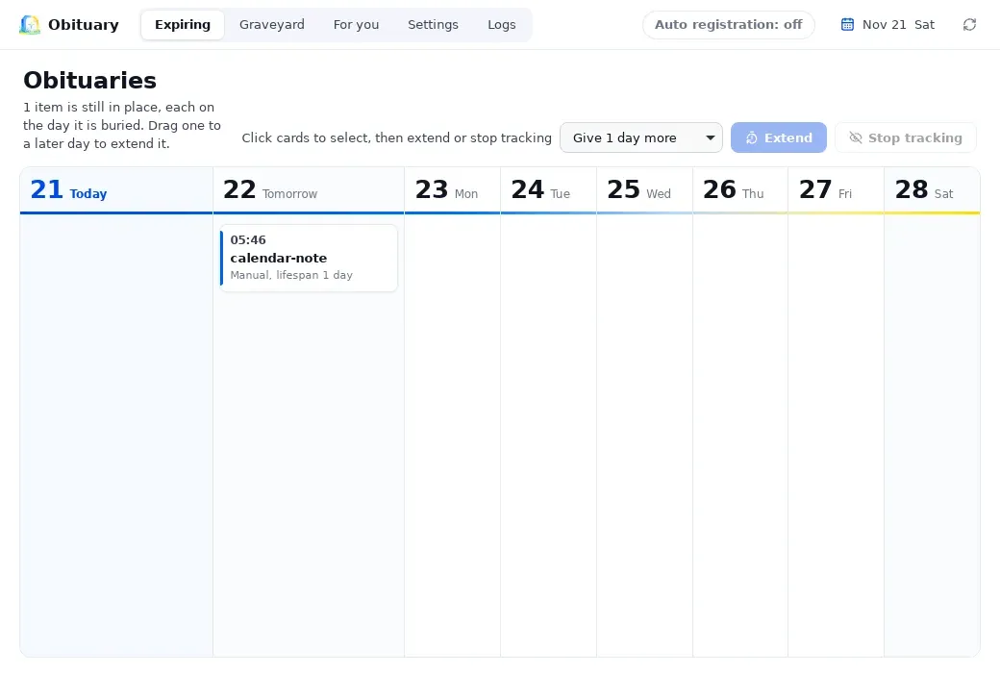
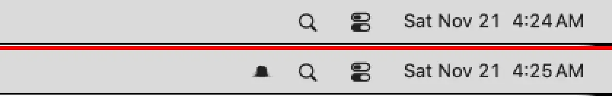
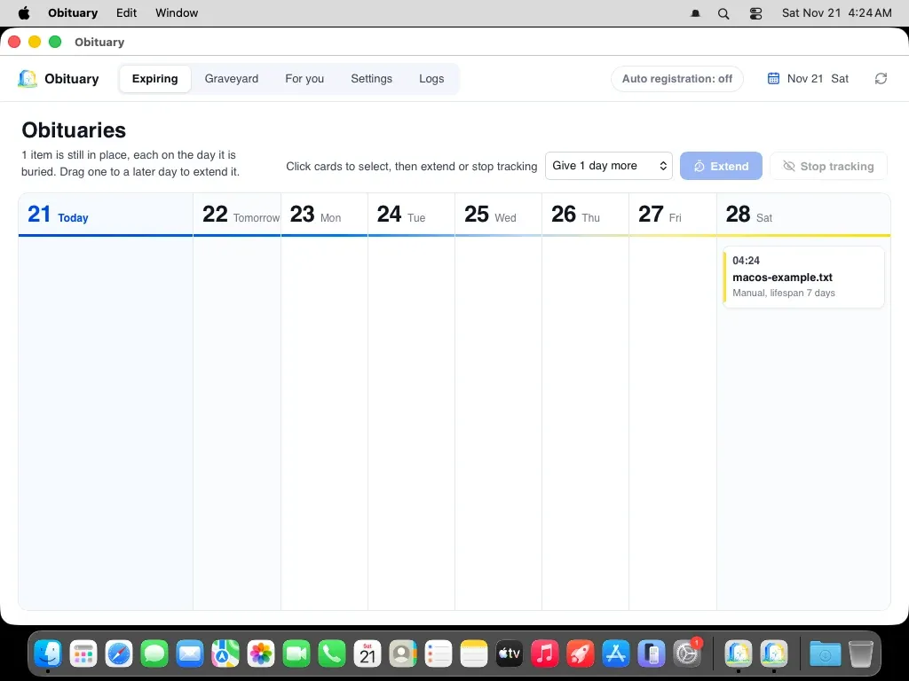
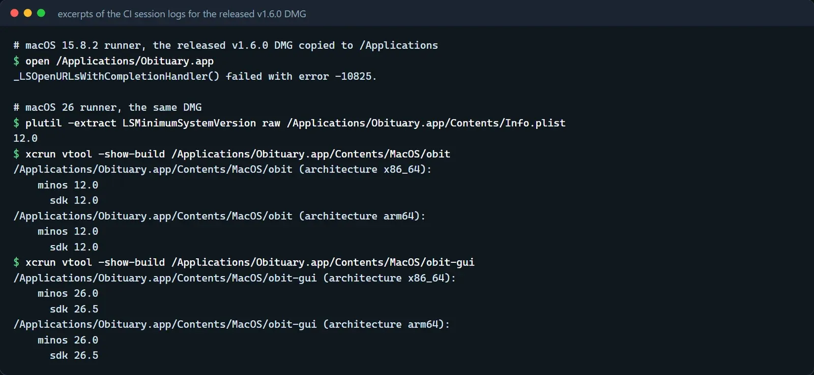
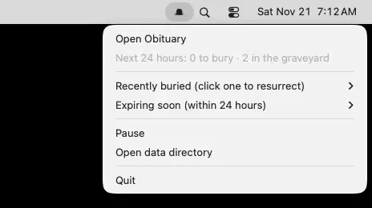

Obituary 1.6.0 came out at noon on 21 November with a small window for Linux and one for macOS, both desktop packages marked as previews. From the first commit of the Linux window code at 3:01 in the morning to the release at 1:22 in the afternoon, a little over ten hours went by. The hardest question in that time was this: without a Mac, how do you know the icon really appeared in the menu bar?

## One window, reused

Windows already had the Wails front end and the command-line scheduled background process. Writing a separate interface for Linux and for macOS would be a lot of work and would invite the same setting to behave three different ways on three platforms, so the decision was to reuse. The window and the tray stay in two separate processes and reuse Wails v2, systray and the existing front end. The release comes in two phases. The first is a `.deb` for Ubuntu 24.04 amd64, where a desktop without a tray host can still open the window from the application list. The second is a universal DMG with an app that supports both Intel and Apple silicon. 1.6.0 is a regular release in which the two desktop packages are marked as previews and the original six archives are left as they were. The context menu and the Recycle Bin are accepted separately. The costs are written in the decision: other Linux distributions and architectures are outside this commitment, and the Mac package is not signed with a Developer ID or notarized, so the documentation has to say how to allow it the first time.

## Linux: a private display and bus

On Linux everything can be run in CI. The verification script uses a private Xvfb display, a private session bus and temporary user directories to check the window, the tray, resurrection and notifications, without touching the host's monitor. The window uses the same front end as Windows. At 3 in the morning the tray and XDG autostart were added, settings that make no sense on Linux were hidden, and the process no longer exits when the tray host is missing. The packaging and validation of the `.deb` was merged at 5:49.

<figure>
  
  <figcaption>The small window running on Linux, with the same front end as on Windows. The screenshot comes from a private Xvfb display, and the interface is in English.</figcaption>
</figure>

## macOS: checking the menu-bar icon in CI

The macOS window can only be built and checked on GitHub Actions' macOS runners. The first commit of the macOS app and tray was at 7:47 in the morning, and a dozen or so commits after that worked the packaging and checks through step by step: the choice of runner, linking UniformTypeIdentifiers, creating the zip from the app's parent folder, verifying checksums in the directory where the package sits, and finally publishing the app through the DMG. Actions runs `plutil`, `lipo`, an ad-hoc `codesign`, `hdiutil` and the app's own `--smoke`, and uploads screenshots of the window and the menu bar.

The hardest part was the menu-bar icon. A running process, a log line saying ready, or a cropped picture each fail to prove which icon a user can actually see. So the check works by comparison. On a native runner it checks the package, the architecture, the signature and the launch, then stops all tray processes, takes a screenshot of the same region of the menu bar without the icon, restarts, and takes one with the icon, keeping the readiness and process lists from before and after. The last commit makes sure all tray processes are stopped before the screenshot without the icon is taken. In the final comparison the tombstone reappears to the left of the search icon.

<figure>
  
  <figcaption>The same region of the menu bar, captured on a macOS runner. The upper strip is after all tray processes were stopped, and the lower one is after the restart, with the tombstone to the left of the search icon.</figcaption>
</figure>

<figure>
  
  <figcaption>The small window running on a macOS runner, from the same round of evidence. The interface is in English.</figcaption>
</figure>

This kind of evidence has limits. It comes from a CI graphical session and does not replace the first-time permission, light and dark mode, login startup, notification authorization and uninstall on a real machine, which are listed separately on a checklist for real hardware.

## The first acceptance run after the release

On the afternoon of the release day, after 1.6.0 was published, we checked the published DMG on GitHub's macOS runners. It was not rebuilt from a branch and was the very file in the release, on one Apple silicon and one Intel runner each, with macOS 15 and macOS 26. The run did not clear the quarantine attribute, did not turn off Gatekeeper and did not approve any system prompt on behalf of a user.

On macOS 26 the results were good. The app cold-starts from `/Applications`, opening it again keeps a single process, Open Obituary in the tray menu opens the calendar window with data, the menu bar and the window title bar follow the system when it switches between light and dark while the window content stays light, and after the app is removed the SHA-256 of the ledger, the configuration and the graveyard record in the user's data directory all match.

On macOS 15 neither runner could open it. After verifying the DMG, copying the app to `/Applications`, ejecting the volume and running `open`, the system returned error -10825 and no window appeared. The cause lies in the build, where no minimum system version was set. `LSMinimumSystemVersion` in `Info.plist` says 12.0, but running `vtool -show-build` on every executable in the app shows that both architecture slices of the GUI and of `obitd` have a minimum system version of 26.0 with SDK 26.5, and only the command-line `obit` has 12.0. The program in fact requires macOS 26.

<figure>
  
  <figcaption>A few passages from the CI session logs, unchanged, with unrelated lines left out. The binaries in the DMG and the declaration in Info.plist do not match.</figcaption>
</figure>

The run found several other things. After the first open no icon appears in the menu bar, and only after starting `obitd --tray` inside the app by hand do the icon and menu appear. The hint in the empty calendar tells you to use Windows Explorer's context menu, which does not apply on macOS. The notification request returned an error on the runner, nothing suggests the user declined, and whether it is a limit of the runner has to be judged in a real user environment. The documentation does not list the exact paths that are kept after the DMG install is removed. Turning on login startup in the settings did not produce the LaunchAgent plist in CI, and there is no way to confirm that a physical click took effect. In the final arm64 run the sample that had been kept could not be found before uninstalling, and the evidence cannot say whether it was lost, wrongly resurrected or caused by the uninstall, so that round does not count as a third pass, while Intel kept it successfully again in its last run.

<figure>
  
  <figcaption>The tray menu during the run on macOS 26.</figcaption>
</figure>

## What has been done, and what has not

The problem is already written up as a known issue in the GitHub release notes for 1.6.0: the macOS window in this release needs macOS 26 and does not open on macOS 15 or earlier, and 1.6.1 fixes it. The fix was merged into main at 4:16 in the afternoon. CI now enforces deployment targets, with the target set to 12, and verifies the same DMG once more before publishing. The first open starts the resident process from the window. Clicks are no longer dispatched when menu rows are removed, which is the phantom click that the run reproduced. The menu bar helper has its own notification identity. The documentation adds the retained data paths and the check of the DMG before a release. 1.6.1 was published at 6:16 in the evening. Before it went out, the same acceptance ran on the candidate DMG on macOS 15 and macOS 26, on Apple silicon and Intel, in both the Gatekeeper lane and the desktop lane, and all eight jobs passed. After publication it ran again on the file in the release, rebuilding nothing, and all eight jobs passed at 6:19. On macOS 15 the desktop lane's cold start, tray process, menu-bar icon and single-process re-open all passed, and the error -10825 that 1.6.0 returned there did not come back.

Four things are left for a real machine. Download the published DMG with a browser on macOS 26 and actually click Open Anyway in the system prompt and in Privacy & Security, then confirm that opening it again no longer asks. Turn on login startup in the settings by hand, check the plist and the service, then turn it off and confirm that both disappear. In two clean user environments choose allow and deny for notifications. On Apple silicon go through the case of keeping one sample and resurrecting another once more, using disposable files for every sample. That checklist is set for 23 November.
