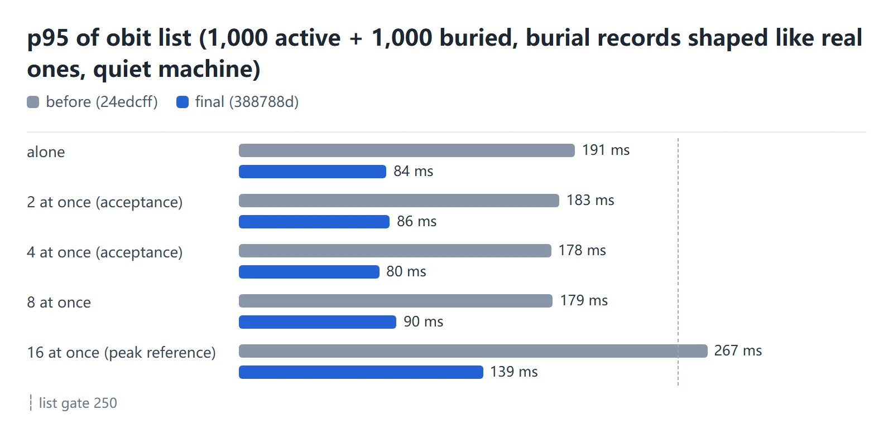
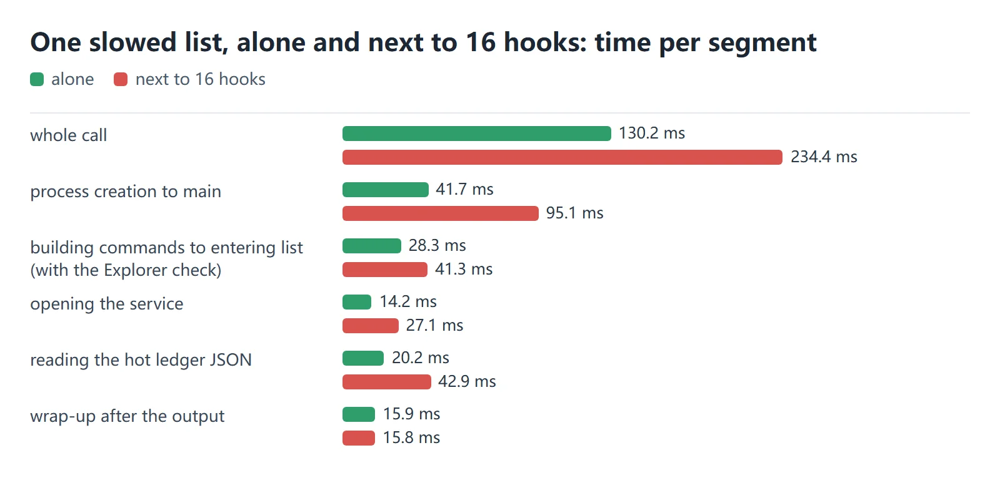

list was slow because every run repeated work it did not have to do.

**With the machine idle, the p95 of `obit list` fell from 191, 183, 178, 179 and 267 ms to 84, 86, 80, 90 and 139 ms, alone and with 2, 4, 8 and 16 at once.**

<figure>
  
  <figcaption>Same machine, 42 waves per level per build, p95 taken as the 40th value in ascending order. Grey is before the work, blue is the final build and the dashed line is the 250 ms gate.</figcaption>
</figure>

This is the work of the evening of 23 November to midday on the 24th, and it follows the last post: the resident single writer got the hooks inside their gate, but the concurrent `obit list` did not pass.

## The starting point: hooks passed, list did not

In the JSON-plus-resident-writer version, with 16 at once, one hook had a p95 of 392.72 ms and the whole wave 408.75 ms, both inside their gates. The concurrent `obit list` came in at 357.09 ms against a gate of 250 ms.

The measurement ran in three time windows of 21 waves each. The list p95 was 370.46, 295.95 and 252.19 ms, and none of the three passed. Main, measured as the baseline in the same round, was 347.49 ms, so the new version was 9.60 ms higher still.

We had also run one control: 16 PreToolUse calls that trigger no writes and no Git, plus the same `obit list`. Its p95 was still 215.11 ms. That suggested process start-up and scheduling contention were heavy in themselves, but the control did not change a single variable within one wave, so we could not hand the remaining gap to start-up or to storage.

The next step was to measure by segment.

## Segment measurement: the extra time is before `main` and in decoding the hot JSON

With 16 hooks running, the extra time in list concentrates in two places: before Go's `main` starts, and in decoding the hot ledger JSON.

We added probes to list and compared what each segment cost alone and with 16 at once. In the probed calls, the medians changed like this:

| Segment | Alone | 16 at once |
|---|---:|---:|
| Before entering `main` | 41.70 ms | 80.97 ms |
| Decoding the hot ledger JSON | 19.59 ms | 44.84 ms |
| Reading the two files | | 2.22 ms in total |
| Preparing the table | | 1.34 ms |
| Writing to standard output | | 0.46 ms |

**Writing the output took only 0.46 ms, so the output pipe is not where the time goes.**

<figure>
  
  <figcaption>A list call near the p95 (235 ms) against its paired solo run, segment by segment. Only the largest segments are drawn; the rest (file reads, cold-snapshot decode, verification, table, pipe write) add up to about 12 ms.</figcaption>
</figure>

The same build, measured the same way in a different period, gave a p95 of 249.24 ms for 16 at once with no probes, far below the 357.09 ms of the earlier three windows and only 0.76 ms from the gate. The same code differs by more than 100 ms in p95 depending on when it is measured, so every step after this was compared on the same machine, interleaved and pair by pair.

### One of the segments has a name: Cobra's double-click check

On Windows, Cobra calls `mousetrap.StartedByExplorer()` before it parses the command, to see whether the parent process is Explorer and so whether to show the double-click notice and exit. Finding the parent walks the system process snapshot twice: once in `syscall.Getppid` and once in mousetrap's parent-name lookup.

That function takes 24.17 ms alone (median) and 33.80 ms with 16 at once, which is 99.6% of the time from "root command built" to "entering `list`".

## First try skipping the check: always a win alone, and a worse p95 at 16

Skipping the double-click check for the literal `list` is a cheap experiment, and we ran it as 84 paired calls (A is the original, B skips the check).

| Scenario | Pairs | A median / p95 | B median / p95 | Over 250 ms, A / B | B faster |
|---|---:|---:|---:|---:|---:|
| Alone | 42 | 139.74 / 172.41 ms | 116.70 / 128.84 ms | 0 / 0 | 42 / 42 |
| 16 at once | 42 | 254.71 / 305.34 ms | 236.39 / 355.41 ms | 25 / 9 | 31 / 42 |

Alone, every pair was faster and the paired median saved 25.68 ms. With 16 at once, 31 pairs were faster and the number of calls over 250 ms fell from 25 to 9, **but the slowest few calls pulled the p95 up from 305.34 to 355.41 ms.**

Skipping the check is a fair candidate for everyday speed, and it does nothing to bring the 16-way p95 down.

## Is 16 at once too extreme? Acceptance changed to 2 to 4

Sixteen hooks starting almost together is a stress case we built on purpose. Having 16 workspaces open does not mean 16 hooks fire at the same moment.

We had not measured how many hooks overlap in everyday use, and our estimate is 2 to 4. So the acceptance basis for list became:

**p95 with 2 to 4 hooks at once, with the gate still at 250 ms; 16 at once is still measured and kept as a peak reference.**

None of the numeric gates was loosened. We only moved the load we measure under closer to everyday use.

## Four directions, each built and measured alone and with 2, 4, 8 and 16 at once

We built one variant per direction we could think of and measured them together in one interleaved run:

| Direction | What it does | p95 at 16 at once |
|---|---|---:|
| a1 Skip the double-click check (the control above) | turn off Cobra's check for the literal `list` only | 852 ms |
| a2 A cheaper double-click check | ask the kernel for the parent's image name and turn Cobra's check off only when it is certainly not `explorer.exe` | 887 ms |
| b The resident process prints | list asks the resident process and writes out the bytes it returns | 362 ms |
| c Less work before process start | looked into it and found nothing to remove | unchanged |
| d The decode step | a summary projection that fits real burial records, the resident process keeping an already-verified snapshot parse, a memory limit no smaller than one decode | 737 ms (summary projection fix only) |
| All together | a2 + b + d | 329 ms |

In this interleaved run the machine was being slowed by another process (a disk-wide scan), so the absolute values are high and only the relations within the run mean anything. The baseline in the same run was 833 ms.

Reading the table: a1 and a2 on their own do almost nothing for the 16-way p95; b alone takes it from 833 to 362 ms and is the most effective; all three together give 329 ms.

## Five causes, ordered by their effect on list

### 1. Every list call pays for a double-click check

About 24 ms alone, and more under contention. `obit --version` on the same machine went from 68.6 ms to 42.2 ms, against 31.3 ms for a bare Go program, and the difference is this one item.

The check now asks the kernel for the parent's image name and turns Cobra's check off only when the parent is certainly not `explorer.exe`; in every other case Cobra judges as before. Every command saves this cost, and a double-click with no arguments behaves as before.

The test copies the test binary to `explorer.exe`, `Explorer.EXE`, `explorer.exe.bak.exe` and `notexplorer.exe` and uses each as the parent. Only the first two keep Cobra's notice. When the check is temporarily changed to always skip, the test fails.

### 2. list redoes, in every new process, what the resident process has already done

Opening the service, reading `store.json`, decoding it and checking the graveyard snapshot add up to about 30 ms, and double that under contention. The resident process already holds the ledger and already has a local endpoint that only the current user can use, so we let it do the printing.

If there is no resident process, if it is an older one, if the request is refused, if it times out or returns nothing, list falls back to reading the ledger itself. The output is byte for byte what it was.

### 3. The resident process's fixed 12 MiB soft memory limit was smaller than the working set of one decode

**The garbage from decoding 1,000 active and 1,000 buried records did not fit under the limit, so the collector ran constantly: the same decode went from 3 to 5 ms to 6 to 16 ms, and the graveyard summary from 7 to 9 ms to 18 to 39 ms.**

Changing only this limit took the list p95 on a real-shaped ledger with 4 at once from 111.6 ms to 80.1 ms. The limit now follows the size of `store.json`: 64 times it, with a floor of 32 MiB and a ceiling of 512 MiB, rechecked at start-up and at every step.

### 4. The summary projection could not hold the burial records the command line writes

This was the most surprising find of the round: **a real ledger never took the fast path for summary reads.**

The fast path decodes strictly. When it meets `longNames`, `parentRef`, `operationRef`, `originRef`, or the three tables `parentChains`, `operations` and `origins`, it reports an unknown field and falls back to a full decode of the cold snapshot. Every burial record that `obit bury` writes carries those fields. The seed ledgers in earlier rounds held only the bare minimum of fields and happened to avoid it, so our gate scenario had been underestimating what real users pay.

The projection now accepts those fields and checks that every reference lands on one row of its table. It no longer parses the contents of the tables, because the hash of the snapshot bytes already proves they are the ones that were committed. List, stats and the window summary benefit even with no resident process: the solo p50 went from 139.4 to 123.3 ms.

### 5. The part that cannot be removed: the operating system creating a process

A bare Go program takes 28.4, 29.5 and 39.4 ms from process creation to `main` alone, with 4 at once and with 16 at once. `obit` takes 35.6, 38.6 and 50.9 ms. The 7 to 12 ms of difference is ours, of which package initialisation is about 5 to 6 ms, and the largest single item is `net`'s `WSAStartup` at 3.1 to 4.8 ms.

`net` is pulled in by cobra's pflag, go-winio and the MCP SDK, and removing it would mean dropping them or splitting into two binaries. We also tried a stripped-down binary with only list and hook (12 MB), and package initialisation was the same 4.7 to 7.2 ms, so splitting the commands would save little. **There is no initialisation in this stretch worth deleting.**

## The final numbers: inside 250 ms at 2 to 4 at once, and at 16 as well

With the machine idle, 42 waves per level per build and a real-shaped ledger, the final build meets the acceptance basis, and the 16-way peak reference too.

| At once | Before p50 / p95 | Final p50 / p95 | Calls over 250 ms, before / final |
|---|---:|---:|---:|
| Alone | 166.2 / 191.4 ms | 72.2 / 84.2 ms | 0 / 0 |
| 2 (acceptance) | 158.1 / 182.6 ms | 72.3 / 86.1 ms | 0 / 0 |
| 4 (acceptance) | 155.3 / 177.9 ms | 67.8 / 80.1 ms | 0 / 0 |
| 8 | 164.3 / 178.9 ms | 76.9 / 89.9 ms | 1 / 0 |
| 16 (peak reference) | 229.1 / 266.7 ms | 97.2 / 139.0 ms | 9 / 0 |

With ten thousand active and ten thousand buried entries (12 waves, so p95 is the maximum and the figures are for information only): alone it went from 414.5 / 429.0 to 124.5 / 225.9 ms, and with 4 at once from 421.9 / 449.0 to 135.3 / 241.7 ms.

### When the machine is busy, not everything passes

In another run, a process was scanning the whole disk, and the median CPU of the whole machine at 2, 4, 8 and 16 at once was 51%, 63%, 71% and 84%. The final build's p95 was 219.5 ms with 2 at once and 222.0 ms with 4, still inside 250 ms, against 401.5 and 508.3 ms before, with 20 calls out of 42 over 250 ms at 4 at once.

**At 16 at once it was 328.9 ms, which misses the peak reference line**; it had been 833.0 ms.

## Behaviour and cost

- **Output is byte for byte the same.** On one ledger, with the resident process present and absent, `obit list`, `--json`, `OBIT_LANG=zh-CN`, `ls` and `list extra` (an error) gave identical stdout, stderr and exit codes across the builds.
- **The protocol only adds.** The version is still 1. An older resident process rejects a list request as invalid, and the new command then falls back to reading the ledger itself, which is tested.
- **Hooks did not get slower.** On the quiet machine, final against baseline for one hook at p95: 130 against 139 ms with 2 at once, 145 against 148 with 4, 248 against 267 with 8 and 272 against 287 with 16.
- **The resident process uses about 10 MB more.** Under load its working set went from 25 to 27 MB to 35 to 39 MB, and private bytes from 56 to 58 MB to 65 to 69 MB, because the floor of the memory limit rose from 12 MiB to 32 MiB. Idle use was not measured separately.
- **A decode always reads the latest commit.** The resident process decodes the current `store.json` for each request and keeps no old copy. Only the immutable graveyard snapshot reuses its previous parse, under the same hash reference, size and modification time. A tampered snapshot size is refused at once, and both the tests and the mutation checks catch it.

The output did not change, only the speed, so the README, the site and `--help` needed no edits.

## What was not done or not verified

- Everything was measured on Windows only. The list request takes the same code path on Unix sockets and passed cross-compilation and vet, but it did not run on real Linux or macOS machines.
- The machine was not exclusive, and one set of data has an outside disk scan in it. A p95 here is the 40th of 42 samples and not a statement about the population.
- The "real-shaped ledger" was synthesised by the probe, with fields taken from the records `obit bury` actually writes, and was not exported from a real person's ledger.
- The full CI run has not happened yet. Four tests in `internal/gui` fail, and they fail the same way on `24edcff`, before this work, so they are unrelated.
- A newly built program is clearly slower on its first run (a bare program took 94 ms from creation to `main` the first time and about 13 ms afterwards, probably a first scan by the system), and the first call after an upgrade will meet that.

The changes are on the `m3-json-resident` branch, with `388788d` as the final commit. They have not merged into main and have not shipped.
