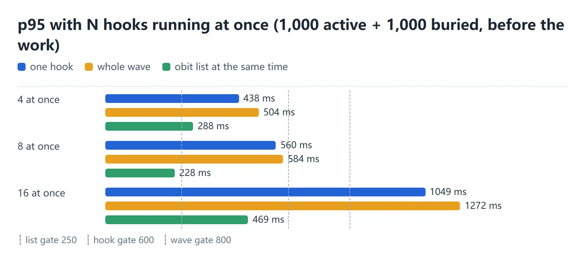

With a dozen agents open at once, Obituary gets slow. In the early hours of 22 November we did not start changing code. We measured first.

**On a ledger of 1,000 active and 1,000 buried entries, 16 hooks writing at once give a single hook a p95 of 1,049 ms.**

## 16 hooks at once: over a second, and a concurrent list takes almost half of one

The more run at once, the worse it gets, and at 16 a hook takes far longer than it should.

The runs used the real `obit hook claude` (PostToolUse, in a project that had already been approved), real Git and real NTFS file IDs, with temporary data and config directories. Each wave started k hooks staggered by 0, 5, 10 and 15 ms, then 65 ms later one real `obit list`, with 7 waves per level.

| At once | Whole wave p95 | One hook p95 | Concurrent list p95 |
|---|---:|---:|---:|
| 4 | 504 ms | 438 ms | 288 ms |
| 8 | 584 ms | 560 ms | 228 ms |
| 16 | 1,272 ms | 1,049 ms | 469 ms |

The 16-way level made 112 writes. One of them had not been registered when its process exited, and the existing queue replayed it, so all 112 ended up accounted for.

<figure>
  
  <figcaption>The p95 before the work, from the profile of 22 November. The dashed lines are the gates set afterwards, which apply to 16 at once only: 600 ms for one hook, 800 ms for the wave and 250 ms for list.</figcaption>
</figure>

## Where it goes: every hook reads and writes the whole ledger, and asks Git for itself

The time goes to process start-up, ledger size and queuing, and no single step looks outrageous on its own.

What hurts most is 16 agents running together: **every hook process reads and writes the entire ledger and asks Git for itself, and they queue behind one another.**

First, the floor for a single process:

- An empty Go program takes a median of 33.4 ms from creation to exit, with a p95 of 48.3 ms.
- An ordinary PreToolUse hook that touches no ledger takes a median of 48.0 ms and a p95 of 68.5 ms.
- All package initialisers together take a median of 11.0 ms, of which i18n is 4.7 ms and net is 3.7 ms.

Then the ledger itself, as medians:

| Operation | 1,000 + 1,000 entries | 10,000 + 10,000 entries |
|---|---:|---:|
| Read the hot ledger | 4.3 ms | 35.9 ms |
| Read the full snapshot | 12.3 ms | 111.4 ms |
| Change the revision of one entry | 14.3 ms | 82.2 ms |

The ledger grew tenfold and changing one entry got almost six times slower, because every commit rewrites the whole hot ledger.

### Burying a directory makes readers wait

With ten thousand entries, burying a directory has to relocate each entry inside it. During that time a reader that decodes nothing and only waits for the shared lock had a median of 2,043 ms over 6 runs, with a p95 of 2,500 ms. At 1,000 entries the same numbers were 209 ms and 211 ms.

We also timed an identity scan with no lock held: one thread, ten thousand files, a median of 1,728 ms. So the wait cannot be removed by adding a path tree.

**Loosening the hook timeout, or swapping in a different JSON library, does not fix this.**

## The plan: five batches, each behind a numeric gate

We would do the pieces that can ship on their own first, and every batch gets a paired same-machine gate that it must pass before it merges.

| Batch | What | Gate |
|---|---|---|
| A | On the existing JSON: a hook process loads only its own command and parses the message catalogue when first needed; list reads only what it shows | Ordinary PreToolUse at least 4 ms faster at the median with no p95 regression; list p95 on a ledger of ten thousand heading from 376 ms to under 300 ms |
| B | Move the ledger to SQLite, change only the rows involved, with replayable receipts | On a ledger of ten thousand, one row changed over a persistent connection at p95 of 15 ms or less; single-process scattered writes no slower than JSON |
| C | A resident process as the only writer; a hook hands over an observation and exits once it has a durable receipt | See below |
| D | Graveyard and doctor | While a directory with ten thousand entries is buried, ordinary readers wait under 100 ms extra at p95 |
| E | Small optimisations, only with evidence | At least 10% paired gain on the same machine |

The gate for batch C is the most important line in the whole plan:

**On a 1,000 + 1,000 ledger with 16 real hooks at once: one hook p95 at most 600 ms, the whole wave at most 800 ms, and a concurrent `obit list` at most 250 ms. One hook also gets a stretch target of under 300 ms.**

A few other rules were settled the same day:

- B and C ship in the same release. B may merge without being switched on, but it cannot ship alone or migrate a user's ledger.
- The per-entry identity check during a directory burial is not skipped. A path prefix may only narrow down candidates, never excuse a safety check.
- On C's healthy path a hook starts no Git and does not read or write the whole ledger; it exits once it has a durable receipt. Returning early without a durable receipt does not count as meeting the gate.
- B waits until the Docker volume work is in main, and takes the next ledger format number that is free at that point.

The profile also included a SQLite prototype: ten thousand rows, a Windows named pipe, and one resident process holding the connection. With 16 clients each request had a p95 of 60.8 ms when answered one by one, and 8.8 ms after adding a 2 ms batching window of up to 32 requests. These numbers cover the storage step only, with no hook start-up, Git or proposals; what the later implementation rounds found is in another post.

## Batch A: no change to the ledger format, merged the same day

Batch A merged into main at 18:38 on 22 November, with no SQLite, no extra process and no ledger format change.

It did two things:

- **A hook registers only its own subcommands.** `main.go` used to build every command before it knew the call was a hook, `list` and `bury` fetched their localised help and read the config at registration, and the i18n package parsed two message catalogues at initialisation. The catalogue now sits behind `sync.OnceValue` and is parsed the first time it is needed.
- **list and the summary take a read-only presentation path.** The bytes of the cold snapshot are still read, and the hash, ownership, ID and safety index are still checked. If the projection meets evidence it cannot verify, an old-format ledger or a migration that is not finished, it falls back to the full read. Writes, resurrection and purge never use the presentation result.

In the measurement both builds were called `obit.exe`, runs alternated AB and BA, and each group had two warm-up pairs, after which no sample was dropped:

| Real process | Pairs | Old p50 | New p50 | Old p95 | New p95 |
|---|---:|---:|---:|---:|---:|
| Ordinary PreToolUse | 61 | 53.13 ms | 48.10 ms | 60.03 ms | 57.94 ms |
| list, 10k active + 10k buried | 35 | 372.20 ms | 242.93 ms | 427.87 ms | 265.40 ms |

Both passed their gates, and list on a ledger of ten thousand came in under 300 ms at p95.

### The gate said no the first time

At one checkpoint along the way list still had a p95 of 567 ms and missed its gate, while the hook p95 had already fallen from 63.21 ms to 56.39 ms. That round was not let through. We changed more, measured again, and the final p95 was 265 ms.

### A red test first: a corrupt snapshot judged healthy

Set one `parentRef` in the cold snapshot to -1 and recompute the hash, and the presentation projection at that point still judged the snapshot healthy. Once a range check on references was added, that case turned green.

What else was checked:

- The output of 44 scenarios in Chinese and English matched the old build character for character, covering help at every level, empty and non-empty lists, JSON, `stats`, exit codes for invalid arguments, and ordinary commands and deletion denials for Claude and Codex.
- Three new mutants were added and the intended assertions caught all three.
- The manually triggered full CI run (`full=true`) passed on Windows, Linux and macOS.

Batch A leaves the lock queue alone, so the 16-way numbers are still there. B and C come next.
