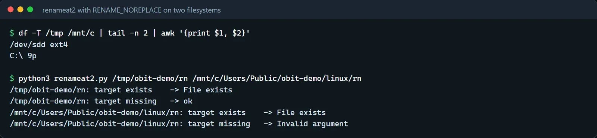
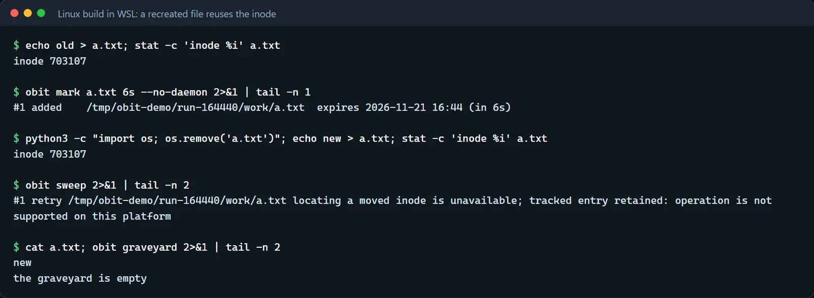

On Windows a burial does one very specific thing. It opens the file, checks its identity on that handle and renames it on the same handle, so there is no chance for the file to be swapped between the check and the rename.

**macOS and Linux have no such system call, since `rename`, `renameat2` and `renameatx_np` all take a parent directory and a name. If an editor swaps in a new file after the check and before the rename, the new file is the one that gets moved.**

## The decision of 10 November: not relaxing the promise, at first

`core.FS` demands that a burial check and then move atomically, and on a platform that cannot do that, any operation that needs it returns unsupported, the entry is kept and nothing is buried.

The alternative was to hard-link the verified inode into the graveyard through `/proc/self/fd`, then move it by name, check it and move it back if it was wrong. For files that shrinks the window a lot, but on a conflict the file that had been swapped in may sit in a quarantine directory until someone puts it back, and for directories it cannot be done at all. We did not take it.

**The cost was written down plainly: on macOS and Linux for the time being you could only register, look and use hooks, while burying, resurrecting and the Recycle Bin returned that the platform does not support them yet, and expired items were not cleaned up.**

## 12 November: move first, then verify, and put it back if it does not match

Two days later the line moved. Without burial and resurrection the core feature was unusable on those two platforms, and many users are on a Mac. On 12 November we asked for macOS and Linux to be supported quickly, and the way to do it was to move first, then verify, and put the file back if it does not match.

In detail it goes like this:

1. The parent directories of source and target are pinned, and the object is moved with a rename that never overwrites: `RENAME_NOREPLACE` with `renameat2` on Linux and `RENAME_EXCL` with `renameatx_np` on macOS.
2. The source object is separately pinned as a file descriptor with `openat`, `O_PATH` on Linux and `O_EVTONLY` on macOS, and it stays open for the whole operation, so the inode cannot be released and reused during the move.
3. As soon as the move is done, the device number, inode, type and link count are checked at the new location.
4. If they do not match, the same non-overwriting rename puts it back and a retryable error is returned.
5. If it cannot be put back because the original place is occupied, the object stays in the graveyard, its record is marked as an identity mismatch and it is never purged, and `obit graveyard` and `obit doctor` show where it is and how to deal with it by hand.

What is weaker than on Windows is also in the decision: if an editor swaps in a new file exactly between the check and the rename, that new file is briefly moved away and put back, or left in the graveyard for a person to handle, and it is not deleted.

### Some file systems do not support a non-overwriting rename at all

What follows is a small experiment in Ubuntu under WSL, with the same `RENAME_NOREPLACE`:

- On ext4 it succeeds when the target does not exist and reports that the file exists when it does.
- On `/mnt/c`, where the Windows disk is mounted through 9p, it returns invalid argument when the target is missing.

On a file system like that Obituary returns unsupported and does not fall back to a plain `rename`.

<figure>
  
  <figcaption>The real result of the same non-overwriting rename on two file systems. ext4 supports it and 9p returns invalid argument, so Obituary refuses to bury in such places.</figcaption>
</figure>

## A different file at the same path: inodes get reused on POSIX

Identity checking has one more problem on POSIX that Windows does not have.

**On Linux, when a file is deleted and a new one is created at the same path, the new file often gets the same inode, and an entry registered days earlier would take the newcomer for the old file.**

The fix on the evening of 12 November added a creation token to the upper 8 bytes of the file ID:

- On Linux it is a hash of the export file handle, which carries the inode's generation, combined with the `statx` creation time.
- On macOS it is the creation time.
- A file system that cannot supply such a token, for example overlayfs without `nfs_export`, refuses lifespans, while an immediate `bury` still works because it pins the file descriptor.
- Entries in an old ledger that hold only an inode are kept at expiry, and `list` and `doctor` ask for a fresh `obit mark`.

Below, the Linux build reproduces this on ext4 under WSL. After the file is deleted and recreated, the new file gets exactly the same inode number, the expiry sweep does not bury it, and the entry is kept and retried later.

<figure>
  
  <figcaption>The Linux build really run on ext4 under WSL. The file that was deleted and recreated got the same inode, and Obituary did not take the new file for the old one and bury it.</figcaption>
</figure>

## The whole suite on both platforms, and 1.1.0 on 13 November

That evening at 8:58 the whole test suite ran on Linux and macOS. Two CI jobs run `go test ./...` plus native safety mutations, and today the Linux job also runs with `-race`. The fixtures were rewritten so that drive letters, junctions, the fake Docker and the temporary directories work on both sides.

Behavior that exists only on Windows, such as alternate data streams, extended paths, the registry, Explorer and shortcuts, is skipped on POSIX with a stated reason, and where POSIX lacks a capability, such as finding an inode across a whole volume, the test asserts the conservative outcome.

### Porting the tests turned up a few product problems, with Windows behavior unchanged

- The delete guard treated every POSIX working directory as WSL interop, so deletions in native Linux and macOS shells were not guarded.
- Uninstall now goes through `obitd` and skips the Run key, Explorer and the context menu.
- Registration and observation now check known tracked paths and no longer fail because a whole-volume lookup is unsupported.
- Names containing a colon can be resurrected.

At 10:15 that night the first round of CI fixes covered a batch of macOS habits: the case-insensitive APFS, `~/Library/Application Support`, and temporary directories that resolve under `/var`.

### 1.1.0

**On 13 November the work was merged at 12:02 and 1.1.0 was published at 12:17.**

- Expiry is checked by launchd on macOS and by a systemd user timer on Linux.
- macOS can install through a Homebrew cask, and both platforms can use the install script that verifies SHA-256 and installs into `~/.local/bin`.
- The delete guard catches `rm -rf` in the terminals of both.
