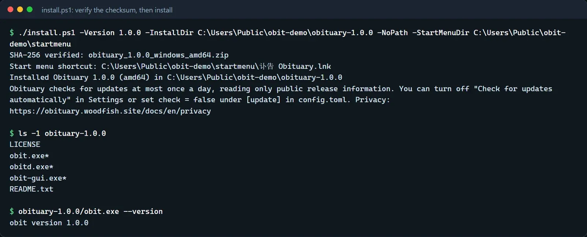
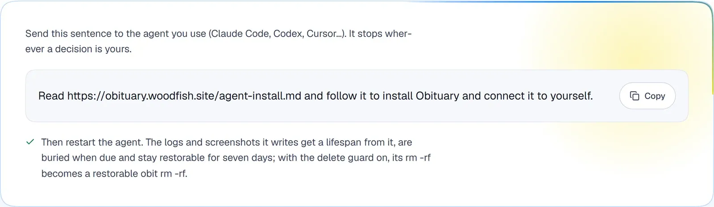

**Obituary 1.0.0 was published at 7:50 in the evening of 11 November, less than four days after the first commit on the night of 7 November.**

It is the full Windows experience, with two installation archives, amd64 and arm64, and a `checksums.txt`.

## The first version is 1.0.0, and only for Windows

The first version in the plan was called v0.1. At 8:43 in the evening of 10 November we decided to finish the whole Windows experience and release it, and to leave the desktop integration for macOS and Linux for later.

- By then the window, the tray, the context menu, the dates in Explorer, the folder policies and the installation channels on Windows were close to ready to ship.
- The platform layer for macOS and Linux was only partly done, and the context menu, folder watching, notifications and file manager labels had not been started.
- Splitting up the core package was also pushed back until after the release, so that large mechanical changes would not collide with the fixes made before it.

**The cost was that macOS and Linux users of 1.0.0 could only build it themselves and try part of the features.**

At 10:47 that night the first version was renamed from v0.1 to 1.0.0.

## The archives and the channels: only a `v*` tag starts a release, and SHA-256 is checked before installing

Releases are built with goreleaser, configured on the evening of 10 November:

- It builds `obit.exe` and `obitd.exe` for Windows on amd64 and arm64 and `obit-gui.exe` for amd64, zips them with a README and the LICENSE, and writes SHA-256 checksums.
- Only a `v*` tag starts the release workflow, which creates just a draft release with the zip files and the checksums, touches no channel, and leaves the release notes to be written by hand before anything becomes public.
- The same evening the manifests for Scoop and winget were written, with a portable zip for winget, along with the installer script `install.ps1`.

### What `install.ps1` does

- It downloads the archive and `checksums.txt`, which always come from the same place, and then verifies the SHA-256. If it does not match, the script refuses to unpack, and there is no switch to bypass the check.
- By default it installs into `%LOCALAPPDATA%\Programs\obituary` and adds that directory to the user's PATH.
- It supports `-WhatIf` and can safely be run again.
- Continuous integration runs the script against the manifests of a snapshot build without touching PATH.

What follows is a real run of the published 1.0.0, installed into a temporary demo directory.

<figure>
  
  <figcaption>The real output of the published installer installing 1.0.0 into a temporary demo directory. The archive is unpacked only after the checksum matches, and it holds three programs plus the license and a readme.</figcaption>
</figure>

winget needs its manifests submitted to Microsoft's repository for review, which takes a few days. While the review is pending, the installation steps meant for agents leave winget out because an agent stops when it meets an error, and the documentation for people says it is in review.

## The first sentence goes to the agent

Obituary is for agents, so the first step of installing it is also handed to an agent. In the early hours of 11 November we wrote a prompt that says to read `agent-install.md` and follow its steps to install Obituary and connect it to yourself.

The agent installs the program, runs `obit init` to wire the hooks, rules and Skill into itself, and stops to ask wherever a decision belongs to the user.

At half past three in the afternoon the install section of the README was replaced by that one sentence and a wall of agents, and the manual ways to install, including Scoop, winget, the script, the mirror in mainland China, connecting agents by hand, checking, updating and uninstalling, moved into `docs/install`, with an English version alongside.

<figure>
  
  <figcaption>The sentence for the agent in the website's install area, with a copy button beside it. The agent reads the document, installs and connects itself, and stops to ask wherever the user has to decide.</figcaption>
</figure>

## The last night, and 1.0.1 less than five hours later

From the early hours to the morning of 11 November there were several rounds of using it ourselves and finding problems. What changed that night:

- Grave notices were added, so that an agent touching a path that has already been buried is told on the spot.
- Docker containers also got lifespans.
- The list of expiring items at the start of a session was made opt-in.
- The wording in the window was gone through page by page, so that a container reads as a Docker container and no longer shows 0 B, and the Chinese name of the Expiring page was changed to say that items are about to be buried.

Before the release there was also a checklist for acceptance on a real machine, about 30 to 40 minutes, in which a freshly created practice repository goes through the Claude Code and Codex flows. Agents and workers in development are not allowed to touch the real `~/.claude`, `~/.codex` or the registry, so what happens inside real hosts can only be checked by a person.

### The pace of the release evening

- Before the release the full tests and the mutation tests each had to run once. The mutation tests took more than twenty minutes when run serially, so at 7:18 in the evening they were split by case number across 8 machines.
- At 7:33 the v1.0.0 tag was created.
- At 7:50 the release was published.

### 1.0.1: rebuilt with Go 1.26.11

Go published 1.26.11 on 10 November, and its release notes say it carries security fixes to cgo, the `go` command, the compiler, the linker and `net/http`. Obituary does not depend on cgo, and the standard library is compiled into the executable, so a fix to the standard library only reaches the archives through a rebuild.

That night we rebuilt with 1.26.11 and updated the dependencies to their current versions, tagged v1.0.1 at 0:22 on 12 November and published it at 0:38.

**From 11 to 21 November a total of 15 versions were released, 1.0.0 included.**
