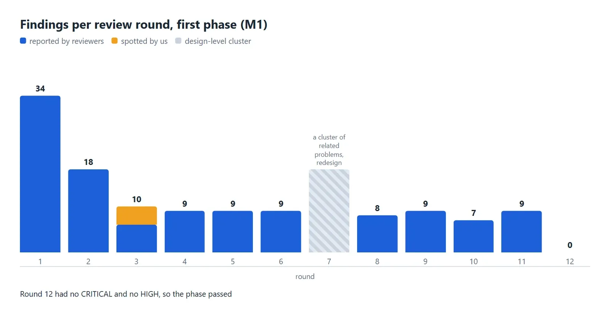
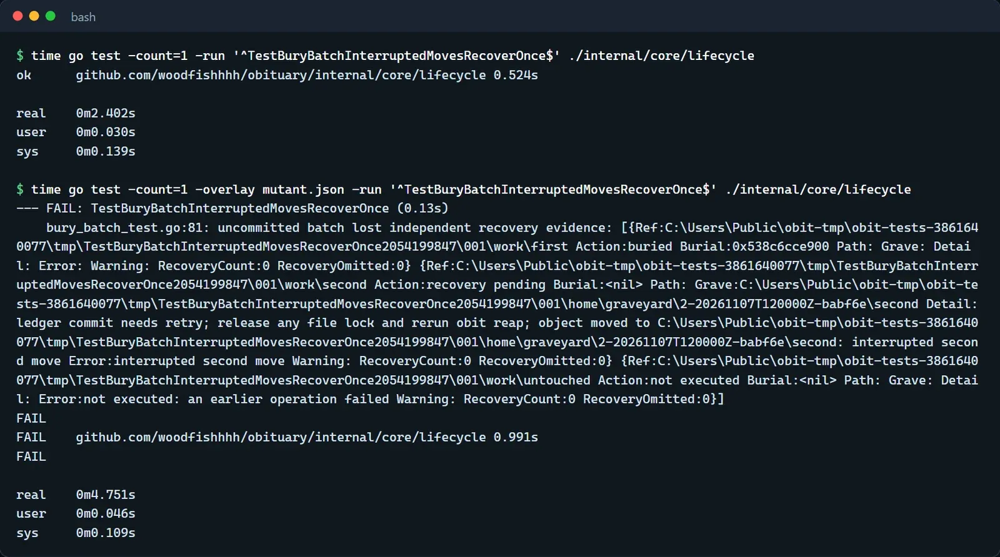

**On 8 November the three phases of Obituary went through 40 review rounds.**

The method was the write, review, fix loop we had settled on the first night, and that day it was pushed as far as it would go. Here are the rounds and times for each phase.

| Phase | Content | Rounds | From (8 Nov) |
|---|---|---|---|
| M1 | Automatic registration, the graveyard, integration with Claude Code and Codex, the background runner | 12 | about 01:00 to 07:00 |
| M2a | The delete guard | 10 | about 07:55 to 12:35 |
| M2b | The MCP server and the Skill | 18 | 8 Nov 13:28 to 9 Nov 09:40 |

## The finding count never fell smoothly to zero, and the MCP phase took about 20 hours

In the first phase the count per round went like this:

- Round 1: the two reviewers reported 34 findings.
- Round 2: 18.
- Round 3: down to 6, plus 4 that we spotted ourselves.
- Rounds 4 to 11: 7 to 9 each, apart from the cluster in round 7.
- Round 12: no CRITICAL and no HIGH.

The curve did not fall smoothly to zero, because each stretch of rounds found a different kind of thing:

- The early rounds found conspicuous mistakes.
- The middle ones found interactions between earlier fixes.
- The later ones found increasingly strange corners.

**The 18 rounds of the MCP phase took about 20 hours, which is the most direct cost of the method.**

<figure>
  
  <figcaption>Findings per round in the first phase: the count falls from 34 to 7 to 9, the cluster in round 7 led to a redesign, and round 12 had nothing serious left.</figcaption>
</figure>

## A round has five steps: review, verify, fix, check, review again

A round starts with the review and ends when CRITICAL and HIGH are at zero.

1. Review: two or three Codex reviewers read the code, read-only, each from a different angle: deletion safety and identity checks, integration and installation, and the facts in the documentation together with regressions and tests. Sometimes two reviewers independently report the same problem. We call that a shared finding, and it usually gets fixed first.
2. Verify: Claude opens the code for every finding, because reviewers are wrong sometimes and contradict each other: one complains that the guard stops too little, another that the command it suggests selects more than the original. Only findings that hold up go on the fix list.
3. Fix: Codex implements the fixes, writing a regression test that fails first and only then changing the code.
4. Check: Claude reads the diff, runs the tests and then the mutation checks to confirm that the tests really catch the change.
5. Review again: fresh reviewers read the fixed version.

**A phase passes only when a round has no CRITICAL and no HIGH.**

## What the rounds found: from conspicuous mistakes to names someone has to construct on purpose

The later rounds kept finding corners that took deliberate effort to reach. These are the findings worth remembering.

### Round 7 of the first phase: the half-finished state of a burial does not belong on the ledger

The review found that the half-finished state of a burial was being kept on the ledger entry, and that this led to a string of related problems.

**Rather than patch one more hole, we moved that state out of the ledger altogether, into a small manifest next to the grave (the previous post describes it).**

We then tested recovery after an interruption at each of 63 points where the process could be cut off.

### Delete guard, round 3: a CRITICAL, because the fallback after `||` would really run

The command was `rm -r repo || /usr/bin/rm -rf backup`. In the original, the fallback after `||` runs only if the first rm fails. Once the guard replaced the first rm with `obit rm`, Obituary could fail where rm would have succeeded, for instance by refusing a path.

**Then the fallback, a path-qualified `rm -rf backup` that is never intercepted, would really run and permanently delete `backup`.**

The fix was to tighten the rule: a deletion that is replaced must be the last segment of the command, preceded only by `&&` or `;`, and anything with `||`, a pipe or a background operator passes through untouched.

### Delete guard, round 5: selecting too much would bury a file the original never touched

Take the path `missing/../keep.txt`, where `missing` does not exist. The real rm fails because that directory is not there. If an equivalent command first normalised the path to `keep.txt` and buried that, it would bury a file the original never meant to touch.

The fix was to check a path containing `..` level by level, to see that each level exists, before normalising it, and in bash to give no equivalent at all and let the command pass. The same round settled a discipline: a table of main scenarios that runs in every round.

### Delete guard, round 8: both HIGH findings were protection failing

Round 8 found no more over-selection. Both HIGH findings were protection failing:

- When the audit log could not be written, a deny that had already been decided was cancelled.
- When the pre-scan of wildcards ran over budget or the current directory could not be read, a command that should have been denied was let through.

**The last thing a guard should do when something goes wrong is switch itself off.**

### MCP and Skill, round 1: 11 findings, one of them HIGH

**We edited `~/.claude.json` directly, but Claude Code rewrites that whole file while it runs, so the two could swallow each other's writes.**

We changed to the official `claude mcp add` and `remove`, and now only read the file to decide whether an entry is ours. The medium findings of that round are representative as well:

- A resurrection that never ran was reported as a success with one warning.
- A request cancelled by the client still executed once it got the lock.
- In recycle mode the description of `obit_bury` still said the item could be restored.
- A broken project `.mcp.json` meant even the hooks could not be uninstalled.

The rounds after that found stranger things:

- 8.3 short names
- alternate data streams
- `K` and the Kelvin sign treated as the same letter under Unicode folding
- volume identity
- ownership markers on the graveyard root

Each was correct as logic, but triggering it required someone to construct such a name on purpose.

## When to stop: grade findings by consequence, not by whether reviewers can still find something

Review has no end. As long as there are reviewers, they will find something, so the stopping rule has to be decided in advance and graded by consequence.

Late in the MCP phase we noticed that more and more of the HIGH findings needed extended-length paths, names constructed inside WSL or particular Unicode folding to trigger, and even when triggered they only left an item in the graveyard, still restorable, instead of permanently deleting the wrong thing. The next day we wrote the rule down as a grading:

- HIGH, must be fixed: only a finding that can delete, move or overwrite the wrong object.
- MEDIUM or LOW: a finding that can only be triggered by extended paths or names constructed in WSL, and that cannot permanently delete the wrong thing.
- Small fixes and test-only changes: a single round.

**Review cannot prove the absence of errors; it only raises the bar for getting through, and the height of the bar has to be set by consequence.**

## How we know it is fixed: regression tests, mutation checks, a main-scenario table

"It is fixed" is the easiest sentence to fool yourself with, and we use three things to keep it honest.

### A regression test that fails first

Turning a finding into a regression test matters more than fixing it, because a fix covers this one time and the test covers every time after. So before changing the logic of the guard, of locating, settling, committing or recycling, we write a failing test that proves nothing will be deleted by mistake. After the fix we temporarily revert it and confirm the test really goes red.

The reverted version has to compile, since a build failure does not count as verification, a rule that dates back to the small detour on the first night.

### Mutation checks: break one decision and see whether a test fails

With `go test -overlay` we break one key decision, for example by turning a condition into one that is never true, recompile, and see whether the test responsible for that spot fails. Every entry in the mutation tables says which file and which piece of it is changed, to what, and which test in which package is supposed to catch it. There are two tables now:

| Mutation table | Entries |
|---|---|
| Core gates and MCP | 516 |
| Delete guard | 138 |
| Total | 654 |

**On this machine, timing two of them, going from the source edit through the build to the corresponding test catching it took 3.9 and 4.8 seconds.** The terminal output of the second is below. CI splits them by index across 8 machines.

<figure>
  
  <figcaption>The same test passes on the original code and fails on the mutant with one decision broken, so the mutant is caught; the second run took 4.8 seconds from edit to failure.</figcaption>
</figure>

### The main-scenario table: the most common deletions run every round

The third is the main-scenario table of the delete guard, which runs on every round and every change so that the most common ways of writing a deletion stay covered.

## Two habits the loop left behind

- Tests are named for the feature and not for the review round. A test file named after a round only records which round wrote it and not what it guards, and what each round fixed and why goes into the commit message.
- Documentation describes today's rules and the reasons and not the history. The architecture document had accumulated passages like "round 11 tried this and backed out", which we rewrote into the current rule plus its reason, and the history stays in commit messages.

At the end of each phase we also do a pass that changes structure and not behaviour, splitting large files and moving end-to-end tests into their own package, and the rule is that the number and results of the tests are the same before and after.
