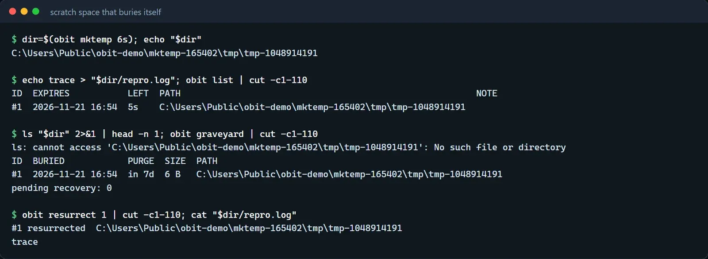

Most of Obituary's code was written by AI, and what the project exists to deal with is what AI leaves behind. With those two things together, the development process itself became the first testing ground. This post covers how the division of labor was settled, when work has to stop for a confirmation, and how we stepped into our own trap first.

## Who decides, who does the work: four roles

| Role | Who | What it does |
|---|---|---|
| Decision | One person | Sets the direction and makes the product trade-offs |
| Coordinator | Claude | Splits large goals into tasks, writes a brief for each task, verifies every finding, merges the changes that come back and guards releases |
| Worker | Codex | Implements each task in its own isolated workspace according to the brief |
| Reviewer | Codex, read-only | Two or three per phase, looking at the same code from different angles in parallel |

Scheduling is done by Orca, which starts terminals, dispatches tasks and collects reports.

**One lesson came out of using it this way: judgment belongs on the coordinator's side, and Codex gets explicit instructions and then gets on with the work, so decisions should not be thrown over to it.**

That is why the briefs are so specific about what to do, what not to do, which files not to touch and what has to come back. From 8 November, dispatching Codex moved from a delegation script we had written ourselves to Orca's orchestration. How many workers can run at the same time is capped, because neither the quota nor the machine can carry too many, and the cap was adjusted a few times.

## Gates and evidence: the decision stays with whoever decides

### Gates

A brief can contain gates. At a certain step the worker has to stop, ask the coordinator and wait for the reply before going on. Anything that is hard to take back is behind a gate:

- pushing to a shared repository
- releasing
- publishing outward

The point of a gate is that the decision stays with whoever makes decisions, while a worker can take the work right up to the last step.

### Evidence

What comes back has to carry evidence, and evidence means real output and not a retelling:

- The results of tests and mutation checks are attached.
- So is the check that the test really fails once the fix is reverted.
- So are screenshots and command output.

The same principle was later applied to outward-facing material. The website and user documentation describe concrete entry points, effects and limits, commands in videos are run for real in an isolated directory and their actual results are used, and a preview, a pending approval or a case that cannot be resurrected must not be presented as supported.

### Review has a rule against endless loops

- HIGH: only a finding that could delete, move or overwrite the wrong object.
- MEDIUM or LOW: a finding that can be triggered only by names built with extended paths or WSL and that cannot permanently delete the wrong thing.
- Small fixes and test-only changes: one round of review.

### From 21 November, the shared website repository is merged and deployed by the coordinator

Workers push only their own branches. The cause was a rebase that replaced a whole stylesheet and deleted four groups of rules, which an acceptance check that looked at a single partial screenshot did not catch.

The coordinator's process now:

1. Check deletions line by line.
2. Merge onto the latest main.
3. Build from the final tree.
4. Screenshot the affected pages.
5. Push, and then check the live pages both overseas and in mainland China.

## We were the first users: and stepped into our own trap first

### Temporary directories: more than 70, taking 2.4 GB

The temporary directories went wrong first. Workers running tests and reproductions left evidence directories in the system temporary folder. Counted on 10 November there were more than 70 of them, taking 2.4 GB, and nobody remembered to delete them.

**This is exactly what Obituary is for.**

So the rule became that debug scripts, logs, reproduction and evidence directories are created with `obit mktemp 2d`, or an existing directory gets `obit mark <path> 2d`, and they are buried by themselves at expiry and can be resurrected. Only when a sandbox account cannot write to the ledger does a worker fall back to making a directory by hand in the temporary folder, and it says so in its report. Obituary refuses to register a directory that contains `.git`, and the worker deletes that one itself when done.

<figure>
  
  <figcaption>The scratch space workers use now, in a real run. After expiry the directory went into the graveyard by itself, and after resurrection the log was still there unchanged.</figcaption>
</figure>

### A pitfall on Windows: directories from `mkdtemp` carry a protected ACL

Codex workers run as a sandbox account, and since Python 3.13 the directories that `mkdtemp` creates on Windows carry a protected ACL. If a test points the temporary directory there, restoring the ACL on `.git` fails and leaves behind a directory that only an administrator can delete.

So tests use the default temporary directory, and cleaning up such a directory takes elevation, running `takeown` and `icacls` on the exact directory and then deleting it with ordinary permissions.

### 14 November: a test build took the place of the real one, and the tray's Open went grey

A worker wanted to measure the CPU use of the background process. It stopped the Obituary background process in use and put its own compiled test build in place, which then managed the real data, and it did not swap the real one back after the test. The tray looks for the window program only in the folder that holds the background program, and the temporary folder with the test build did not have it, so Open on the tray went grey. It simply looked as if it could not be clicked, and there was no way to see why.

**This shows the point best: a test script changed the real environment, and the only symptom was a greyed-out button.**

The fix has two layers:

- The immediate one: swap the real build back as soon as that round of measurement ended, and from then on test scripts swap it back on exit.
- The product-level one: when the window program is missing, Open can still be clicked and shows a notification saying what is missing and how to fix it, which went into 1.3.0.

### One thing to arrange in advance

When Orca restarts, the workers that are running lose their connection, so before a restart the session ID of every worker is written down and afterwards each one is picked up again by its ID exactly where it was.
