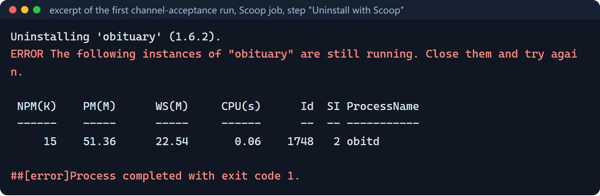
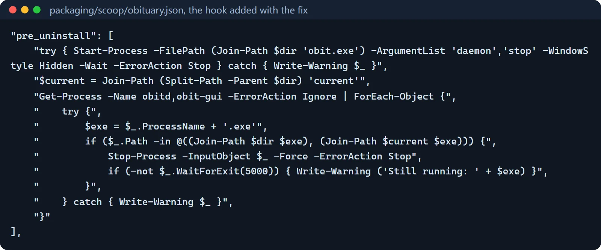

A correct manifest does not guarantee that a user can install the package and remove it cleanly. On 22 November we had the Scoop and Homebrew clients install 1.6.2 for real.

**In the first run, both channels failed at the uninstall step.**

## How the acceptance runs: one manual workflow, three jobs

After a release, once both channels point at the new version, `channel-acceptance.yml` is triggered by hand with the version number, and it installs the package for real on disposable GitHub machines.

| Job | Machine | Uninstall path |
|---|---|---|
| Scoop, the documented path | Windows | `obit uninstall --yes` first, then `scoop uninstall obituary`, with the processes started through the `current` link |
| Scoop, the direct path | Windows | `scoop uninstall obituary` straight away, with the processes started from the versioned directory |
| Homebrew | macOS 15 | `obit uninstall --yes` first, then `brew uninstall --cask obituary` |

Each job follows the same script:

1. Read the index and check that the version in it equals the version entered.
2. Install from the channel; `obit --version` prints `obit version <version>` and `obitd --help` runs.
3. Register, list, bury and resurrect a sample file, and use `cmp` to check that the resurrected content matches the original byte for byte.
4. Bury it once more, so the graveyard holds real content and not an empty directory.
5. Leave the background process running (and on Windows the window too), then uninstall with the package manager.
6. Check that `obit` and `obitd` have gone from PATH, and that `store.json` and the graveyard directory are byte for byte what they were before the uninstall.

What the runs do not cover: Windows arm64, Intel Macs, the DMG, and the first Gatekeeper approval on a personal computer.

## Windows: the background process was still running, so Scoop refused to uninstall

**`scoop uninstall obituary` reported that instances of obituary were still running and refused to remove it. The process it listed was `obitd`.**

<figure>
  
  <figcaption>An excerpt of the real log from the first run. The script had just finished burying and resurrecting, Obituary's background process obitd was still running, and Scoop refused to uninstall for that reason.</figcaption>
</figure>

Real users will hit this too. You install Obituary, use it for a while, the resident tray process keeps running, and a plain `scoop uninstall` is refused.

The first thing we tried was running `obit daemon stop` in the acceptance script before the uninstall, and that run went green. It meant working around the problem for the user, so it did not stay. The fix that stayed is in the Scoop manifest, which gained a hook that runs before the uninstall:

- It first runs `obit daemon stop`, so the background process exits by itself.
- It then looks for `obitd` and `obit-gui` processes, handles only those whose path is under the versioned directory or the `current` directory, force-stops them, waits 5 seconds, and warns if one is still there.

Both paths have to be covered, because a process may have been started from the versioned directory or through the `current` link, which is why the acceptance has two Scoop jobs.

<figure>
  
  <figcaption>The pre-uninstall hook in the manifest. It stops only the obitd and obit-gui that belong to this installation, and a process with the same name in some other directory is left alone.</figcaption>
</figure>

**A 1.6.2 that was already installed from the old manifest does not pick the hook up by itself.** New installs, and every release from now on, carry it.

## macOS: current Homebrew wants a third-party tap to be trusted first

In the first run the Homebrew job stopped at the step that reads the index, with `Refusing to load cask ... from untrusted tap ...` and a suggestion to trust the cask or the tap with `brew trust`.

The cause was that we read the cask with `brew info` before installing it, and current Homebrew will not load a recipe from a third-party tap until the tap is trusted.

The install command in the docs already uses the full name, with the tap in front, in the form:

```bash
brew install --cask <tap>/obituary
```

Installing by the full name makes Homebrew trust the tap automatically, so neither the cask nor the docs needed to change. What changed is the acceptance script, which now reads the recipe in the index with `git show HEAD:Casks/obituary.rb` without loading it, and uses `brew info` to check the version only after the install.

The macOS uninstall has a stretch of its own. It first runs `obit daemon enable` to install the launchd user agent, uses `launchctl kickstart` to make it really run, and then runs `obit uninstall --yes`. It checks that both the plist file and the loaded service are gone (`launchctl print` returns 113), and finally runs `brew uninstall --cask obituary` and checks that the background process is gone too.

## The result: three green jobs, data kept byte for byte

After the fix, 1.6.2 installs and runs from Scoop (Windows x64) and from Homebrew (macOS arm64), and each client uninstalls it. Both programs disappear from PATH, and the isolated ledger and the non-empty graveyard are byte for byte what they were before.

The workflow merged into main at 19:46 on 22 November. After 1.7.0 was released on 23 November we triggered it once more, and all three jobs passed with 1.7.0.
