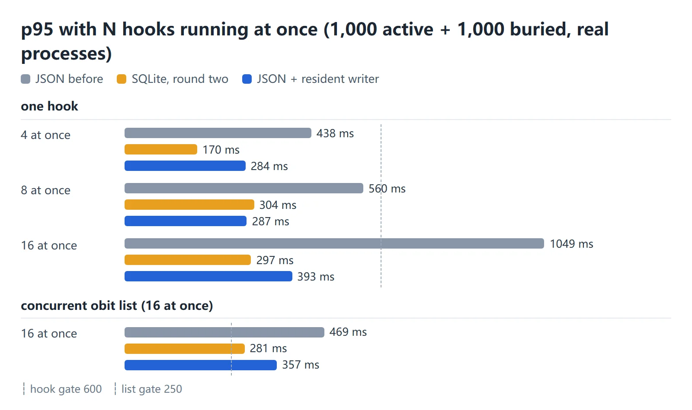
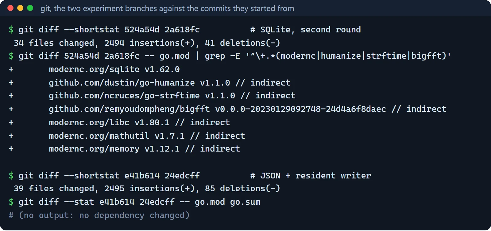

Both routes bring the p95 of 16 concurrent hooks inside the 600 ms gate, and this time we chose the one that leaves the ledger format alone: JSON with a resident single writer.

**At the ledger size we actually use on the development machine (443 active entries, 1,080 buried ones, a 282 KB `store.json`), the extra gain from SQLite does not cover what it costs.**

This post puts the measurements from the second SQLite round and from JSON with a resident writer into the same tables. The post of 9 November, "The ledger: JSON, SQLite, and a rewrite we did not merge", covered an earlier evaluation that was shelved while we waited for a resident process. This one covers the two rounds we did once the resident process existed.

## SQLite took two rounds: most gates passed, list did not, and creating the database had a gap

Batch A merged on the evening of 22 November, and work on B and C started. By the afternoon of 23 November the SQLite branch stood at `2a618fc`.

Round one wired in pure-Go SQLite (modernc.org/sqlite v1.62.0), changed only the rows that changed, and added idempotent receipts, and the tests passed. The interface above it still read the whole ledger every time, though, so **changing one row in a ledger of ten thousand took about 113 ms against a gate of 15 ms.**

Round two changed the interface to read and write by row. The resident process held the database connection, and hooks handed their observations to it over local IPC.

What passed:

- Changing one row by ID in a ledger of ten thousand took a p95 of 5.33 ms on Windows and 7.13 ms on WSL, against a gate of 15 ms.
- With 16 hooks at once, one hook had a p95 of 296.71 ms and the whole wave 318.87 ms, against gates of 600 and 800 and a stretch target of 300 ms. At 4 and 8 at once it was also faster than before.
- With the resident process force-killed at two critical points, nothing was lost and nothing was registered twice.

What did not:

- With 16 hooks running, the concurrent `obit list` took 281.33 ms against a gate of 250 ms.
- A short-lived process writing directly matched JSON at the median but was about 7 ms slower at p95, so we could not claim that scattered writes were no slower.
- Some write paths had not moved to row-level writes, and the upgrade matrix for old ledgers and the full CI run were not finished.

**There was also a data-safety problem: if the last step of first-time creation failed, it left a half-built database behind, and afterwards Obituary could not open the ledger.**

In detail, the database had committed but the version fence had not been published. The ordinary error compensation restored the rows without restoring the state "this database did not exist", and later reads failed with `SQLite ledger exists without its version fence`. An orphan database can be neither treated as an empty ledger nor deleted automatically. The fix is a private staging area, ownership and a re-entrant publish for first-time creation and import, with an exit simulated at every stage. That work was half done when we stopped.

A few problems round two found and fixed:

- Read-only diagnostics (the test packages for `doctor`, `init`, `uninstall` and MCP) modified the WAL sidecar files, because short connections were forced to keep WAL.
- After the graveyard summary inside the fence was tampered with, purge was not refused; the original test got `purged` before the fix.
- On Windows the named pipe returned `Incorrect function`; access is now restricted to the current user and the endpoint owner is checked before sending.

## Pausing: the slowness was queuing and Git, not the storage format

Once the round-two results were in, we stopped and looked again at where the problem actually was.

Three facts together:

- With concurrency a hook takes over a second, and most of that is every hook locking the whole ledger to read and write it and running Git itself. A resident process as the only writer fixes that, and it has little to do with the storage format.
- At 1,000 + 1,000 entries a short-lived SQLite process writing directly is as fast as JSON, at a p95 of 85.78 ms against 83.87 ms. SQLite only pulls clearly ahead beyond ten thousand entries.
- The costs of SQLite were already visible: about 4 MiB more binary, old versions that cannot open the new ledger, new failure points, and three rounds without converging.

**So we decided to pause SQLite and spend a day checking whether a resident process as the only writer, with the ledger format unchanged, could pass the same gates.**

The third SQLite round was stopped on the spot. Its uncommitted changes, the fix for the orphan database, half finished, went into a git stash, and the branch stayed at `2a618fc`.

## JSON with a resident writer: the ledger stays, the writing moves

This version keeps the v18 JSON ledger and changes how writes happen.

- **A hook only hands over an observation.** The PostToolUse write goes to `obitd` over a Windows named pipe that only the current user can open (a socket on Unix). The receipt means the queue is durable, not that anything is registered. With no resident process the hook registers directly as before. If the resident process accepts the request but no receipt arrives within 250 ms, the hook saves a request file under the same request ID, so nothing is registered twice.
- **A receipt means durable.** Requests that arrive at the same moment are merged into one write, into `observations.jsonl`, which every version understands.
- **The resident process replays in batches.** Thirty-two at a time. Git, consent, rules and identity checks run on a private copy of the ledger without holding `store.lock`. The commit takes the lock and checks that the bytes of `store.json` are still the ones that were read, writes once per batch, and only then deletes the requests and flushes the audit. If another process committed in the meantime the batch is redone, and after three conflicts in a row it finishes while holding the lock.
- **Readers do not queue.** `obit list`, `obit stats` and the hook's notices read the last committed `store.json`. A commit is an atomic rename, so what they read is always a whole version.

The single writer covers only the Post path. CLI semantic writes and the "already told" marker still write to the ledger directly.

## Side by side: at 16 at once, both routes pass the hook gate

The numbers below are p95 from a 1,000 + 1,000 ledger, the real `obit hook claude`, the real `obit list`, real Git and a tray-less `obitd`.

<figure>
  
  <figcaption>The p95 of the three implementations. Grey is the JSON ledger at the profile of 22 November, orange is the second SQLite round and blue is JSON with a resident writer. The three sets were not run together and the machine had other jobs on it, so they are compared with their own gates only.</figcaption>
</figure>

| Metric (p95, ms) | Gate | JSON before | SQLite round two | JSON + resident |
|---|---|---:|---:|---:|
| One hook, 4 at once | no worse than before | 438.45 | 170.28 | 283.57 |
| One hook, 8 at once | no worse than before | 559.93 | 303.60 | 286.67 |
| One hook, 16 at once | 600 (stretch 300) | 1,049.36 | 296.71 | 392.72 |
| Whole wave, 16 at once | 800 | 1,271.59 | 318.87 | 408.75 |
| Concurrent `obit list`, 16 at once | 250 | 468.73 | 281.33 | 357.09 |

The verdict is the same for both: **hook and wave pass, the concurrent list fails.** SQLite's hook is about 100 ms lower than JSON with a resident writer, and its list about 76 ms lower.

In the same round, JSON with a resident writer also measured main as its baseline: 980.16 ms for one hook, 1,091.39 ms for the wave and 347.49 ms for list. Against their own same-round baselines, SQLite cut the 16-way hook p95 to about 28% of what it was, and JSON with a resident writer to about 40%. Of the three time windows, only the quietest met the stretch target of 300 ms with JSON and a resident writer (293.4 ms, the other two being 591.6 and 378.1).

### A ledger of ten thousand

| Metric (p95, ms) | JSON, main of the same round | SQLite round two | JSON + resident |
|---|---:|---:|---:|
| Change one entry | 82.2 (profile of 22 November, median) | 5.33 (persistent connection, warm) | not row-level |
| One hook, 16 at once | 1,269.4 | not measured | 396.4 |
| Whole wave, 16 at once | 1,339.9 | not measured | 456.7 |
| Concurrent list, 16 at once | 642.4 | not measured | 525.5 |

The ten-thousand numbers come from only 15 waves, so p95 equals the maximum, and there is no gate. The JSON "change one entry" figure comes from a different profile run, with a different driver from the SQLite row.

**With ten thousand entries, hooks in JSON with a resident writer are barely affected by size, because a hook no longer reads or writes the ledger, and the cost of size moves into the resident process.** Each batch rewrites the whole JSON twice, once for the commit and once to drain the audit, which takes about 0.2 s at ten thousand entries, and hooks do not wait for it.

### The price: registration completes later

With JSON and a resident writer the hook returns first and registration finishes in the background, so the time from the start of a wave until everything is in the ledger grows:

| Wave start to everything registered (1,000 + 1,000, 16 at once) | Median | p95 |
|---|---:|---:|
| JSON baseline | 1.04 s | 1.20 s |
| JSON + resident | 2.93 s | 3.44 s |
| SQLite round two (wave start to queue empty) | | 6.92 s |

This is when registration completes, not when an agent receives a notice. At ten thousand entries it was 8.21 s and 10.52 s, against 6.80 s and 11.29 s for the baseline.

## Costs and risks: size, dependencies, compatibility, failure points

SQLite puts its cost in the binary and the format, while JSON with a resident writer puts it in registration delay and a new piece of replay logic.

<figure>
  
  <figcaption>Where the two experiment branches stood when they stopped, against their own starting points. Tests and the benchmark driver account for a good share of the lines. The SQLite round is over two thousand lines plus a new dependency tree, and JSON with a resident writer adds no dependency.</figcaption>
</figure>

| Item | SQLite round two (`2a618fc`) | JSON + resident (`24edcff`) |
|---|---|---|
| Binary size | obit +4,199,936 bytes, obitd +4,227,072 bytes (Windows amd64, stripped); across the six platforms the increase is 3.82 to 4.14 MiB | not measured separately |
| New dependencies | `modernc.org/sqlite` v1.62.0 and 6 indirect ones | none, `go.mod` and `go.sum` unchanged |
| Resident process memory | not measured | after the later list work, 35 to 39 MB working set under load, against 25 to 27 MB before |
| Older version opening the new ledger | refused: the format number goes up, old ledgers have to be migrated, and an old program refuses the new format | works: v1.7.0 listed 1,000 entries, its `obitd --once` imported the queued observations and registered each once, and the new resident process reopened the ledger and carried on registering |
| Non-test Go code | 16 files, 1,798 lines added and 14 removed, with some writes still not migrated | 17 files, 862 lines added and 76 removed, covering the Post path only |
| Estimate of what remains | the audit put B and C at 5 to 8 person-days each, and the full migration matrix was not done | the author estimates 8 to 12 person-days, plus 3 to 5 more for every write to go through `obitd` while it is healthy |

Fault injection on both sides:

- SQLite: the resident process was force-killed "before the queue write" and "after commit, before the receipt", and both lost and duplicate registrations were 0. This was a one-off test process carrying the production IPC handler, not an arbitrary-instruction kill of the production `obitd`.
- JSON + resident, 1,000 entries: the real `obitd` was hit with `TerminateProcess` at random moments while hooks kept arriving. Two groups made 560 writes and 50 kills, with 0 missing and 0 duplicated.
- JSON + resident, ten thousand entries: 16 at once × 20 rounds, 20 kills, 320 expected paths. The driver reported a timeout inside its 180-second drain limit (298 registered, 22 pending), and **that run cannot be reported as a pass.** We left the resident process running and re-read the ledger independently: 10,320 active entries in all, 320 of them registered once each, every revision 1, nothing missing, nothing duplicated, queue empty. The last restart and the last commit were about 191 seconds apart.

Both are process-level kills and not power-loss tests.

## Which one fits which scale

When the ledger holds a few thousand entries and the bottleneck is lock queuing and every hook running its own Git, JSON with a resident writer fits better. When it holds ten thousand or more and rewriting the whole ledger on every commit becomes the main cost, SQLite fits better.

| Condition | Better fit |
|---|---|
| Ledger of a few thousand entries, slow because of queuing and Git | JSON + resident |
| Ten thousand entries or more, rewriting the whole hot ledger costs seconds in total | SQLite, 5 ms against 82 ms to change one row |
| Older versions must still open the ledger | JSON + resident |
| 4 MiB more binary, a one-way format migration and a new set of failure points are acceptable | SQLite |

We went the JSON way this time for four reasons:

1. The slowdown at 16 at once came from queuing and Git, and a single writer moves both out of the hook. SQLite is another 100 ms or so lower than JSON with a resident writer on this, and both are inside the 600 ms gate.
2. list missed 250 ms on both routes, and on SQLite it was 281 ms. The later breakdown put list's slowness on process start-up, decoding again every time and the resident process's memory limit; JSON with a resident process fixed it without changing the store. That is in the next post.
3. The size of our own ledger sits in the left-hand row. Ten thousand entries and more is where SQLite wins.
4. JSON with a resident writer leaves the ledger format alone. 1.7.0 opens it and can replay the queue it writes, and no one-way migration is needed.

The SQLite branch stays, at `2a618fc`, and can be picked up at any point. The first job is the gap that leaves an orphan database after a failed first creation. Whether to add row-level writes to the ledger is a question for when real data beyond ten thousand entries exists.

## What we did not measure

- One hook and list on their own or with 2 at once: neither round measured them. List at 1, 2, 4, 8 and 16 at once is in the next post.
- SQLite with concurrent hooks and list on a ledger of ten thousand, and its resident memory.
- The two routes were never interleaved in one run. The historical columns come from different periods, and the machine was never exclusive.
- macOS was not run, and Linux passed only targeted tests under WSL.

Neither branch had merged into main by 24 November, and nothing has shipped.
