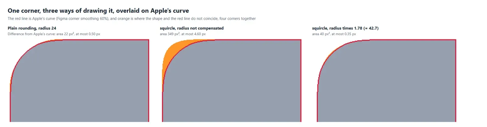
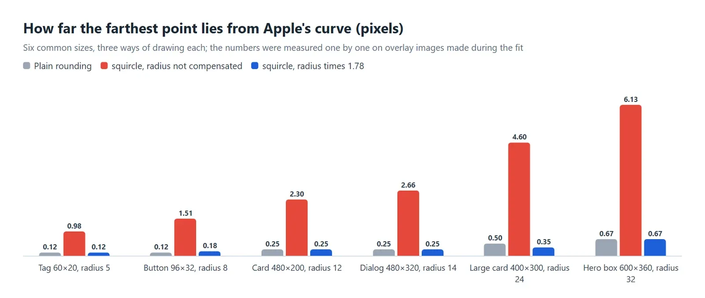
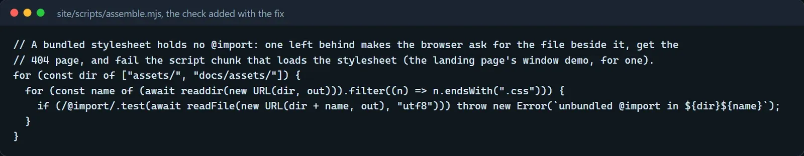

At 1:40 in the afternoon of 21 November continuous-curvature corners were merged into main, and every rounded corner in the window, on the landing page and in the docs became the smooth curve Apple uses. Three minutes later the landing page went blank, and it came back after 39 minutes on the overseas site and 41 on the one in mainland China. This post first covers how the corners were made, and then the blank page.

## The curve we wanted

The goal was the corner of an iOS icon or card, where the curve leaves the straight edge gradually and there is no moment where a circular arc suddenly starts. Chromium and WebView2 support a native `corner-shape: squircle` from version 139, but at the same radius a squircle cuts much less of the corner than a circle does. The depth along the diagonal is 0.23 of the radius against 0.41 for an arc, and it looks distinctly squarer. Simply switching `corner-shape` on therefore gives a corner other than the one we wanted.

## Fitting 1.78

The answer is to scale up the radius. The reference was Figma's corner smoothing at 60%, which is the iOS corner, drawn as an outline with figma-squircle and used only for comparison, never shipped. We overlaid 13 sizes, from a 60×20 tag to a 600×360 hero box, with radii from 5 to 32 pixels, zoomed the images in 2 to 8 times and computed the pixel difference. For every size the best ratio fell between 1.77 and 1.79. Boxes that the browser clamps, where the radius is more than 0.28 of the height, were left out, and the 20-pixel-high tag came out at 1.73 to 1.81. The ratio settled on was 1.78. After scaling, the depth along the diagonal is 0.40 of the radius against Apple's 0.41, the length along the edge where the bend starts is 1.78 times the radius against Apple's 1.6, and the largest deviation of the outline from the reference curve is 0.18 pixels at a radius of 8 and 0.67 pixels at a radius of 32.

<figure>
  
  <figcaption>One of the overlays from the fit, radius 24. The red line is Apple's curve and orange is where the shape and it do not coincide, and the compensated squircle follows the red line closely.</figcaption>
</figure>

<figure>
  
  <figcaption>How far the farthest point of each of the three ways of drawing lies from Apple's curve. The uncompensated squircle gets squarer as the size grows, and with the factor 1.78 it is as close as plain rounding.</figcaption>
</figure>

Apple's curve already differs from a circular arc of the same radius by only about 2% of the radius, 0.1 pixels at 8 pixels and 0.7 at 32. At the radii common in an interface, the change the eye sees is a softer entry into the bend, and the sudden start of the arc is gone. For a more obviously square look, `--squircle-k` can be turned down to around 1.5, at the cost of drifting away from Apple's outline.

## Letting the build do it

The source still contains only ordinary `border-radius`. A PostCSS plugin, `scripts/squircle-corners.mjs`, with no dependencies, is attached to the builds of the window, the landing page and the docs. It rewrites the radius of each rounded rectangle to `calc(<radius> * var(--squircle-k, 1))` and adds `corner-shape: var(--squircle-shape, round)`. The two variables are defined only inside `@supports (corner-shape: squircle)`. Engines that support it get the new shape. Engines that do not, Safari and WKWebView, WebKitGTK and Firefox, compute the original radius and plain round corners, with pixels identical to before the change. A change in one place therefore changes the whole site, and any rounded corner written later takes effect by itself.

The plugin leaves alone percentages, radii of 100 pixels and above, pills such as `calc(infinity * 1px)`, and radii of 0 and under 5 pixels. Pills written with a small pixel radius, such as switches and badges, are written directly as `999px`. Where an inner frame sits tight against an outer one, the outer one is written by hand as `calc(var(--r) * var(--squircle-k, 1) + inset)`, so the same radius is not applied to every layer. `border-radius: inherit` inherits the shape as well. No path is computed in script for an SVG clip-path or mask, because that would cut off borders, shadows and focus rings along with the corner. The existing `postcss-smooth-corners` was not used either. Its ratio is baked into every rule, at 1.715, matched by area and not by the 60% fit to Figma, and it does not scale radii written with `var()` and `calc()`, which is how the window's radius tokens and Tailwind's are written.

The plugin has 11 tests, and 7 deliberate breakages were all caught. On the side of engines that do not support it, the two builds of the same pages were compared pixel by pixel in WebKit. For every look of the window, its pages, dialogs, cards and buttons, and for all screenshots of the docs, the number of differing pixels was 0, and static elements on the landing page also came out at 0, with differences only in the parts that move, caused by timing. Performance did not change. The landing page's first screen has an FCP of 184 to 188 milliseconds and an LCP of 448 milliseconds before and after, and gzipped CSS grew by 362 bytes for the window, 367 for the landing page and 163 for the docs, with no runtime script added.

<figure>
  
  <figcaption>The top-left corner of the install box on the landing page, before on the left and after on the right. The travelling light fits the border and the outer ring more tightly as it goes around the corner.</figcaption>
</figure>

## A blank landing page

These changes were merged into main at 1:40 in the afternoon. At 1:43 the landing page of the overseas site began to go blank, and the site in mainland China followed at 1:53.

The cause was in how the stylesheets were assembled. The window's stylesheet begins by importing `squircle.css`, and the landing page wraps the whole window stylesheet in `@layer gui`, so that the unlayered `button` rule in the window cannot override the landing page's own button styles. After the merge, that `@import` ended up inside the layer, where an import is invalid, and Vite did not inline it. On the live site the browser requested `assets/squircle.css` by relative path and got the 404 page back, refused to use it as a stylesheet, and the lazy chunk that carries the window demo's styles also failed to preload, which left the page empty. A deployment of the development documentation in between carried the same problem. Only the landing page was affected, and not the programs or the downloads.

Why did the build pass? The screenshots came from a production build, but from the one before the rebase. After the rebase the builds of both sites, the documentation and the front-end checks were run again, and nobody opened the landing page again. After the release, the stylesheet's 404 was first taken for a temporary lack of synchronization in an edge cache, until the screenshot came out blank and the browser console reported a failed CSS preload, and only then was the final output examined.

At 2:14 in the afternoon the fix was merged into main. The landing page's build now removes that line from the window's stylesheet, because the landing page's `index.css` imports the same file at the top level. `assemble.mjs` gained a check: after the build, it scans every bundled stylesheet of the landing page and of the docs, and if a single `@import` is left, the build fails. The check is shown below. The worker deliberately left an import in the output of the landing page and in that of the docs, and both runs failed as expected. After the import was removed again the build passed, and the landing page and the docs were checked on the overseas site and on the one in mainland China. The overseas site recovered at 2:22 and the mainland site at 2:34, and counted by the time the Pages deployment of each site finished, the windows of impact were 39 minutes 10 seconds and 41 minutes 7 seconds.

<figure>
  
  <figcaption>The check added to the assembly script with the fix, only seven lines. If a single @import is left in a bundled stylesheet, the whole build fails.</figcaption>
</figure>

The process changed too. The shared website repository is merged and deployed by the coordinator, and workers push only their own branches and report which shared files they touched. The coordinator checks deletions line by line, merges onto the latest main, builds from the final tree, screenshots the affected pages, pushes, and looks at the live pages overseas and in mainland China separately. A green CI run, or a successful deployment of one of the sites, does not replace that step. The screenshot has to be taken on the final production tree after the merge.
