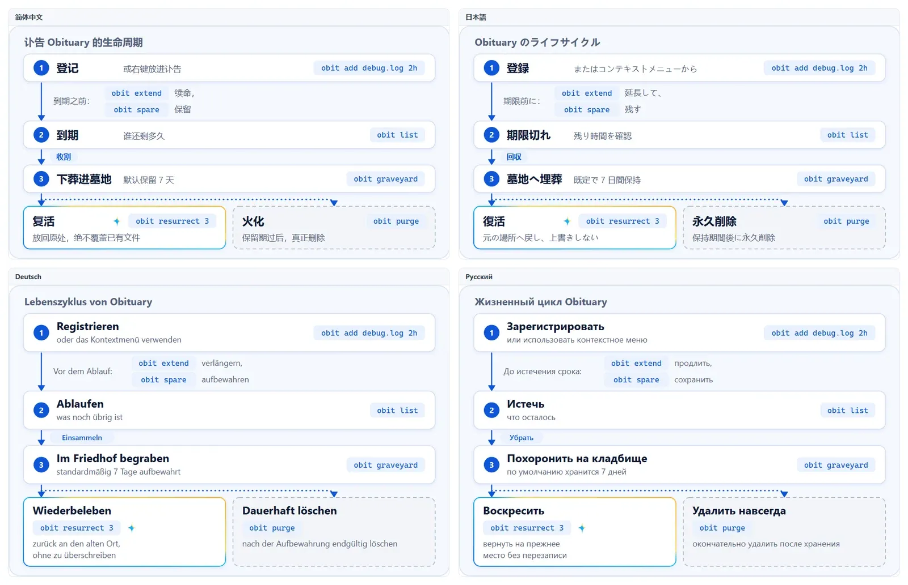
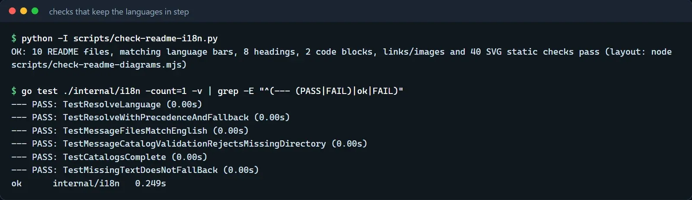
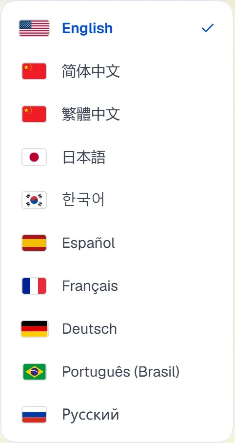

The text of Obituary has to be read in ten languages, and the hardest part comes after the translation, in keeping the versions in step and in the layout. When one passage changes, have the other nine changed with it? When a German word in a diagram is much longer than the Chinese one, does it push out of its box? At half past five on the afternoon of 20 November the README in ten languages was merged into main, and by the early morning of the next day the website and the documentation were in ten languages too.

## One source file, nine that follow

The English `README.md` is the only source. Every change has to bring the other nine along in the same commit: Simplified Chinese, Traditional Chinese, Japanese, Korean, Spanish, French, German, Brazilian Portuguese and Russian. The language bar in the first line is identical in all ten files, with an SVG flag in front of each language, and Traditional Chinese also uses the flag of China.

A glossary fixes the six most common words in every language, so that translators do not each make their own choices. Here is how five of the languages write them. In the non-Chinese texts `purge` means permanent deletion, while the Chinese texts keep their cremation metaphor.

| English | 简体中文 | 日本語 | Deutsch | Русский |
|---|---|---|---|---|
| bury | 下葬 | 埋葬 | begraben | похоронить |
| graveyard | 墓地 | 墓地 | Friedhof | кладбище |
| resurrect | 复活 | 復活 | wiederbeleben | воскресить |
| lifespan | 寿命 | 寿命 | Lebensdauer | срок жизни |
| expire | 到期 | 期限切れ | ablaufen | истекать |
| register | 登记 | 登録 | registrieren | зарегистрировать |

## Measure the text in a browser

The README has two diagrams, the lifecycle and the delete guard, each in a light and a dark version for every language, 40 images in all. The width of every piece of text in a diagram is measured in a headless browser with the real fonts, with extra room kept for the wider fallback font Verdana. Widths are not estimated, nothing is squeezed horizontally, and explanatory text is never smaller than 14 px at a width of 880 px.

The check script `pnpm check` takes the real bounding box of every text, card, command box and arrow, and checks whether texts overlap, whether they spill out of a card or a command box, whether a command box sits inside its own card, whether spacing and padding are enough, whether anything touches an arrow, contrast, orphan words, punctuation at the start of a line, and whether the text after wrapping agrees with the original in `strings.json`. Then it runs again with the fallback font. The check script has to be checked too. `pnpm test` holds a set of deliberately broken diagrams that prove the script really catches problems. Adding or loosening a rule means adding a matching broken diagram, switching the rule off for a moment and confirming that the test fails. After all checks pass, each image is still looked at in a headless browser, because a script does not replace eyes.

<figure>
  
  <figcaption>The lifecycle diagram from the README, 4 of its 10 language versions. German and Russian words are much longer than Chinese ones, and the text still stays inside its cards.</figcaption>
</figure>

The SVGs are measured with the fonts of the local machine, and the fonts on CI differ, so CI only checks and does not regenerate. That rule is written in the README maintenance notes next to the diagrams.

## The text inside the software

The software interface uses go-i18n. Any new user-visible text first gets a stable, dot-separated message ID and its English default in `internal/i18n/messages.go`, and then a translation in `active.zh-CN.json`. The English source is maintained by the message definitions in Go, `active.en.json` is an extraction that can be committed, and after a message is added or changed `goi18n extract` is run and the keys and placeholders of the two languages are checked. Both catalogs are embedded in the binary. At the moment the interface exists in English and Simplified Chinese, and adding a language means copying the key set of `active.zh-CN.json`.

Which language is used is resolved with a fixed precedence: `OBIT_LANG`, the `ui.language` setting, `LC_ALL`, `LC_MESSAGES`, `LANG`, and finally the operating system's interface language. Traditional Chinese tags such as `zh-TW`, `zh-HK` and `zh-MO` must not fall through to Simplified Chinese.

There is a list of things that are never translated, so that what is meant for agents keeps stable bytes: the denial texts of the delete guard and the hooks, equivalent commands, output in a host's protocol, the names and descriptions of MCP tools, JSON fields, exit codes, paths, version prefixes, log markers, registry keys and Wails data fields. The hook path does not load the language catalog either. What follows is a real run of the consistency checks, the static check of the READMEs and the tests of the software's message catalog, one of which verifies that missing text does not quietly fall back to another language.

<figure>
  
  <figcaption>A real run of the checks that keep the languages in step. The README on one side and the software's message catalog on the other, and missing text makes a test fail instead of quietly falling back.</figcaption>
</figure>

## The website in ten languages

In the early hours of 21 November the website got pages in ten languages as well, Simplified Chinese at `/`, Traditional Chinese at `/zh-TW/`, English at `/en/` and the others at `/<language code>/`. Every page is prerendered at build time with its own `<html lang>`, hreflang links pointing at each other and a canonical link, and the whole site has a `sitemap.xml` and a `robots.txt`. In the language menu every language has a flag. When the visitor's browser language differs from the page, the page quietly says so in the visitor's own language and never redirects automatically. The first screen and the install section follow the visitor's system, Windows, macOS or Linux, and can be switched by hand without the layout jumping. Traditional Chinese, Japanese and Korean use the fonts that come with the visitor's system, and only Simplified Chinese uses a trimmed Noto Sans SC.

<figure>
  
  <figcaption>The website's language menu. Traditional Chinese also uses the flag of China, and the language of the current page carries a check mark.</figcaption>
</figure>

## A line-by-line read of every language

The page for each language was read through line by line by a separate worker, against the English and Simplified Chinese pages and the terms of that language's README. The round at 5 in the morning of 21 November found concrete problems. In Japanese the undo button had been worded as redo, where it should be 元に戻す. In Spanish the flow diagram said that something can be resurrected for 7 days, and it should say it can be restored for 7 days. In German, seven places that put something in the graveyard needed auf den or auf dem Friedhof. In Russian the undo button had been given the label for cancel.

One problem was shared by several languages. On the non-Chinese pages the demo of the small window shows the English interface, whose second tab is called Graveyard, while the label translated from the Chinese interface said about to be cremated, which contradicted both the picture and the text under it, so every language now says graveyard. For layout, the label under the empty avatar slot is cut off with an ellipsis above 119 px, five languages did not fit and were given short labels, and no page overflows at widths of 1440 and 390 px any more. The eight localized home pages of the documentation were rewritten early the same morning as well, with the core terms aligned to the website and the README, and both site builds now check the translated pages.
