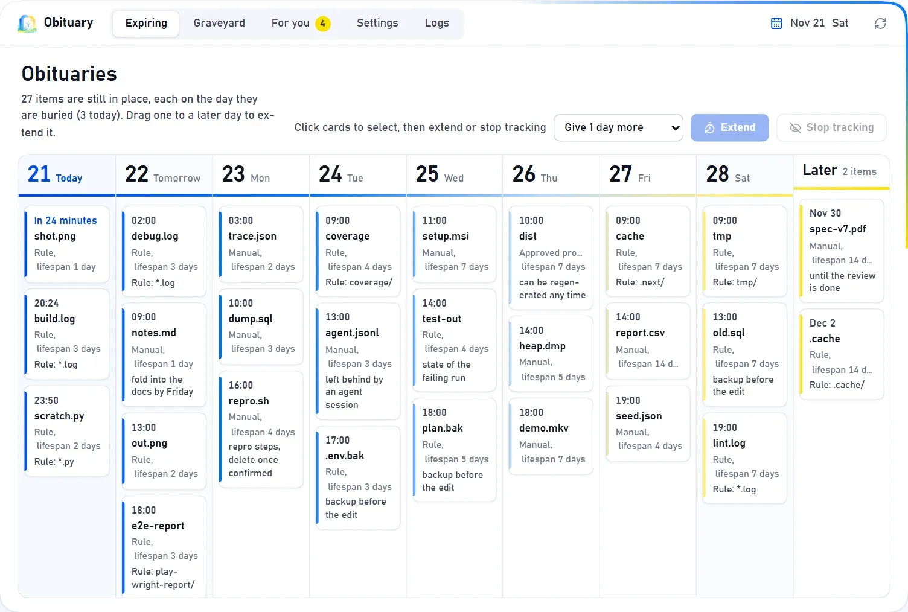
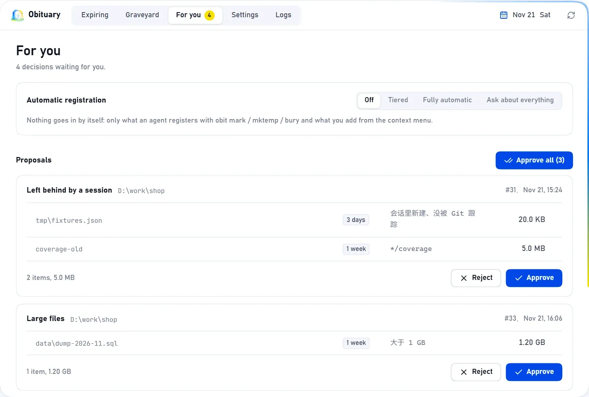
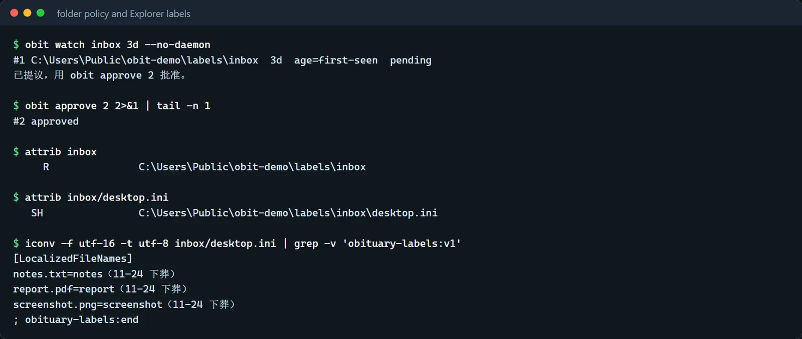

Obituary has put agents first from the first day and left the half for humans for later. But approving a proposal, browsing the graveyard and resurrecting a file all end with a person, and someone who does not use the command line gets stuck as soon as a proposal appears. That half was added on 10 November. The context menu and folder policies came in the early afternoon, the tray process a little after three, the window's backend and the dates in Explorer around five, and the React version of the window at nine in the evening.

## A small resident tray process

The first design had no tray. Expiry was handled by a hidden scheduled task that ran every 5 minutes. A scheduled task cannot be the single writer of the ledger and cannot watch folders in real time, so on the evening of 9 November we decided to run a very small resident tray process by default, which is `obitd`. It starts at login, runs as a single instance, acts as the ledger's single writer, the folder watcher and the expiry reaper, and never pops anything up on its own. Every piece came ready-made. The tray icon uses fyne.io/systray, the single instance relies on a named mutex from `x/sys/windows`, folders are watched with fsnotify, autostart is a Run key for the current user, and `debug.SetMemoryLimit` holds the memory in check. The scheduled task stays as a fallback for when the tray is not running. The cost was rewriting the earlier principle of having no tray, and a resident process has to look after its own memory and CPU.

The tray menu has an entry for recent burials. It lists the 10 most recent records in the graveyard, manual deletions and expiries alike, with name, original folder, time and source. Clicking one resurrects only that one, through all the existing safety checks, and a failure shows its reason in the menu without a popup. On the command line `obit resurrect --last` picks the batch to undo by agent session or by the current project. The tray process has no session and sits in no project, so moving the command there would turn it into undoing the latest batch on the whole machine, which might bring back something the user never wanted. The tray therefore does not call it, and the extra click buys a resurrection of exactly the entry that was clicked.

## The window

The tray menu's Open Obituary shows a small window. The first version had five pages. The graveyard page searches, resurrects and purges. The page of decisions holds proposals and rules waiting for trust. The expiring page extends lifespans or stops tracking. The settings page holds folder policies, recycle mode, the retention period and the switches for the context menu and autostart. The last page is the log. Closing the window leaves only the tray icon.

The interface was built with Wails, a WebView2 shell around a web interface, whose backend reuses the existing Go code, needs no C compiler and can be reused later on macOS and Linux. The other options each had a price. A pure Win32 library is the smallest and fastest but would have to be redone for another platform, Fyne and webview_go need a C compiler, Gio takes too much development, and a separate C# WinUI needs one more language. The price of Wails is a second interface to maintain, and while the window is open WebView2 is expected to take 50 to 100 MB of extra memory, released when the window closes. The look is that of a web page.

The five pages came out at half past five in the afternoon, and by nine in the evening they had been replaced by a React version that shows a calendar by default, with every item on the day it expires, plus eight appearances and both Chinese and English. The next two figures show today's window with demo data, from the same components that the landing page embeds.

<figure>
  
  <figcaption>The Expiring page of the window in the calendar look. Each card is a file or folder with a lifespan, placed on the day it expires, and a selected card can be extended or no longer tracked.</figcaption>
</figure>

<figure>
  
  <figcaption>The For you page. Proposals are grouped by source and say why they are listed, and approving or rejecting them needs no command line.</figcaption>
</figure>

## Context menu and folder policies

The context menu uses the classic registry-based approach, which appears under Show more options in Windows 11. Select one or several files or folders, right-click and choose Add to Obituary, then 1 day, 7 days or 30 days, or choose Bury now, and what is buried can be resurrected. When it finishes a notification says how many items went in and how many failed.

A folder policy hands the same job to a whole folder. `obit watch <folder> <lifespan>` gives each top-level file or folder inside it a lifespan of its own, counted by default from the moment it is first seen. Such a policy takes effect only with the user's approval, so the command merely makes a proposal and registration starts after `obit approve`. Right-clicking the blank area of a folder also offers a Set folder policy entry.

## Dates in Explorer

In Explorer a person cannot tell which files are about to be cleared. The way to show it is a hidden `desktop.ini` in the folder with a `[LocalizedFileNames]` section, which makes Explorer display a name with a date while the real file name stays the same. What it shows is the burial date, with no countdown. By default labels appear only in Downloads, on the Desktop and in folders under a policy, Git workspaces are left out by default, and `[explorer]` in `config.toml` turns them off or widens their reach.

<figure>
  
  <figcaption>A real run in a demo directory. After the policy is approved the folder carries the read-only attribute, desktop.ini is hidden and system, and it holds one display name per file. The label text is always the name followed by the month-day and 下葬, which means buried.</figcaption>
</figure>

The approach has a price. The folder gains a hidden `desktop.ini` and has to carry the read-only attribute, which Microsoft's documentation names as the switch that enables the special behavior of desktop.ini, and the file itself is Unicode text with the system and hidden attributes. Explorer also keeps its own cache, so after an extension the same window can show the previous date for up to about a minute, and none of the eight kinds of refresh notification we tried made it refresh at once. Pressing F2 on a folder changes only its display name and leaves the real directory name alone, and a renamed file is still tracked by its file ID. Writing `desktop.ini` also uses the handle approach, checking and committing through one handle, and whatever sections, streams and attributes the user had in it are kept as they were. Labels outside the configured scope are removed at the next sync.
