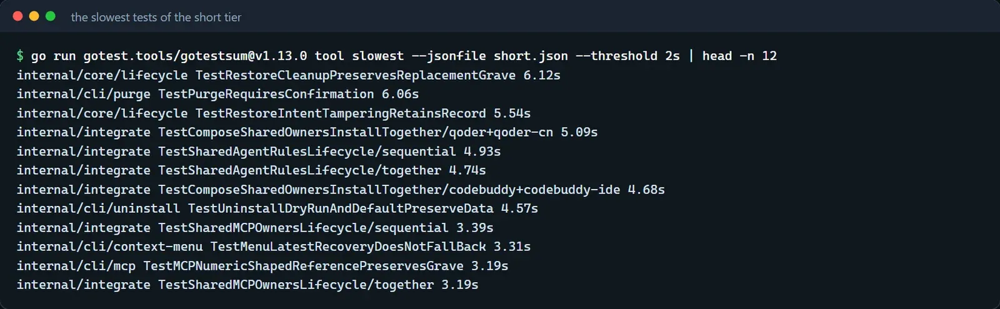

Most of Obituary's tests are integration tests: a real file system, real Git and real PowerShell. What they have to prove is exactly that these real things are not mixed up, so the tests cannot all be replaced by fakes. The price is slowness.

**On 10 November about a dozen workers were running tests on this machine at the same time, and the slowness turned into a standstill.**

## Where the time went: disk, fsync and process creation, not the CPU

Running the same suite on an idle GitHub machine, the doctor package finished in 63 seconds. On the local machine, with several workers running the full suite at once, it ran into the 1500-second timeout without finishing, while the CPU was only about 26% busy.

The time went to these:

- Every test creates a Git repository.
- Every ledger write calls fsync.
- Each PowerShell start takes about 0.4 seconds.
- Every doctor test checks 30 agents.

A rule had been agreed the evening before: during development run only the packages that changed, run mutation tests only for the few relevant cases by name, and run the full suite and both mutation sets once before delivery. It came about because a worker had rerun the full suite and both mutation sets after every single fix, and one task dragged on for hours. The next afternoon 425 top-level tests and 97 subtests were made parallel, which touches none of the costs above.

## Two tiers: only the fast one locally, the full suite only in CI

The decision of 10 November made the rule stricter.

- Locally, whether on a worker or the coordinator, only the changed packages are run, with `go test -short` during development, and slow integration tests are skipped under `-short`. The target is for `go test -short ./...` over the whole tree to finish in under 60 seconds on an idle machine.
- The full suite and the two mutation sets run only in CI, which splits them into parallel jobs and lists the 30 slowest tests every time, so a regression that makes the suite slower shows up at once.

### What made the fast tier genuinely fast

- Test binaries do not call fsync by default, much as SQLite's tests use `synchronous=OFF`. Tests that exist to check the order of writes to disk switch it on, and crash tests inject an interruption instead of cutting power, so coverage is the same.
- The Git test repository is created once per package and copied from a template afterwards.
- Doctor tests inspect only the agents they need.
- Most of the places where tests reach Git and PowerShell now use fakes, with only a few real calls kept.

The resulting numbers:

| Scenario | `go test -short ./...` over the whole tree |
|---|---|
| Idle machine | about 61 seconds |
| With eleven workers running | about 81 seconds |
| A cold-cache run today, 74 packages (the code and tests have grown since) | 110 seconds, no failures |

### A surprise: the testlog file

After each run Go's test driver rewrote testlog files of several hundred megabytes, and one worker waited another ten minutes after seeing ok. `testenv` now compacts that file only for stable Go 1.26.x when the format is fully recognised, leaves anything else byte for byte unchanged, and says so once per process.

<figure>
  
  <figcaption>The slowest tests as listed by gotestsum after a cold-cache run of the whole tree under -short today. 36 tests take more than 2 seconds and the slowest takes 6.12 seconds. CI lists the slowest 30 in the same way on every run.</figcaption>
</figure>

## The bill: the CI cadence follows it

**On 10 November every push ran the full suite, the repository was still private, Windows runners are billed at twice the rate, and a day of that came to about 1284 billable minutes.**

The same evening this was changed:

- Pushes and pull requests run only the `-short` tier on one machine.
- The four full shards run every night when main has new commits and can be started by hand.
- Mutations run weekly.
- Packaging runs only when packaging files change.

The cost is written into the decision too: there is no full-suite green light locally any more, and what `-short` misses may only turn up in the next night's full run.

After the repository became public on 11 November, standard runners stopped costing anything, and the cadence went back to a full run on every push, with four shards in parallel, tests with `-race` on Linux and POSIX tests on macOS, and results in about 10 minutes. Mutation tests are split by case number across 8 machines, and locally `OBIT_MUTATION_SHARD=k/n` runs just one share.

### A detail from the CI investigation: tests must run from pwsh

The MSYS runtime enables the backup and restore privileges on an elevated token, every child process inherits them, and the ACL fixtures that are meant to deny access then deny nothing. We had first suspected that TEMP paths were too long and added a workaround, which turned out to be a wrong diagnosis, so it was removed and the tests now run from pwsh and not from Git Bash.

## Keeping tests away from the real machine

When tests are this real, it matters even more that they cannot touch the real user environment. The `TestMain` of every test package calls `testenv.Main(m)`, which:

- Points the data directory, the configuration directory, the user's home directory and the temporary directory at disposable ones.
- Clears inherited `GIT_*` variables and installs a dedicated gitconfig.
- Redirects the context menu and the startup entry with `OBIT_TEST_REGISTRY_ROOT`. Both the test process and the `obit` and `obitd` child processes it starts write under a disposable `HKCU\Software\obituary-test-*` key. That name prefix is mandatory, and a value that does not match it is rejected before any registry key is opened.

Before and after the tests, the real context menu, startup entry, Start menu and desktop shortcuts are also compared read-only, and any change fails the test. The top-level entries under `.obituary\graveyard` at the root of the volume that holds the temporary directory get the same treatment, because a new entry there means something leaked to the real volume root.
