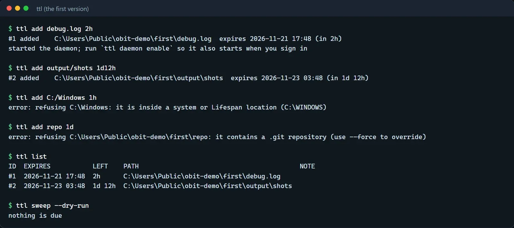

7 November 2026 was a Saturday. Around ten at night we wanted to give a file or folder a time to live, so that it would be cleaned up automatically when the time ran out.

**By the end of that evening the idea had a first version of code, had survived one review, had gone through three rounds of names, and had the name it has today: Obituary.**

## Existing tools only handle folders, and nobody handles what AI agents leave behind

We looked around first: nobody offers a countdown on a single file, and nothing is built for the command line or for AI agents.

Windows offers two routes:

- Schedule a one-off task that runs `Remove-Item` at the right time. This needs a script for every file.
- Use Storage Sense, which clears fixed places such as Downloads by age. It cannot be pointed at an arbitrary file.

Third-party tools take almost the same approach: watch a folder and remove whatever is older than N days. Some are paid, some are free, and quite a few of the free ones have gone years without an update. All of them are rules per folder.

As a business this does not hold up:

- The need is small and fewer people would pay for it.
- The core is a timed delete that anyone can write.
- The operating system could add a rule tomorrow and remove the reason for the tool to exist.
- Larger file-automation products treat it as one rule among many.

So we had no plans for a general file-organising rule engine, and none for cloud sync.

One situation, though, is not covered at all. AI agents leave a lot behind in a workspace: debug scripts, logs, screenshots, test output, temporary worktrees. Our own rules file already had a line asking for the temporary files a task produced to be cleaned up when the task ends. That rule depends on the agent remembering it, and in a long session, once the context has been compressed, rules read earlier are easily forgotten. When the rule is remembered, the cleanup is often an `rm -rf` whose result nobody checks.

At the moment an agent creates a file, it knows best what the file is for and roughly how long it should live. If it writes down a lifespan right then, and the system deals with the file when time is up, nothing depends on remembering.

**That is where Obituary starts: what an agent produces carries a lifespan from the moment it is created.**

## A first version in thirteen minutes, identifying files by identity rather than path

Claude wrote the first version in about thirteen minutes. It was called Lifespan then, and its command was `ttl`.

- Commands: `add`, `list`, `extend`, `cancel`, `sweep` and `log`, every command able to print JSON for scripts and agents.
- Expiry: a background process started at login. Items went to the Recycle Bin through the system's `IFileOperation` interface, and when the bin could not take an item, the file was kept and retried later instead of being deleted outright.
- Catch-up: anything that expired while the machine was off or asleep was handled after boot or wake.

Files were identified by their identity and not by path. The identity is the volume serial number plus a 128-bit file ID, so a renamed or moved file is still found, and a new file that now sits at the old path is left alone.

The limits on what can be registered:

- Drive roots, system folders and Program Files cannot be given a lifespan, and neither can a user's own folders, although what is inside them can.
- Links and junctions are always refused.
- Git repositories need `--force` and are checked again when the time comes.

<figure>
  
  <figcaption>The first version rebuilt from that night's source: lifespans for a file and a folder, refusals for a system folder and for a folder with a .git directory, and a list ordered by expiry.</figcaption>
</figure>

There were 17 tests, one of which really sends a file to the Recycle Bin and only runs when an environment variable is set. To check that the test for "do not delete if the identity does not match" could catch a bug, we broke that check on purpose and watched for red. The first attempt left a variable unused and the build failed, which proved nothing. A different change finally turned the test red.

**That detour became a standing rule: the reverted version has to compile, and a build failure does not count as verification.**

## The first review: 26 findings, nearly all of them valid

That night we did not rush to install it on a machine we use every day. We asked two Codex reviewers to read the code first, read-only. One looked at deletion safety and use of the Windows API, the other at concurrency, storage, the background process and the command line. The results were back in about ten minutes: 26 findings. We opened the code for each one, and nearly all of them held. They fell into three groups.

### Mistaking one object for another

Register a temporary hard link and delete it, and a lookup by file ID could land on another name and send an important file to the Recycle Bin.

Two more cases:

- 8.3 short names such as `PROGRA~1`, and paths whose parent directory is a junction, slipped past a protected-path check that only compared strings.
- When Downloads or the Desktop had been moved to another drive, protection recognised only the default location.

### Checks that failed in the permissive direction

- The `.git` check looked only at first-level subdirectories and let the path through when reading failed.
- A transient error such as a locked file or a permission problem was treated as the file being gone, so its record was dropped.

### State and durability

- A sweep worked from a snapshot taken at its start, so items extended or cancelled in the middle were still processed afterwards.
- Writes were not flushed before commit, so a power cut could lose updates.
- Duration arithmetic could overflow and get around the ten-year cap.

A version written in thirteen minutes yielding this many findings is hardly a surprise.

**Mistaking one object for another, which means treating what is in front of it as what was originally registered, is the most dangerous moment for a tool that deletes things, and that kind of problem kept coming back over the following week.** Making this version trustworthy was most of the work of the next two weeks.

## Three rounds of names, and Obituary

Nobody would remember Lifespan or `ttl`, so we went through three rounds of names:

1. The first round was poetic (morning dew, mayfly, night-blooming cereus) and not catchy enough.
2. The second turned to the image of something collected when its time is up. 生死簿, the book in which the king of the underworld is said to record every person's lifespan, with Grim as its English name, fitted well, but it shares a name with a commonly used screenshot command on Linux. In the same round was Atropos, the Fate of Greek myth who cuts the thread of life, and a search showed an existing open-source project in the AI space that would have outranked us.
3. For the third round we checked for collisions first and chose afterwards. Nothing with that name exists on npm, Homebrew, PyPI, crates.io, Debian or Arch.

**We settled on Obituary (讣告 in Chinese), with the command `obit` and a background process `obitd`.**

The commands follow the theme and keep plain aliases: `mark` is `add`, `spare` is `cancel`, and `reap` is `sweep`.

## Direction: agents first, native Windows first, a write-review-fix loop

With the name fixed, the direction was fixed too.

- Audience: Obituary is designed for AI agents first. Hooks, MCP and Skills are first-class entry points, installing should take one command and removal should leave nothing behind, and the differences between agents have to be respected. The context menu and tray for people come later.
- Platform: native Windows first, using file identity and handles directly, and macOS and Linux afterwards.
- Way of working: write, review, fix. After each phase two reviewers read the code, we fix what they find and ask two more, and we repeat until a round turns up nothing serious before moving on.
- Language: Go, and the reasons have a post of their own.

Nearly all of the next two weeks went that way.
