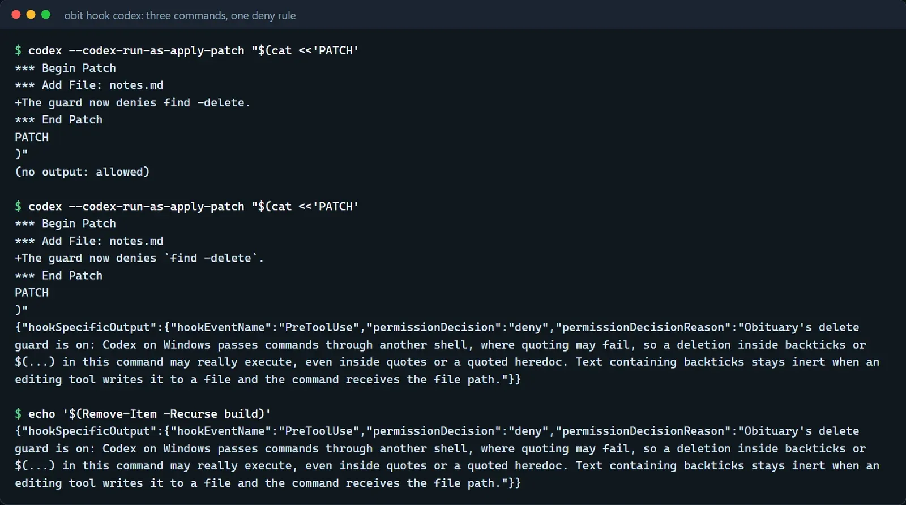

At 10:57 in the evening of 19 November a Codex worker put a piece of release notes containing backticks into a shell command, and that command deleted everything in its current directory. It was the project's main working directory, and the deletion was permanent, with nothing going to the Recycle Bin. What follows is the account as it happened.

## The background

That week someone had said in public that after an agent is forbidden `rm`, it switches to `find -delete` to get around it. We checked, and the delete guard of the time could indeed not stop that form, since it recognized only `rm`, `rmdir`, `git clean` and `Remove-Item` in command position. A patch from a Codex worker was merged into main a little after five that afternoon, so that the guard also stops the deleting actions of `find` and the command that `xargs` actually runs. The 1.4.2 release that contained it was going through the release process, and the Codex worker in charge of the release was writing the release notes into a file.

## What happened

The release notes contain the characters `find -delete`, because that is exactly what this version fixes. The worker put the text into a shell command and submitted it. The patch text sat in a quoted heredoc that was handed to Codex's own apply-patch entry point. By bash rules the backticks in a quoted heredoc are plain text and do not run. But on Windows, when Codex handed the command to bash in WSL, a layer of quoting was broken, so the heredoc effectively became unquoted and what was inside the backticks was executed as a command. `find -delete` with no path deletes everything under the current directory. The worker's working directory was the project's main working directory, and not a copy that could be thrown away.

All the code is on GitHub, so nothing was lost. What had not yet been committed was restored one piece at a time from the full text that remained in the session record and from the list of the worker's last `git status`.

## What we first got wrong

Our first judgment after the incident was that once 1.4.2 was out, the guard would stop this kind of deletion. After checking, that was wrong. What the guard sees is the command the worker submitted, a quoted heredoc in which the backticks are plain text by bash rules, so it judges the command to be safe. What went wrong was the next step, the extra layer that appears when Codex hands the command to bash in WSL, and the guard cannot see that step. What 1.4.2 does stop is `find -delete`, `find -exec rm` and `xargs rm` written out directly. Before upgrading we ran a test once, and 1.4.1 let `find ./probe -name x -delete` through. That is a real improvement, but it is not the route this incident took.

What really protects against this kind of thing is two other rules. Workers do their work in isolated workspaces, so even if something is deleted, it is only a copy that can be thrown away, and this worker happened to be in the main working directory, so that rule had not been met. And text that contains backticks does not pass through a shell. It is written into a file with an editing tool, and the command receives only the file path. Both rules were written into the instructions for workers that same night. The same evening we also checked the configuration on this machine. The delete guard of Claude Code was set to show only grave notices and did not deny deletions, because the delete guard has to be switched on with `obit init --guard-rm`, and that night it was switched on for Claude Code as well. We also began putting an operating-system permission boundary around workers, allowing writes only to their own workspace, the corresponding repository's `.git` and the temporary directory, with network access allowed and every other location unwritable and undeletable. In a test in a temporary repository the boundary stopped writes and deletions outside the workspace with Access is denied. Codex's built-in sandbox configuration makes `git commit` fail inside the workspace, because a commit has to write the main repository's `.git`, and it also cuts the network, so a custom set of permissions was needed and the switch was to wait until a test passed.

## Counting the layer in between

1.4.3 was published in the early hours of 20 November and targets exactly that layer. It applies only to Codex on Windows. Anywhere in the command text, every span wrapped in backticks and every `$(…)` is treated as a command that may run, whether it is inside quotes, inside a quoted heredoc or in a comment. Each is checked once as Bash and once as PowerShell, and if it contains a deletion the command is denied. Both readings are needed because PowerShell also runs `$(…)`, and review found that reading only as Bash lets `'$(Remove-Item -Recurse x)'` inside single quotes slip through. The rule sits ahead of the ordinary guard's context checks and does not look at the working directory, because a WSL working directory, a PowerShell declaration with no Windows working directory, or a missing hook program would each make the ordinary guard skip the whole check, and this rule needs none of those conditions. Other agents, and Codex on other systems, behave as before. After the release we handed the command from that evening unchanged to the published Windows build, and the result was a denial.

Below is a real run in which three Codex commands are handed to `obit hook codex`. The first is a quoted heredoc that contains plain text, and it is allowed. The second is the same command with a pair of backticks added to the text, and it is denied. The third is `$(Remove-Item …)` in single quotes, and it is denied too. The reason for the denial is written as statements, and it tells the agent to write text that contains backticks into a file with an editing tool and to pass only the file path in the command.

<figure>
  
  <figcaption>How the 1.4.3 rule behaves on the real hook. Whether the same patch has that pair of backticks decides between allowing and denying it.</figcaption>
</figure>

This rule denies some commands that are harmless, such as a piece of text inside quotes that explains `rm`. The cost is that the agent writes it another way and tries again. The cost of letting through a deletion that really runs in the second shell is that files are gone for good. That differs from the guard's trade-off elsewhere. Elsewhere the guard would rather miss something than offer an equivalent command that selects more than the original, because a wrong equivalent would delete something else. Here the guard offers no equivalent and only denies, and a denial selects nothing, so it can afford to be stricter.

The incident ended up as one more row in the threat model of the architecture document: a command changes shape when it is handed from one shell to another. The guard sees only the text of a command, and it cannot see how that text is reinterpreted by each layer of shell in between. That is the edge of what it can do, and writing it down is more useful than pretending the edge is not there.
