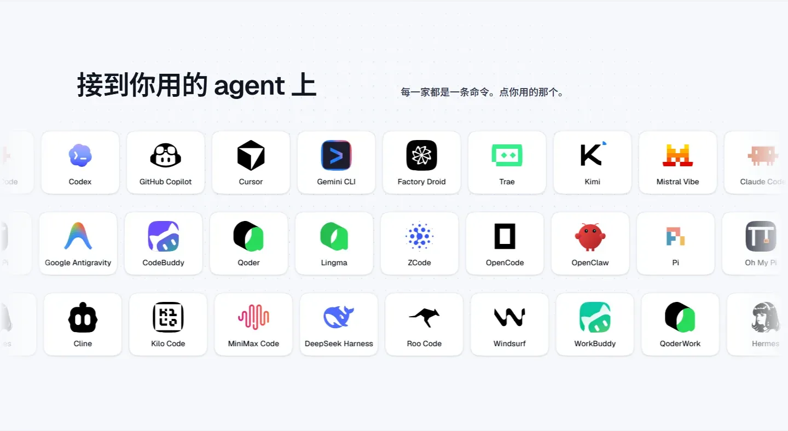
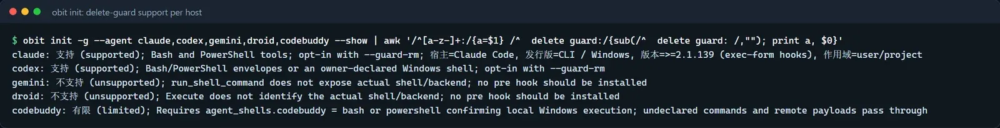

讣告现在能接 30 个 agent：17 个通过原生 hook，9 个通过插件，4 个只有规则文件和 MCP。最早只有 Claude Code 和 Codex 两家。11 月 9 日下午三点多，接入层改成了适配器注册表，到晚上七点二十分，30 家里已经接上了 29 家，ZCode 在第二天上午补上。文档里的 agent 覆盖表由 `obit init --show --format markdown` 生成，代码里的能力声明一变，表就跟着变。

## 三种接法

一个 agent 能不能接上讣告，取决于它的宿主给了什么入口，入口也决定了讣告能做到多少。

第一种是原生 hook。宿主在工具调用前后启动一个命令，把事件的 JSON 从标准输入递给它，Claude Code、Codex、Copilot、Cursor、Gemini CLI、Factory Droid 都是这样，一共 17 家。命令是 `obit hook <agent>`，每次调用都是一个新进程，所以这一步必须很轻。

第二种是插件。OpenCode、Pi、OpenClaw、Hermes 这些宿主的扩展点是在宿主进程里运行的 TypeScript 或 Python 插件，没有命令式的 hook。我们给它们带一个很薄的插件，把宿主的工具调用事件整理成带版本号的 JSON，交给同一个 `obit hook <agent>`，一共 9 家。

第三种只有规则文件和 MCP。Roo Code、Windsurf、WorkBuddy 和 QoderWork 目前只接到这两样，讣告没有为它们安装 hook 或插件。能做的是把使用说明写进它们读取的规则文件，再注册 MCP 服务，由 agent 读了说明之后自己决定什么时候调用 `obit mark` 和 `obit bury`。这四家都没有写文件后的自动登记，删除前的拦截也不会自动安装。

<figure>
  
  <figcaption>官网首页的接入栏。每个图标是一个已接入的 agent，点击后打开这一家的接入文档。</figcaption>
</figure>

## 同一个判断，薄薄的一层翻译

30 家不能写 30 份判断逻辑。所有宿主共用一套处理，每一家的适配器只做三件事：把宿主的原始输入解码成统一的事件，把处理结果编码回宿主的协议，以及出错时给出一个中立的回答。处理本身都在 `Handle` 这一个函数里。适配器登记在一张注册表里，命令行的 `obit hook <agent>` 子命令直接从注册表生成，输入上限是 4 MiB，UTF-8 的 BOM 在解码前去掉。

这个骨架在 11 月 9 日下午三点十分先落地，而且只改结构。Claude Code 和 Codex 在改前改后的测试集完全一致，都是 2,522 个结果，`Handle` 的函数体逐字节相同。动手前的调研发现，原来的入口在解码之前就判断事件类型，每接一家新 agent，就会在每条 shell 命令前打开一次配置。现在先解码成统一的事件，只有 PreToolUse 之外的事件才打开完整的服务，PreToolUse 仍然不读账本、不启动 git、不碰网络。

插件这一种用的是版本 1 的 JSON 协议，规矩有四条。路径只能来自宿主官方的工具参数或明确的成功回报，shell 命令必须有可信的证据说明它是哪种 shell，会话按 agent 分开命名，回应里只有拒绝和上下文文字，从来没有放行，也没有改写后的命令。最后一条和删除护栏的取舍一致：讣告只拒绝，不替 agent 改命令。

## 每一家能做到什么，照实标出来

同一个事件在不同宿主里能做的事差别很大。讣告把能力分成写文件后登记、会话提示、删除护栏、MCP 和 Skill 几项，每一家的每一项都标成支持、有限或不支持，后面写明原因。`obit init --show` 和 `obit doctor --verbose` 都会打印这张表，官网文档里的覆盖表由同一个命令生成。

最严的一项是删除护栏，因为它要知道命令是在哪种 shell 里执行的。同一行 `rm -rf` 在 bash 和 PowerShell 里意思不同，按错误的语法解析，会拦错对象，或者给出错误的等价命令。Claude Code 把 Bash 和 PowerShell 做成两个工具，看工具名就知道。Codex 0.167 在原生 Windows 上把所有命令都报成 Bash，不说实际用的是哪种 shell。11 月 9 日我们加了一个配置项，让用户声明 Codex 用的是 bash 还是 powershell，`obit init --guard-rm` 会从 Codex 的配置推断并写入，用户也可以改。声明了就按那种 shell 解析和拦截，没声明就放行。后来这个配置项推广成按 agent 声明的 `[agent_shells]`，CodeBuddy 和 MiniMax Code 的删除护栏用的就是它，远端执行的命令不拦截。Gemini CLI 的 `run_shell_command` 和 Droid 的 `Execute` 不给出 shell 的身份，覆盖表里标为不支持，讣告也不为它们安装执行前的 hook。

<figure>
  
  <figcaption>同一个命令的真实输出，用 awk 只留下每家的删除护栏一行。支持、有限、不支持后面跟着原因，其中 CodeBuddy 要先在配置里声明自己的 shell。</figcaption>
</figure>

## 宿主给不了文字的时候

有些宿主能在写文件的回调里通知讣告，却没办法在这个回调里把文字递给 agent，比如 Antigravity、Hermes 和 Kilo Code 的写入回调，还有 Cursor 异步的会话开始。讣告有时需要告诉 agent 一件事，比如有一条提议在等用户决定。最初的做法是这类事件整个跳过，结果这次写入没有被观察，也没有登记。后来改成事件照常处理，登记、观察和快照都做，只是不把提议标成已通知。同一个会话里下一个能递文字的事件会把待通知的内容送出去，送完才标记。保证是至少送达一次，宁可重复，不会丢。Claude Code 和 Codex 的行为没有变。

## 国内的工具和只能手动的步骤

有些宿主的公开资料不足以让我们放心地改它的配置文件，比如 Trae 的全局 MCP 位置和 Roo 的配置路径。对这些宿主，`obit init` 不去猜，只打印精确的手动步骤，状态里写成需要手动步骤，不算失败，也不假装已经装好。

11 月 9 日晚上接的是国内的一批。我们调研了二十多家，接了 CodeBuddy、WorkBuddy、Qoder（含国内版）、灵码、MiniMax Code 和 DeepSeek Harness，第二天上午加了 ZCode。已经停服的、老旧的和很小众的没有接，这些工具的用户仍然可以手动注册讣告的 MCP 服务，用上同一段使用说明。

新增的每一家宿主都在测试里带一份协议夹具，也就是宿主 payload 的样本，命令行验收会对注册表里新增的每个 agent 名跑一遍。
