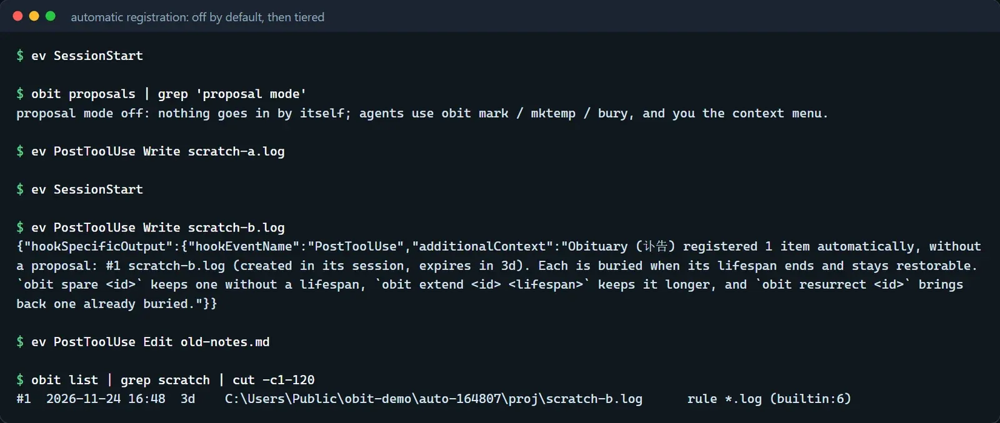

自动登记在 11 月 14 日一天里先放开，当晚收回，第二天凌晨默认关闭。1.2.0 在晚上 9 点发布，1.3.0 在第二天凌晨 3 点半发布，隔了不到七个小时。这条路上每一步都有一个具体的问题推着走。

## 先让每条提议都能放心批准

问题出在 11 月 12 日。会话结束时，讣告会列出这次会话留下的东西，作为提议让用户批准。有两条提议把 agent 刚写、还没提交的源文件列成了三天后下葬的候选，agent 只能对用户说，这两条请拒绝。

根因是会话差分调用 `git ls-files --others --directory` 时少带了 `--exclude-standard`。结果里既有被 Git 忽略的生成物，也有没被忽略、只是还没提交的新文件。11 月 13 日凌晨的修复只让提议收两类东西：被 Git 忽略、而且名字属于依赖、构建输出或缓存的条目。没被忽略的新文件是还没提交的工作，一律不提议。被忽略的也不一定能重新生成，`.env`、本地的设置文件和 `*.tfstate` 都被忽略，却不能丢，所以不在名单里的不提议。容器提议只保留能通过 compose 工作目录或绑定挂载归到会话项目的，归不到的可能是用户自己起的。每一条提议的提示里也写明它是建议批准的，以及批准之后会发生什么。目标是凡是讣告拿出来的提议，agent 都能放心地说一声请批准。

## 既然都能放心批准，为什么还要等人

11 月 14 日我们接着问：既然每条提议都能放心批准，为什么还要让用户点头？傍晚 7 点 58 分，分级的自动登记合进来，`[proposals] mode` 有三档，默认是分级。

分级模式下有三类东西直接登记，不再出提议。第一类是 agent 在这次会话里自己新建的文件，要三项证据同时成立。一是 hook 看到了这次写入。二是会话开始时记下的 Git 快照里没有这个文件，没有它上面的文件夹，也没有它里面的任何东西。三是文件系统记录的创建时间晚于会话开始，它里面的所有内容也一样。一个被改了名或者搬过来的旧文件夹仍然带着旧的创建时间，所以 agent 就算被人劝着把用户的某个文件夹改名叫 `test-results/`，得到的也只是一条提议。第二类是被 Git 忽略、能重新生成的遗留物。第三类是会话为这个项目起的容器。其余的，比如会话开始前就在的文件、只有会话差分发现的路径、agent 没有创建的大文件夹，仍然只是提议。任何模式下都不会自动做的有四件：登记 Git 跟踪的文件，登记用户拒绝过的项目，批准文件夹策略，信任 `.obitrules`。

没问用户就登记的东西，都会事后告知。每次自动登记在同一次账本提交里存一份回执，hook 在写完文件后或者下一次会话开始时，把还没告诉过的回执转告 agent，并附上 `obit spare`、`obit extend` 和 `obit resurrect` 三条出路。`obit proposals` 里列在已自动登记的下面，小窗口的待你决定页上有已自动处理的列表，每一项都能撤回或续命，页面最上面可以切换模式，切到全自动之前会先确认一次。

<figure>
  
  <figcaption>小窗口里的自动登记开关。今天的默认选中关，旁边是分级、全自动和全部都问三档。</figcaption>
</figure>

1.2.0 晚上 9 点发布，1.2.1 在将近 11 点跟上。

## 当晚的体检

当晚我们把这台机器上讣告记着的东西从头过了一遍，找出四类问题。依赖和构建产物被自动排上了到期时间，其中一个 `node_modules` 早已到期，每个小时试着埋一次。有 311 条记录指向已经删掉的工作区，工作区一删，讣告不再核对，这些条目就一直挂着。有两次埋葬一直失败，其中一个 133 MB 的测试目录失败了 54 次，每次都超时，失败后固定隔一小时再试，没有上限，也没有任何提示，没人知道它在白干。同一个容器出了两条提议，项目还被记成了用户的主目录，因为项目归属用的是会话当时所在的文件夹。

这几类问题有一个共同的根子。被 Git 忽略只说明这个东西不用提交，不说明它可以丢，`node_modules`、本地数据库和构建缓存都在这一类里，删了要重装、重建。1.2.x 把被 Git 忽略当成了可以自动处理，这是第一类问题的来源。

## 默认关闭

当晚的决定是自动登记默认关闭，并入 1.3.0。关闭时什么都不会自动进讣告，也不会出提议。进讣告只有两条路：agent 自己用命令登记，也就是 `obit mark`、`obit mktemp` 和 `obit bury`，或者用户在资源管理器里右键放进来，右键菜单里于是多了放进讣告和现在埋掉。删除护栏、墓地提醒和收工整理照常工作，因为它们都是 agent 自己在做决定。就算用户打开了自动模式，依赖、构建产物和缓存也永远不会被自动登记，也不再出现在提议里。升级时，已经安装的版本统一切到关闭，以前自动登记的这类东西撤回，东西留在原处，不再计时，之后用户在设置里怎么改都算数。给 agent 看的说明、README、文档和官网同时改成同一个说法。

另外几类问题也在 1.3.0 里一起处理。失败的埋葬根因是一个文件夹里有没有 Git 仓库要先找一遍，这一步在账本锁里只给了 100 毫秒，冷缓存时不够，超时之后就一直重试。现在这一步先在锁外做，最多 30 秒，锁里只再做一次 100 毫秒的复查，找不完的算失败，不算通过。失败之后隔一阵再试，间隔从 1 分钟起越来越长，最长一天，连续失败 12 次就停下来等用户，小窗口里有没埋成的一栏，写明原因，可以重试，也可以不再跟踪。在讣告之外被删掉的文件，下一次检查就把记录结掉，不用等到期。一个容器只出一条提议，Docker 没开时提议的批准按钮不可用，卡片上写明原因。

下面是真实运行的结果。同一个 Git 工作树，默认的关闭模式下 agent 写了一个日志，讣告什么都没做。把模式改成分级，开一个新会话，新建的日志当场登记并告知，而会话开始前就在的笔记被编辑了一下，仍然没有被登记。

<figure>
  
  <figcaption>在演示用的 Git 工作树里真实运行。ev 是一个小函数，把一个 Claude Code 的 hook 事件交给 obit hook claude。关闭时 agent 写文件没有任何登记，分级时新建的日志当场登记并告知，会话前就有的文件不动。</figcaption>
</figure>

1.3.0 发布之后，我们用它去埋每个大约一万三千个条目的临时目录，其中两个连着失败了两次。显式的 `obit bury` 本来就在锁外先把整个文件夹查一遍，没有时间限制，但这个结果没有被锁里的快速检查采用，冷缓存时 100 毫秒仍然不够。修复是让这个结果算数，只有在查完之后又超时，才重复那些不需要遍历的检查。1.3.1 在 1.3.0 发布 37 分钟之后发出。
