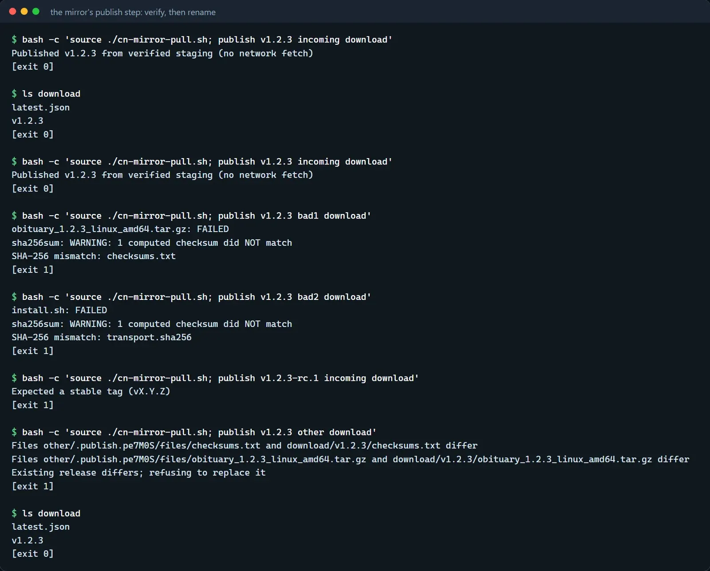

讣告要让国内的用户也装得上，而 GitHub 在国内有时连不上，有时很慢。11 月 11 日，也就是 1.0.0 发布的那一天，国内镜像和官网一起上线。

镜像本身不复杂，难的是每次发版之后，怎么让安装包安全、及时地出现在镜像上。

**这个同步方式一共改了三次：发版时上传，服务器自己去拉，最后由流水线推上去。**

## 同一个域名，两条线路：国内走镜像，境外走 GitHub Pages

官网用同一个域名，DNS 按线路分流：

- 境外线路解析到 GitHub Pages。
- 国内线路解析到国内的服务器。
- 另有一个专给程序用的子域名，永远指向这台国内服务器。

官网有一份专门给国内构建的版本，页面里所有的链接、给 agent 的那句话和安装脚本都指向镜像，不发任何站外请求。

程序自己也认得镜像：

- `install.ps1` 默认从 GitHub 下载，10 秒内 GitHub 没有回答，就换成镜像，加上 `-Mirror cn` 则从一开始就用镜像。安装包和 `checksums.txt` 永远来自同一个地方。
- 安装收据里记着这份安装包来自哪里，是 GitHub、镜像还是自定义的地址，从镜像装的，更新命令也用镜像上的安装脚本。
- 更新检查在 GitHub 完全没有回答时，读镜像上的 `latest.json`，校验和平时一样。
- 发布稳定版本时，流水线同时把 `latest.json` 写到镜像上。

## 第一种办法：发版时上传，第一天就出了两个问题

最先的办法最直接：发布一个正式版之后，流水线把安装包上传到国内服务器。第一天出的两个问题：

- 安装包从美国的机房传到国内服务器，26 MB 传了超过十分钟，任务被取消，重跑才成功。
- 站点部署和安装包上传撞在一起，服务器一次只让一个上传进来，后来的那个报错退出。

修法是上传任务带重试，服务器占着的时候等一等再来，上传的超时也放宽了。

## 第二种办法：服务器自己去拉，GitHub 的发布下载地址三次里有两次超时

11 月 19 日，1.4.2 把方式换了。发版之后，由国内服务器直接从 GitHub 多线程拉取安装包，几分钟内就能从国内源下载。

第一次真跑就卡住了：服务器去下载 `checksums.txt`，GitHub 的发布下载地址在三次里有两次超时，而同一个文件的 API 地址每次都在一秒内答复。

于是改成每次先向 API 要这个文件的临时地址，每个文件一次匿名的 API 请求，再让 aria2 在这个地址上开 16 个连接，失败的一次重新取一个新地址，接着下载没完成的部分。

**在服务器上完整拉一遍 v1.4.1，9 个文件一共 66.6 MB，用了 317 秒，`checksums.txt` 和每个安装包都和线上镜像逐字节一致。**

安装脚本从此用标签对应的 Git 字节，是 LF，不再是旧的上传留下的 CRLF 版本。

## 第三种办法：由流水线推上去，服务器只复核和改名发布

问题出在这条路本身：国内服务器去连 GitHub，是整条链路里最不可靠的一段。11 月 21 日凌晨，同步改成了由 GitHub 的 runner 推送。

### runner 一侧

- 用只读的令牌下载六个归档文件和 `checksums.txt`。
- 两个安装脚本取自同一个 Git 标签。
- 核对归档清单和 SHA-256。
- 通过固定的主机密钥上传到服务器的暂存区。

### 服务器一侧

接收上传的账号只能执行一条受限的命令：要么接收一个只写的上传，要么执行 `publish vX.Y.Z`。两者拿同一把锁。

- 服务器从暂存区里重新复核文件和哈希。
- 在同一个文件系统上用改名发布完整的版本目录。
- 再按 runner 核对过的最新正式版，原子地更新 `latest.json`。
- 同一个标签下内容不同，拒绝覆盖，内容相同则保留原来的文件。
- 部署任务排成一队，不取消正在运行的那个。

校验和文件 `transport.sha256` 校验的是脚本和元数据在传输中有没有出错，不是发布者的签名。

### 服务器这一步在真实代码上的表现

图里调用的是仓库里那份服务器脚本的发布函数，输入是合成的发布文件。第一次正常发布，再发一次内容相同的，没有变化。下面四种情形都被拒绝：

- 安装包被改过
- 安装脚本被改过
- 版本号不是稳定版
- 同一个标签下内容不同

**拒绝之后对外的目录始终只有 `latest.json` 和一个版本目录。**

<figure>
  
  <figcaption>镜像服务器脚本的发布步骤，真实运行，输入是合成文件。核对不通过就整体拒绝，已经对外的目录不受影响。</figcaption>
</figure>

## 保留的手动办法和事先写好的回滚

原来的手动办法保留了下来：人工执行 `pull vX.Y.Z`，让服务器自己去拉，这是整个流程里唯一还会从服务器访问 GitHub 的一条路。

回滚的办法也先写好了：

1. 等部署空闲。
2. 把这次的工作流退回。
3. 只撤销这一把钥匙对应的授权，不动其他的站点钥匙。
4. 已经发布的版本一个不删。
