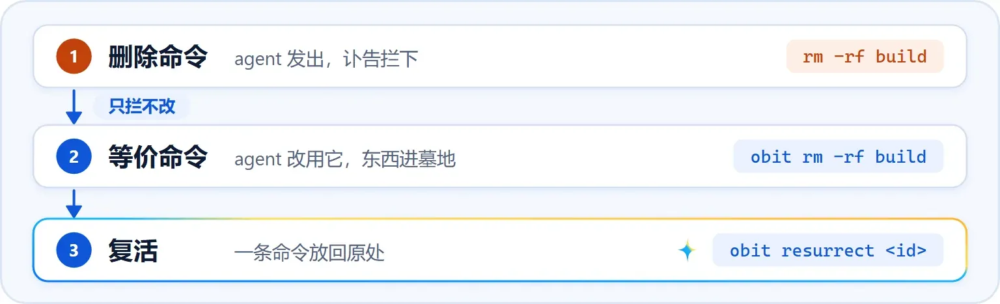
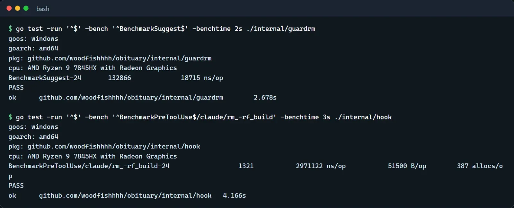

agent 清理现场的时候用的是 `rm -rf`、`git clean -fdx`、`Remove-Item`，这几条命令都是直接删除，回收站里什么也不会留下。

编辑器一侧的保险也有边界。以 Claude Code 的检查点为例，[官方文档](https://code.claude.com/docs/en/checkpointing)写得很清楚：它跟踪的是 Claude 自己的文件编辑工具改过的文件，只被 Bash 命令改动过的文件不在其中，要还原请用 Git 之类的版本控制。可是 agent 清理的东西，很多从来没进过 Git，比如调试脚本、日志、截图和还没提交的改动。

删除护栏就是为这个缺口做的。它挂在 agent 的工具调用前置 hook 上，读即将执行的命令，认出是删除就拒绝，并告诉 agent 一个能复活的等价命令。

<figure>
  
  <figcaption>护栏的整条路径：拦下删除命令，给出等价命令，东西进墓地，需要时一条命令复活。</figcaption>
</figure>

## 只拒绝，不改写

最初的设计是静默改写：hook 把 `rm -rf x` 悄悄换成 `obit rm -rf x`，agent 什么都不用知道。在 Claude Code 2.1.317 上实测，这条路走不通，它按改写之后的命令检查权限，用户给原命令设的拒绝规则就这样被绕过了。Codex 那边要改写命令，还必须同时替用户给出 allow，同样等于绕过了用户的规则。一个本来为了保护用户的 hook，反而成了绕过用户权限的通道。

所以护栏从来不改写命令。它只拒绝，用一句陈述说明原因和等价命令，由 agent 发起新的一次调用，用户自己的权限规则对这次调用照常生效，代价是 agent 多走一轮。给 agent 看的这段文字我们从来不翻译，也写成陈述句，不写成命令。下面用一个小函数，把一个 PreToolUse 载荷喂给 `obit hook claude`，不带 `--notice-only` 就是护栏开着的状态，输出是一行 JSON：

```text
$ hook() { printf '{"session_id":"demo","cwd":"C:/Users/Public/obit-demo","hook_event_name":"PreToolUse","tool_name":"%s","tool_input":{"command":"%s"}}' "$1" "$2" | obit hook claude; }

$ hook Bash 'rm -rf build'
{"hookSpecificOutput":{"hookEventName":"PreToolUse","permissionDecision":"deny","permissionDecisionReason":"Obituary's delete guard is on: `obit rm -rf build` provides restorable deletion; `obit resurrect` restores graveyard entries."}}
```

护栏能指给 agent 的，是四个会下葬的命令，`obit rm`、`obit rmdir`、`obit remove-item` 和 `obit git-clean`。它们照着原命令的语义来：`obit rm` 沿用 GNU rm 的参数、退出码和提示，`obit remove-item` 认 PowerShell 的参数，`obit git-clean` 先用 `git clean -n` 预览，再把列出的路径逐个下葬。每个路径都走同一套下葬服务，被拒绝就报错，绝不退化成真的删除。护栏默认不开，要 `obit init --guard-rm` 才注册。

## 拦得太少，还是选得太多

删除护栏审查的前 7 轮，HIGH 一直在两个方向之间挤压，拦得太少，或者建议的命令选中得比原命令多。后者会删错东西，是更严重的一边，上一篇讲的那条 CRITICAL 就是例子：`||` 后面的回退命令，会在等价命令失败的时候真的执行。所以我们定了一条原则，宁可漏拦，不能多选。凡是可能多选的功能都不做，包括跨 shell 的路径换算、PowerShell 的数组和通配、根据参数去猜 shell，解析不了的复杂命令原样放行。

这条原则被我们用过了头，用在了一个不该用的地方，而且用了五天。1.0.0 发布时，护栏只在能给出逐字等价的 obit 命令时才拦，这个子集很窄，命令稍微复杂一点，护栏就沉默了。`rm -rf build && npm run build`、`rm -rf build 2>/dev/null`、`rm -rf build || true`、`rm -rf "$OUT"/*`、`git clean -fdx && npm ci` 这些都是 agent 清理现场时常写的形式，全部不在子集里，全部畅通无阻。

11 月 13 日我们发现，自己把两个问题混在了一起：这条命令是不是删除，和我们能不能给出一个与它逐字等价的命令。第二个问题必须保守，因为错了会多选，删错东西。第一个问题不需要，拒绝本身不执行任何东西，不会多选，所以拒绝可以拦得宽。[那次提交](https://github.com/woodfishhhh/obituary/commit/12c9d11)把两件事分开：任何命令位置上字面的 `rm`、`rmdir`、`git clean`、`Remove-Item`（包括别名）都拒绝，只有落在支持子集里的才给出等价命令，给不出的，拒绝理由写明为什么没有等价命令，并指向通用的 `obit bury <路径>` 和 `obit git-clean`。同一个函数，这次是一条带 `&&` 的命令：

```text
$ hook Bash 'rm -rf build && npm run build'
{"hookSpecificOutput":{"hookEventName":"PreToolUse","permissionDecision":"deny","permissionDecisionReason":"Obituary's delete guard is on: `rm` deletes permanently and no exact obit equivalent applies to this command (deletion must be the final command segment). `obit bury <path>...` provides restorable deletion for literal paths, `obit git-clean` for git clean; `obit resurrect` restores graveyard entries. For targets selected at runtime, the safe alternative is to list and review the paths first, then give them as explicit operands to `obit rm -- <path>...`."}}
```

## 怎么读一条命令

判断一个词是不是在命令位置，就得真的解析 shell，不能靠正则。`\rm`、`'rm'`、`r''m`、`/usr/bin/rm`、`rm.exe` 去掉引号和路径之后都是 rm，`git -C x clean` 要先跳过 git 的全局选项再看子命令。字符串、注释、带引号的 heredoc 正文和其他命令的参数都不算命令，`echo "rm -rf build"` 不会被拦；`rm --help`、`git clean -n`、`Remove-Item -WhatIf` 只是预览，也不算；含变量、命令替换或通配的命令词，不算字面的删除。shell 不确定的，比如没有声明 shell 的 Windows 上的 Codex，放行并写进审计；bash 的语法解析失败时，退回按单词扫描整条命令，而不是直接放行。

下面三条没有任何输出，也就是放行。后面两条被拒绝，第一条给出的是 PowerShell 版的等价命令，第二条是 find 的 `-delete`，它没有等价命令：

```text
$ hook Bash 'echo \"rm -rf build\"'
$ hook Bash 'rm --help'
$ hook PowerShell 'Remove-Item -Recurse -Force build -WhatIf'
$ hook PowerShell 'Remove-Item -Recurse -Force build'
{"hookSpecificOutput":{"hookEventName":"PreToolUse","permissionDecision":"deny","permissionDecisionReason":"Obituary's delete guard is on: `obit remove-item -Recurse -Force build` provides restorable deletion; `obit resurrect` restores graveyard entries."}}
$ hook Bash 'find . -name \"*.tmp\" -delete'
{"hookSpecificOutput":{"hookEventName":"PreToolUse","permissionDecision":"deny","permissionDecisionReason":"Obituary's delete guard is on: `find -delete` deletes permanently and no exact obit equivalent applies to this command (unsupported command structure: find). `obit bury <path>...` provides restorable deletion for literal paths, `obit git-clean` for git clean; `obit resurrect` restores graveyard entries. For targets selected at runtime, the safe alternative is to list and review the paths first, then give them as explicit operands to `obit rm -- <path>...`."}}
```

解析器换过一次。最初是我们手写的分词器，大约一千行，仅这一块在删除护栏的审查里就占了 10 轮。11 月 9 日，bash 这一半换成了 shfmt 用的解析器 `mvdan.cc/sh`，由它认出语句、词的边界、引号和赋值，能不能给等价命令仍由护栏自己的子集决定。库不负责去引号，所以保留了一小段只处理允许节点的静态解码。换库带来的行为差异全部落在保守的一侧，含 NUL 字节的命令和带注释的续行都改成了放行。到 11 月 13 日，判断是不是删除才用上它的整棵语法树，列表、管道、`||`、后台、子 shell、`$(…)`、反引号、进程替换、没加引号的 heredoc 里的替换，每个命令位置都要看一遍。PowerShell 没有现成的 Go 解析器，只好保留一个手写的扫描器，它跳过注释和字符串，把脚本块和 `$(…)` 当作代码读，连 PowerShell 认的弯引号也算引号。

这一块我们也下了模糊测试的功夫。11 月 9 日给护栏加了模糊测试，种子是 90 条命令，检查建议出来的命令和原命令是否只差被替换的那个命令词，5 分钟跑了 3,047,091 个输入。同一天，对换库那次改动的独立审查找到一个低危问题，奇数个反斜杠后面接换行时，静态解码器会给出建议，而旧的分词器会放行，这类续行现在整体放行。11 月 13 日，模糊测试又抓到 shfmt 的一个迭代器在调用方遇到错误就停下时会 panic；另外 4 MiB 的括号会把解析器的栈撑爆、让 hook 崩溃，所以现在嵌套超过 256 层就不交给解析器了。

护栏在每次工具调用前都会跑，所以它不起 git，不碰网络，判断一条命令靠的是语法解析。用仓库里的基准在这台机器上量，bash 命令的一次解析和判断约 29 微秒，连同 JSON 解码和其他检查，整个前置 hook 在进程内处理一次 `rm -rf build` 约 10.7 毫秒，不含进程启动。两个数字差着两个数量级，CPU 剖析显示差出来的时间几乎都在 Windows 的文件系统调用里：每次工具调用，hook 都要在 PATH 里找一遍 `obit`，核对它是不是这个程序自己，好决定建议的等价命令写 `obit` 还是写绝对路径，这一步和命令是不是删除无关。

<figure>
  
  <figcaption>两个基准的原始输出：解析加判断是微秒级，整个前置 hook 是毫秒级。</figcaption>
</figure>

拦截和放行都有计数，`obit stats` 里能看到拦了多少次，被放行的命令也会写进审计，缺口才有机会被发现。

## 拦不住什么

现在它认的是命令位置上的 `rm`、`rmdir`、`git clean`、`Remove-Item`（含别名），以及 bash 里的 `find -delete`、`find -exec rm`、`xargs rm`，这三种间接写法是 11 月 19 日、1.4.2 里加的。名单之外的删除方式护栏不认识，它读的只是 shell 命令的文字，看不见一个程序内部做了什么，`sudo rm`、`bash -c '…'` 这类包装命令也没有去解析。

架构文档里记着四条已知限制。它们都需要特殊环境，后果都是下葬了、仍然能复活，要修它们就得在原生程序里模拟外部系统，而这正是护栏刻意不做的跨系统翻译。

- PowerShell 会话里设了 `$WhatIfPreference` 或 `$ConfirmPreference` 时，`obit remove-item` 拿不到会话状态，不会只预览或询问；
- 目录里有 NTFS ACL 禁止删除的子项时，`rm -rf` 删不掉它们，而整目录改名下葬会把它们一起带进墓地；
- WSL 开了 `metadata` 挂载选项时，Linux 侧的权限 Windows 这边不检查，`rm` 因权限失败的地方，`obit rm` 可能成功；
- agent 的 shell 继承了同名的包装函数（比如导出的 `rm() { /usr/bin/rm -i "$@"; }`）时，hook 只看得到命令文本、看不到会话里的函数，建议的 `obit rm` 会绕过这个包装。

护栏看到的是 agent 提交的命令文字，所以命令在到达 shell 之前如果变了样，它就看不到。比如 Codex 在 Windows 上再把命令交给另一层 shell，引号的含义就可能变掉，这一层在 11 月 19 日的一次事故里真的出现过，另有一篇讲它。装不装护栏，还取决于宿主能不能告诉我们命令实际在哪种 shell 里执行，告诉不了的，我们就不装，覆盖表里会写明这一格不支持。最后，以你的身份运行、专门对付讣告的进程，本来就能直接删你的文件，护栏不防它。
