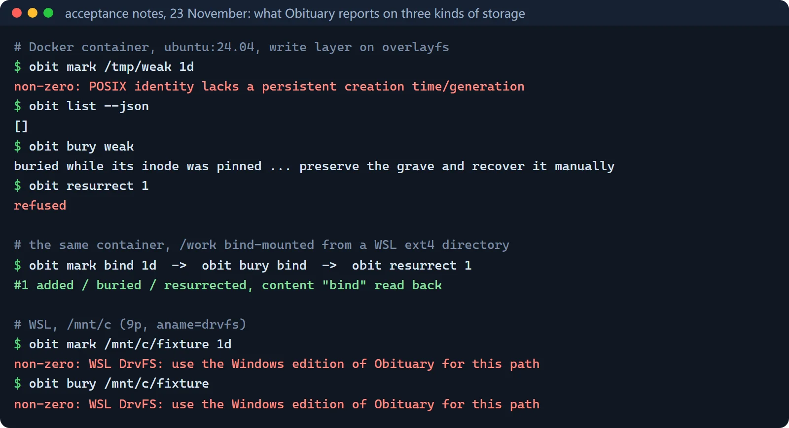

讣告认一个文件，靠的是它的持久身份。有两类地方给不出可靠的身份，11 月 23 日我们在真机上把它们的边界核实了一遍。

**在容器的写入层和 WSL 的 Windows 挂载盘上，讣告拒绝登记，文件原地不动，并告诉你该怎么办。**

## 为什么拒绝：设备号加 inode 删除之后会被复用

文件被删掉再重建，哪怕路径一样，也不能被当成原来那一个。Windows 上讣告用 128 位的文件 ID。Linux 和 macOS 上光有设备号和 inode 不够，因为这两个值在文件删除之后可以被复用，同一个路径被删了再建，可能得到同一对数字。

所以 POSIX 上的身份必须带上创建时间或代数（generation），缺了就拒绝：分不清"被删了再建的对象"和"原来的对象"，就不能给它定一个安全的寿命。

## Docker 写入层：拒绝登记，文件不动

容器自己的可写层是 overlayfs，它拿不到持久身份。

我们从本地的 `ubuntu:24.04` 建了一个临时标签，用 `docker run --rm --network none`，普通用户，不加任何额外能力，用 `stat -f` 确认 `/tmp` 是 `overlayfs`。

- `obit mark /tmp/weak 1d` 返回非零，报 `POSIX identity lacks a persistent creation time/generation`。
- 紧接着读回 `weak`，文件还在原处。`obit list --json` 是 `[]`，墓地里 `burials: null, pendingCount: 0`。
- **登记失败没有退化成移动。**

**在这样的写入层上手动 `obit bury`，文件会进墓地，但不能自动复活。** 单独执行 `obit bury weak` 才会移动，提示 `buried while its inode was pinned ... preserve the grave and recover it manually`，紧接着 `obit resurrect 1` 被拒绝。它和自动到期是两回事，所以这种手动下葬不能当成可复活来宣传。

<figure>
  
  <figcaption>11 月 23 日的验收记录摘录。三种存储上讣告的反应：容器写入层拒绝登记，绑定挂载正常，WSL 的 Windows 挂载盘拒绝并指向 Windows 版。</figcaption>
</figure>

### 绑定挂载进来的目录一切正常

同一个容器里，我们把 WSL 原生 ext4 上的一个目录绑定挂载到 `/work`，文件和讣告的数据目录都在这个挂载里。`mark bind 1d`、`bury bind`、`resurrect 1` 依次回报 `#1 added`、`buried`、`resurrected`。确认下葬后源路径消失，复活后读回原来的内容。

我们没有假设任意的卷都能提供持久身份。文档的建议是把文件和数据目录放在卷或绑定挂载上，背后是 ext4 这类能提供持久身份的文件系统。

## WSL 的 Windows 挂载盘：原来是一条看不懂的报错

在 WSL 里，`/mnt/c` 这样的路径是 Windows 盘，`findmnt` 显示它是 9p，挂载选项里有 `aname=drvfs`。

原来的 Linux 版在这里表现不一致：`mark` 失败，但建议改用 Linux 的 `bury`。照着建议去 `bury`，旧版会真的尝试立即下葬，最后因为这个挂载不支持安全的改名而报 `retry ... nothing was overwritten (invalid argument)`。**用户看到的是一个没法照着处理的改名失败。**

现在 Linux 版在这类路径上明确拒绝：

```text
WSL DrvFS: use the Windows edition of Obituary for this path
```

我们用两本账本验证它不会重复管同一个文件：

- Windows 版先把一个测试文件登记为 `#2`。
- 一个 Linux 进程在独立的挂载命名空间里，把同一个 Windows 临时目录绑定到 `/mnt/c`，分别执行 `mark /mnt/c/fixture 1d` 和 `bury /mnt/c/fixture`，两次都返回非零并给出上面的提示。文件内容读回仍是原来的。
- Linux 一侧 `list --json` 是 `[]`，墓地没有条目。Windows 一侧的列表仍然只有 `#2`。
- Windows 版 `bury` 之后源路径消失，`resurrect 2` 之后原路径和 7 字节的内容都和原来一致。

两本账本互不共享，也就不会各管一半。

### 检查的是设备，不是 `/mnt/` 这个前缀

检测放在 Linux 的文件操作入口：先取出文件所在设备的主次设备号，再到 `/proc/self/mountinfo` 里找对应的 9p 挂载，选项里有 `aname=drvfs` 才拒绝。

这样做的理由是 DrvFS 可以挂在别的地方，也可以被绑定挂载到别处，按路径前缀猜会漏掉这些情况，也会误伤别的 9p 共享。其他可识别的 9p 共享不会因此被一概拒绝。持久身份的算法、账本、下葬和复活的协议都没有改。

### 第一版放错了位置：合法命令被误拒

第一版把这个检查放在通用的路径解析里。用一个 DrvFS 上的项目作为当前目录、操作原生 `/tmp` 里的文件，合法的命令也被误拒了。

最后的版本把检查限定在 Guard 对"被管理对象"的检查上，项目查找不再受它影响。同一个项目里 `mark`、`bury`、`resurrect` 原生文件，读回 `native`，和 DrvFS 文件被明确拒绝同时成立。

测试用 `OBIT_TEST_DRVFS_PATH` 指向一个真实文件，`TestDrvFSOwnershipAppliesOnlyToManagedPaths` 保证它只作用于被管理的路径，`Test9pDeviceOwnership` 覆盖别名挂载、普通 9p 和未知设备。把最终的 Guard 检查去掉（临时副本仍然能编译），前一个测试以 `missing Windows handoff: <nil>` 失败，说明它抓得到这个错误。

这个修复在 11 月 23 日 15:11 合进 main。

## 用户文档怎么写

十种语言的安装页和首页都写了这两条：

- **WSL：** 项目和 agent 的配置放在原生 Linux 文件系统里，例如 `~/projects`。`/mnt/c` 这样的 DrvFS 挂载可能不支持安装所需的安全改名，在这些挂载上登记、下葬或复活文件，只用 Windows 版。
- **Docker：** 容器的 overlayfs 提供不了持久的文件身份时，`obit mark` 拒绝登记并让文件留在原处。要用寿命和复活，把文件和讣告的数据目录放在由 ext4 这类提供持久身份的文件系统支撑的卷或绑定挂载上。

## 没有测到的

WSL1、开启了导出的其他 overlayfs、所有的卷驱动，都没有测。
