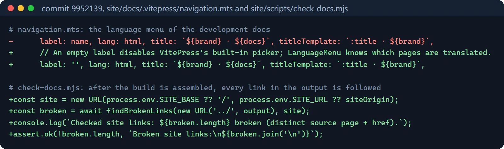

两个站点的页面数量、图片、RSS 和 sitemap 都对得上，验收找到的阻断项只有一个：开发文档页面上有 320 条指向不存在页面的链接。

**开发文档的语言菜单列了十种语言，只有中文和英文有开发文档，其余八种全是死链，两套产物各 160 条。**

## 验收量了什么：两套产物，加两个线上域名

11 月 23 日，基线是 1.7.0 的发布提交。我们先在本地构建海外版（`pnpm build`）和国内镜像版（`pnpm build:cn`），逐项核对产物，再去线上回读。

本地每套产物的数量：

| 项目 | 数量 |
|---|---:|
| 主文档页面 | 160（16 页 × 10 种语言） |
| agent 指南页面 | 270（27 个 agent × 10 种语言） |
| 开发文档页面 | 20（中文、英文各 10 页） |
| 博客文章页面 | 44（中文 22 篇 + 英文 22 篇） |
| 博客列表页 | 2 |
| sitemap | 文档 450 条，博客 46 条，根 10 条，都唯一且全部对得上产物 |
| RSS | 中文 22 项，英文 22 项 |
| 文档和 agent 页的语言互链 | 430 个页面 × 10 个，缺失 0 |

预期的 680 条路由缺失 0 条，本地产物里指向图片的引用缺失 0 个。

另外几项逐个核对过：

- 命令参考 77 个命令乘 10 种语言，和命令行实际的 `--help` 一致。
- 27 个 agent 指南里的接入命令，和首页命令条用的同一个 `initCommand` 输出完全一致，不一致 0 条。
- 博客文章的图片契约测试 6 项全过。

### 用户命令抽验：安装、卸载、保留数据、默认值

所有运行都显式使用临时的数据、配置和用户目录，没有碰真实账本。15 项抽验分五组，每组三项：

- **安装：** `obit config --create` 后读回路径，`obit init --global --agent codex --mcp --skill` 真的写入 hooks、MCP 配置和 Skill，`--show` 报告的能力和文档一致。
- **卸载：** `--dry-run` 只输出计划不改文件，`--yes` 移除 hooks、MCP 和 Skill 但保留数据目录和 `config.toml`，输出明确写着程序文件由安装器或包管理器删除。
- **保留数据：** 卸载前后数据和配置都在，计划里不把墓地记录列为删除对象，只移除讣告自己加的内容。
- **三个平台的边界：** 文档里写的 Windows 任务计划、macOS launchd、Linux systemd 和 crontab 都有对应的源码；Linux 的 `init --dry-run` 不会写资源管理器菜单和注册表。
- **默认值：** `obit help init` 的默认 agent 是 claude，`obit config` 的 `retention_days=7`、`update.check=true`、`proposals.mode=off`，和命令参考一致。

之后又从 GitHub Releases 下载 1.7.0 的 Windows 和 Linux 发布包，核对 SHA-256，在 Windows 和 WSL 上各重做了一遍，两边都是 `obit version 1.7.0`。Windows 这台机器上 `obit uninstall --yes` 因为另一份安装的计划任务而安全地拒绝了系统服务那一部分，返回非零，数据和配置照文档保留；干净 Windows 上的完整卸载由 Scoop 的验收覆盖。

## 死链：语言菜单把十种语言都列出来了

20 个开发文档页面，每页的语言菜单指向 8 个没有生成的语言目录。例如 `docs/dev/agent-integration.html` 指向 `/docs/zh-TW/dev/agent-integration.html`，同页还有日、韩、西、法、德、葡、俄的同名页面。

**20 页乘每页 8 个目标，每套产物 160 条，两套合计 320 条。**

仓库里已经有 `check-docs.mjs`，明确要求非中英文的开发文档目录不存在。可是通用的语言菜单仍然按十种语言输出链接，两处各自都对，对不上的地方没有检查。

## 修复：让自己的语言菜单接管，再让构建检查所有站内链接

修复在 11 月 23 日 13:47 提交，13:55 合进 main，海外 Pages 和国内镜像同时部署。

<figure>
  
  <figcaption>同一个提交里的两处改动。上半是语言菜单，空的 label 会关掉 VitePress 内置的选择器；下半是构建新增的检查，有任何一条站内死链就失败。</figcaption>
</figure>

菜单的修法只有一行：把 VitePress 的内置语言选择器关掉，换成我们自己的 `LanguageMenu`，它知道哪些页面有翻译。用户文档仍然是十种语言，开发文档页的菜单只剩中文和英文。

### 新增的检查：构建完成之后逐条追链接

`site/scripts/check-links.mjs` 在两个站点组装完成之后，把产物里每个 HTML 页面的链接都追一遍，包括 `<a>`、语言互链和 canonical：

- 站内链接指向的页面或文件不存在，记一条"缺目标"。
- 链接带 `#` 锚点，而目标页里没有这个 `id`，记一条"缺锚点"。
- 只要有一条，构建就失败，并列出每条的来源页和链接。

检查程序自己也有测试，一并接进了两个站点的构建。修复上线之后，两套产物的死链引用从 320 降到 0。

## 第二个发现：字体文件没有跟着网站发布

构建日志里有一条不阻断构建的警告：`/fonts/noto-serif-sc-subset.woff2` 没有在构建时解析，产物里没有这个文件，三份样式表引用了它。

这三份是官网首页小窗口演示的懒加载样式，来自桌面版的外观目录。公开可选的日历和一行外观都不用这款衬线字体，文档和博客也不加载这些分块，所以访客在首页上看不到排版问题。不过链接指向 404，迟早会在某个地方出事。

修法是让变体样式直接引用桌面版 `public/fonts` 里的唯一一份字体源文件，保持原来的稳定地址，并在组装时带上字体的 OFL 许可文本，不再多提交一份二进制。

同一个检查器顺带扩展到样式表里的 `url()`。拿它去扫修复之前的本地海外产物，准确报出 3 条，全是这个字体；修复后海外和国内两套产物都是 0 条。

## 线上回读：506 个页面都是 200，国内一侧只能间接核对

上线之后我们在两个域名上各回读了一遍。

- 根 sitemap、文档 sitemap、博客 sitemap 一共 506 条路由，海外直连全部返回 200。用国内解析的地址对同一批路由再请求一遍，也是 506 条全部 200。
- 两边 506 条响应的 SHA-256 逐字节一致。
- 字体文件在两个域名上都返回 200，类型是 `font/woff2`，204168 字节，浏览器能解码，OFL 许可文本 4543 字节，和桌面版的源文件哈希一致。
- 浏览器在两个域名上各回读了 22 个页面；两篇博客文章的中英文页里，图片元素都解码成功，代码块都在。

国内一侧的证据有边界：响应逐字节一致，意味着我们这台机器没法分辨请求是被代理到海外，还是真由镜像返回，所以只能说两个域名的部署作业成功、实际响应正确，不能说明从国内别的网络打开也一样。
