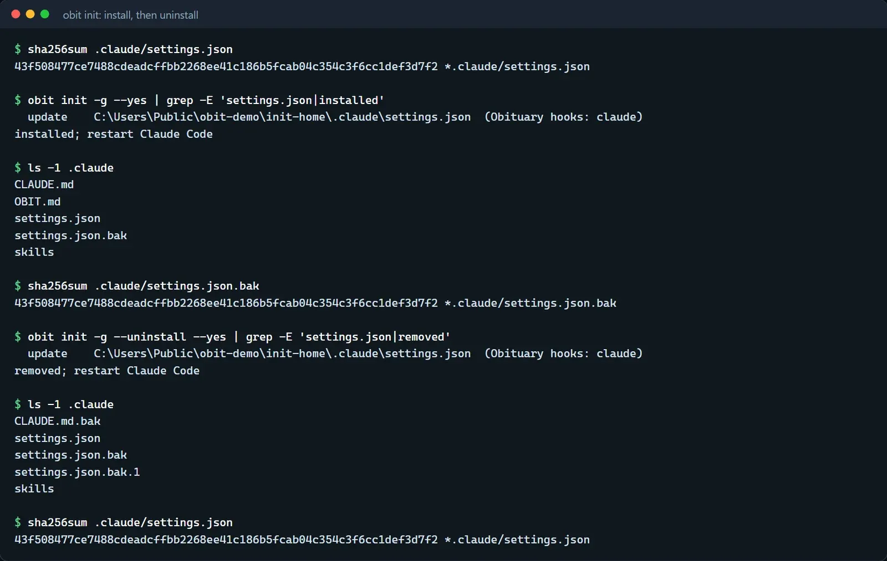

`obit init` 要把讣告写进各家 agent 的配置文件，比如 Claude Code 的 `settings.json` 和 Codex 的 `hooks.json`。这些文件不是我们的。用户的编辑器可能正开着它，宿主 agent 自己也可能随时在改写。安装器不能吞掉别人刚保存的内容，也不能留下写了一半的文件。11 月 10 日下午到晚上，围绕这个问题改了三轮，每一轮都是把一个名字换成一个句柄。

## 窗口出在最后一次核对之后

安装器原来的流程是先算计划，把每个要改的文件的原文记下来，落盘时再读一遍，和原文不一样就拒绝，一样才写。复审发现这一步之后还有一个窗口：最后一次核对和真正写入之间，编辑器如果恰好用临时文件加原子改名的办法保存了这个文件，编辑器的新内容就会被覆盖或删掉。动手的一方是我们，吃亏的是用户刚保存的改动。

## 先试了 ReplaceFileW

Windows 没有按身份原子替换文件的系统调用。微软的文档在讲单个文档类文件的更新时，给的常见办法是先写一个新文件，再替换原文件，其中一种就是 ReplaceFile。ReplaceFileW 还能把被替换的那一版留作备份，看上去正合适。我们实测发现，替换的这段时间里目标名会短暂消失。一个线程反复替换文件，另一些线程不停地打开并读它，16,329 次读取里有 11,160 次读不到。宿主 agent 如果恰好在这时读配置，可能当成没有配置，写回一份默认值。NTFS 事务也不是出路，微软明确建议开发者不要在新代码里依赖它。

## 持有句柄，不持有名字

最后的做法是在已经固定住的父目录里，用不共享写也不共享删除的句柄打开目标，读出最终内容和文件身份，必须和计划时一致。持着这个句柄，以独占创建的方式写编号备份，备份就是这次核对过的那一份字节。新内容先写进临时文件，临时文件同样用独占创建、不共享写和删除的句柄建出来，之后的写入、核对和改名发布都用这同一个句柄，失败时也用它删除，别的进程没有机会把临时文件换掉。最后关闭目标上的句柄，立刻改名替换。核对和备份期间，别人的就地写入和改名保存都会被共享模式挡住。任何一步发现内容或身份不一致，这次安装就中止，用户的版本原样保留，不会自动重试去覆盖它。要删除文件时，也在核对过的同一个句柄上处置，不再按名字删。同样的实验里，3,208 次并发读取一次都没有读不到。

<figure>
  
  <figcaption>同一种并发读取实验下两种替换办法的结果。ReplaceFileW 让目标名短暂消失，按目录句柄改名替换时目标名始终都在。</figcaption>
</figure>

这个改法本身又被复审盯了几轮。第一轮发现临时文件原来是通过 `os.Root` 创建、关闭，之后再按名字改名，另一个进程可以在中间把它换掉，让自己的内容被发布出去，于是有了上面那种整个过程只用一个句柄的做法，改名用的是 `NtSetInformationFile`，相对父目录的句柄。再审一轮没有新的 HIGH 和 MEDIUM，只剩两处 LOW，其中一处是临时文件按绝对路径创建，检查之后如果父目录被换成 junction，临时文件会落到别处。它改成了用 `NtCreateFile` 相对已固定的父目录句柄创建，只共享读，带删除权限，安装器和资源管理器标签的写入都走这个函数，旧的按路径创建的函数删掉了。两个包里的测试都在最后一次核对之后把父目录换成目录或 junction，断言什么都不会落到外面。

关闭句柄到改名完成之间还剩一个很短的窗口，实测中位数 0.77 毫秒，P99 是 2.1 毫秒。编辑器恰好在这个窗口里保存，它的那一版可能被覆盖，编号备份保住的是核对过的旧版本。冲突时这次安装算失败，要用户重跑。

## 只碰自己写的东西

安装器认定哪些东西是自己的，规则很严。只有程序是指向 `obit` 或 `obit.exe` 的绝对路径、参数是 `hook <agent>` 的 hook 条目才算讣告的，用户自己的复合命令不算。改 `settings.json` 时保持键的顺序，不转义 `&&` 这类字符，保留原来的 BOM，改动之后的文件按两空格缩进输出。备份按 `.bak`、`.bak.1` 的顺序独占创建，旧备份永远不覆盖。卸载只删自己加的。

用户级的 `~/.claude.json` 是 Claude Code 运行时整体重写的状态文件，我们改名覆盖它，会和运行中的 Claude Code 互相吞掉写入，所以讣告只读它来判断归属，写入交给官方的 `claude mcp add-json` 和 `claude mcp remove`。

下面是真实运行的结果。一份用户自己写了 PreToolUse 钩子的 `settings.json`，安装之后备份和原文件的 SHA-256 完全一致，卸载之后 `settings.json` 又和原文件完全一致，卸载前的那一版留在 `settings.json.bak.1` 里。

<figure>
  
  <figcaption>在临时的演示目录里运行 obit init 安装再卸载：三次 sha256sum 的值一致，说明备份是核对过的原始字节，卸载把文件还原得一字节不差。</figcaption>
</figure>

## macOS 和 Linux

这套办法依赖 Windows 的共享模式，macOS 和 Linux 上没有对应的东西。所以在那两个平台上，`obit init` 一直返回不支持，agent 接不上，下葬就算已经能用也没有用。11 月 12 日补上了 POSIX 的版本。它在钉住的父目录里读出目标的内容和身份，包括设备号、inode、大小、修改时间和内容，必须和计划时一致，然后独占创建编号备份，新内容写进同目录里独占创建的临时文件并 fsync，改名之前再核对一次目标没有变，最后在父目录里改名替换并 fsync 目录。删除文件时不直接 unlink，先用不覆盖的改名把它移成编号备份，再核对身份，不符就原样放回。最后一次核对到改名之间同样有一个很短的窗口，量级和 Windows 上一样。
