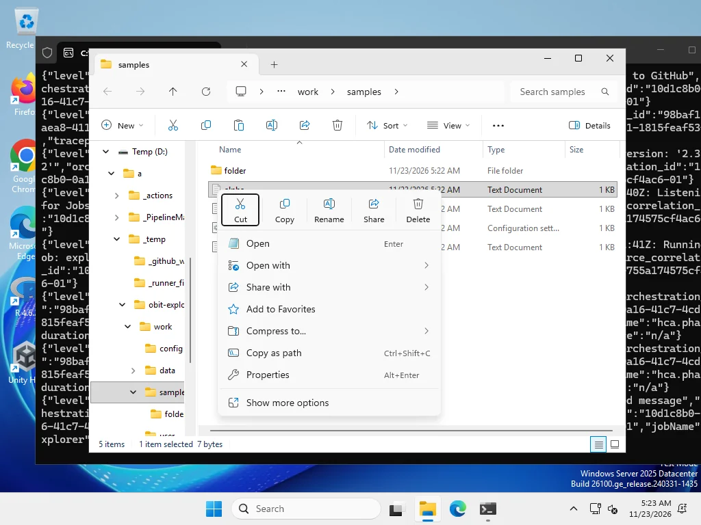
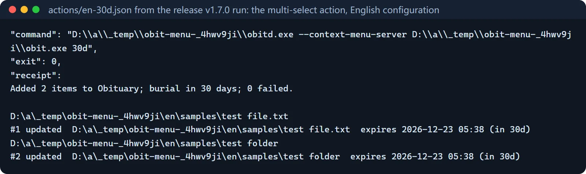
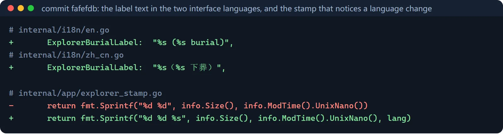

资源管理器右键菜单的注册和动作都验收通过了，验收顺带找到一个真缺陷。

**资源管理器里的日期标签，不管界面是什么语言，一律写成中文的「名字（11-13 下葬）」。**

## 怎么验收：发布版二进制，GitHub 的一次性 Windows 机器

这台开发机没有启用 Windows Sandbox，我们也不想在真实桌面上注册菜单，所以验收放在 GitHub 托管的 Windows runner 上，用手动触发的 `explorer-acceptance.yml`。

被测的是发布版 1.7.0 的 Windows amd64 归档，它的 SHA-256 和发布清单一致。验收跑两轮，一轮中文配置，一轮英文配置，各用独立的账本。这里的中英文指讣告的界面语言，不是两套 Windows 显示语言。

## 点菜单这条路没走通：47 分钟 16 次运行，15 次失败

我们最先想让界面自动化真的点一遍菜单。

12:51 加上第一个验收工作流，到 13:38 通过，一共 17 个提交，16 次运行。前 12 次由推送触发，13:19 把推送触发关掉，后面 4 次手动触发。**15 次失败，第 16 次通过，通过的那一次已经不再点菜单。**

三次手动的界面尝试停在这里：

- 第一次没有枚举到经典菜单。
- 第二次只拿到第一层的几个按钮和一个 `Popup`。
- 第三次 `Popup` 的边界框是 NaN，没法定位。

<figure>
  
  <figcaption>第二次手动运行的截图，取自 runner 上的真实桌面。右下角标着 Windows Server 2025，菜单只有第一层，底部是 Show more options，经典菜单在它后面，自动化始终没有点进去。</figcaption>
</figure>

## 改成直接调用菜单注册的处理程序

菜单点不到，我们就把菜单背后的东西直接调一遍：用的是注册表里真正注册的处理程序，只是不经过鼠标。

- **单文件和单目录的动作：** 读出注册表里该菜单项的命令，替换路径占位符后启动。
- **多选的动作：** 启动注册的 `LocalServer32`，把同一组 Shell 文件项作为一个 `IDataObject` 送进 `IDropTarget::Drop`。

两种语言的 COM 处理进程都返回 0，错误清单 `failures.json` 是空的，没有走任何备用入口。

<figure>
  
  <figcaption>多选动作在 runner 上的真实回执。文件和目录同选，30 天寿命，两项都成功，到期时间都是 2026-12-23 05:38。</figcaption>
</figure>

逐项的结果：

- **文字：** 文件、目录和空白处的菜单文字，中英文两轮都和预期一致。共享的寿命子菜单按注册序号是 1、7、30 天。
- **寿命：** 单文件 1 天，单目录 7 天，文件和目录同选 30 天，每一项都核对了命令行返回的路径、到期时间和磁盘上的对象。混选的回执是 2 项成功、0 项失败。
- **空白处：** 注册的是"设置文件夹策略"。执行后记录的是所选目录、30 天和 `consent: pending`，没有自动批准。
- **撤销、下葬、复活：** `obit spare` 撤销目录的寿命后，它从列表里消失。随后注册的下葬动作只移走这个目录，另一个文件没动，墓地里只有它。再用注册的复活动作恢复，目录里的文件字节一致，墓地回到空的。
- **标签和卸载：** 文件夹里原有的 `desktop.ini` 的注释和 `InfoTip` 在加标签时保留，卸载后文件逐字节复原。父目录属性 16 → 17 → 16，INI 文件属性 32 → 38 → 32，样本文件和目录的属性也回到原值。第三方的菜单项还在，讣告的文件寿命菜单已经移除。

## 验收找到的缺陷：标签一律是中文

十种语言的用户文档里，日期标签都写成各自语言的样子，英文是 "name (11-13 burial)"，西班牙语是「nombre (entierro el 13 de noviembre)」。实际写进资源管理器的却只有一种：「名字（11-13 下葬）」。八种语言的用户看到的都是中文。

我们最先打算按十种语言的文档去做标签。后来改了：讣告的界面本来只支持简体中文和英文，其他语言环境一律回退英文，这是文档里写明的现有约定，右键菜单和通知也这样做。所以标签只做两种：

- 简体中文界面：`名字（11-13 下葬）`
- 其他一律：`name (11-13 burial)`

八种语言的文档和 README 原先写成各自语言的样子，和实际不符，一并改正，不扩展界面语言。

<figure>
  
  <figcaption>修复里的三行：标签文字的两种写法，以及记录账本状态的印记多了语言。印记里的语言一变，下一轮同步就会重写所有标签。</figcaption>
</figure>

修复的要点：

- **换了界面语言，下一次刷新就改写。** 同步标签用的印记原来只记账本文件的大小和修改时间，现在多记语言。没有语言后缀的旧印记会让标签刷新一次，1.7.0 写下的中文标签因此会被改成当前语言。
- **用户改过的显示名不动。** 卸载照样把原来的显示名原样还原。

这个修复在 11 月 23 日 14:18 提交，14:33 合进 main。Windows 上的全量测试和主 CI 都通过了。

## 没有测到的

- 在资源管理器里真的点经典菜单。
- 菜单项在屏幕上和别的软件菜单之间的顺序，我们只能确认注册的序号。
- 加了标签之后按 F2，编辑框里初始显示的文字。
- 设寿命、下葬时桌面通知有没有真的弹出来。回执证明处理程序执行了，不证明用户看到了通知。

日期标签的修复没有在资源管理器里人工看过，下一版发布之后用这个验收流程补一次。
